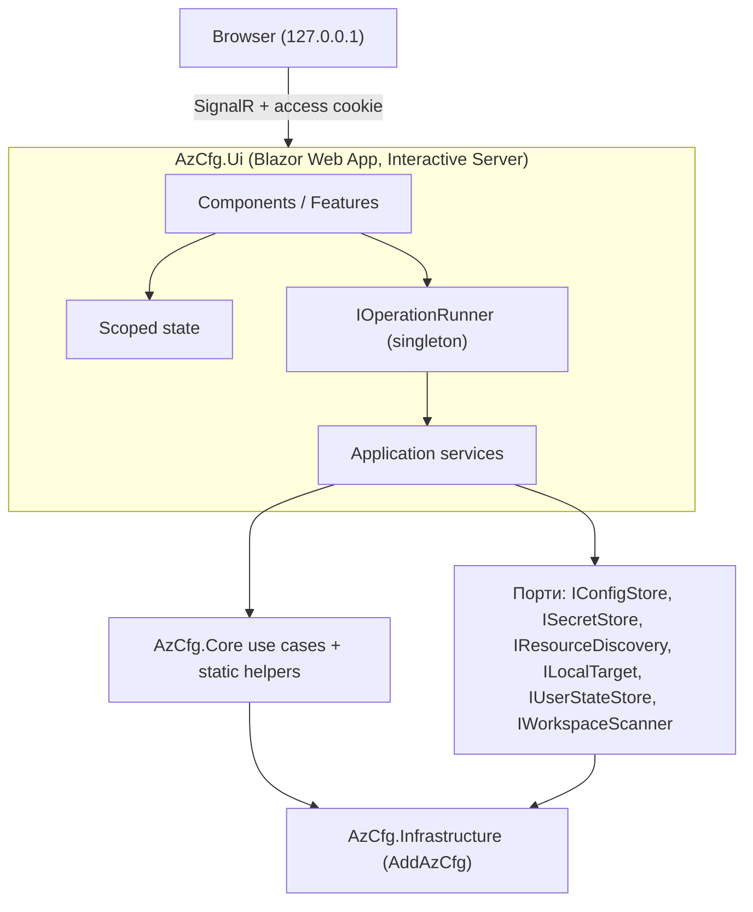
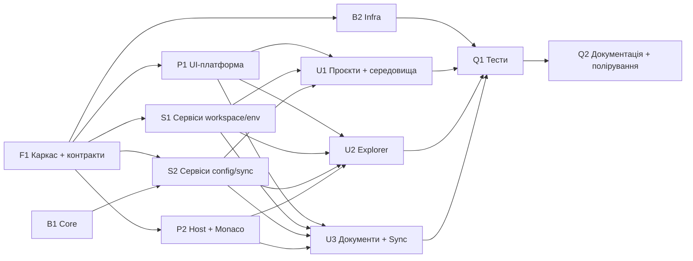

# AzCfg UI — план реалізації MVP

Самодостатній план для **агента-оркестратора**: він роздає задачі розділу 10 агентам-виконавцям, які не мають
іншого контексту, крім репозиторію, `CLAUDE.md` і цього файлу. Розділ 0 — для оркестратора, решта — довідка,
на яку посилаються брифи задач (поле «Читати»).

Позначення: **[є]** — механізм уже існує в коді, **[нове]** — рішення цього плану. `G*` — прогалини (розділ 3),
`AD-*` — архітектурні рішення (розділ 5), `FR-*` — вимоги (розділ 4).

---

## 0. Протокол оркестратора

### 0.1 Цикл
1. Візьми задачі з розділу 10, у яких усі «Залежить від» уже змерджені в `origin/dev` (статус — у 0.6).
   Хвилі паралельного запуску — розділ 11.2.
2. Для кожної задачі запусти агента-виконавця в **окремому git worktree** з брифом за шаблоном 0.2.
   Паралельно — лише задачі однієї хвилі (у них не перетинаються файли, див. 11.3).
3. Коли агент повернув PR — перевір за чеклістом 0.4.
4. Мердж PR у `dev` робить користувач (або оркестратор лише з явного дозволу користувача). Після мерджу
   онови статус у 0.6 і стартуй задачі, що розблокувалися, від свіжого `origin/dev`.
5. Агент повернув блокер або відхилення від контракту → див. 0.5. Не вирішуй за агента, якщо рішення змінює контракт.

### 0.2 Шаблон брифу для виконавця
Підстав `<ID>`, `<назва>`, `<slug>`, `<Читати>` з блоку задачі. Більше нічого не додавай — бриф самодостатній.
```text
Ти виконуєш задачу <ID> «<назва>» у репозиторії AzCfg (.NET 10, мова спілкування — українська, код англійською).

Контекст (читай лише це):
1. CLAUDE.md (правила шарів, безпека, конвенції).
2. docs/ui-mvp-plan.md: розділ 9 (кодстайл), блок задачі <ID> у розділі 10, розділи <Читати>.
3. Код — лише файли, названі в задачі, і найближчий сусідній файл/тест як зразок стилю.

Git (ти в окремому worktree; гілку dev НЕ checkout-ь — вона зайнята іншим worktree):
  git fetch origin && git switch -c feature/ui-<id>-<slug> origin/dev
Далі — процес скіла /feature, кроки 2–7 (тести першими, build/test, коміт, push, PR у dev).

Правила:
- Змінюй лише файли з поля «Файли» задачі + відмітку `- [ ] **<ID>` → `- [x]` у docs/ui-mvp-plan.md (розділ 10).
- Контракти розділу 7 — обов'язкові 1:1. Якщо контракт неможливо виконати — зупинись і поверни блокер
  (що саме, чому, запропонована зміна), нічого не комітячи.
- Жодних нових пакетів, mock-бібліотек, змін Directory.Packages.props / AzCfg.slnx (якщо задача їх не називає).
- Значення секретів ніколи не потрапляють у логи, винятки, розмітку до Reveal, ToString/JSON.
- `dotnet build AzCfg.slnx` без warnings і `dotnet test AzCfg.slnx` зелені перед комітом.

Відповідь (лише це): URL PR; 1–3 пункти що зроблено; відхилення від плану (або «немає»);
що не перевірено (наприклад, ручна перевірка в браузері).
```

### 0.3 Гілки, worktree, PR
- Одна задача = одна гілка `feature/ui-<id>-<slug>` від `origin/dev` = один PR у `dev`.
- Скіл `/feature` у кроці 1 робить `git switch dev` — у worktree це падає, тому бриф замінює крок 1 на
  `git switch -c … origin/dev` (G27).
- Залежна задача стартує лише після мерджу залежностей у `origin/dev` (не від гілки іншого агента).
- CI немає — оркестратор перевіряє build/test локально (0.4).

### 0.4 Чекліст перевірки PR
1. `gh pr diff <N> --name-only` — лише файли з поля «Файли» задачі (+ рядок відмітки в цьому плані).
2. У worktree гілки PR: `dotnet build AzCfg.slnx -v q --nologo`, `dotnet test AzCfg.slnx -v q --nologo`,
   `dotnet format AzCfg.slnx --verify-no-changes`.
3. Пункти «Приймання» задачі покриті тестами (назви тестів відповідають пунктам).
4. Сигнатури розділу 7 не змінені (або змінені з оновленням розділу 7 у тому ж PR і з погодження — 0.5).
5. Grep по диффу: немає `Reveal()` поза дозволеними місцями (Application Reveal/Apply-шлях), немає логування
   `PlanRequest`/`PushSource`/значень, немає `static` змінного стану, немає нових `PackageReference` без версій у props.
6. Відповідь агента містить «що не перевірено» — перенеси це в чекліст задачі Q2 (ручний smoke).

### 0.5 Блокери і зміни контрактів
- Дрібне уточнення, що не змінює сигнатур (наприклад, повідомлення помилки) — агент вирішує сам і пише у «відхиленнях».
- Зміна сигнатури розділу 7 — лише через оркестратора: оцінити, які задачі зачеплені (розділ 11.3), оновити розділ 7
  в окремому PR `docs/ui-plan-contract-<slug>` або в PR задачі, і перезапустити зачеплені незмерджені задачі з новим брифом.
- Агент упав двічі на тій самій задачі — розбий задачу на дві за межею «Application / UI» і повідом користувача.

### 0.6 Статус
| ID | Задача | Залежить від | Хвиля | Статус |
| --- | --- | --- | --- | --- |
| F1 | Каркас UI, контракти, `AzureErrors` | — | W1 | [ ] |
| B1 | Core: `FromNestedJson`, redaction, `PullSelectedAsync` | — | W1 | [ ] |
| B2 | Infrastructure: credential, lock, `WorkspaceScanner` | F1 | W2 | [ ] |
| P1 | UI-платформа: дизайн-система, workbench, палітра | F1 | W2 | [ ] |
| P2 | Безпека хосту + Monaco | F1 | W2 | [ ] |
| S1 | Сервіси: workspace, середовища, Azure status, операції | F1 | W2 | [ ] |
| S2 | Сервіси: explorer, sync workflow, документи | F1, B1 | W2 | [ ] |
| U1 | UI: проєкти, прив'язка, середовища | P1, S1, S2 | W3 | [ ] |
| U2 | UI: Configuration Explorer + інспектор | P1, P2, S1, S2 | W3 | [ ] |
| U3 | UI: JSON-документи + Sync/Diff | P1, P2, S1, S2 | W3 | [ ] |
| Q1 | Наскрізні та безпекові тести | B2, U1, U2, U3 | W4 | [ ] |
| Q2 | Документація, ADR, полірування, smoke | Q1 | W5 | [ ] |

---

## 1. Продукт і межі MVP

**AzCfg UI** — локальний developer workspace: відкрити теку з .NET-проєктами, прив'язати проєкт до сервісу в Azure
App Configuration, переглядати конфігурацію середовищ, редагувати її (дерево або JSON у Monaco) і синхронізувати
локальні файли з Azure з попереднім переглядом змін.

Модель: **Project → Environment → Configuration Sources**.

| Рівень | Що це | Звідки |
| --- | --- | --- |
| Project | `.csproj` + `ProjectBinding` (сервіс, цілі, vault на середовище, активне середовище) | `IProjectDetector`, `IProjectService`, `projects.json` |
| Environment | `ConfigEnvironment(Name, StoreEndpoint, Label, IsProtected, WriteLabel)`; режим — `UserProfile.Mode` (ADR 0008) | `profile.json` (спільний для всіх проєктів) |
| Sources | локальні цілі (user-secrets, `appsettings.local.json`), App Configuration store, Key Vault-и з KV references | `ILocalTarget`, `IConfigStore`, `ISecretStore` |

App Configuration і Key Vault — одне джерело середовища: секрет існує в UI лише як KV reference
(`ConfigValue.KeyVaultRef`), vault — з URI референса (ADR 0005). Окремого перегляду всього Key Vault немає.

**Цілі:** UI поверх наявних `AzCfg.Core`/`AzCfg.Infrastructure` без дублювання бізнес-логіки; усі сценарії CLI
(`init`, `pull`, `use`, `plan`, `push`, `edit`) + дерево, Monaco, diff, вибір окремих змін, конфлікти; секрети не
потрапляють у браузер до явного Reveal; Production read-only за замовчуванням.

**Не-цілі:** promote у UI, вибір/зміна режиму середовищ і labels у UI (є в CLI: `init --mode`, `azcfg config`; UI
лише показує режим і працює в будь-якому), редагування шаблонів ігнору в UI (CLI `azcfg ignore`), запис у `local.settings.json`, створення Key Vault, ранжування vault-ів,
перейменування середовищ, віддалений/багатокористувацький доступ, E2E у браузері, пакування UI як dotnet tool,
міжпроцесний lock CLI↔UI.

---

## 2. Що вже є в коді (довідка)

### 2.1 Шари
```
AzCfg.Core            BCL + ILogger. Model, Mapping, Sync, Abstractions (порти), UseCases. Нічого не питає/не друкує.
AzCfg.Infrastructure  Azure SDK, ФС, стан користувача; DI: services.AddAzCfg() — усе singleton.
AzCfg.Cli             Spectre.Console.Cli; композиція сценаріїв і промпти (зразок для Application-шару UI).
```

### 2.2 Публічний API, який перевикористовує UI
| API | Для чого в UI |
| --- | --- |
| `ISetupService.DiscoverEnvironmentsAsync` / `SaveProfileAsync` | Майстер середовищ (кандидати з тегу/суфікса, `IsProtected`) |
| `IUserStateStore.LoadProfileAsync` + `IEnvironmentResolver.Resolve` | Список середовищ (`null` профіль → майстер) |
| `IProjectService.ResolveAsync(repoPath)` → `ProjectResolution(Candidates, IsConfident, TargetOptions, Existing)` | Майстер прив'язки. **Є binding → `Existing`, а `Candidates`/`TargetOptions` порожні** (G20) |
| `IProjectService.BindAsync(repoPath, service, values, secrets)` | Збереження binding; небезпечна ціль секретів → `InvalidOperationException`; **скидає** `VaultByEnvironment`/`ActiveEnvironment`/`Ignore` (G5) |
| `ISyncService.DiffAsync` → `ConfigDiff(Items: DiffItem(Key, Kind, Base, Local, Remote))` | Дерево зі статусами, Changes. `StateItem.Value` — `Plain(Value)` або `Secret(SecretUri?, Fingerprint)` |
| `ISyncService.PlanPushAsync(binding, env, PushSource)` → `SyncPlan(Changes, Conflicts, RequiresVaultChoice, TouchesGlobal)` + `Warnings` | `LocalFiles(Delete = false)` — base = знімок, upsert (локальні видалення → `SyncWarning(DeleteSkipped)`), ігноровані ключі не потрапляють; `EditedJson` — base = **поточний remote** (G15) |
| `ISyncService.ApplyAsync(plan, ApplyOptions(ConfirmedEnvironment, ConfirmGlobal))` | Кидає до будь-якого запису: конфлікти, `RequiresVaultChoice`, protected без назви (ignore case), global без підтвердження. Спершу KV, потім App Config. Без `Failed` — знімок оновлюється **лише для ключів плану** |
| `ISyncService.PullAsync(binding, env, progress, force)` → `PullResult(Env, ValuesWritten, SecretsWritten, Blocked, LocalChanges)` + `Warnings`, `Ignored` | Повний перезапис цілей (ігноровані ключі зберігають локальне значення). Блокує лише при локальних змінах відносно знімка **активного** середовища; **без `ActiveEnvironment` не перевіряє нічого** (G21). Ставить `ActiveEnvironment = env` |
| `ISyncService.ExportJsonAsync` | Edit JSON середовища (секрети як `{"@kv": name}`, global під `@global`) |
| `JsonProjection.ToEditJson` / `FromEditJson(json, fingerprinter, knownSecrets)` / `ToNestedJson` | JSON view, валідація без мережі, серіалізація локальних файлів |
| `KeyMapper.ToStoreKey(scope, service, path)`, `ToKeyVaultSecretName`, `ScopeMerger.Merge` | Імена секретів, remote-only перегляд |
| `ConfigEnvironment.IsProtectedByName` | Пропозиція захисту в майстрі |
| `SecretString` (`Reveal()`, `ToString()`=`***`, JSON=`"***"`), `ISecretFingerprinter`, `LocalValue` (редагований `ToString`) | Політика секретів |
| Порти `IConfigStore`, `ISecretStore`, `IResourceDiscovery`, `ILocalTarget`, `IProjectDetector`, `IUserStateStore` | UI, як і CLI, використовує їх напряму для композиції |

`ILocalTarget` для binding вибирається як у Core: `targets.First(t => t.Kind == binding.X.Kind)`.
`ThreeWayDiff.SecretName` — `internal`; UI не додає `InternalsVisibleTo`, а розбирає URI сам (G25).

### 2.3 Infrastructure
- `AppConfigStore(TokenCredential)` — `global:*` + `<service>:*`; `env.Label == null` → усі labels, інакше без label +
  label середовища; `ConfigEntry.Label` переноситься; запис рівно з `entry.Label`; ETag-запис, 412 → `ApplyResult.Failed`;
  `ListLabelsAsync` для майстра.
- `KeyVaultSecretStore` — `GetAsync(secretUri)`, `SetAsync(vault, name, value)`, кеш `SecretClient` на vault.
- `ResourceGraphDiscovery(ArmClient)` — stores і vault-и. `CsprojDetector` — `*.csproj`, пропускає лише `bin/obj`.
- `AppSettingsLocalTarget`, `UserSecretsTarget` (база `JsonFileTarget`: читання через `ConfigurationBuilder.AddJsonFile`,
  запис `ToNestedJson`, повний перезапис).
- `JsonUserStateStore(root)`: `DefaultRoot` = `%APPDATA%/azcfg`; `profile.json`, `projects.json` (ключ — `Path.GetFullPath`,
  ignore case на Windows), `snapshots/<sha256>/<env>.json`, `fingerprint.key`; атомарний запис; **без блокування** (G12).
- `DefaultAzureCredential` створюється тричі (G11). Тексти помилок — у `AzCfg.Cli/CliErrors.Describe` (G10).

### 2.4 CLI-композиція, яку відтворює Application-шар UI
- Середовище: `--env` → `binding.ActiveEnvironment` → `"dev"`; порівняння назв — `OrdinalIgnoreCase`.
- Прив'язка: впевнений кандидат → авто; інакше вибір; секрети — лише в безпечну ціль.
- Push: конфлікти → відмова; `RequiresVaultChoice` → вибір із `FindKeyVaultsAsync` → зберегти `VaultByEnvironment[env]`
  → перепланувати; protected → ввести назву; `TouchesGlobal` → окреме підтвердження.
- `use <env>` = `PullAsync(force: false)` → `Blocked` → показати ключі → за згодою `force: true`.
- Середовища: `IEnvironmentResolver` у DI — `ProfileEnvironmentResolver` (store- або label-режим за `profile.Mode`).
- `PullResult.Warnings` / `SyncPlan.Warnings` (`DuplicateLabels`, `LabelOverride`, `DeleteSkipped`) показуються
  користувачу (CLI — жовтим). Push видаляє remote-ключі лише з `--delete` (`LocalFiles(Delete: true)`).

### 2.5 ADR 0008 для UI
- Режим середовищ, labels і ігнор — дані профілю/binding; UI не змінює їх поведінку, лише відображає
  (режим у Environments, label ключа в інспекторі, бейдж «ignored» у дереві з `IgnoreRules`/`binding.Ignore`).
- Попередження з `Warnings` — обов'язково видимі в PlanReview і PullPreview.
- `BindAsync` скидає й `Ignore` разом з `VaultByEnvironment`/`ActiveEnvironment` — G5 зберігає всі три.
- ADR 0009 (0.3.0): `LocalValue.Scope` з позначки `//@global` — UI зберігає позначки при записі локальних файлів
  (`JsonProjection.ToNestedJsonText`, `ReadGlobalMarkers`), `FromNestedJson` (G8) має повертати той самий scope;
  `ProjectInfo.IsLibrary` — бібліотеки/тест-проєкти без цілей; `GitIgnoreLocalFiles` робить файл проєкту безпечним
  для секретів через `ILocalTarget.EnsureGitIgnoredAsync` під час bind/pull.

---

## 3. Прогалини та рішення

| # | Прогалина | Рішення | Задача |
| --- | --- | --- | --- |
| G1 | Немає розбору `.sln`/`.slnx` і пошуку конфіг-файлів | Порт `IWorkspaceScanner` (Core) + `WorkspaceScanner` (Infra, `Microsoft.VisualStudio.SolutionPersistence`) | F1, B2 |
| G2 | `CsprojDetector` обходить `.git`, `node_modules` | Пропускати `.git`, `.vs`, `.idea`, `node_modules`, `bin`, `obj`, теки з `.` | B2 |
| G3 | Немає списку воркспейсів | `<state-root>/ui/workspaces.json` | S1 |
| G4 | Binding один на `RepoPath`, у воркспейсі кілька проєктів | Новий binding: `RepoPath` = тека `.csproj`. Пошук: тека `.csproj`, далі предки до кореня воркспейсу; binding предка приймається, лише якщо `ValuesTarget.ProjectPath` або `SecretsTarget.ProjectPath` == цей `.csproj`. **Прийнятий binding використовується як є** (його `RepoPath` — ключ знімків, спільний із CLI) | S1 |
| G5 | `BindAsync` скидає `VaultByEnvironment`/`ActiveEnvironment`/`Ignore` | `WorkspaceService.BindAsync`: після Core `BindAsync` — `SaveBindingAsync(binding with { старі поля })` | S1 |
| G6 | Pull лише «все або нічого» | `ISyncService.PullSelectedAsync` (Core, TDD) | B1 |
| G7 | Вибір окремих змін push | Без Core: `plan with { Changes = subset }` — `ApplyAsync` оновлює знімок лише для ключів плану | S2 |
| G8 | Немає зворотного до `ToNestedJson` | `JsonProjection.FromNestedJson` (паритет із `JsonFileTarget.ReadAsync`) | B1 |
| G9 | `PushSource.EditedJson/Promote.ToString()` друкує JSON із можливим `"value"` секрету | `PrintMembers` → `Json = ***` | B1 |
| G10 | Тексти помилок Azure у CLI | `AzureErrors.Describe/Classify` в Infra, `CliErrors` делегує | F1 |
| G11 | Три `DefaultAzureCredential`, немає перевірки логіну | Один `TokenCredential` singleton; `AzureStatusService` пробує токен | B2, S1 |
| G12 | `SaveBindingAsync` — read-modify-write без блокування | `SemaphoreSlim(1,1)` у `JsonUserStateStore` (міжпроцесна гонка — R6) | B2 |
| G13 | `SyncProgress` не репортиться | Невизначений прогрес | — |
| G14 | `DiffAsync`/`PlanPushAsync` резолвлять секрети послідовно | Кеш `ConfigurationView` + явний Refresh; заміри в Q2 (R3) | S2, Q2 |
| G15 | `EditedJson` бере поточний remote як base → давно відкритий редактор мовчки перетре чужі зміни | Stale-детектор: повторний export ≠ export на момент відкриття → діалог | S2, U3 |
| G16 | Знімки/active/vault прив'язані до назви середовища | Перейменування заборонене (видалити + додати) | U1 |
| G17 | Ранжування vault-ів не реалізоване | Список із пошуком (паритет із CLI) | U3 |
| G18 | `LocalSettingsTarget` не реалізований | `local.settings.json` — лише виявлений файл (read-only), не ціль | B2, U1 |
| G19 | Вибір середовища за замовчуванням живе в CLI | `EnvironmentRules.SelectDefault` (те саме правило) | S1 |
| G20 | `ResolveAsync` для прив'язаного проєкту не дає кандидатів і `TargetOptions` → зміна прив'язки неможлива | `WorkspaceService.ProposeSetupAsync`: якщо `Existing` — `TargetOptions` будує сам (`ILocalTarget.CanHandle` + `InspectAsync`, формат: `LocalSettings` → `FlatDictionary`, інакше `NestedJson`), `Candidates` = `ListServicePrefixesAsync(SelectDefault-середовище)` з поточним сервісом першим, `IsConfident = false`, `Existing` зберігається | S1 |
| G21 | Перший pull (`ActiveEnvironment == null`) мовчки перезаписує наявні локальні файли | `ISyncWorkflowService.UnmanagedLocalKeysAsync` → якщо не порожньо, діалог «N локальних ключів буде перезаписано» перед pull | S2, U1 |
| G22 | ASP.NET Core логує URL запиту з `?token=` | `Logging:LogLevel:Microsoft.AspNetCore = Warning` у `appsettings.json`; токен ніде не логиться власним кодом | F1, P2 |
| G23 | Випадковий порт відомий лише після старту | URL з `IServerAddressesFeature` в `ApplicationStarted`, потім `InstanceLock` і `BrowserLauncher` | P2 |
| G24 | Статичні реєстри вкладок/sidebar — глобальний стан, ламають паралельні тести | Реєстрації через DI-записи (`TabRegistration`, …), без `static` | F1 |
| G25 | `ThreeWayDiff.SecretName` internal | `SecretUris.NameOf/VaultOf` у Application (розбір сегмента після `secrets/`) | S2 |
| G26 | «Keep local» не визначений для видаленого локально ключа і global-ключа | Локальні значення завжди scope `Service`; немає локально → `Remove(Service)`; є → `SetPlain`/`SetSecret` у `Service` | S2 |
| G27 | `/feature` робить `git switch dev`, що падає у worktree | Бриф 0.2: гілка від `origin/dev` | — |
| G28 | `WorkspaceState` не тримав список середовищ; зміни профілю не поширювались | `WorkspaceState.Environments` + перечитування після `SaveAsync` | F1, U1 |
| G29 | Події singleton-сервісів (`IOperationRunner`, `IAzureStatusService`) приходять не з потоку рендера й з інших circuit-ів | Правило: обробники → `InvokeAsync(StateHasChanged)`, відписка в `Dispose` (розділ 9) | усі UI |
| G30 | Видалене середовище лишається в `binding.ActiveEnvironment` | `SelectDefault` ігнорує відсутнє; Environments-вкладка попереджає при видаленні активного у відкритих проєктах | S1, U1 |

**Що не змінюємо:** модель, порти й сервіси Core. Зміни Core лише додаткові (G1 типи, G6, G8, G9), з TDD.
CLI-поведінка не змінюється (CLI-тести не правляться, крім стабів `ISyncService` у B1).

---

## 4. Функціональні вимоги

**[MVP]** — входить у DoD; **[S]** — stretch.

### 4.1 Project Explorer
- FR-P1 [MVP] «Open Folder»: серверний браузер тек (AD-8), поле шляху з автодоповненням, список останніх.
- FR-P2 [MVP] Пошук `.sln`, `.slnx`, `.csproj` (G2).
- FR-P3 [MVP] Дерево Workspace → Solution → Project → конфіг-файли; проєкти поза solution — група «Projects»;
  проєкт у кількох solution — під кожним.
- FR-P4 [MVP] Конфіг-файли: `appsettings.json`, `appsettings.{Env}.json`, `appsettings.local.json`, `local.settings.json`
  (read-only, «not supported yet»), user-secrets. Бейдж «values»/«secrets» на цілях прив'язки.
- FR-P5 [MVP] Воркспейси: відкрити, закрити, прибрати зі списку (binding не видаляється), pin.
- FR-P6 [MVP] Статус проєкту: Unbound / Bound (сервіс, активне середовище).
- FR-P7 [MVP] Майстер прив'язки: сервіс (кандидати, впевнений збіг виділено, ручне введення), ціль значень, ціль секретів
  (лише `IsSafeForSecrets`, з поясненням), зміна прив'язки зі збереженням vault-ів і активного середовища (G5, G20).

### 4.2 Environments
- FR-E1 [MVP] Немає `profile.json` → майстер: discovery, назва, `IsProtected`, ручний endpoint.
- FR-E2 [MVP] Список: додати, видалити, змінити endpoint, `IsProtected`. Перейменування — ні (G16).
- FR-E3 [MVP] Тип для відображення (Development/Staging/Production/Custom) — похідний (`EnvironmentRules.KindOf`).
- FR-E4 [MVP] Перемикач середовища проєкту; активне позначене. «Make active» = `use` (2.4) з G21-попередженням.
- FR-E5 [MVP] Vault для нових секретів на середовище (`VaultByEnvironment`).
- FR-E6 [MVP] Статус підключення: Connected / Auth required / Forbidden / Unreachable.

### 4.3 Configuration Explorer
- FR-C1 [MVP] Дерево ключів (сегменти за `:`), агреговані лічильники змін/конфліктів на гілках.
- FR-C2 [MVP] Колонки/інспектор: local, remote, scope, тип (plain / KV ref з vault host і назвою), джерело local, `DiffKind`.
- FR-C3 [MVP] Пошук (ключ + plain-значення; секрети не шукаються за значенням), фільтри: змінені, конфлікти, секрети, scope.
- FR-C4 [MVP] Tree ↔ JSON view (read-only Monaco: local / remote, секрети як `{"@kv": "<name>"}`).
- FR-C5 [MVP] Неактивне середовище (або немає активного) — remote-only режим.
- FR-C6 [S] Індикатор «service override перекриває global».

### 4.4 JSON Editor
- FR-J1 [MVP] Monaco: JSON, синтаксична валідація, форматування, тема `azcfg-dark`.
- FR-J2 [MVP] «Remote JSON» (`ExportJsonAsync`): семантична валідація (`FromEditJson`, маркери), schema, «Review changes».
- FR-J3 [MVP] «Local file» для цілей прив'язки: відкрити, валідація (`FromNestedJson`), зберегти (`WriteAsync`).
  Ціль секретів — лише після «Reveal & edit».
- FR-J4 [MVP] Dirty-крапка, підтвердження закриття, `Ctrl+S`, `Ctrl+Shift+F`.
- FR-J5 [MVP] Stale-детектор Remote JSON (G15).

### 4.5 Azure
- FR-A1 [MVP] Лише `DefaultAzureCredential`; акаунт у status bar; при помилці — `az login` + Retry.
- FR-A2 [MVP] Редагувати plain, додати, видалити ключ (scope service; global — явним перемикачем + підтвердження) — через
  конвеєр edit JSON (AD-7).
- FR-A3 [MVP] KV ref: vault/секрет, Reveal (автоприховування 30 с), «Set new value» (`{"@kv": name, "value": v}`).
- FR-A4 [MVP] «Move to Key Vault» для plain (ім'я з `KeyMapper`, вибір vault за потреби).
- FR-A5 [MVP] 401/403/404/412/мережа — повідомлення з `AzureErrors.Describe` (ролі RBAC).

### 4.6 Synchronization
- FR-S1 [MVP] Local → Azure (`PushSource.LocalFiles`) лише в **активне** середовище; за замовчуванням upsert,
  видалення — явним перемикачем (`Delete: true`).
- FR-S2 [MVP] Azure → Local: preview (лише активне), pull усього або вибраних ключів.
- FR-S3 [MVP] Diff viewer: список змін + Monaco diff (секрети — `***`/статус fingerprint).
- FR-S4 [MVP] Чекбокси окремих змін в обох напрямках.
- FR-S5 [MVP] Конфлікти: base/local/remote; «Keep remote» = pull ключа; «Keep local» = edit JSON (G26). Поки є конфлікти
  в плані — apply заблокований.
- FR-S6 [MVP] Перед apply: зведення; protected → ввести назву; `TouchesGlobal` → чекбокс; `RequiresVaultChoice` → вибір vault;
  результат із `Failed` (412) → «Re-plan».
- FR-S7 [MVP] Захист Production — AD-9.

### 4.7 General UX
- FR-U1 [MVP] Єдина темна тема. FR-U2 [MVP] Вкладки з keep-alive редакторів. FR-U3 [MVP] Статуси: акаунт, підключення,
  операції. FR-U4 [MVP] Command palette `Ctrl+K`/`Ctrl+Shift+P`. FR-U5 [MVP] Loading/empty/error стани, toast-и.

---

## 5. Архітектура UI

### 5.1 Схема


### 5.2 Шари `AzCfg.Ui`
- **Components / Features** — відображення й взаємодія. Інжектять лише Application-інтерфейси (7.3), state (7.4),
  `IOperationRunner`, `IDialogService`, `IToastService`. Усі IO-виклики — через `IOperationRunner.RunAsync`.
- **Application** — композиція сценаріїв поверх Core (аналог CLI `*CommandBase`): view-моделі, маскування, UI-правила
  безпеки. Чисті класи без Razor і без `IOperationRunner`; тестуються xunit на реальних Core-сервісах + fakes портів.
- **State** — scoped (на circuit) контейнери з `event Action? Changed`.
- **Hosting** — Kestrel, токен доступу, single instance, запуск браузера.

### 5.3 Рішення
| ID | Тема | Рішення |
| --- | --- | --- |
| AD-1 | State | [нове] Scoped observable state (`WorkspaceState`, `EditorTabsState`, `ExplorerState`, `ProtectedUnlockState`), без Fluxor. Кеш `ConfigurationView` у `ExplorerState`, інвалідується після pull/apply/save/зміни профілю. Кілька вкладок браузера = незалежні circuit-и. |
| AD-2 | Persistence | [є] `profile.json`, `projects.json`, `snapshots/` через `IUserStateStore`, формат без змін. [нове] `<state-root>/ui/workspaces.json`, `ui/instance.json`. Binding — G4. |
| AD-3 | Hosting | [нове] Blazor Web App, глобальний `InteractiveServer` з `prerender: false`. Kestrel лише `127.0.0.1:<--port або 0>`; `AllowedHosts=localhost;127.0.0.1`. Токен доступу (32 байти, base64url) на запуск: `/?token=` → cookie `azcfg_ui` (HttpOnly, SameSite=Strict, Path=/) → 302 на `/`; без валідного cookie → 401 для всього, включно з `/_blazor` і статикою (крім `/favicon.ico`). CSP: `default-src 'self'; script-src 'self'; style-src 'self' 'unsafe-inline'; worker-src 'self' blob:; connect-src 'self' ws://127.0.0.1:*; frame-ancestors 'none'` + `X-Content-Type-Options: nosniff`, `Referrer-Policy: no-referrer`. `HubOptions.MaximumReceiveMessageSize = 2 MB`. `DetailedErrors=false`. Логи `Microsoft.AspNetCore` ≥ Warning (G22). Single instance через `ui/instance.json` (pid, port, token): живий pid + порт відповідає → відкрити браузер на наявний інстанс і вийти. Реальний URL — з `IServerAddressesFeature` в `ApplicationStarted` (G23). Запуск: `dotnet run --project src/AzCfg.Ui [-- --no-browser] [--port N]`. |
| AD-4 | Auth | [є] Лише `DefaultAzureCredential`. [нове] Один `TokenCredential` singleton (G11); `AzureStatusService` бере токен `https://management.azure.com/.default`, акаунт — з claim-ів JWT payload (`upn`/`unique_name`/`preferred_username`, `tid`; base64url-декод без валідації, лише для показу). Інтерактивного логіну немає: `az login` + Retry. Перша перевірка — у фоні після старту. |
| AD-5 | Секрети | [є] `SecretString`, fingerprint-и, план/знімок без значень. [нове] (1) значення секрету не рендериться до Reveal; (2) Reveal remote — `ISecretStore.GetAsync`, значення лише в полі компонента, приховування через 30 с, при зміні вкладки й у `Dispose`; (3) local маскується, якщо ключ — секрет за diff (`StateValue.Secret`) **або** походить із `SecretsTarget`, коли той ≠ `ValuesTarget`; (4) файл цілі секретів у Monaco — лише після «Reveal & edit»; (5) пошук і палітра не індексують значення секретів; (6) логи — лише ключі/назви операцій; (7) введене значення секрету — одразу в `SecretString`, у Core потрапляє лише через `"value"` edit JSON, у state після apply/cancel не зберігається. |
| AD-6 | Monaco | [нове] Пакет `BlazorMonaco` (асети локально, без CDN; standalone + diff). Ізольований обгортками `CodeEditor`/`DiffEditor` — заміна на власний interop торкнеться лише їх (R7). Тема `azcfg-dark` з токенів 8.2. Schema `wwwroot/schemas/edit-json.schema.json`. Keep-alive: неактивні вкладки ховаються CSS; ліміт 12 завантажених вкладок (найстаріша неактивна не-dirty вивантажується). Ліміт документа 1 MB. |
| AD-7 | UI ↔ Core | [нове] Компоненти → `IOperationRunner` → Application → Core/порти. Є дія в Core — викликаємо її, не відтворюємо. Усі remote-редагування (дерево, інспектор, JSON) — **один конвеєр**: export → `EditJsonPatcher`/Monaco → `PlanRequest(EditedJson, ExportedAtOpen)` → вкладка PlanReview → `ApplyAsync`. Локальні редагування → `ILocalDocumentService.SaveAsync` → далі звичайний push `LocalFiles`. |
| AD-8 | Вибір теки | [нове] Серверний `IDirectoryBrowser` (корені: home + диски / `/`), список тек, автодоповнення, позначка тек із `.sln/.slnx/.csproj`. |
| AD-9 | Production | [є] `IsProtected`, `ConfirmedEnvironment`, `ConfirmGlobal` у Core. [нове] Protected-середовище: 2px рамка `--az-env-prod`, бейдж PROTECTED, замок; **read-only за замовчуванням** — дії редагування неактивні до «Unlock editing» (на circuit і середовище, `ProtectedUnlockState`); apply — `TypedConfirmAsync` (кнопка неактивна до збігу, ignore case, без Enter-за-замовчуванням); pull із protected — окреме попередження «секрети production буде записано локально». Для **всіх** середовищ: `LocalFiles` push лише в активне (`InvalidOperationException` в Application). UI-перевірки — додатковий шар, остаточна — у Core. |
| AD-10 | Довгі операції | [нове] `IOperationRunner` (singleton): `Running`, `Recent` (останні 20), мапінг винятків через `AzureErrors`. **Read** скасовуються токеном компонента. **Write** (apply, pull, save, bind, save profile) ігнорують токен UI і виконуються з `ApplicationStopping` — частковий apply через закриття вкладки неможливий; кнопки дії заблоковані, поки операція триває; результат лишається в `Recent` (status bar), навіть якщо circuit зник. |
| AD-11 | Розширюваність | [нове] Реєстрації через DI-записи (G24): `TabRegistration`, `SidebarRegistration`, `StatusBarItemRegistration`, `ICommandContributor`. Кожна фіча реєструє своє у `Features/<X>/<X>Feature.cs` (регіони `// services` — S-задачі, `// ui` — U-задачі). Workbench рендерить через `DynamicComponent`. |

---

## 6. Структура і власність файлів

```
src/AzCfg.Ui/                                    Microsoft.NET.Sdk.Web; refs Core, Infrastructure; BlazorMonaco
  AzCfg.Ui.csproj, Program.cs, appsettings.json  F1 (Program.cs фінальний, далі не змінюється)
  Hosting/HostingExtensions.cs                   F1 мінімум → P2
  Hosting/{AccessTokenGate,SecurityHeaders,InstanceLock,BrowserLauncher}.cs   P2
  Application/
    Contracts/**                                 F1 — усі типи 7.3 (один тип на файл)
    PlatformServices.cs                          F1 (порожній AddUiPlatform) → P1, S1 (по рядку)
    Workspace/  WorkspaceRegistry, WorkspaceService, DirectoryBrowser              S1
    Environments/ EnvironmentService, EnvironmentRules                             S1
    Azure/      AzureStatusService                                                 S1
    Operations/ OperationRunner                                                    S1
    Explorer/   ConfigurationExplorerService, ConfigTreeBuilder, SecretRevealService   S2
    Sync/       SyncWorkflowService, EditJsonPatcher, SecretUris                   S2
    Documents/  LocalDocumentService, RemoteDocumentService                        S2
    Commands/   CommandRegistry                                                    P1
  State/**                                       F1 (усі state-класи й реєстрації — робочі)
  Components/
    App.razor, Routes.razor, _Imports.razor      F1 (усі <link>/<script> одразу, див. F1)
    DesignSystem/**                              P1 (+ ToastService, DialogService, DialogHost)
    Layout/**                                    P1 (Workbench, ActivityBar, SidebarHost, TabStrip, TabHost,
                                                    StatusBar, OperationsIndicator, ReconnectModal, WelcomeTab)
    Editors/**                                   P2 (CodeEditor, DiffEditor, MonacoTheme)
  Features/
    FeatureRegistrations.cs                      F1
    Projects/      ProjectsFeature.cs (F1 → S1 services → U1 ui), ProjectsSidebar, OpenFolderDialog,
                   ProjectSetupWizard, ProjectSettingsTab                          U1
    Environments/  EnvironmentsFeature.cs, EnvironmentsTab, ProfileWizard, EnvironmentSwitcher, AccountStatus  U1
    Explorer/      ExplorerFeature.cs, ExplorerTab, Tree/**, Inspector/**          U2
    Documents/     DocumentsFeature.cs, RemoteJsonTab, LocalFileTab                U3
    Sync/          SyncFeature.cs, ChangesSidebar, PlanReviewTab, PullPreviewTab, ConflictView, ApplyDialog, VaultPicker  U3
    CommandPalette/ CommandPaletteFeature.cs, CommandPalette, PlatformCommands     P1
  wwwroot/css/{tokens,base}.css                  F1 порожні → P1
  wwwroot/js/shortcuts.js                        F1 порожній → P1
  wwwroot/schemas/edit-json.schema.json          P2
  wwwroot/lib/lucide/LICENSE                     P1

src/AzCfg.Core/  (лише додавання)
  Abstractions/IWorkspaceScanner.cs, Model/{SolutionFormat,SolutionInfo,ConfigFileKind,ConfigFileInfo,WorkspaceProject,WorkspaceScan}.cs   F1
  Mapping/JsonProjection.cs (+FromNestedJson), Sync/PushSource.cs, UseCases/{ISyncService,SyncService}.cs   B1

src/AzCfg.Infrastructure/
  Azure/{AzureErrors,AzureErrorKind}.cs          F1
  DependencyInjection.cs, State/JsonUserStateStore.cs, Local/{WorkspaceScanner,CsprojDetector}.cs, AzCfg.Infrastructure.csproj   B2
src/AzCfg.Cli/CliErrors.cs                       F1 (делегує AzureErrors)

tests/AzCfg.Ui.Tests/                            F1: Microsoft.NET.Sdk.Razor; xunit + bunit; лінк Core.Tests/Fakes
  Fakes/**                                       S1 (FakeWorkspaceScanner, FakeTokenCredential); U-задачі — fakes лише
                                                 у своїй теці тестів (Features/<X>/Fakes), щоб не конфліктувати
  Application/<Area>/**, Components/**, Hosting/**, State/**, Features/<X>/**, Integration/**, Security/**
```

### Пакети (додає лише F1, версії — у `Directory.Packages.props`)
| Пакет | Проєкт | Навіщо |
| --- | --- | --- |
| `BlazorMonaco` (остання стабільна 3.x) | AzCfg.Ui | Monaco + diff editor, асети в `_content/` |
| `Microsoft.VisualStudio.SolutionPersistence` (остання стабільна 1.x) | AzCfg.Infrastructure (PackageReference додає B2) | Офіційний парсер `.sln`/`.slnx` |
| `bunit` (остання стабільна 2.x) | AzCfg.Ui.Tests | Тести компонентів |

Lucide — без пакета: SVG-шляхи в компоненті `Icon` + `LICENSE` (ISC). Шрифти — системні стеки.

---

## 7. Контракти

Обов'язкові 1:1 (зміна — лише за 0.5). XML `<summary>` у коді переносить коментарі з цих блоків.

### 7.1 Core (додавання)
```csharp
// Abstractions/IWorkspaceScanner.cs — F1 (тип), B2 (реалізація)
public interface IWorkspaceScanner
{
    /// Solutions (only .csproj entries, absolute paths), projects (via IProjectDetector) and well-known config
    /// files in each project folder. A broken solution file is skipped with a warning, never fails the scan.
    Task<WorkspaceScan> ScanAsync(string rootPath, CancellationToken ct);
}
// Model/* — F1, один тип на файл
public enum SolutionFormat { Sln, Slnx }
public sealed record SolutionInfo(string Path, string Name, SolutionFormat Format, IReadOnlyList<string> ProjectPaths);
public enum ConfigFileKind { AppSettings, AppSettingsEnvironment, AppSettingsLocal, LocalSettings, UserSecrets }
/// EnvironmentName — для AppSettingsEnvironment (appsettings.{Env}.json); UserSecrets: Exists=false, якщо файлу ще немає.
public sealed record ConfigFileInfo(string Path, ConfigFileKind Kind, string? EnvironmentName, bool Exists);
public sealed record WorkspaceProject(ProjectInfo Project, IReadOnlyList<ConfigFileInfo> ConfigFiles);
public sealed record WorkspaceScan(string RootPath, IReadOnlyList<SolutionInfo> Solutions, IReadOnlyList<WorkspaceProject> Projects);

// Mapping/JsonProjection.cs — B1
/// Inverse of ToNestedJson. Yields the same set as JsonFileTarget.ReadAsync for the same content (arrays → index
/// segments, scalars → strings, same case-insensitive duplicate rule, same handling of null/empty objects).
/// JsonException for invalid JSON; ArgumentException for a non-object root or duplicate keys; messages name keys, never values.
public static IReadOnlyList<LocalValue> FromNestedJson(string json);

// Sync/PushSource.cs — B1: EditedJson і Promote друкують "Json = ***" (PrintMembers), FromEnvironment — як є.

// UseCases/ISyncService.cs — B1
/// Pulls only `keys` of `env`, keeping every other local value. `env` must equal binding.ActiveEnvironment
/// (OrdinalIgnoreCase), else InvalidOperationException (also when there is no active environment).
/// Selected keys are overwritten unconditionally; a key missing remotely is removed locally; a KV reference goes to
/// SecretsTarget, a plain value to ValuesTarget, and is removed from the other target. Same secrets-target safety check
/// as PullAsync, before any write. The snapshot is updated only for `keys` (secrets as fingerprint).
/// Returns written counts; Blocked = false, LocalChanges = [].
Task<PullResult> PullSelectedAsync(ProjectBinding binding, ConfigEnvironment env, IReadOnlyCollection<string> keys, CancellationToken ct);
```

### 7.2 Infrastructure
```csharp
// Azure/AzureErrorKind.cs, Azure/AzureErrors.cs — F1
public enum AzureErrorKind { Auth, Forbidden, NotFound, PreconditionFailed, Network, Validation, Other }
public static class AzureErrors
{
    public static string Describe(Exception ex);         // тексти CliErrors.Describe без змін + 404/412/мережа
    /// AuthenticationFailedException, CredentialUnavailableException, 401 → Auth; 403 → Forbidden; 404 → NotFound;
    /// 412 → PreconditionFailed; HttpRequestException, TaskCanceledException без скасування токена, RequestFailedException{Status:0} → Network;
    /// ArgumentException, JsonException, InvalidOperationException → Validation; інше → Other.
    public static AzureErrorKind Classify(Exception ex);
}
// DependencyInjection.AddAzCfg — B2: services.AddSingleton<TokenCredential>(_ => new DefaultAzureCredential());
// AppConfigStore, SecretClient-фабрика KeyVaultSecretStore, ArmClient беруть його з IServiceProvider.
```

### 7.3 Application (`AzCfg.Ui.Application.Contracts`, F1)
```csharp
// --- Workspace ---------------------------------------------------------------
public sealed record WorkspaceEntry(string RootPath, string DisplayName, DateTimeOffset LastOpened, bool Pinned);
public interface IWorkspaceRegistry                                   // ui/workspaces.json; порядок: pinned, потім LastOpened desc
{
    Task<IReadOnlyList<WorkspaceEntry>> ListAsync(CancellationToken ct);
    Task AddOrTouchAsync(string rootPath, CancellationToken ct);
    Task RemoveAsync(string rootPath, CancellationToken ct);           // projects.json не чіпає
    Task SetPinnedAsync(string rootPath, bool pinned, CancellationToken ct);
}
public sealed record ProjectNode(WorkspaceProject Project, ProjectBinding? Binding) { public string Id => Project.Project.CsprojPath; }
public sealed record SolutionNode(SolutionInfo Solution, IReadOnlyList<ProjectNode> Projects);
public sealed record WorkspaceTree(string RootPath, IReadOnlyList<SolutionNode> Solutions, IReadOnlyList<ProjectNode> LooseProjects);
public sealed record ProjectSetupProposal(ProjectInfo Project, ProjectResolution Resolution);
public interface IWorkspaceService
{
    Task<WorkspaceTree> OpenAsync(string rootPath, CancellationToken ct);              // scan + binding lookup (G4) + registry touch
    Task<ProjectSetupProposal> ProposeSetupAsync(ProjectInfo project, CancellationToken ct); // ResolveAsync(тека .csproj) + G20
    /// New binding: RepoPath = тека .csproj. Existing: its RepoPath, VaultByEnvironment and ActiveEnvironment are kept (G5).
    Task<ProjectBinding> BindAsync(ProjectInfo project, string service, LocalTargetBinding values, LocalTargetBinding secrets, CancellationToken ct);
    Task<ProjectBinding> SetVaultAsync(ProjectBinding binding, string environment, Uri? vault, CancellationToken ct); // null → прибрати
}
public sealed record DirectoryItem(string Name, string FullPath, bool HasDotNetProjects);
public sealed record DirectoryListing(string? Path, string? Parent, IReadOnlyList<DirectoryItem> Items); // Path = null → корені
public interface IDirectoryBrowser
{
    Task<DirectoryListing> ListAsync(string? path, CancellationToken ct);   // лише теки, без прихованих; немає доступу → порожньо
    IReadOnlyList<string> Complete(string partialPath, int max = 20);
}

// --- Environments & Azure ----------------------------------------------------
public enum EnvironmentKind { Development, Staging, Production, Custom }
public static class EnvironmentRules                                       // чисті функції (S1)
{
    public static bool IsActive(ProjectBinding binding, ConfigEnvironment env);   // ActiveEnvironment == Name, OrdinalIgnoreCase
    /// Active (якщо є в списку) → "dev" → перше → null (G19, G30).
    public static ConfigEnvironment? SelectDefault(IReadOnlyList<ConfigEnvironment> environments, ProjectBinding? binding);
    /// IsProtected → Production; dev|development → Development; stage|stg|staging|test|qa → Staging; інакше Custom.
    public static EnvironmentKind KindOf(ConfigEnvironment env);
}
public interface IEnvironmentService
{
    Task<IReadOnlyList<ConfigEnvironment>?> ListAsync(CancellationToken ct);       // null → профілю немає
    Task<IReadOnlyList<EnvironmentCandidate>> DiscoverAsync(CancellationToken ct);
    /// ArgumentException: порожня/дубльована назва (OrdinalIgnoreCase), endpoint не абсолютний https.
    Task SaveAsync(IReadOnlyList<ConfigEnvironment> environments, CancellationToken ct);
}
public enum ConnectionState { Unknown, Checking, Connected, AuthRequired, Forbidden, Unreachable }
public sealed record AzureAccountStatus(ConnectionState State, string? Account, string? TenantId, string? Message);
public sealed record EnvironmentHealth(string Environment, ConnectionState State, string? Message, DateTimeOffset CheckedAt);
public interface IAzureStatusService                                       // singleton; кеш 5 хв
{
    AzureAccountStatus Account { get; }
    event Action? Changed;
    Task<AzureAccountStatus> CheckAccountAsync(CancellationToken ct);
    /// Проба: перший елемент IConfigStore.ReadAsync(env, service) (або ListServicePrefixesAsync, коли service = null).
    Task<EnvironmentHealth> CheckEnvironmentAsync(ConfigEnvironment env, string? service, CancellationToken ct);
}

// --- Operations --------------------------------------------------------------
public enum OperationKind { Read, Write }
public sealed record OperationInfo(Guid Id, string Title, OperationKind Kind, DateTimeOffset StartedAt);
public sealed record OperationOutcome(OperationInfo Info, bool Succeeded, string? Message, DateTimeOffset FinishedAt);
public abstract record OperationResult<T>
{
    public sealed record Success(T Value) : OperationResult<T>;
    public sealed record Failed(string Message, AzureErrorKind Kind) : OperationResult<T>;
    public sealed record Cancelled : OperationResult<T>;
}
public interface IOperationRunner                                          // singleton
{
    IReadOnlyList<OperationInfo> Running { get; }
    IReadOnlyList<OperationOutcome> Recent { get; }                        // останні 20
    event Action? Changed;
    /// Read: скасовується uiToken. Write: ігнорує uiToken, працює з ApplicationStopping (AD-10). Винятки не кидає.
    Task<OperationResult<T>> RunAsync<T>(string title, OperationKind kind, Func<CancellationToken, Task<T>> work, CancellationToken uiToken);
}

// --- Explorer ----------------------------------------------------------------
public enum ConfigValueKind { Plain, KeyVaultReference }
public sealed record ConfigKeyView(
    string Key, DiffKind? Status,                   // Status = null у remote-only
    ConfigScope? Scope, ConfigValueKind Kind, bool IsSecret,
    string? LocalValue, bool LocalMasked,           // LocalValue = null, якщо відсутнє або замасковане
    string? RemoteValue,                            // лише plain
    Uri? SecretUri, string? SecretName, string? VaultHost, LocalTargetKind? LocalSource);
public sealed record ConfigTreeNode(string Segment, string Path, ConfigKeyView? Leaf, IReadOnlyList<ConfigTreeNode> Children, int ChangedCount, int ConflictCount);
public sealed record ConfigurationView(ProjectBinding Binding, ConfigEnvironment Environment, bool IsRemoteOnly,
    IReadOnlyList<ConfigKeyView> Keys, ConfigTreeNode Root, DateTimeOffset LoadedAt);
public sealed record ConfigFilter(string? Text = null, bool ChangedOnly = false, bool ConflictsOnly = false, bool SecretsOnly = false, ConfigScope? Scope = null);
public enum ConfigSide { Local, Remote }
public interface IConfigurationExplorerService
{
    /// Активне: DiffAsync + ReadAsync обох цілей (джерело). Неактивне/немає активного: IConfigStore.ReadAsync + ScopeMerger.Merge, без резолву секретів.
    Task<ConfigurationView> LoadAsync(ProjectBinding binding, ConfigEnvironment env, CancellationToken ct);
    ConfigTreeNode Filter(ConfigurationView view, ConfigFilter filter);   // чиста; текст — ключ і plain-значення
    string ToJson(ConfigurationView view, ConfigSide side);               // секрети як {"@kv": name}
}
public interface ISecretRevealService
{
    Task<SecretString> RevealRemoteAsync(Uri secretUri, CancellationToken ct);
    Task<SecretString?> RevealLocalAsync(ProjectBinding binding, string key, CancellationToken ct);
}

// --- Sync --------------------------------------------------------------------
/// ExportedAtOpen — export JSON на момент відкриття редактора (G15). PrintMembers не друкує Source і ExportedAtOpen.
public sealed record PlanRequest(ProjectBinding Binding, ConfigEnvironment Environment, PushSource Source, string Title, string? ExportedAtOpen = null);
/// Index — позиція в SyncPlan.Changes; Before/After — лише plain, інакше null.
public sealed record ChangeRow(int Index, ChangeKind Kind, string Key, ConfigScope Scope, bool IsSecret, string? Before, string? After, string? SecretName);
public sealed record PlanReview(PlanRequest Request, SyncPlan Plan, IReadOnlyList<ChangeRow> Rows, bool IsStale);
public sealed record ApplyGate(bool CanApply, IReadOnlyList<string> BlockingReasons, bool RequiresTypedConfirmation, bool RequiresGlobalConfirmation, bool RequiresVaultChoice);
public sealed record ApplyConfirmation(string? TypedEnvironmentName, bool GlobalConfirmed);
public sealed record PullPreviewRow(string Key, DiffKind Kind, bool IsSecret, string? Local, string? Remote);  // Remote*/Conflict; секрети — null
public sealed record PullPreview(ProjectBinding Binding, ConfigEnvironment Environment, IReadOnlyList<PullPreviewRow> Rows, IReadOnlyList<string> LocalChanges);
public interface ISyncWorkflowService
{
    /// LocalFiles для неактивного середовища → InvalidOperationException (AD-9).
    Task<PlanReview> PlanAsync(PlanRequest request, CancellationToken ct);
    Task<IReadOnlyList<AzureResource>> ListVaultsAsync(CancellationToken ct);          // за назвою
    Task<PlanReview> ChooseVaultAsync(PlanRequest request, Uri vault, CancellationToken ct); // SetVaultAsync + PlanAsync
    SyncPlan Select(SyncPlan plan, IReadOnlySet<int> changeIndexes);                   // чиста; TouchesGlobal перераховується
    ApplyGate Evaluate(SyncPlan selected);                                             // чиста
    Task<ApplyResult> ApplyAsync(SyncPlan selected, ApplyConfirmation confirmation, CancellationToken ct);
    Task<PullPreview> PreviewPullAsync(ProjectBinding binding, ConfigEnvironment env, CancellationToken ct); // лише активне
    /// Ключі локальних цілей, коли ActiveEnvironment = null (перший pull їх перезапише, G21); інакше [].
    Task<IReadOnlyList<string>> UnmanagedLocalKeysAsync(ProjectBinding binding, CancellationToken ct);
    Task<PullResult> PullAsync(ProjectBinding binding, ConfigEnvironment env, bool force, CancellationToken ct);
    Task<PullResult> PullSelectedAsync(ProjectBinding binding, ConfigEnvironment env, IReadOnlyCollection<string> keys, CancellationToken ct);
    /// «Keep local» (G26): export → патч локальним значенням ключа у scope Service → PlanRequest(EditedJson, ExportedAtOpen).
    Task<PlanRequest> KeepLocalAsync(ProjectBinding binding, ConfigEnvironment env, string key, CancellationToken ct);
}
public static class EditJsonPatcher   // чиста; текст edit JSON (формат ToEditJson); Global → під "@global"
{
    /// Створює проміжні об'єкти; лист на місці об'єкта або навпаки → ArgumentException (з ключем).
    public static string SetPlain(string editJson, ConfigScope scope, string key, string value);
    public static string SetSecret(string editJson, ConfigScope scope, string key, string secretName, SecretString value);
    public static string Remove(string editJson, ConfigScope scope, string key);       // прибирає порожніх батьків
}

// --- Documents ---------------------------------------------------------------
public sealed record JsonDiagnostic(string Message, string? Key, int? Line, int? Column);
public sealed record LocalDocument(LocalTargetBinding Target, string Json, bool IsSecretsTarget);
public interface ILocalDocumentService
{
    Task<LocalDocument> OpenAsync(ProjectBinding binding, LocalTargetBinding target, CancellationToken ct); // ToNestedJson(ReadAsync), indented
    IReadOnlyList<JsonDiagnostic> Validate(string json);                                // FromNestedJson
    /// Невалідний JSON → ArgumentException; ціль секретів → повторний InspectAsync, небезпечна → InvalidOperationException.
    Task SaveAsync(ProjectBinding binding, LocalTargetBinding target, string json, CancellationToken ct);
}
public sealed record RemoteDocument(ProjectBinding Binding, ConfigEnvironment Environment, string ExportedJson);
public interface IRemoteDocumentService
{
    Task<RemoteDocument> OpenAsync(ProjectBinding binding, ConfigEnvironment env, CancellationToken ct);  // ExportJsonAsync
    IReadOnlyList<JsonDiagnostic> Validate(string json);                                // FromEditJson(json, fingerprinter, {}), без мережі
    Task<bool> IsStaleAsync(RemoteDocument document, CancellationToken ct);             // повторний export ≠ ExportedJson
}

// --- Commands & UI services --------------------------------------------------
public sealed record UiCommand(string Id, string Title, string Category, string? Shortcut, Func<Task> Execute, Func<bool>? IsEnabled = null);
public interface ICommandContributor { IEnumerable<UiCommand> Commands { get; } }      // scoped; реєструє кожна фіча
public interface ICommandRegistry                                                      // scoped (P1)
{
    IReadOnlyList<UiCommand> All { get; }                                              // contributors + динамічні
    IDisposable Register(UiCommand command);
    event Action? Changed;
}
public enum ToastLevel { Info, Success, Warning, Error }
public interface IToastService { void Show(string message, ToastLevel level = ToastLevel.Info, string? details = null); }
public sealed class DialogReference { public void Close(object? result = null); }      // каскадний параметр у вмісті діалогу
public interface IDialogService                                                        // scoped (P1, DialogHost у Workbench)
{
    Task<bool> ConfirmAsync(string title, string message, string confirmText = "OK", bool danger = false);
    Task<bool> TypedConfirmAsync(string title, string message, string expected);       // збіг ignore case, як у Core
    Task<object?> ShowAsync(Type component, string title, IReadOnlyDictionary<string, object?>? parameters = null);
}
```

### 7.4 State і реєстрації (`AzCfg.Ui.State`, F1 — робоча реалізація)
```csharp
public enum TabKind { Welcome, Explorer, RemoteJson, LocalFile, PlanReview, PullPreview, Environments, ProjectSettings }
public sealed record TabDescriptor(TabKind Kind, string? ProjectId = null, string? Environment = null, string? Discriminator = null); // ключ дедуплікації
public sealed record EditorTab(Guid Id, TabDescriptor Descriptor, string Title, bool IsDirty, bool IsProtected, object? Payload, bool IsLoaded);
public sealed class EditorTabsState                    // scoped
{
    public const int MaxLoaded = 12;
    public IReadOnlyList<EditorTab> Tabs { get; }
    public Guid? ActiveId { get; }
    public event Action? Changed;
    public Guid Open(TabDescriptor descriptor, string title, object? payload = null, bool isProtected = false); // наявний → активувати, оновити payload/title
    public bool RequestClose(Guid id);                 // false → dirty, потрібне підтвердження
    public void ForceClose(Guid id);
    public void SetDirty(Guid id, bool dirty);
    public void Activate(Guid id);                     // вантажить вкладку; > MaxLoaded → вивантажити найстарішу неактивну не-dirty
}
public sealed class WorkspaceState                     // scoped
{
    public WorkspaceTree? Tree { get; }
    public IReadOnlyList<ConfigEnvironment>? Environments { get; }   // null → профілю немає (G28)
    public ProjectNode? SelectedProject { get; }
    public ConfigEnvironment? SelectedEnvironment { get; }
    public event Action? Changed;
    public void SetTree(WorkspaceTree? tree); public void SetEnvironments(IReadOnlyList<ConfigEnvironment>? environments);
    public void Select(ProjectNode? project, ConfigEnvironment? environment);
    public void UpdateBinding(string projectId, ProjectBinding binding);   // замінює ProjectNode у Tree і SelectedProject
    public ProjectNode? FindProject(string projectId);
}
public sealed class ExplorerState                      // scoped
{
    public ConfigurationView? View { get; } public ConfigFilter Filter { get; } public string? SelectedKey { get; }
    public event Action? Changed;
    public void SetView(ConfigurationView? view); public void SetFilter(ConfigFilter filter); public void Select(string? key);
    public void Invalidate(string? projectId = null, string? environment = null);   // null → усе; View = null → вкладка перезавантажує
}
public sealed class ProtectedUnlockState               // scoped; ключ — назва середовища, OrdinalIgnoreCase
{
    public bool IsUnlocked(string environment); public void Unlock(string environment); public void Lock(string environment);
    public event Action? Changed;
}
public enum SidebarView { Projects, Changes, Environments }
public enum StatusBarAlignment { Left, Right }
public sealed record TabRegistration(TabKind Kind, Type Component);           // компонент має [Parameter] EditorTab Tab
public sealed record SidebarRegistration(SidebarView View, Type Component, string Icon, string Title, int Order);
public sealed record StatusBarItemRegistration(Type Component, StatusBarAlignment Alignment, int Order);
public static class UiRegistrationExtensions
{
    public static IServiceCollection AddTab(this IServiceCollection s, TabKind kind, Type component);
    public static IServiceCollection AddSidebar(this IServiceCollection s, SidebarView view, Type component, string icon, string title, int order);
    public static IServiceCollection AddStatusBarItem(this IServiceCollection s, Type component, StatusBarAlignment alignment, int order);
}
```

**Вкладки** (дедуплікація за `TabDescriptor`):
| TabKind | ProjectId | Environment | Discriminator | Payload | Власник |
| --- | --- | --- | --- | --- | --- |
| Welcome | — | — | — | — | P1 |
| Explorer | так | так | — | — | U2 |
| RemoteJson | так | так | — | — | U3 |
| LocalFile | так | — | `"values"` / `"secrets"` | — | U3 |
| PlanReview | так | так | — | `PlanRequest` (нова заміщує стару) | U3 |
| PullPreview | так | так | — | — | U3 |
| Environments | — | — | — | — | U1 |
| ProjectSettings | так | — | — | — | U1 |

---

## 8. Дизайн-система і UX

### 8.1 Принципи «AzCfg Dark»
Workbench як у VS Code (activity bar → sidebar → вкладки → status bar); тиха естетика редактора, контраст шарами
фону, моноширинні ключі/значення; дерево + таблиця + інспектор; кольорова «таблетка» середовища всюди, де є його
контекст; клавіатура першочергово (`Ctrl+K`); безпека видима (секрет — `key-round` + маска, protected — червоний замок).

### 8.2 Токени (`wwwroot/css/tokens.css`, назви фіксовані)
```css
:root {
  --az-bg-0: #0d0f13; --az-bg-1: #13161b; --az-bg-2: #191d23; --az-bg-3: #20252d; --az-bg-4: #2a303a;
  --az-border: #262b33; --az-border-strong: #353c47;
  --az-fg-1: #e6e8eb; --az-fg-2: #a4abb6; --az-fg-3: #6c7480; --az-fg-on-accent: #0d0f13;
  --az-accent: #5b9dff; --az-accent-muted: rgba(91,157,255,.16);
  --az-success: #3fb68b; --az-warning: #e5a43b; --az-danger: #f0605d; --az-info: #5aa9e6;
  --az-env-dev: #3fb68b; --az-env-stage: #e5a43b; --az-env-prod: #f0605d; --az-env-custom: #a78bfa;
  --az-diff-added: #3fb68b; --az-diff-modified: #e5a43b; --az-diff-deleted: #f0605d; --az-diff-conflict: #f472b6; --az-diff-remote: #5aa9e6;
  --az-font-ui: system-ui, -apple-system, "Segoe UI", Roboto, sans-serif;
  --az-font-mono: "JetBrains Mono", "Cascadia Code", "SF Mono", Consolas, monospace;
  --az-text-xs: 11px; --az-text-sm: 12px; --az-text-md: 13px; --az-text-lg: 15px; --az-text-xl: 18px;
  --az-space-1: 4px; --az-space-2: 8px; --az-space-3: 12px; --az-space-4: 16px; --az-space-6: 24px;
  --az-radius-sm: 4px; --az-radius-md: 6px; --az-radius-lg: 10px; --az-row-h: 28px; --az-control-h: 30px;
  --az-shadow-overlay: 0 12px 32px rgba(0,0,0,.45); --az-focus-ring: 0 0 0 2px var(--az-accent);
}
```
`bg-0` — застосунок/activity bar, `bg-1` — sidebar/панелі, `bg-2` — editor/картки, `bg-3` — hover/input, `bg-4` — selected.
Monaco-тема `azcfg-dark` — з тих самих значень.

### 8.3 Layout
```
┌──┬────────────────┬──────────────────────────────────────────────┬───────────────┐
│AB│ Sidebar        │ [Explorer · api · dev] [Remote JSON · prod ●] │               │
│  │ (Projects /    ├──────────────────────────────────────────────┤  Inspector    │
│  │  Changes /     │ env pills: (dev●) (stage) (PROD🔒)  [search]  │  (у вкладці   │
│  │  Environments) │ tree / JSON view                              │   Explorer)   │
├──┴────────────────┴──────────────────────────────────────────────┴───────────────┤
│ Status: 👤 user@tenant · ● dev connected · api-service · ⟳ 1 operation · Ctrl+K   │
└───────────────────────────────────────────────────────────────────────────────────┘
```
Activity bar 48px; sidebar 280px (splitter 200–480); status bar 24px; inspector 360px.
Protected у вкладці: 2px верхня рамка `--az-env-prod`, бейдж `PROTECTED`, замок на вкладці.

### 8.4 Компоненти (P1)
`Icon`, `Button` (primary/secondary/ghost/danger; loading), `IconButton` (tooltip), `Badge` (neutral/success/warning/danger/info),
`EnvPill` (колір за `EnvironmentKind`, замок, крапка «active»), `TextInput`, `PasswordInput` (значення лише в `SecretString`),
`SearchBox` (debounce 150 мс, `Esc` очищає), `Select`, `Checkbox` (tri-state), `Dialog` (focus trap, `Esc`), `ConfirmDialog`,
`TypedConfirmDialog` (кнопка активна лише при збігу ignore case; без autofocus на кнопці), `Toolbar`, `Tooltip`, `Spinner`,
`Skeleton`, `EmptyState` (іконка, заголовок, текст, дія), `Banner` (info/warning/danger, Retry, «Copy details»),
`ToastHost` + `ToastService`, `DialogHost` + `DialogService`, `Splitter`, `TreeView<T>` (`Virtualize` > 500 вузлів, ↑↓←→ Enter).

Lucide: `folder`, `folder-open`, `file-json`, `file-cog`, `file-lock`, `key-round`, `lock`, `lock-open`, `shield-alert`, `cloud`,
`cloud-upload`, `cloud-download`, `git-compare`, `search`, `command`, `settings`, `refresh-cw`, `plus`, `trash-2`, `pencil`, `eye`,
`eye-off`, `check`, `x`, `triangle-alert`, `info`, `loader-circle`, `chevron-right`, `chevron-down`, `layers`, `server`, `globe`,
`circle-user`, `copy`, `undo-2`, `save`, `filter`, `list-tree`, `braces`, `link`. Невідома назва → `ArgumentException`.

### 8.5 Візуальні коди
| Стан | Візуал |
| --- | --- |
| `LocalAdded/Modified/Deleted` | крапка `--az-diff-added/modified/deleted` + літера A/M/D |
| `RemoteAdded/Modified/Deleted` | `cloud-download` кольору `--az-diff-remote` |
| `Conflict` | `--az-diff-conflict`, `git-compare`, завжди нагорі в Changes |
| Секрет | `key-round` + `••••••` + `eye` (Reveal) |
| Global scope | бейдж `global` (info) |
| Підключення | ● зелена Connected, ● жовта Checking, ● червона AuthRequired/Forbidden/Unreachable |

### 8.6 UX-стани і шорткати
- Loading: skeleton-рядки; спінер у кнопці; операції — у status bar.
- Empty: «Open a folder», «Set up environments», «Bind this project», «No keys for this service in <env>»,
  «<env> is not active — showing remote only. Make active».
- Помилки: inline `Banner` з `OperationResult.Failed.Message` + Retry; transient — toast; «Copy details» — тип винятку
  і повідомлення (Core не кладе значення в повідомлення). Auth required — banner на весь workbench з `az login` + Retry.
- Шорткати: `Ctrl+K`/`Ctrl+Shift+P` палітра, `Ctrl+S` зберегти/Review, `Ctrl+Shift+F` формат, `Ctrl+W` закрити вкладку,
  `Ctrl+Shift+E` Projects, `Ctrl+Shift+G` Changes, `F5` Refresh.

---

## 9. Кодстайл і правила реалізації

Загальне (як у наявному коді Core/Infrastructure):
- C# latest: file-scoped namespaces, primary constructors, collection expressions (`[]`, `[.. x]`), expression-bodied члени,
  pattern matching (`is { } x`, `switch`-вирази), `var`. Компактно: короткий метод — один вираз; без порожніх рядків-розпірок
  всередині коротких методів.
- Один тип на файл (вкладені record-варіанти, як `ConfigValue.Plain`, — дозволені). Моделі — `sealed record`, immutable.
- Коментарі — лише XML `<summary>` на публічних контрактах/сервісах із поведінкою і правилами помилок; без коментарів,
  що переказують код.
- Async: `CancellationToken ct` останнім параметром, без `Async`-методів без токена; `ConfigureAwait` не використовується.
- Винятки Application: `ArgumentException` (невалідний ввід), `InvalidOperationException` (заборонений стан); повідомлення
  називають ключ, ніколи значення.
- Без нових абстракцій поза розділом 7; без `static` змінного стану; без mock-бібліотек; без нових пакетів.
- Логи: `ILogger<T>`, лише ключі/назви операцій/типи винятків. Ніколи — значення, `PlanRequest`, `PushSource`, `SyncPlan`, токени.

Razor:
- `.razor` з коротким `@code`; `.razor.cs` (partial) — коли код > ~80 рядків. Стилі — `.razor.css`, лише через токени 8.2.
- Параметри `[Parameter, EditorRequired]` де обов'язкові; події — `EventCallback<T>`.
- Компоненти не містять бізнес-логіки: виклик Application через `IOperationRunner.RunAsync`, результат —
  `switch` по `Success/Failed/Cancelled`.
- Підписка на події state/singleton: в `OnInitialized`, обробник `() => InvokeAsync(StateHasChanged)`, відписка в `Dispose` (G29).
- Read-операції компонента — з `CancellationTokenSource`, що скасовується в `Dispose`.
- Значення секрету в компоненті — лише поле `SecretString?`, `Reveal()` — безпосередньо в розмітці Reveal-блоку; очищення при Hide/`Dispose`.

Тести:
- xunit, назви `Method_Condition_Result` (як у `tests/AzCfg.Core.Tests`). Fakes — ручні; Core-fakes лінкуються з
  `tests/AzCfg.Core.Tests/Fakes`. Application тестується на **реальних** `SyncService`/`ProjectService`/`SetupService` + fakes портів.
- bUnit 2.x: `BunitContext`, `Render<T>`, `JSInterop.Mode = JSRuntimeMode.Loose` для Monaco.
- Кожен пункт «Приймання» задачі — щонайменше один тест (крім явно позначених «вручну»).

---

## 10. Задачі

Спільне для всіх: build без warnings, test зелений, `dotnet format` чистий; TDD для Core; розділ 9 обов'язковий.
Поле «Файли» — повний перелік дозволених змін (плюс відмітка `[x]` своєї задачі тут).

- [ ] **F1 — Каркас UI, контракти, `AzureErrors`**
  - **Мета:** компільований `AzCfg.Ui` + `AzCfg.Ui.Tests`, усі контракти розділу 7 (крім B1-частини), робочі state і
    реєстрації, спільні тексти помилок — щоб W2 ішла паралельно без спільних файлів.
  - **Читати:** 2, 3 (G1, G10, G22, G24, G28), 5, 6, 7.1 (сканер), 7.2, 7.3, 7.4.
  - **Scope:**
    - `src/AzCfg.Ui` (`Microsoft.NET.Sdk.Web`, refs Core/Infrastructure, `BlazorMonaco`). `Program.cs` фінальний:
      `builder.AddAzCfgHosting(); builder.Services.AddAzCfg().AddAzCfgUi(); builder.Services.AddRazorComponents().AddInteractiveServerComponents().AddHubOptions(o => o.MaximumReceiveMessageSize = 2 * 1024 * 1024);`
      `app.UseAzCfgHostSecurity(); app.UseAntiforgery(); app.MapStaticAssets(); app.MapRazorComponents<App>().AddInteractiveServerRenderMode();`
    - `Hosting/HostingExtensions.cs`: `AddAzCfgHosting` (Kestrel `127.0.0.1`, порт з `--port` або 0) і порожній `UseAzCfgHostSecurity` — наповнить P2.
    - `appsettings.json`: `AllowedHosts=localhost;127.0.0.1`, `Logging:LogLevel:Default=Information`, `Microsoft.AspNetCore=Warning`, `DetailedErrors=false`.
    - `Components/App.razor` (`<Routes @rendermode="new InteractiveServerRenderMode(prerender: false)" />`, те саме для `HeadOutlet`),
      **усі** підключення одразу: `css/tokens.css`, `css/base.css`, `AzCfg.Ui.styles.css`, скрипти BlazorMonaco
      (`_content/BlazorMonaco/jsInterop.js`, `lib/monaco-editor/min/vs/loader.js`, `editor.main.js` — за README пакета),
      `js/shortcuts.js`; порожні `wwwroot/css/tokens.css`, `base.css`, `js/shortcuts.js`. `Routes.razor` — один маршрут `/`
      на тимчасовий `Components/Layout/Workbench.razor` із текстом «AzCfg» (P1 замінює вміст), `_Imports.razor`.
    - Core: `IWorkspaceScanner` + 6 типів моделі (7.1). Infra: `AzureErrorKind`, `AzureErrors` (7.2); `CliErrors.Describe` → `AzureErrors.Describe`.
    - `Application/Contracts/**` — усі типи 7.3 (`DialogReference` — клас із подією `Closed`, яку слухає `DialogHost`).
    - `State/**` — усі типи 7.4 з робочою реалізацією.
    - `Features/FeatureRegistrations.cs`: `AddAzCfgUi()` = `AddUiPlatform()` + `AddProjectsFeature()` + `AddEnvironmentsFeature()` +
      `AddExplorerFeature()` + `AddDocumentsFeature()` + `AddSyncFeature()` + `AddCommandPaletteFeature()` + scoped state.
      Кожен `Add*Feature` — у `Features/<X>/<X>Feature.cs` з регіонами `// services` і `// ui`, тіло `=> services;`.
      `Application/PlatformServices.cs` — `AddUiPlatform()` з порожнім тілом.
    - `tests/AzCfg.Ui.Tests` (`Microsoft.NET.Sdk.Razor`, xunit, bunit, `<Using Include="Xunit" />`,
      `<Compile Include="..\AzCfg.Core.Tests\Fakes\*.cs" Link="Fakes\Core\%(Filename)%(Extension)" />`).
    - `Directory.Packages.props`: 3 пакети розділу 6. `AzCfg.slnx`: 2 проєкти.
  - **Файли:** `src/AzCfg.Ui/**` (лише перелічене вище), `src/AzCfg.Core/Abstractions/IWorkspaceScanner.cs`,
    `src/AzCfg.Core/Model/{SolutionFormat,SolutionInfo,ConfigFileKind,ConfigFileInfo,WorkspaceProject,WorkspaceScan}.cs`,
    `src/AzCfg.Infrastructure/Azure/{AzureErrors,AzureErrorKind}.cs`, `src/AzCfg.Cli/CliErrors.cs`, `tests/AzCfg.Ui.Tests/**`,
    `tests/AzCfg.Infrastructure.Tests/Azure/AzureErrorsTests.cs`, `AzCfg.slnx`, `Directory.Packages.props`.
  - **Залежить від:** —
  - **Приймання:** (1) `dotnet run --project src/AzCfg.Ui` показує сторінку на `127.0.0.1` (вручну); (2) DI: `AddAzCfg().AddAzCfgUi()`
    будується з `ValidateOnBuild`; (3) CLI-тести без змін і зелені; (4) `AzureErrors.Classify` — кожен `AzureErrorKind`, `Describe`
    — тексти CLI без змін; (5) `PlanRequest.ToString()` не містить JSON і `ExportedAtOpen`; (6) `EditorTabsState`: open/dedupe
    (оновлює payload)/close/dirty/ліміт 12; (7) `ExplorerState.Invalidate`, `ProtectedUnlockState` (ignore case),
    `WorkspaceState.UpdateBinding`; (8) `AddTab` для вже зареєстрованого `TabKind` → `InvalidOperationException` одразу;
    (9) bUnit: `App` рендериться.
  - **Тести:** `tests/AzCfg.Ui.Tests/{State,Composition}/**`, `AzureErrorsTests`.

- [ ] **B1 — Core: `FromNestedJson`, redaction `PushSource`, `PullSelectedAsync`**
  - **Мета:** G6, G8, G9 — лише додаткові зміни Core, TDD.
  - **Читати:** 2.2, 3 (G6, G8, G9), 7.1.
  - **Scope:** `JsonProjection.FromNestedJson` за 7.1; `PushSource.EditedJson`/`Promote` — `PrintMembers` з `Json = ***`;
    `ISyncService.PullSelectedAsync` + реалізація в `SyncService` (перевикористати `ReadRemoteAsync`, `ReadLocalAsync`,
    розподіл значень/секретів як у `PullAsync`); 4 `StubSync` у CLI-тестах — `=> throw new NotSupportedException();`.
    Паритетний тест: той самий JSON → `FromNestedJson` і `AppSettingsLocalTarget.ReadAsync` (temp-файл) дають однаковий набір
    (вкладеність, масиви, числа, bool, null, порожні об'єкти/масиви, регістр і дублікати ключів).
  - **Файли:** `src/AzCfg.Core/Mapping/JsonProjection.cs`, `src/AzCfg.Core/Sync/PushSource.cs`, `src/AzCfg.Core/UseCases/{ISyncService,SyncService}.cs`,
    `tests/AzCfg.Core.Tests/Mapping/JsonProjectionFromNestedJsonTests.cs`, `tests/AzCfg.Core.Tests/Sync/PushSourceRedactionTests.cs`,
    `tests/AzCfg.Core.Tests/UseCases/SyncServicePullSelectedTests.cs`, `tests/AzCfg.Infrastructure.Tests/Local/NestedJsonParityTests.cs`,
    `tests/AzCfg.Cli.Tests/{PullCommandTests,PlanPushCommandTests,EditCommandTests,PromoteCommandTests}.cs` (лише стаби).
  - **Залежить від:** —
  - **Приймання:** (1) round-trip `ToNestedJson` ↔ `FromNestedJson`; паритет зелений на всіх кейсах; помилки без значень;
    (2) `PushSource` `ToString()` без JSON; (3) `PullSelectedAsync`: невибрані локальні значення й зміни лишаються; видалений
    remote → видалений локально; plain↔secret переїжджає між цілями; знімок оновлено лише для вибраних (наступний `PullAsync`
    без `force` не блокується через них); env ≠ active або немає active → виняток; небезпечна ціль секретів → нічого не записано;
    у знімку секрет — лише fingerprint.
  - **Тести:** по одному на кожен пункт (fakes `FakeConfigStore`, `FakeSecretStore`, `FakeLocalTarget`, `FakeUserStateStore`).

- [ ] **B2 — Infrastructure: єдиний credential, lock стану, `WorkspaceScanner`**
  - **Мета:** G1, G2, G11, G12, G18.
  - **Читати:** 2.3, 3 (G1, G2, G11, G12, G18), 7.1, 7.2.
  - **Scope:** `AddAzCfg()`: singleton `TokenCredential`, усі клієнти беруть його з DI; реєстрація `IWorkspaceScanner`.
    `JsonUserStateStore`: приватний `SemaphoreSlim(1,1)` навколо read-modify-write `SaveBindingAsync` і всіх записів.
    `WorkspaceScanner` (`IProjectDetector` для проєктів; `*.sln`/`*.slnx` у дереві — через `SolutionPersistence`
    (`SolutionSerializers.GetSerializerByMoniker`), лише `.csproj`, абсолютні шляхи; битий solution → warning у `ILogger`;
    конфіг-файли в теці проєкту: `appsettings.json`, `appsettings.*.json` (`.local` → `AppSettingsLocal`, інше → `AppSettingsEnvironment`
    з `EnvironmentName`), `local.settings.json`; `UserSecrets` — `PathHelper.GetSecretsPathFromSecretsId`, якщо є `UserSecretsId`).
    `CsprojDetector`: пропуск `.git`, `.vs`, `.idea`, `node_modules`, `bin`, `obj`, тек на `.`. PackageReference `SolutionPersistence`.
  - **Файли:** `src/AzCfg.Infrastructure/{DependencyInjection.cs,AzCfg.Infrastructure.csproj}`, `src/AzCfg.Infrastructure/State/JsonUserStateStore.cs`,
    `src/AzCfg.Infrastructure/Local/{WorkspaceScanner,CsprojDetector}.cs`,
    `tests/AzCfg.Infrastructure.Tests/{DependencyInjectionTests.cs,State/JsonUserStateStoreConcurrencyTests.cs,Local/WorkspaceScannerTests.cs,Local/CsprojDetectorTests.cs}`.
  - **Залежить від:** F1.
  - **Приймання:** (1) один екземпляр `TokenCredential` у DI; (2) 50 паралельних `SaveBindingAsync` різних repo → усі 50 у
    `projects.json`; (3) temp-репо з `.sln` + `.slnx` + проєктом поза solution + `node_modules/x.csproj` + `.git/x.csproj` → коректна
    структура, пропуски працюють; битий `.sln` не валить скан; (4) скасування через `ct`; (5) CLI-тести зелені.
  - **Тести:** указані у «Файли»; фікстури `.sln`/`.slnx` генеруються в тесті.

- [ ] **P1 — UI-платформа: дизайн-система, workbench, діалоги, палітра**
  - **Мета:** FR-U1–U5 (платформа), AD-11; усе, у що фічі лише додають вкладки/sidebar/команди.
  - **Читати:** 5 (AD-1, AD-6 keep-alive, AD-10, AD-11), 6, 7.3 (Commands & UI services, Operations), 7.4, 8, 9.
  - **Scope:**
    - Дизайн-система: `tokens.css` (точно 8.2), `base.css` (reset, типографіка, scrollbars, focus ring), компоненти 8.4
      з `.razor.css`, `ToastService`/`ToastHost`, `DialogService`/`DialogHost` (`ShowAsync` рендерить компонент у `Dialog`,
      каскадує `DialogReference`), `Icon` (SVG-словник), `wwwroot/lib/lucide/LICENSE`. Реєстрація в `AddUiPlatform()`.
    - Shell: `Workbench` (замінює F1-заглушку), `ActivityBar` (з `IEnumerable<SidebarRegistration>`, `Order`), `SidebarHost`,
      `TabStrip` (dirty-крапка, замок protected, `Ctrl+W`, контекстне закриття), `TabHost` (`DynamicComponent` за `TabRegistration`,
      keep-alive за `EditorTab.IsLoaded`, `ErrorBoundary` на вкладку з Banner + «Reload tab»), `StatusBar` (з
      `StatusBarItemRegistration`), `OperationsIndicator` (`IOperationRunner.Running`/`Recent`, через інтерфейс), `ReconnectModal`,
      `WelcomeTab` (Open folder → команда `projects.openFolder`, recent — `IWorkspaceRegistry`); закриття dirty-вкладки → `ConfirmAsync`.
    - `CommandRegistry` (scoped, `ICommandContributor` + динамічні), `wwwroot/js/shortcuts.js` (глобальні шорткати 8.6 → `[JSInvokable]`
      → виконання команди за Id), `CommandPalette` (оверлей, fuzzy по `All`, префікси: `>` команди, `@` ключі `ExplorerState.View`
      (лише ключі), `#` проєкти `WorkspaceState`, `env:` середовища; ↑↓ Enter Esc; шорткати справа), `PlatformCommands`
      (Close tab, Next/Prev tab, Toggle sidebar, Open palette).
  - **Файли:** `src/AzCfg.Ui/wwwroot/{css/**,js/shortcuts.js,lib/lucide/LICENSE}`, `src/AzCfg.Ui/Components/{DesignSystem,Layout}/**`,
    `src/AzCfg.Ui/Application/Commands/**`, `src/AzCfg.Ui/Application/PlatformServices.cs`, `src/AzCfg.Ui/Features/CommandPalette/**`,
    `tests/AzCfg.Ui.Tests/{Components/DesignSystem,Components/Layout,Application/Commands,Features/CommandPalette}/**`.
  - **Залежить від:** F1.
  - **Приймання:** (1) жодних кольорів/відступів поза токенами; (2) Dialog: focus trap, Esc; TypedConfirm — кнопка неактивна до
    збігу (ignore case); TreeView — стрілки, віртуалізація; SearchBox debounce; (3) дедуплікація вкладок, dirty-close → confirm,
    помилка у вкладці не валить workbench; (4) палітра: fuzzy-ранжування, префікси, `IsEnabled=false` не виконується, < 50 мс на
    2000 ключів; значення не індексуються; (5) `Icon` з невідомою назвою → виняток.
  - **Тести:** bUnit на тестових компонентах у реєстраціях; fake `IOperationRunner`/`IWorkspaceRegistry` — у теці тестів P1.

- [ ] **P2 — Безпека хосту + Monaco**
  - **Мета:** AD-3, AD-6, G22, G23.
  - **Читати:** 3 (G22, G23), 5 (AD-3, AD-6), 7.3 (`JsonDiagnostic`), 8.2, 9.
  - **Scope:**
    - Hosting: `HostingExtensions` (CLI-аргументи `--port`, `--no-browser`), `AccessTokenGate` (7.3/AD-3), `SecurityHeaders` (CSP та ін.),
      `InstanceLock` (`<DefaultRoot>/ui/instance.json` атомарно: pid, port, token; живий інстанс → відкрити браузер на нього й
      завершити процес до старту Kestrel), `BrowserLauncher` (Windows `cmd /c start`/`Process.Start` з `UseShellExecute`, macOS `open`,
      Linux `xdg-open`; `--no-browser` → URL у консоль). URL — після `ApplicationStarted` з `IServerAddressesFeature`.
    - Editors: `CodeEditor` (`Value`, `ReadOnly`, `SchemaUri`, `OnChange(string)` debounce 250 мс, `OnDirtyChanged(bool)` проти
      baseline, `GetValueAsync`, `SetValueAsync` (новий baseline), `FormatAsync`, `SetMarkersAsync(IReadOnlyList<JsonDiagnostic>)`,
      `RevealKeyAsync(string key)`, `OnSave`/`OnFormat` з `Ctrl+S`/`Ctrl+Shift+F`), `DiffEditor(Original, Modified, ReadOnly)`,
      `MonacoTheme` (`azcfg-dark` з 8.2), `Dispose` моделей; `wwwroot/schemas/edit-json.schema.json` (`@kv`: string,
      `value`: string|null, `@global`: object; інші — рекурсивно object|string|number|boolean); ліміт документа 1 MB → повідомлення.
  - **Файли:** `src/AzCfg.Ui/Hosting/**`, `src/AzCfg.Ui/Components/Editors/**`, `src/AzCfg.Ui/wwwroot/schemas/**`,
    `tests/AzCfg.Ui.Tests/{Hosting,Components/Editors}/**`.
  - **Залежить від:** F1.
  - **Приймання:** (1) без cookie/з неправильним токеном → 401 (включно з `/_blazor`); правильний `?token=` → cookie + 302 на `/`;
    `Host: evil.example` → 400; (2) токен не потрапляє в логи (перехоплювач `ILoggerProvider`); (3) друга копія не стартує сервер;
    (4) редактор: dirty після undo до baseline = false; маркери прокидаються; (5) вручну: Monaco працює з CSP, без CDN-запитів,
    1 MB JSON відкривається й зберігається.
  - **Тести:** middleware на `DefaultHttpContext`; `InstanceLock` у temp-каталозі; bUnit Loose JSInterop для editor C#-логіки.

- [ ] **S1 — Сервіси: workspace, середовища, Azure status, операції**
  - **Мета:** backend для FR-P1, P5–P7, FR-E1–E6, FR-A1, AD-10; G3, G4, G5, G19, G20, G30.
  - **Читати:** 2.2, 2.4, 3 (G3–G5, G19, G20, G30), 5 (AD-4, AD-10), 7.3 (Workspace, Environments & Azure, Operations), 9.
  - **Scope:** `WorkspaceRegistry` (`<DefaultRoot>/ui/workspaces.json`, корінь — параметр конструктора, атомарний запис);
    `WorkspaceService` (G4, G5, G20; `OpenAsync` групує проєкти за `SolutionInfo.ProjectPaths`, решта — `LooseProjects`;
    порівняння шляхів — як у `JsonUserStateStore` (`GetFullPath`, ignore case на Windows)); `DirectoryBrowser` (корені:
    home + `DriveInfo.GetDrives()` ready на Windows / `/` на Unix; `HasDotNetProjects` — `*.sln`, `*.slnx`, `*.csproj` на 1 рівні;
    `UnauthorizedAccessException` → порожньо); `EnvironmentRules`, `EnvironmentService` (`ListAsync` через `LoadProfileAsync` +
    `IEnvironmentResolver`; `SaveAsync` → `ISetupService.SaveProfileAsync`); `AzureStatusService` (AD-4, `AzureErrors.Classify` →
    `ConnectionState`; токен не логиться й не зберігається); `OperationRunner` (AD-10; `IHostApplicationLifetime`; логує лише title
    і тип винятку). Реєстрації — регіони `// services` у `ProjectsFeature.cs` і `EnvironmentsFeature.cs`; singleton-и
    `OperationRunner` і `AzureStatusService` теж у `EnvironmentsFeature.cs` (не в `PlatformServices.cs`, який належить P1).
  - **Файли:** `src/AzCfg.Ui/Application/{Workspace,Environments,Azure,Operations}/**`,
    `src/AzCfg.Ui/Features/{Projects/ProjectsFeature.cs,Environments/EnvironmentsFeature.cs}` (лише `// services`),
    `tests/AzCfg.Ui.Tests/Application/{Workspace,Environments,Azure,Operations}/**`, `tests/AzCfg.Ui.Tests/Fakes/{FakeWorkspaceScanner,FakeTokenCredential}.cs`.
  - **Залежить від:** F1.
  - **Приймання:** (1) CLI-binding на корені репо підхоплюється для проєкту, на який вказує, і **не** для інших; його `RepoPath`
    не змінюється; (2) повторна прив'язка зберігає vault-и й активне середовище; `ProposeSetupAsync` для прив'язаного проєкту дає
    `TargetOptions` і кандидатів; (3) прибрати воркспейс — `projects.json` без змін; порядок pinned → LastOpened;
    (4) `SaveAsync` відхиляє дублікати (ignore case) і не-https endpoint; `SelectDefault` для видаленого активного → dev → перше;
    `KindOf` за правилом; (5) `AuthenticationFailedException` → `AuthRequired`; акаунт і tenant з JWT; (6) `OperationRunner`: скасування
    uiToken не перериває Write, перериває Read (`Cancelled`); виняток → `Failed` з `AzureErrors`; `Running`/`Recent`/`Changed`.
  - **Тести:** реальний `ProjectService`/`SetupService` + `FakeUserStateStore`, `FakeProjectDetector`, `FakeConfigStore`,
    `FakeLocalTarget`, `StubResourceDiscovery`; `FakeTokenCredential` (згенерований JWT); temp-каталоги.

- [ ] **S2 — Сервіси: explorer, sync workflow, документи**
  - **Мета:** backend для FR-C1–C5, FR-J2–J5, FR-A2–A4, FR-S1–S6; AD-5, AD-7; G7, G14, G15, G21, G25, G26.
  - **Читати:** 2.2, 2.4, 3 (G7, G14, G15, G21, G25, G26), 5 (AD-5, AD-7, AD-9), 7.3 (Explorer, Sync, Documents), 9.
  - **Scope:**
    - `ConfigurationExplorerService` (7.3; маскування AD-5; `KeyVaultRef` → `SecretUri`, `SecretName`, `VaultHost`; `LocalSource` —
      з окремих `ReadAsync` цілей), `ConfigTreeBuilder` (дерево за `:`, лічильники, ordinal-сортування; ключ може бути і листом,
      і гілкою), `Filter`, `ToJson` (local — `ToNestedJson` plain + `{"@kv": name}` для секретів; remote — `ToEditJson`),
      `SecretRevealService`.
    - `SecretUris` (`NameOf`, `VaultOf` — G25), `EditJsonPatcher` (`System.Text.Json.Nodes`), `SyncWorkflowService`: `PlanAsync`
      (`PlanPushAsync` → `ChangeRow`; `IsStale` для `EditedJson` з `ExportedAtOpen`: повторний `ExportJsonAsync` ≠ `ExportedAtOpen`);
      `ChangeRow.Scope = (After ?? Before)?.Scope ?? Service`;
      `ListVaultsAsync`; `ChooseVaultAsync` (через `IWorkspaceService.SetVaultAsync`); `Select` (`plan with { Changes = subset,
      TouchesGlobal = subset.Any(c => c.Kind != Delete && (c.After ?? c.Before)?.Scope == Global),
      RequiresVaultChoice = subset.Any(c => c.Kind == CreateSecret && c.After is null) }`, `Conflicts` без змін); `Evaluate` (конфлікти, порожній вибір, `RequiresVaultChoice` → блок;
      `IsProtected` → typed; `TouchesGlobal` → global); `ApplyAsync` → `ApplyOptions`; `PreviewPullAsync` (з `DiffAsync`);
      `UnmanagedLocalKeysAsync`; `PullAsync`; `PullSelectedAsync`; `KeepLocalAsync` (G26; ім'я секрету — `SecretUris.NameOf` remote-URI,
      інакше `KeyMapper.ToKeyVaultSecretName(KeyMapper.ToStoreKey(Service, service, key))`).
    - `LocalDocumentService`, `RemoteDocumentService` (7.3; рядок/колонка з `JsonException.LineNumber/BytePositionInLine`).
    - Реєстрації — регіони `// services` у `ExplorerFeature.cs`, `SyncFeature.cs`, `DocumentsFeature.cs`.
  - **Файли:** `src/AzCfg.Ui/Application/{Explorer,Sync,Documents}/**`,
    `src/AzCfg.Ui/Features/{Explorer/ExplorerFeature.cs,Sync/SyncFeature.cs,Documents/DocumentsFeature.cs}` (лише `// services`),
    `tests/AzCfg.Ui.Tests/Application/{Explorer,Sync,Documents}/**`.
  - **Залежить від:** F1, B1.
  - **Приймання:** (1) секрет `S3cr3t!` (remote і local із `SecretsTarget`) відсутній у серіалізованому `ConfigurationView`,
    `ChangeRow`, `PullPreview`, `ToJson`; (2) неактивне середовище → remote-only без `ISecretStore.GetAsync`; (3) subset apply
    оновлює знімок лише для вибраних ключів (реальний `SyncService`); (4) stale-детектор спрацьовує після зміни remote;
    (5) `Evaluate`: protected без typed → `CanApply=false`; жодного коду, що прибирає `Conflicts`; (6) `LocalFiles` у неактивне →
    виняток; (7) `EditJsonPatcher`: scope, вкладеність, `@global`, секрет із `value`, видалення порожніх батьків, конфлікт лист/об'єкт;
    (8) `KeepLocalAsync`: змінений, видалений, секретний ключ, ключ із global; (9) документи: save → open дає той самий набір;
    `"value": null` → діагностика з ключем; ціль секретів небезпечна → виняток; повідомлення без значень;
    (10) `UnmanagedLocalKeysAsync` — ключі лише без `ActiveEnvironment`.
  - **Тести:** реальний `SyncService` + `FakeConfigStore`, `FakeSecretStore`, `FakeLocalTarget`, `FakeUserStateStore`;
    fake `IWorkspaceService` — у теці тестів S2.

- [ ] **U1 — UI: проєкти, прив'язка, середовища**
  - **Мета:** FR-P1–P7, FR-E1–E6, FR-A1 (UI).
  - **Читати:** 3 (G4, G16, G20, G21, G28, G30), 4.1, 4.2, 5 (AD-8, AD-9, AD-10), 7.3 (Workspace, Environments & Azure, Sync:
    `PullAsync`, `UnmanagedLocalKeysAsync`), 7.4, 8, 9.
  - **Scope:**
    - `ProjectsSidebar` (Workspace → Solution → Project → файли; бейджі values/secrets; Unbound/Bound + активне середовище;
      дії: Open explorer, Bind/Settings, Copy path; `local.settings.json` read-only з тултипом; Refresh скану; список воркспейсів
      pin/remove), `OpenFolderDialog` (`IDirectoryBrowser`, автодоповнення, recent), `ProjectSetupWizard` (сервіс: кандидати,
      впевнений виділено, ручне введення — непорожнє, без `:`, не `global`; ціль значень; ціль секретів — лише `IsSafeForSecrets`
      з поясненням; немає профілю → спершу `ProfileWizard`; після Bind — `WorkspaceState.UpdateBinding`), `ProjectSettingsTab`
      (сервіс, цілі — повторна прив'язка; vault на середовище: `ListVaultsAsync` + «не задано»).
    - `ProfileWizard` (discovery → таблиця кандидатів: назва, `IsProtected` за `IsProtectedByName`, ручний endpoint; збереження →
      `WorkspaceState.SetEnvironments`, `ExplorerState.Invalidate()`), `EnvironmentsTab` (додати/видалити/endpoint/protected, без
      перейменування; попередження при видаленні середовища, активного у відкритих проєктах), `EnvironmentSwitcher` (status bar +
      використовується U2 у тулбарі Explorer: `EnvPill`-и, активне позначене), «Make active»: `UnmanagedLocalKeysAsync` → якщо не
      порожньо — confirm «N ключів буде перезаписано»; protected — попередження про секрети production; `PullAsync(force:false)` →
      `Blocked` → діалог зі списком ключів: Push first (відкриває Changes) / Discard local changes (`force:true`) / Cancel;
      успіх → `UpdateBinding` + `ExplorerState.Invalidate`. `AccountStatus` (status bar, `IAzureStatusService`, Retry),
      workbench-банер «Auth required» (`az login`), статус підключення середовищ.
    - Реєстрації (`// ui`): sidebar Projects (Order 0) і Environments (Order 2), вкладки `Environments`, `ProjectSettings`,
      status-bar items, `ICommandContributor` (Open Folder `projects.openFolder`, Switch Workspace, Go to Project…, Bind project,
      Manage environments, Make <env> active).
  - **Файли:** `src/AzCfg.Ui/Features/{Projects,Environments}/**` (у `*Feature.cs` — лише `// ui`), `tests/AzCfg.Ui.Tests/Features/{Projects,Environments}/**`.
  - **Залежить від:** P1, S1, S2.
  - **Приймання:** (1) скан теки з 3 solution і 20 проєктами — через `IOperationRunner` (Read), UI не блокується, закриття діалогу
    скасовує; (2) небезпечна ціль недоступна для секретів; після прив'язки дерево оновлюється; зміна цілей не скидає vault-и;
    (3) заблокований pull ніколи не перезаписує без явного «Discard»; перший pull з наявними локальними ключами — лише після confirm;
    (4) перемикання/збереження середовищ інвалідує `ExplorerState`; protected позначені всюди; (5) валідація форми середовищ.
  - **Тести:** bUnit на fakes Application-інтерфейсів (у `tests/AzCfg.Ui.Tests/Features/<X>/Fakes`).

- [ ] **U2 — UI: Configuration Explorer + інспектор**
  - **Мета:** FR-C1–C5, FR-A2–A4, AD-5, AD-9 (у редагуванні).
  - **Читати:** 3 (G21), 4.3, 4.5, 5 (AD-5, AD-7, AD-9), 7.3 (Explorer, Sync, Documents), 7.4, 8, 9.
  - **Scope:**
    - `ExplorerTab` (тулбар: `EnvironmentSwitcher` з U1 — якщо U1 ще не змерджений, локальний `EnvPill`-рядок у своїй теці;
      SearchBox, фільтри, Tree/JSON, Refresh, Open Remote JSON, Open local file → відкривають вкладки `RemoteJson`/`LocalFile`
      через `EditorTabsState`; `TreeView` з колонками Key / Local / Remote / Status; JSON view — `CodeEditor ReadOnly` з `ToJson`;
      remote-only банер з «Make active»-командою; protected-рамка; завантаження через runner (Read), skeleton, кеш у `ExplorerState`).
    - `KeyInspector` (ключ, scope, тип, local/remote, джерело, `DiffKind`; KV: vault host, secret name, Reveal 30 с, Copy; дії:
      Edit value, Set secret value (`PasswordInput`), Move to Key Vault, Delete key, Add key (шлях, scope service/global з
      попередженням), Edit local value (лише активне → `ILocalDocumentService` Open/patch/Save через runner Write).
      Remote-дії: `IRemoteDocumentService.OpenAsync` → `EditJsonPatcher` → `PlanRequest(EditedJson, ExportedAtOpen)` →
      `EditorTabsState.Open(PlanReview, payload)`. Protected і не розблоковано → дії неактивні з «Unlock editing» (`ProtectedUnlockState`).
    - Реєстрації (`// ui`): вкладка `Explorer`, команди «Find key…», «Refresh», «Unlock editing <env>», «Lock <env>».
  - **Файли:** `src/AzCfg.Ui/Features/Explorer/**` (у `ExplorerFeature.cs` — лише `// ui`), `tests/AzCfg.Ui.Tests/Features/Explorer/**`.
  - **Залежить від:** P1, P2, S1, S2.
  - **Приймання:** (1) 2000 ключів — плавний скрол, фільтр < 100 мс; (2) маска AD-5 у розмітці; секрет зникає з розмітки після
    Hide, зміни вкладки, 30 с; (3) remote-only для неактивного/без активного; (4) жодної remote-зміни без PlanReview; протектед —
    unlock → review; (5) інспектор генерує правильний патч (fake `ISyncWorkflowService`/`IRemoteDocumentService`).
  - **Тести:** bUnit: фільтри, маска, remote-only, вибір ключа, reveal/hide, unlock-gate, генерація `PlanRequest`.

- [ ] **U3 — UI: JSON-документи + Sync/Diff**
  - **Мета:** FR-J1–J5, FR-S1–S7, FR-A5 (відображення), G15, G17.
  - **Читати:** 3 (G15, G17, G26), 4.4, 4.6, 5 (AD-5, AD-7, AD-9, AD-10), 7.3 (Sync, Documents), 7.4, 8, 9.
  - **Scope:**
    - `RemoteJsonTab` (`CodeEditor` зі schema; валідація з debounce → маркери; dirty; `Ctrl+S` = Review: невалідно → ні;
      `IsStaleAsync` → діалог «Remote changed since opened: Reload / Review anyway» → `PlanRequest(EditedJson, ExportedAtOpen)` →
      PlanReview; Format; Reload; protected → read-only до unlock). `LocalFileTab` (ціль із Discriminator; ціль секретів —
      заглушка з «Reveal & edit»; валідація; `Ctrl+S` → `SaveAsync` (Write) → `ExplorerState.Invalidate`).
    - `ChangesSidebar` (для `WorkspaceState.SelectedProject` + активного середовища: Conflicts / Local changes / Remote changes з
      `ExplorerState.View` (завантажує, якщо немає); «Review push» → `PlanRequest(LocalFiles)` → PlanReview; «Review pull» → PullPreview).
    - `PlanReviewTab` (рядки `ChangeRow` з чекбоксами за scope; Before/After plain; «secret will be set» для `CreateSecret`;
      `DiffEditor` local/remote для вибраного ключа; stale-банер; `VaultPicker` при `RequiresVaultChoice` (пошук, `ChooseVaultAsync`);
      `ApplyDialog`: зведення, `TypedConfirmAsync` для protected, чекбокс global; результат applied/failed, для `Failed` — «Re-plan»).
    - `PullPreviewTab` (рядки з чекбоксами; «Pull selected» → `PullSelectedAsync`; «Pull all» → `PullAsync` з обробкою `Blocked`
      як у U1; protected — попередження), `ConflictView` (base/local/remote; Keep remote = `PullSelectedAsync([key])`; Keep local =
      `KeepLocalAsync` → PlanReview). Після apply/pull/save — `ExplorerState.Invalidate`.
    - Реєстрації (`// ui`): вкладки `RemoteJson`, `LocalFile`, `PlanReview`, `PullPreview`; sidebar Changes (Order 1); команди
      «Open Remote JSON», «Review push», «Review pull».
  - **Файли:** `src/AzCfg.Ui/Features/{Documents,Sync}/**` (у `*Feature.cs` — лише `// ui`), `tests/AzCfg.Ui.Tests/Features/{Documents,Sync}/**`.
  - **Залежить від:** P1, P2, S1, S2.
  - **Приймання:** (1) невалідний JSON не дає зберегти/перейти до review; stale-діалог при зміненому remote; після save Explorer
    показує `LocalModified`; (2) apply неможливий при конфліктах, порожньому виборі, без vault, без typed для protected; кнопка
    заблокована під час операції; (3) push локальних файлів лише для активного; (4) вибір підмножини → `Select`; конфлікт-дії.
  - **Тести:** bUnit з Loose JSInterop і fakes Application-інтерфейсів.

- [ ] **Q1 — Наскрізні та безпекові тести**
  - **Мета:** довести сценарії цілком і AD-3, AD-5, AD-9 (реальні Core + Application + компоненти; Azure/ФС — fakes).
  - **Читати:** 5 (AD-3, AD-5, AD-9), 12, 7 (за потреби).
  - **Scope:** `UiTestHost` (DI як у `Program`: `AddAzCfg()` із заміною портів на fakes + `AddAzCfgUi()`, bUnit-рендер `Workbench`).
    Сценарії: (1) перший запуск → профіль → відкрити теку → прив'язати → pull (з G21-confirm) → Explorer; (2) змінити локальне
    значення → Changes → 1 з 2 змін → apply → знімок оновлено лише для неї; (3) Remote JSON → новий секрет → vault choice →
    apply (KV перед App Config); (4) конфлікт → Keep remote / Keep local; (5) protected: unlock → review → typed confirm, без нього
    apply неможливий; (6) pull blocked → Discard; (7) stale Remote JSON; (8) 412 → `Failed` → Re-plan; (9) Auth required → banner
    → Retry. Безпека: seed-секрет `AZCFG-TEST-SECRET-7f3a` у fake KV і local secrets — обхід усіх вкладок/станів, відсутній у
    `Markup` до Reveal і після Hide; логи (перехоплювач) без seed і токена; `ToString`/JSON `PlanRequest`/`PushSource`/`SyncPlan`
    без seed; жодна дія редагування protected без unlock; `LocalFiles` у неактивне неможливий.
    Знайдені дефекти — виправлення у файлах відповідних фіч (дозволено цій задачі), кожне окремим комітом.
  - **Файли:** `tests/AzCfg.Ui.Tests/{Integration,Security}/**`; виправлення — `src/AzCfg.Ui/**`.
  - **Залежить від:** B2, U1, U2, U3.
  - **Приймання:** 9 сценаріїв і безпекові інваріанти 12.3 зелені, без мережі.

- [ ] **Q2 — Документація, ADR, полірування, smoke**
  - **Мета:** MVP Definition of Done.
  - **Читати:** увесь план; `docs/adr/0007-*.md` як зразок формату ADR.
  - **Scope:** `docs/adr/0008-ui-host-and-architecture.md` (AD-1–3, 6–8, 10, 11), `docs/adr/0009-ui-secrets-and-protected-environments.md`
    (AD-4, 5, 9) у форматі наявних ADR; `docs/architecture.md` (розділ «UI»), `CLAUDE.md` (команда `dotnet run --project src/AzCfg.Ui`,
    структура, правила UI-шару з розділу 9, посилання на ADR), `README.md` (розділ «UI»: запуск, `az login`, ролі, безпека localhost,
    binding на теку `.csproj` — R9); полірування empty/loading/error, фокус і клавіатура; заміри 12.4 і рішення по R3; рішення
    відкритих питань 13.2 зафіксовані; чекліст ручної перевірки з 12.5 + пункти «не перевірено» з PR-ів — у PR (smoke на реальному
    Azure проходить **користувач**, агент готує чекліст і запускає UI локально).
  - **Файли:** `docs/**`, `CLAUDE.md`, `README.md`, `src/AzCfg.Ui/**` (лише полірування, без нових фіч).
  - **Залежить від:** Q1.
  - **Приймання:** розділ 14 виконано, крім пункту smoke (його відмічає користувач).

---

## 11. Граф, хвилі, спільні файли

### 11.1 Граф


### 11.2 Хвилі
| Хвиля | Задачі | Агентів |
| --- | --- | --- |
| W1 | F1, B1 | 2 |
| W2 | B2, P1, P2, S1, S2 (S2 — після B1) | 5 |
| W3 | U1, U2, U3 | 3 |
| W4 | Q1 | 1 |
| W5 | Q2 | 1 |

Критичний шлях: **F1 → P1 → U3 → Q1 → Q2**. P1 — найбільша задача W2; стартуй її першою.

### 11.3 Спільні файли
| Файл | Хто | Як уникнути конфлікту |
| --- | --- | --- |
| `Directory.Packages.props`, `AzCfg.slnx`, `Program.cs`, `App.razor`, `appsettings.json` | лише F1 | Усе підключено одразу |
| `AzCfg.Infrastructure/DependencyInjection.cs`, `JsonUserStateStore.cs`, `CsprojDetector.cs` | лише B2 | — |
| `Core/UseCases/ISyncService.cs`, `SyncService.cs`, CLI `StubSync` | лише B1 | — |
| `Application/PlatformServices.cs` | F1 (порожній), P1 | S1 реєструє свої singleton-и в `EnvironmentsFeature.cs` |
| `Features/<X>/<X>Feature.cs` | F1 (порожні), S1/S2 (`// services`), U1/U2/U3/P1 (`// ui`) | Різні регіони; S і U різних хвиль |
| `wwwroot/css/*.css`, `js/shortcuts.js` | F1 (порожні), P1 | — |
| `EnvironmentSwitcher` | U1 (власник); U2 використовує | U2 до мерджу U1 — локальний рядок `EnvPill` у своїй теці, заміна в Q2 |
| `docs/ui-mvp-plan.md` | усі (лише свій рядок `[x]`), оркестратор (0.6, розділ 7 за 0.5) | Рядки задач рознесені |

### 11.4 Що не можна змінювати без оркестратора
Контракти розділу 7; `TabKind`/`TabDescriptor` і правило дедуплікації; семантика `OperationKind.Write`; правило «remote-зміни
лише через edit JSON → PlanReview» (AD-7); «`LocalFiles` push лише в активне» (AD-9); ключ проєкту `ProjectId = CsprojPath`
і G4.

---

## 12. Тестування

### 12.1 Рівні
| Рівень | Що | Де |
| --- | --- | --- |
| Core unit (TDD) | `FromNestedJson`, `PullSelectedAsync`, redaction | `tests/AzCfg.Core.Tests` (B1) |
| Infrastructure | `AzureErrors`, scanner, detector, lock, credential, паритет JSON | `tests/AzCfg.Infrastructure.Tests` (F1, B1, B2) |
| Application | усі `Application/**` на реальних Core-сервісах + fakes портів | `tests/AzCfg.Ui.Tests/Application` (S1, S2) |
| Components/Features | поведінка, gate-и, маскування, dirty (bUnit) | `tests/AzCfg.Ui.Tests/{Components,Features}` (P1, P2, U*) |
| Hosting | token gate, host filtering, заголовки, instance lock | `tests/AzCfg.Ui.Tests/Hosting` (P2) |
| Integration / Security | сценарії Q1 | `tests/AzCfg.Ui.Tests/{Integration,Security}` (Q1) |
| Manual smoke | реальний Azure | 12.5 (Q2, користувач) |

### 12.2 Правила
Жодних живих Azure-викликів в автотестах; fakes не дублюються (Core-fakes лінкуються); UI-fakes — у теці тестів задачі;
без mock-бібліотек; кожен FR [MVP] — щонайменше один тест на Application або компонент.

### 12.3 Безпекові інваріанти (обов'язкові)
1. Значення секрету відсутнє в розмітці, `ConfigurationView`, `ChangeRow`, `PullPreview`, логах — до явного Reveal і після Hide.
2. `PlanRequest`, `PushSource.*`, `SyncPlan` — `ToString()` і JSON без значень.
3. Apply у protected без typed-підтвердження неможливий в UI і падає в Core при обході gate.
4. Конфлікти ніде в UI-коді не прибираються з плану.
5. Без токена доступу → 401; чужий `Host` → 400; токен не в логах.

### 12.4 Продуктивність (Q2)
Explorer на 2000 ключів: рендер дерева < 300 мс після даних, фільтр < 100 мс, палітра < 50 мс; заміряти `DiffAsync` на 200
секретах (R3).

### 12.5 Ручний smoke (реальний Azure)
`az login` → запуск UI → майстер середовищ (discovery) → відкрити репо з `.slnx` → прив'язати проєкт → pull dev → змінити
локальне значення → push 1 зміни → Remote JSON: секрет із vault choice → перевірити reference і секрет у порталі → змінити ключ
у порталі → stale-діалог → protected: unlock + typed confirm → вимкнути мережу → Unreachable → `az logout` → AuthRequired → Retry.
Плюс CSP + Monaco без CDN (DevTools → Network), WebSocket-кадри без секрету до Reveal.

---

## 13. Ризики і рішення відкритих питань

### 13.1 Ризики
| ID | Ризик | Пом'якшення |
| --- | --- | --- |
| R1 | Інший локальний процес підключається до UI | AD-3: loopback, токен, SameSite=Strict, AllowedHosts, CSP |
| R2 | Секрет витікає в DOM/WebSocket/логи | AD-5, 12.3, Q1, `DetailedErrors=false` |
| R3 | `DiffAsync`/`PlanPushAsync` повільні на багатьох секретах (G14) | Кеш, Refresh; якщо заміри Q2 > 5 с на 200 секретах — окремий Core-PR з обмеженим паралелізмом у `ReadRemoteAsync` (поведінка та сама) |
| R4 | Застарілий Remote JSON перетирає чужі зміни (G15) | Stale-детектор + ETag на ключах плану |
| R5 | Частковий apply при розриві circuit-а | Write на `ApplicationStopping` (AD-10), `Failed` → Re-plan |
| R6 | Гонка запису стану між CLI і UI | In-process lock (B2); міжпроцесний — поза MVP |
| R7 | BlazorMonaco несумісний із .NET 10 | Обгортки P2; fallback — власний interop + вендоринг monaco-editor лише у файлах P2 (рішення оркестратора за 0.5) |
| R8 | Великий JSON через SignalR | 2 MB ліміт хаба, 1 MB ліміт документа |
| R9 | Binding на теку `.csproj` ≠ звичка CLI запускати з кореня | Fallback на binding предка (G4), README |
| R10 | Перейменування середовища ламає знімки | Заборонене (G16) |
| R11 | Паралельні агенти конфліктують у файлах | 11.3, DI-реєстрації (AD-11), бриф обмежує «Файли» |
| R12 | `DefaultAzureCredential` повільно стартує | Один singleton, перша перевірка у фоні |

### 13.2 Відкриті питання — рішення для MVP (агенти не чекають на них)
| # | Питання | Рішення MVP |
| --- | --- | --- |
| Q1 | Пакування UI | Лише `dotnet run --project src/AzCfg.Ui` |
| Q2 | Per-project набори середовищ | Ні: профіль глобальний, показуються всі |
| Q3 | Binding-ключ | Тека `.csproj` для нових; адоптований binding предка — як є (G4) |
| Q4 | Pull із protected у локальні файли | Дозволено з окремим попередженням |
| Q5 | Редагування файлу цілі секретів у Monaco | Дозволено після «Reveal & edit» |
| Q6 | Міжпроцесний lock CLI↔UI | Поза MVP |
| Q7 | Promote у UI | Наступна ітерація |
| Q8 | Перейменування середовищ | Наступна ітерація (з міграцією знімків і binding-ів) |
| Q9 | Ранжування vault-ів (ADR 0005, крок 4) | Наступна ітерація, у Core для CLI й UI |

---

## 14. MVP Definition of Done

Функціональність
- [ ] Усі FR [MVP] (розділ 4) доступні в UI й покриті тестами.
- [ ] Відкриття теки → solution/project дерево з конфіг-файлами; воркспейси зберігаються між запусками.
- [ ] Майстри середовищ і прив'язки працюють без CLI; binding-и CLI підхоплюються (G4); зміна прив'язки зберігає vault-и (G5, G20).
- [ ] Explorer: дерево, пошук/фільтри, джерела, Tree/JSON view; remote-only для неактивного середовища.
- [ ] Monaco: Remote JSON (валідація, schema, stale) і Local file (валідація, save), dirty-вкладки.
- [ ] Local→Azure і Azure→Local з preview, вибором змін, diff, конфліктами; перший pull попереджає про перезапис (G21).
- [ ] Production: read-only за замовчуванням, unlock, typed confirm; `LocalFiles` push лише в активне.
- [ ] Статуси акаунта й підключень, `az login` guidance, loading/empty/error стани, command palette.

Якість і безпека
- [ ] `dotnet build AzCfg.slnx` без warnings, `dotnet test AzCfg.slnx` зелений, `dotnet format` чистий.
- [ ] Сценарії й безпекові інваріанти Q1 (12.3) зелені.
- [ ] UI слухає лише `127.0.0.1`, доступ лише з токеном, токен не в логах; без CDN-запитів.
- [ ] Core: зміни лише додаткові (G1, G6, G8, G9), TDD; CLI-тести без змін, крім стабів B1.
- [ ] Нові пакети — лише `BlazorMonaco`, `Microsoft.VisualStudio.SolutionPersistence`, `bunit`.

Документація
- [ ] ADR 0008, 0009; `README.md` (UI), `docs/architecture.md` (UI), `CLAUDE.md` (команди, структура, правила UI).
- [ ] Ручний smoke 12.5 пройдений користувачем на реальному Azure.
- [ ] Усі задачі розділу 10 відмічені `[x]`.
