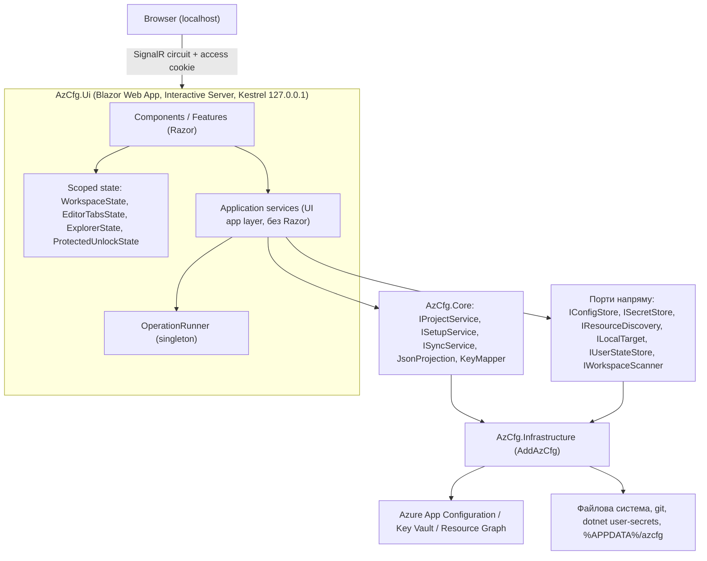
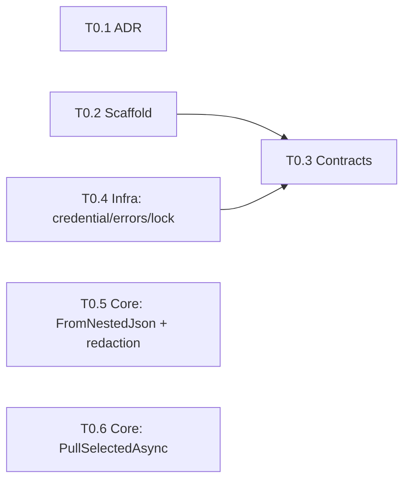
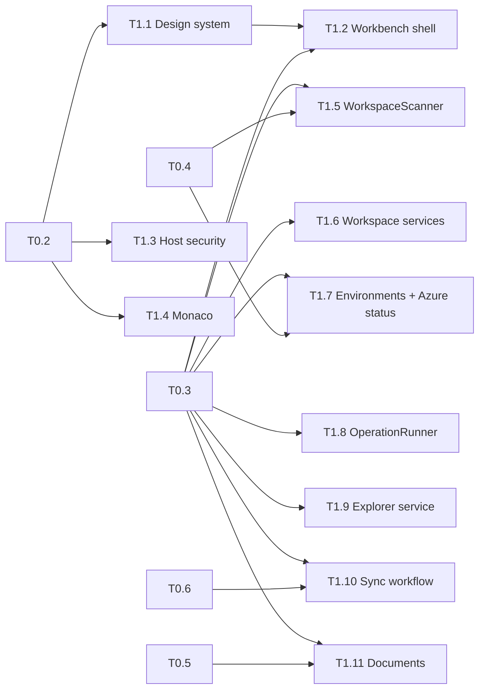
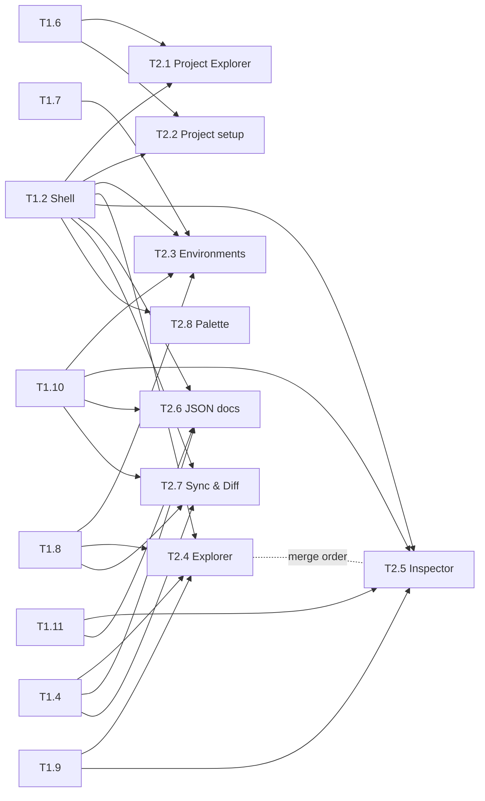
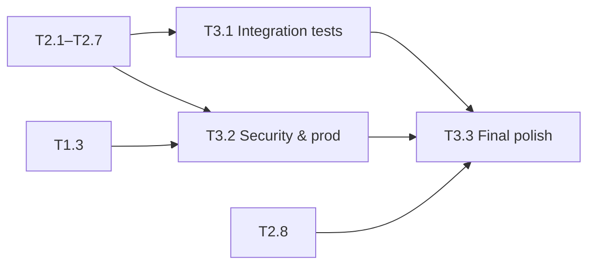
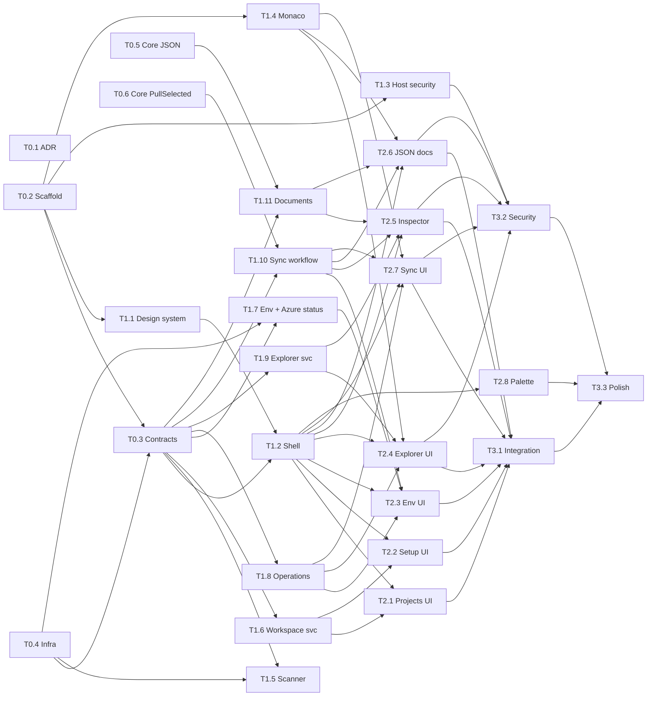

# AzCfg UI — план реалізації MVP

План для паралельного виконання кількома агентами. Одна задача = одна гілка = один PR у `dev`
(той самий процес, що й у `docs/mvp-plan.md`: `/feature <ID> <назва>`, спершу тести, потім код).

## Як взяти задачу
1. Прочитай `CLAUDE.md`, розділи 4–7 цього документа (архітектура, структура, контракти, дизайн-система).
2. Візьми невідмічену задачу з розділу 9, у якої всі «Залежить від» уже `[x]`.
3. Працюй лише у файлах, перелічених у задачі. Спільні файли (розділ 10.3) змінюй лише якщо задача їх явно називає.
4. У тому ж PR відміть задачу: `- [ ]` → `- [x]`.
5. Контракти з розділу 6 — обов'язкові. Змінювати сигнатуру контракту можна лише окремим PR з оновленням цього документа.

---

## 1. Overview & Goals

**AzCfg UI** — локальний developer workspace для .NET-розробників: відкрити папку з .NET-проєктами, прив'язати
проєкт до сервісу в Azure App Configuration, переглядати конфігурацію середовищ, редагувати її (дерево або JSON у
Monaco) і синхронізувати між локальними файлами та Azure з попереднім переглядом змін.

Модель продукту: **Project → Environment → Configuration Sources**.

| Рівень | Що це в AzCfg | Звідки береться |
| --- | --- | --- |
| Project | `.csproj` + його прив'язка `ProjectBinding` (сервіс, локальні цілі, vault на середовище, активне середовище) | `IProjectDetector`, `IProjectService`, `projects.json` |
| Environment | `ConfigEnvironment(Name, StoreEndpoint, Label, IsProtected)` | `profile.json` (спільний для всіх проєктів користувача) |
| Configuration Sources | локальні цілі (user-secrets, `appsettings.local.json`), App Configuration store середовища, Key Vault-и, на які посилаються KV references | `ILocalTarget`, `IConfigStore`, `ISecretStore` |

App Configuration і Key Vault — **одне** джерело середовища: секрет існує в UI лише як KV reference у App
Configuration (`ConfigValue.KeyVaultRef`) — vault визначається з URI референса (ADR 0005). Окремого «перегляду
всього Key Vault» у MVP немає.

### Цілі MVP
- UI повністю працює поверх наявних `AzCfg.Core` і `AzCfg.Infrastructure`; бізнес-логіка (мапінг ключів, merge,
  3-way diff, план, apply, безпека секретів) не дублюється.
- Усі сценарії CLI (`init`, `pull`, `use`, `plan`, `push`, `edit`) доступні в UI; плюс: дерево конфігурації,
  Monaco-редактор, diff viewer, вибір окремих змін в обох напрямках, розв'язання конфліктів.
- Секрети не потрапляють у браузер, поки користувач явно не натисне «Показати».
- Production захищено: read-only за замовчуванням, підтвердження введенням назви, жодних «застосувати все» без перегляду.

### Не-цілі MVP
Promote у UI, `LabelResolver`, `LocalSettingsTarget` (запис у `local.settings.json`), створення Key Vault,
ранжування vault-ів (ADR 0005, крок 4), перейменування середовищ, багатокористувацький/віддалений доступ,
E2E-тести в браузері, пакування UI як dotnet tool.

---

## 2. Current Architecture Analysis

Досліджено: `CLAUDE.md`, `README.md`, `docs/architecture.md`, `docs/mvp-plan.md` (усі задачі `[x]`), ADR 0001–0007,
весь `src/` (Core, Infrastructure, Cli), структура `tests/` і fakes.

### 2.1 Шари (як є)
```
AzCfg.Core            BCL + ILogger. Model, Mapping, Sync, Abstractions (порти), UseCases. Нічого не питає/не друкує.
AzCfg.Infrastructure  Azure SDK, файлова система, стан користувача; DI: services.AddAzCfg()
AzCfg.Cli             Spectre.Console.Cli; залежить від Core + Infrastructure; композиція сценаріїв і промпти
```
`AddAzCfg()` реєструє все як singleton (безстанні сервіси) — придатно для Blazor Server без змін.

### 2.2 Публічний API Core, який перевикористовує UI

| API | Що дає UI |
| --- | --- |
| `ISetupService.DiscoverEnvironmentsAsync` / `SaveProfileAsync` | Майстер середовищ (кандидати з тегу `environment`/суфікса, `IsProtected`) |
| `IUserStateStore.LoadProfileAsync` + `IEnvironmentResolver.Resolve` | Список середовищ |
| `IProjectService.ResolveAsync` / `BindAsync` | Майстер прив'язки проєкту: кандидати сервісу, `LocalTargetOption` (`Exists`, `IsSafeForSecrets`), збережений binding |
| `ISyncService.DiffAsync` → `ConfigDiff` (`DiffItem`: `Base/Local/Remote` як `StateItem`, `DiffKind`) | Дерево конфігурації зі статусами, diff viewer, preview pull. Секрети — лише fingerprint |
| `ISyncService.PlanPushAsync(binding, env, PushSource)` → `SyncPlan` | Local→Azure (`LocalFiles`), редагування remote (`EditedJson`) |
| `ISyncService.ApplyAsync(plan, ApplyOptions)` | Apply з перевірками: конфлікти, vault, protected (ввести назву), global |
| `ISyncService.PullAsync(..., force)` → `PullResult` (`Blocked`, `LocalChanges`) | Azure→Local повністю, перемикання активного середовища |
| `ISyncService.ExportJsonAsync` | Документ «Remote JSON» для Monaco |
| `JsonProjection.ToEditJson` / `FromEditJson` / `ToNestedJson` | Read-only JSON view, валідація edit JSON без мережі, серіалізація локальних файлів |
| `KeyMapper` (`ToStoreKey`, `ToKeyVaultSecretName`), `ScopeMerger.Merge` | Імена секретів для «перенести в Key Vault», remote-only перегляд неактивного середовища |
| `ConfigEnvironment.IsProtectedByName` | Пропозиція захисту в майстрі середовищ |
| `SecretString`, `ISecretFingerprinter`, `LocalValue` (редагований `ToString`) | Політика секретів у UI |
| Порти `IConfigStore`, `ISecretStore`, `IResourceDiscovery`, `ILocalTarget`, `IProjectDetector` | CLI вже використовує порти напряму (`IResourceDiscovery` для вибору vault, `IUserStateStore` для збереження vault) — UI робить так само |

### 2.3 Infrastructure (як є)
- `AppConfigStore` — читання `global:*` + `<service>:*` (label `\0` або `env.Label`), `ApplyAsync` з ETag
  (`Add` → `If-None-Match`, `Update/Delete` → `onlyIfUnchanged`), 412 → `ApplyResult.Failed`. Кеш клієнтів на endpoint.
- `KeyVaultSecretStore` — `GetAsync(secretUri)`, `SetAsync(vault, name, value)`; кеш `SecretClient` на vault.
- `ResourceGraphDiscovery` — stores і vault-и через Resource Graph (перший tenant, пагінація).
- `CsprojDetector` — рекурсивний пошук `*.csproj`, пропускає лише `bin/obj`; `UserSecretsId`, `AzureFunctionsVersion`.
- `AppSettingsLocalTarget` (`appsettings.local.json`, безпечність через `git check-ignore` + `git ls-files`),
  `UserSecretsTarget` (`secrets.json`, `dotnet user-secrets init` при першому записі), спільна база `JsonFileTarget`.
- `JsonUserStateStore` — `profile.json`, `projects.json` (ключ — повний шлях), `snapshots/<sha256(path)>/<env>.json`,
  `fingerprint.key`; атомарний запис через temp + move.
- Auth: `DefaultAzureCredential`, але створюється **тричі** (Key Vault, ARM, App Config) — окремі кеші токенів.

### 2.4 CLI-логіка, яку UI мусить відтворити як композицію (не бізнес-логіка)
- Вибір середовища: `--env` → `binding.ActiveEnvironment` → `"dev"` (`EnvironmentCommandBase`).
- Прив'язка: впевнений кандидат → автоматично; інакше вибір; секрети — лише в безпечну ціль (`PullCommandBase`).
- Push: конфлікти → відмова; `RequiresVaultChoice` → вибір із `FindKeyVaultsAsync` → зберегти
  `VaultByEnvironment[env]` → перепланувати; protected → ввести назву; `TouchesGlobal` → окреме підтвердження (`PushCommandBase`).
- Тексти помилок auth/401/403 з потрібними ролями — `CliErrors.Describe` (лежить у CLI → переносимо, див. T0.4).

### 2.5 Прогалини та знахідки

| # | Прогалина / ризик у коді | Рішення для UI MVP | Задача |
| --- | --- | --- | --- |
| G1 | Немає розбору `.sln`/`.slnx` і пошуку конфіг-файлів | Новий порт `IWorkspaceScanner` (Core) + `WorkspaceScanner` (Infrastructure) | T0.3, T1.5 |
| G2 | `CsprojDetector` обходить усе, крім `bin/obj` (`.git`, `node_modules` теж) | Розширити список пропусків | T1.5 |
| G3 | Немає списку відкритих воркспейсів | UI-реєстр `ui/workspaces.json` у каталозі стану користувача | T1.6 |
| G4 | Binding один на `RepoPath`; у воркспейсі кілька проєктів | `RepoPath` = **тека `.csproj`**; fallback на binding предка, якщо його цілі вказують на цей `.csproj` (сумісність із CLI) | T1.6 |
| G5 | `BindAsync` при повторній прив'язці скидає `VaultByEnvironment` і `ActiveEnvironment` | `WorkspaceService.BindAsync` після `BindAsync` зберігає binding з перенесеними полями | T1.6 |
| G6 | Pull лише «все або нічого» | Новий `ISyncService.PullSelectedAsync` (Core, TDD) — також дає «Keep remote» для конфліктів | T0.6 |
| G7 | Вибір окремих змін для push | Без змін Core: `plan with { Changes = subset }`; `ApplyAsync` оновлює знімок лише для ключів плану | T1.10 |
| G8 | Немає зворотного до `ToNestedJson` розбору для редактора локальних файлів | `JsonProjection.FromNestedJson` (Core, TDD, паритет із `JsonFileTarget.ReadAsync`) | T0.5 |
| G9 | `PushSource.EditedJson(Json)` / `Promote(Json, …)` — авто-`ToString()` record-а друкує JSON, а він може містити `"value"` секрету | Редагувати `PrintMembers` (`Json = ***`) | T0.5 |
| G10 | Тексти помилок Azure живуть у CLI | `AzureErrors.Describe/Classify` в Infrastructure, CLI використовує їх | T0.4 |
| G11 | Три окремі `DefaultAzureCredential`; немає способу перевірити, чи користувач залогінений | Один `TokenCredential` singleton у `AddAzCfg()`; `AzureStatusService` пробує токен | T0.4, T1.7 |
| G12 | `JsonUserStateStore.SaveBindingAsync` — read-modify-write без блокування; у Blazor Server можливі паралельні виклики | In-process `SemaphoreSlim` у store. Міжпроцесна гонка CLI↔UI лишається (ризик R6) | T0.4 |
| G13 | `SyncProgress` ніколи не репортиться | MVP: невизначений прогрес; репортинг — поза MVP | — |
| G14 | `ReadRemoteAsync` резолвить секрети послідовно (N × `GetAsync`) для кожного `DiffAsync`/`PlanPushAsync` | MVP: кеш `ConfigurationView`, явний Refresh; ризик R3 | T1.9 |
| G15 | `EditedJson` використовує **поточний remote як base** — давно відкритий редактор при apply мовчки поверне чужі remote-зміни | Детектор застарілості: при Review повторний export і порівняння з export на момент відкриття | T1.10, T2.6 |
| G16 | Знімки, `ActiveEnvironment`, `VaultByEnvironment` прив'язані до **назви** середовища | MVP: перейменування заборонене (лише видалити + додати) | T2.3 |
| G17 | Ранжування vault-ів (ADR 0005 крок 4) не реалізоване; CLI показує весь список | MVP: список із пошуком (паритет із CLI) | T2.7 |
| G18 | `LocalSettingsTarget` не реалізований | `local.settings.json` показується в дереві проєкту як виявлений файл (read-only), не як ціль прив'язки | T1.5, T2.1 |
| G19 | Вибір середовища за замовчуванням (`Active ?? "dev"`) — у CLI | Однорядкове правило відтворюється в `IEnvironmentService.SelectDefault` (задокументовано тут, не нова логіка) | T1.7 |

### 2.6 Що НЕ змінюємо
Модель, порти та сервіси Core залишаються як є. Зміни Core — лише **додаткові** (G1 порт, G6 метод, G8 функція,
G9 редагування `ToString`), кожна з обґрунтуванням вище і TDD.

---

## 3. Functional Requirements

Позначки: **[MVP]** — входить у Definition of Done; **[S]** — stretch, якщо лишиться час.

### 3.1 Project Explorer
- FR-P1 [MVP] Вибір директорії: діалог «Open Folder» із серверним браузером тек (браузер не може передати шлях
  серверу — див. рішення AD-8), поле шляху з автодоповненням, список останніх.
- FR-P2 [MVP] Пошук `.sln`, `.slnx`, `.csproj` (без `bin`, `obj`, `.git`, `node_modules`, прихованих тек).
- FR-P3 [MVP] Дерево: Workspace → Solution → Project → конфіг-файли; проєкти поза solution — у групі «Projects».
- FR-P4 [MVP] Виявлення конфіг-файлів: `appsettings.json`, `appsettings.{Env}.json`, `appsettings.local.json`,
  `local.settings.json`, user-secrets (`secrets.json` за `UserSecretsId`). Бейдж «bound: values/secrets» на цілях прив'язки.
- FR-P5 [MVP] Список воркспейсів: відкрити, закрити, видалити зі списку (binding у `projects.json` не видаляється), pin.
- FR-P6 [MVP] Статус проєкту: `Unbound` / `Bound` (сервіс, активне середовище).
- FR-P7 [MVP] Майстер прив'язки: сервіс (кандидати, впевнений збіг виділено), ціль значень, ціль секретів
  (лише `IsSafeForSecrets`), зміна прив'язки зі збереженням vault-ів і активного середовища.

### 3.2 Environment Management
- FR-E1 [MVP] Перший запуск без `profile.json` → майстер: discovery stores, назва, `IsProtected`, ручний endpoint.
- FR-E2 [MVP] Список середовищ: додати (discovery або вручну), видалити, змінити endpoint, `IsProtected`.
  Перейменування — ні (G16).
- FR-E3 [MVP] Тип для відображення: Development / Staging / Production / Custom — похідний від назви та `IsProtected`
  (без нового поля в моделі).
- FR-E4 [MVP] Перемикач середовища на рівні проєкту; активне середовище (те, що в локальних файлах) позначене.
  «Make active» = pull з обробкою `Blocked` (= `azcfg use`).
- FR-E5 [MVP] Налаштування середовища на рівні проєкту: vault для нових секретів (`VaultByEnvironment`).
- FR-E6 [MVP] Статус підключення кожного середовища (Connected / Auth required / Forbidden / Unreachable).

### 3.3 Configuration Explorer
- FR-C1 [MVP] Ієрархічне дерево ключів (сегменти за `:`), агреговані статуси на гілках.
- FR-C2 [MVP] Колонки/інспектор: local value, remote value, scope (`service`/`global`), тип (plain / KV reference
  з vault host і назвою секрету), джерело локального значення (`UserSecrets`/`AppSettingsLocal`), `DiffKind`.
- FR-C3 [MVP] Пошук (за ключем і plain-значенням; секрети не шукаються за значенням) і фільтри:
  змінені, конфлікти, лише секрети, scope.
- FR-C4 [MVP] Tree View ↔ JSON View (read-only Monaco: local / remote, секрети як `{"@kv": "<name>"}`).
- FR-C5 [MVP] Неактивне середовище — remote-only режим (порівняння з локальними файлами вимкнене, бо вони
  відображають інше середовище).
- FR-C6 [S] Індикатор «service override перекриває global».

### 3.4 JSON Editor
- FR-J1 [MVP] Monaco: підсвічування JSON, валідація синтаксису, форматування, тема AzCfg Dark.
- FR-J2 [MVP] Документ «Remote JSON» (edit JSON середовища, `ExportJsonAsync`): семантична валідація через
  `JsonProjection.FromEditJson` (маркери на ключах), JSON schema для `@kv`/`value`/`@global`, кнопка «Review changes».
- FR-J3 [MVP] Документ «Local file» для цілей прив'язки: відкриття, валідація (`FromNestedJson`), збереження через
  `ILocalTarget.WriteAsync`. Ціль секретів відкривається лише після явного «Reveal & edit».
- FR-J4 [MVP] Незбережені зміни: крапка на вкладці, підтвердження при закритті, `Ctrl+S` / `Ctrl+Shift+F`.
- FR-J5 [MVP] Детектор застарілості Remote JSON (G15).

### 3.5 Azure Integration
- FR-A1 [MVP] Auth лише `DefaultAzureCredential` (наявний механізм); статус акаунта в status bar, інструкція
  `az login` + Retry при помилці.
- FR-A2 [MVP] Редагування plain-значення, додавання та видалення ключа (scope сервісу; global — лише явним перемикачем
  scope і з окремим підтвердженням) — через edit JSON pipeline (`EditJsonPatcher` → `PlanPushAsync(EditedJson)`).
- FR-A3 [MVP] KV reference: показ vault/секрету, «Reveal» (`ISecretStore.GetAsync`, автоприховування), «Set new value»
  (`{"@kv": name, "value": v}` → `CreateSecret` у той самий vault).
- FR-A4 [MVP] «Move to Key Vault» для plain-значення (новий секрет, ім'я з `KeyMapper`, вибір vault за потреби).
- FR-A5 [MVP] Помилки 401/403/412/мережа — зрозумілі повідомлення з ролями RBAC (тексти з `AzureErrors`).

### 3.6 Synchronization
- FR-S1 [MVP] Local → Azure: план із локальних файлів (`PushSource.LocalFiles`) лише в **активне** середовище.
- FR-S2 [MVP] Azure → Local: preview remote-змін (з `DiffAsync`), повний pull або вибрані ключі (`PullSelectedAsync`).
- FR-S3 [MVP] Diff Viewer: список змін + Monaco diff (local vs remote JSON; секрети — `***`/fingerprint-статус).
- FR-S4 [MVP] Вибір окремих змін (чекбокси) в обох напрямках.
- FR-S5 [MVP] Конфлікти: показ base/local/remote; «Keep remote» (= pull ключа), «Keep local» (= edit JSON для ключа).
  Поки є конфлікти — push плану заблокований (як у Core).
- FR-S6 [MVP] Підтвердження перед apply: зведення змін; protected → ввести назву; `TouchesGlobal` → окремий чекбокс;
  `RequiresVaultChoice` → вибір vault; результат із `Failed` (412) і пропозицією перепланувати.
- FR-S7 [MVP] Захист Production — див. AD-9.

### 3.7 General UX
- FR-U1 [MVP] Темний інтерфейс (єдина тема).
- FR-U2 [MVP] Вкладки (Explorer, Remote JSON, Local file, Changes, Plan review, Settings) з keep-alive редакторів.
- FR-U3 [MVP] Статуси: акаунт, підключення середовищ, поточні операції.
- FR-U4 [MVP] Command Palette `Ctrl+K` / `Ctrl+Shift+P`: дії, перехід до проєкту/середовища, пошук ключа.
  Обґрунтування: дешево (реєстр команд + один компонент), а навігація по ключах і середовищах — головний сценарій.
- FR-U5 [MVP] Loading states (skeleton/спінер), empty states, помилки (banner + Retry + copy details), toast-и.

---

## 4. Proposed UI Architecture

### 4.1 Загальна схема


### 4.2 Шари всередині `AzCfg.Ui`
- **Components / Features** — лише відображення та взаємодія. Жодних викликів Azure/FS напряму; лише через
  Application services і state.
- **Application** (`AzCfg.Ui/Application/**`) — композиція сценаріїв поверх Core (аналог `*CommandBase` у CLI):
  перетворення результатів Core у view-моделі, політика маскування секретів, правила UI-безпеки. Чисті C#-класи,
  тестуються xunit без bUnit.
- **State** — scoped (на circuit) observable-контейнери з подією `Changed`; без сторонніх бібліотек (AD-1).
- **Hosting** — Kestrel, токен доступу, single instance, запуск браузера.

### 4.3 Архітектурні рішення

Позначення: **[є]** — механізм уже існує, **[нове]** — рішення цього плану.

| ID | Тема | Рішення |
| --- | --- | --- |
| AD-1 | UI state management | [нове] Scoped observable state-класи (`WorkspaceState`, `EditorTabsState`, `ExplorerState`, `ProtectedUnlockState`) з `event Action? Changed`; компоненти підписуються в `OnInitialized`, відписуються в `Dispose`. Без Fluxor/Redux: один користувач, один процес, стан простий. Кеш даних (`ConfigurationView`) — у state, інвалідовується після pull/apply/save. Кілька вкладок браузера = кілька незалежних circuit-ів (прийнятно). |
| AD-2 | Persistence проєктів і середовищ | [є] `profile.json` (середовища), `projects.json` (binding), `snapshots/` — через `IUserStateStore`, без змін формату. [нове] UI-only стан у `<state-root>/ui/`: `workspaces.json` (відкриті воркспейси, pin, last opened), `instance.json` (порт, pid). Binding-ключ = тека `.csproj` (G4). |
| AD-3 | Локальний hosting | [нове] Blazor Web App, глобальний `InteractiveServer` з `prerender: false` (уникаємо подвійної ініціалізації та JS interop до рендеру). Kestrel лише `http://127.0.0.1:<random>`; `AllowedHosts=localhost;127.0.0.1` (захист від DNS rebinding); випадковий токен доступу на запуск у URL → HttpOnly SameSite=Strict cookie → редірект на чистий URL; усі запити (включно з `/_blazor`) без cookie → 401. Single instance через `ui/instance.json`: другий запуск відкриває браузер на наявний інстанс. `HubOptions.MaximumReceiveMessageSize` = 2 MB (вміст Monaco приходить через SignalR; дефолт 32 KB зламає великі JSON). `DetailedErrors=false`. Запуск: `dotnet run --project src/AzCfg.Ui` (+ `--no-browser`, `--port`). |
| AD-4 | Azure authentication | [є] Лише `DefaultAzureCredential` (CLAUDE.md). [нове] Один `TokenCredential` singleton для всіх клієнтів (G11); `AzureStatusService` перевіряє `GetTokenAsync(https://management.azure.com/.default)` і показує акаунт з claim-ів токена (декодування payload без валідації — лише для відображення, без нових пакетів). Інтерактивного логіну в UI немає: інструкція `az login` + Retry. |
| AD-5 | Робота з секретами | [є] `SecretString`, fingerprint-и, план/знімок без значень. [нове] Політика UI: (1) у DOM ніколи не рендериться значення секрету, доки користувач не натисне Reveal; (2) Reveal remote — `ISecretStore.GetAsync`, значення живе лише в полі компонента, автоприховування через 30 с і при зміні вкладки; (3) локальне значення маскується, якщо ключ — секрет за diff (`StateValue.Secret`) **або** походить із `SecretsTarget`, коли той відрізняється від `ValuesTarget`; (4) файл цілі секретів відкривається в Monaco лише після «Reveal & edit»; (5) пошук не матчить значення секретів; (6) логування: жодних значень, жодного `PlanRequest`/`PushSource` у логах (G9); (7) значення секрету, введене в UI, передається в Core лише через `"value"` edit JSON і не зберігається в state після apply/cancel. |
| AD-6 | Monaco Editor | [нове] Пакет **BlazorMonaco** (MIT, активно підтримується, містить статичні асети Monaco → працює офлайн, без CDN; має standalone і diff editor). Обгортки `CodeEditor`/`DiffEditor` у `Components/Editors` ізолюють пакет: заміна на власний JS interop торкнеться лише цих двох файлів. Тема `azcfg-dark` з токенів дизайн-системи. JSON schema для edit JSON (`wwwroot/schemas/edit-json.schema.json`). Keep-alive: відкриті редактори не знищуються при перемиканні вкладок (CSS-приховування), ліміт 12 відкритих редакторів. |
| AD-7 | UI ↔ Core interaction | [нове] Компоненти → Application services → Core use cases / порти. Правило: якщо дія є в Core (`PlanPushAsync`, `ApplyAsync`, `DiffAsync`…) — UI викликає її, а не відтворює. Усі remote-редагування (дерево, інспектор, JSON) йдуть **одним конвеєром** edit JSON → `PlanPushAsync(EditedJson)` → review → `ApplyAsync`. Локальні редагування → `ILocalTarget.WriteAsync` → далі звичайний push локальних файлів. Помилки — через `AzureErrors` (G10). |
| AD-8 | Вибір директорії | [нове] Серверний `IDirectoryBrowser` (корені: home, диски/`/`), діалог зі списком тек, поле шляху з автодоповненням; позначка тек, що містять `.sln/.slnx/.csproj`. Нативний діалог ОС не використовуємо (UI в браузері). |
| AD-9 | Безпечна робота з Production | [є] `ConfigEnvironment.IsProtected`; `ApplyAsync` вимагає `ConfirmedEnvironment`; `ConfirmGlobal`. [нове] Захищене середовище в UI: червона рамка воркспейсу + бейдж PROTECTED; **read-only за замовчуванням** — дії редагування неактивні до «Unlock editing» (на сесію circuit-а, на середовище); apply — діалог із введенням назви (кнопка неактивна до збігу, без Enter-за-замовчуванням); Local→Azure лише в активне середовище; pull із protected у локальні файли — з окремим попередженням «секрети production будуть записані локально»; заборонені масові дії «на всі середовища». Перевірки UI — додатковий шар; остаточна перевірка лишається в Core. |
| AD-10 | Довготривалі операції | [нове] `OperationRunner` (singleton): реєструє операції (status bar показує поточні), мапить винятки через `AzureErrors`. **Read** — скасовуються токеном компонента (закрили вкладку → скасовано). **Write** (apply, pull, save) — не скасовуються навігацією/розривом circuit: виконуються з токеном `ApplicationStopping`, щоб не лишити частковий apply; кнопки блокуються, доки операція триває. Прогрес — невизначений (G13). |
| AD-11 | Розширюваність без конфліктів | [нове] `TabContentRegistry` (kind → тип компонента), `SidebarRegistry`, `ICommandRegistry`, і по одному файлу реєстрації DI на feature (`Features/<X>/<X>Feature.cs`) — створюються в T0.3, кожна задача заповнює лише свій файл. Workbench рендерить вкладки через `DynamicComponent`. |

---

## 5. Project Structure

```
src/AzCfg.Ui/                                   Microsoft.NET.Sdk.Web; refs Core, Infrastructure; BlazorMonaco
  AzCfg.Ui.csproj
  Program.cs                                    T0.2 (форма фіксована, далі не змінюється)
  appsettings.json                              T0.2 (Logging, AllowedHosts)
  Hosting/                                      T0.2 каркас, T1.3 реалізація
    HostingExtensions.cs                        AddAzCfgHosting(), UseAzCfgHostSecurity()
    AccessTokenGate.cs                          middleware токена доступу
    InstanceLock.cs                             ui/instance.json, single instance
    BrowserLauncher.cs
  Application/
    Contracts/                                  T0.3 — усі інтерфейси та records розділу 6.2
    Workspace/      WorkspaceService, WorkspaceRegistry, DirectoryBrowser                 T1.6
    Environments/   EnvironmentService                                                     T1.7
    Azure/          AzureStatusService                                                     T1.7
    Operations/     OperationRunner                                                        T1.8
    Explorer/       ConfigurationExplorerService, ConfigTreeBuilder, SecretRevealService   T1.9
    Sync/           SyncWorkflowService, EditJsonPatcher, ApplyGatePolicy, PlanSelection   T1.10
    Documents/      LocalDocumentService, RemoteDocumentService                            T1.11
    Commands/       CommandRegistry                                                        T1.2
  State/            WorkspaceState, EditorTabsState, ExplorerState, ProtectedUnlockState   T0.3 (контракт), T1.2 (реалізація)
  Components/
    App.razor, Routes.razor, _Imports.razor                                                T0.2
    Layout/         Workbench, ActivityBar, SidebarHost, TabStrip, TabHost, StatusBar, ReconnectModal   T1.2
    DesignSystem/   Icon, Button, IconButton, Badge, EnvPill, TextInput, SearchBox, Select, Checkbox,
                    Dialog, ConfirmDialog, TypedConfirmDialog, Toolbar, Tooltip, Spinner, Skeleton,
                    EmptyState, Banner, ToastHost, Splitter, TreeView                       T1.1
    Editors/        CodeEditor, DiffEditor, MonacoTheme                                      T1.4
  Features/
    FeatureRegistrations.cs                     T0.3: AddAzCfgUi() викликає всі AddXxxFeature()
    Projects/       ProjectsFeature.cs, ProjectsSidebar, OpenFolderDialog, ProjectSetupWizard, ProjectSettingsTab   T2.1, T2.2
    Environments/   EnvironmentsFeature.cs, EnvironmentsTab, ProfileWizard, EnvironmentSwitcher                    T2.3
    Explorer/       ExplorerFeature.cs, ExplorerTab, Tree/*, Inspector/*                                           T2.4, T2.5
    Documents/      DocumentsFeature.cs, RemoteJsonTab, LocalFileTab                                               T2.6
    Sync/           SyncFeature.cs, ChangesSidebar, PlanReviewTab, PullPreviewTab, ConflictView, ApplyDialog      T2.7
    CommandPalette/ CommandPaletteFeature.cs, CommandPalette                                                       T2.8
  wwwroot/
    css/tokens.css, css/base.css                T1.1
    js/shortcuts.js                             T1.2
    schemas/edit-json.schema.json               T1.4
    lib/lucide/LICENSE                          T1.1 (ISC)

src/AzCfg.Core/            (лише додавання)
  Abstractions/IWorkspaceScanner.cs             T0.3
  Model/SolutionInfo.cs, SolutionFormat.cs, ConfigFileInfo.cs, ConfigFileKind.cs, WorkspaceProject.cs, WorkspaceScan.cs   T0.3
  Mapping/JsonProjection.cs  (+FromNestedJson)  T0.5
  Sync/PushSource.cs         (редагування)      T0.5
  UseCases/ISyncService.cs, SyncService.cs (+PullSelectedAsync)   T0.6

src/AzCfg.Infrastructure/
  Azure/AzureErrors.cs, AzureErrorKind.cs       T0.4
  State/JsonUserStateStore.cs (lock)            T0.4
  DependencyInjection.cs (credential)           T0.4, потім T1.5 (реєстрація сканера)
  Local/WorkspaceScanner.cs, Local/CsprojDetector.cs (пропуски)   T1.5

src/AzCfg.Cli/CliErrors.cs                      T0.4 (делегує AzureErrors)

tests/AzCfg.Ui.Tests/                           Microsoft.NET.Sdk.Razor; xunit + bunit
  AzCfg.Ui.Tests.csproj                         T0.2; лінкує ../AzCfg.Core.Tests/Fakes/*.cs (Compile Include … Link)
  Application/**, Components/**, Hosting/**, Security/**, Integration/**
```

`AzCfg.slnx` і `Directory.Packages.props` змінює лише T0.2 (усі нові пакети одразу).

### Пакети (усі через `Directory.Packages.props`, додає T0.2)
| Пакет | Де | Навіщо | Альтернатива, чому ні |
| --- | --- | --- | --- |
| `BlazorMonaco` (3.x) | AzCfg.Ui | Monaco + diff editor, асети локально | Власний interop + вендоринг monaco-editor — більше коду; лишається fallback-ом (AD-6) |
| `Microsoft.VisualStudio.SolutionPersistence` (1.0.x) | AzCfg.Infrastructure | Офіційний парсер `.sln` і `.slnx` (той самий, що в dotnet CLI/MSBuild) | Власний парсер `.sln` (текстовий формат із GUID-ами) — крихкий |
| `bunit` (2.x) | AzCfg.Ui.Tests | Тести компонентів без браузера | Playwright — важкий, поза MVP |

Lucide: **без пакета** — підмножина SVG-шляхів (~40 іконок) у компоненті `Icon` + файл ліцензії ISC.
Шрифти — системні стеки, без вендорингу.

---

## 6. Data Models & Contracts

### 6.1 Нові контракти Core (додавання, T0.3/T0.5/T0.6)

```csharp
// Core/Abstractions/IWorkspaceScanner.cs (T0.3)
public interface IWorkspaceScanner
{
    /// Solutions, projects (via IProjectDetector) and well-known config files under rootPath.
    Task<WorkspaceScan> ScanAsync(string rootPath, CancellationToken ct);
}

// Core/Model (T0.3) — один тип на файл
public enum SolutionFormat { Sln, Slnx }
public sealed record SolutionInfo(string Path, string Name, SolutionFormat Format, IReadOnlyList<string> ProjectPaths); // абсолютні шляхи .csproj
public enum ConfigFileKind { AppSettings, AppSettingsEnvironment, AppSettingsLocal, LocalSettings, UserSecrets }
public sealed record ConfigFileInfo(string Path, ConfigFileKind Kind, string? EnvironmentName, bool Exists); // UserSecrets: Exists=false, якщо файлу ще немає
public sealed record WorkspaceProject(ProjectInfo Project, IReadOnlyList<ConfigFileInfo> ConfigFiles);
public sealed record WorkspaceScan(string RootPath, IReadOnlyList<SolutionInfo> Solutions, IReadOnlyList<WorkspaceProject> Projects);
```

```csharp
// Core/Mapping/JsonProjection.cs (T0.5)
/// Inverse of ToNestedJson: nested objects → "A:B" keys. Result must equal what JsonFileTarget.ReadAsync
/// yields for the same file content (arrays → index segments, scalars → strings, same case-insensitive
/// duplicate rule). Throws JsonException for invalid JSON, ArgumentException for a non-object root or
/// duplicate keys; messages name the key, never a value.
public static IReadOnlyList<LocalValue> FromNestedJson(string json);

// Core/Sync/PushSource.cs (T0.5) — EditedJson і Promote: PrintMembers друкує "Json = ***".
```

```csharp
// Core/UseCases/ISyncService.cs (T0.6)
/// Pulls only `keys` of `env` into the local targets, keeping every other local value. `env` must be the
/// binding's ActiveEnvironment (InvalidOperationException otherwise, including when there is none — a full
/// PullAsync comes first). Selected keys are overwritten unconditionally (the client has shown the preview);
/// a key missing remotely is removed locally; a key is written to SecretsTarget if it is a KV reference,
/// else to ValuesTarget, and removed from the other target. Same secrets-target safety check as PullAsync.
/// The snapshot is updated only for `keys`. Returns counts of written values/secrets; Blocked is always false.
Task<PullResult> PullSelectedAsync(ProjectBinding binding, ConfigEnvironment env, IReadOnlyCollection<string> keys, CancellationToken ct);
```

### 6.2 Контракти Application (AzCfg.Ui/Application/Contracts, T0.3)

```csharp
// --- Workspace ---------------------------------------------------------------
public sealed record WorkspaceEntry(string RootPath, string DisplayName, DateTimeOffset LastOpened, bool Pinned);
public interface IWorkspaceRegistry                                  // ui/workspaces.json
{
    Task<IReadOnlyList<WorkspaceEntry>> ListAsync(CancellationToken ct);
    Task AddOrTouchAsync(string rootPath, CancellationToken ct);
    Task RemoveAsync(string rootPath, CancellationToken ct);           // binding у projects.json не чіпає
    Task SetPinnedAsync(string rootPath, bool pinned, CancellationToken ct);
}

public sealed record ProjectNode(WorkspaceProject Project, ProjectBinding? Binding);   // Id = Project.Project.CsprojPath
public sealed record SolutionNode(SolutionInfo Solution, IReadOnlyList<ProjectNode> Projects);
public sealed record WorkspaceTree(string RootPath, IReadOnlyList<SolutionNode> Solutions, IReadOnlyList<ProjectNode> LooseProjects);
public sealed record ProjectSetupProposal(ProjectInfo Project, ProjectResolution Resolution);

public interface IWorkspaceService
{
    Task<WorkspaceTree> OpenAsync(string rootPath, CancellationToken ct);   // scan + binding lookup (G4) + registry touch
    Task<ProjectSetupProposal> ProposeSetupAsync(ProjectInfo project, CancellationToken ct); // ResolveAsync(тека .csproj)
    /// BindAsync + перенесення VaultByEnvironment/ActiveEnvironment з попереднього binding (G5).
    Task<ProjectBinding> BindAsync(ProjectInfo project, string service, LocalTargetBinding values, LocalTargetBinding secrets, CancellationToken ct);
    Task<ProjectBinding> SetVaultAsync(ProjectBinding binding, string environment, Uri vault, CancellationToken ct);
}

public sealed record DirectoryItem(string Name, string FullPath, bool HasDotNetProjects);
public sealed record DirectoryListing(string? Path, string? Parent, IReadOnlyList<DirectoryItem> Items); // Path=null → корені
public interface IDirectoryBrowser
{
    Task<DirectoryListing> ListAsync(string? path, CancellationToken ct);
    IReadOnlyList<string> Complete(string partialPath, int max = 20);
}

// --- Environments & Azure ----------------------------------------------------
public enum EnvironmentKind { Development, Staging, Production, Custom }        // лише для відображення
public interface IEnvironmentService
{
    Task<IReadOnlyList<ConfigEnvironment>?> ListAsync(CancellationToken ct);     // null → профілю ще немає
    Task<IReadOnlyList<EnvironmentCandidate>> DiscoverAsync(CancellationToken ct);
    /// Валідація: непорожні унікальні назви (OrdinalIgnoreCase), абсолютний https endpoint.
    Task SaveAsync(IReadOnlyList<ConfigEnvironment> environments, CancellationToken ct);
    ConfigEnvironment? SelectDefault(IReadOnlyList<ConfigEnvironment> environments, ProjectBinding binding); // Active ?? "dev" ?? перше
    EnvironmentKind KindOf(ConfigEnvironment environment);
}

public enum ConnectionState { Unknown, Checking, Connected, AuthRequired, Forbidden, Unreachable }
public sealed record AzureAccountStatus(ConnectionState State, string? Account, string? TenantId, string? Message);
public sealed record EnvironmentHealth(string Environment, ConnectionState State, string? Message, DateTimeOffset CheckedAt);
public interface IAzureStatusService
{
    AzureAccountStatus Account { get; }
    event Action? Changed;
    Task<AzureAccountStatus> CheckAccountAsync(CancellationToken ct);
    /// Проба: перший елемент IConfigStore.ReadAsync(env, service) — одна сторінка, без повного читання.
    Task<EnvironmentHealth> CheckEnvironmentAsync(ConfigEnvironment env, string service, CancellationToken ct);
}

// --- Operations --------------------------------------------------------------
public enum OperationKind { Read, Write }
public sealed record OperationInfo(Guid Id, string Title, OperationKind Kind, DateTimeOffset StartedAt);
public abstract record OperationResult<T>
{
    public sealed record Success(T Value) : OperationResult<T>;
    public sealed record Failed(string Message, AzureErrorKind Kind) : OperationResult<T>;  // AzureErrorKind з Infrastructure (T0.4)
    public sealed record Cancelled : OperationResult<T>;
}
public interface IOperationRunner
{
    IReadOnlyList<OperationInfo> Running { get; }
    event Action? Changed;
    /// Read: скасовується uiToken. Write: ігнорує uiToken, використовує ApplicationStopping (AD-10).
    Task<OperationResult<T>> RunAsync<T>(string title, OperationKind kind, Func<CancellationToken, Task<T>> work, CancellationToken uiToken);
}

// --- Explorer ----------------------------------------------------------------
public enum ConfigValueKind { Plain, KeyVaultReference }
public sealed record ConfigKeyView(
    string Key,
    DiffKind? Status,                    // null у remote-only режимі
    ConfigScope? Scope,                  // remote/base provenance
    ConfigValueKind Kind,
    bool IsSecret,
    string? LocalValue,                  // null, якщо відсутнє АБО замасковане (див. LocalMasked)
    bool LocalMasked,
    string? RemoteValue,                 // лише plain; для секретів null
    Uri? SecretUri, string? SecretName, string? VaultHost,
    LocalTargetKind? LocalSource);
public sealed record ConfigTreeNode(string Segment, string Path, ConfigKeyView? Leaf, IReadOnlyList<ConfigTreeNode> Children,
    int ChangedCount, int ConflictCount);
public sealed record ConfigurationView(ProjectBinding Binding, ConfigEnvironment Environment, bool IsRemoteOnly,
    IReadOnlyList<ConfigKeyView> Keys, ConfigTreeNode Root, DateTimeOffset LoadedAt);
public sealed record ConfigFilter(string? Text = null, bool ChangedOnly = false, bool ConflictsOnly = false, bool SecretsOnly = false, ConfigScope? Scope = null);
public enum ConfigSide { Local, Remote }
public interface IConfigurationExplorerService
{
    /// Активне середовище: DiffAsync + ILocalTarget.ReadAsync (джерело ключа). Неактивне: IConfigStore.ReadAsync + ScopeMerger.Merge.
    Task<ConfigurationView> LoadAsync(ProjectBinding binding, ConfigEnvironment env, CancellationToken ct);
    ConfigTreeNode Filter(ConfigurationView view, ConfigFilter filter);              // чиста функція
    string ToJson(ConfigurationView view, ConfigSide side);                          // секрети як {"@kv": name}, без значень
}
public interface ISecretRevealService
{
    Task<SecretString> RevealRemoteAsync(Uri secretUri, CancellationToken ct);
    Task<SecretString?> RevealLocalAsync(ProjectBinding binding, string key, CancellationToken ct);
}

// --- Sync --------------------------------------------------------------------
/// PrintMembers не друкує Source (може містити секрет, G9).
public sealed record PlanRequest(ProjectBinding Binding, ConfigEnvironment Environment, PushSource Source, string Title, string? ExportedAtOpen = null);
public sealed record ChangeRow(int Index, ChangeKind Kind, string Key, ConfigScope Scope, bool IsSecret,
    string? Before, string? After, string? SecretName);                             // Before/After — лише plain, інакше null
public sealed record PlanReview(PlanRequest Request, SyncPlan Plan, IReadOnlyList<ChangeRow> Rows,
    bool IsStale);                                                                   // IsStale — G15
public sealed record ApplyGate(bool CanApply, IReadOnlyList<string> BlockingReasons,
    bool RequiresTypedConfirmation, bool RequiresGlobalConfirmation, bool RequiresVaultChoice);
public sealed record ApplyConfirmation(string? TypedEnvironmentName, bool GlobalConfirmed);
public sealed record PullPreviewRow(string Key, DiffKind Kind, bool IsSecret, string? Local, string? Remote);  // лише Remote*/Conflict
public sealed record PullPreview(ProjectBinding Binding, ConfigEnvironment Environment, IReadOnlyList<PullPreviewRow> Rows, bool HasLocalChanges);

public interface ISyncWorkflowService
{
    Task<PlanReview> PlanAsync(PlanRequest request, CancellationToken ct);
    Task<IReadOnlyList<AzureResource>> ListVaultsAsync(CancellationToken ct);
    Task<PlanReview> ChooseVaultAsync(PlanRequest request, Uri vault, CancellationToken ct);  // SetVaultAsync + перепланування
    SyncPlan Select(SyncPlan plan, IReadOnlySet<int> changeIndexes);                 // чиста; перераховує TouchesGlobal
    ApplyGate Evaluate(SyncPlan selected);                                           // чиста
    Task<ApplyResult> ApplyAsync(SyncPlan selected, ApplyConfirmation confirmation, CancellationToken ct);
    Task<PullPreview> PreviewPullAsync(ProjectBinding binding, ConfigEnvironment env, CancellationToken ct);
    Task<PullResult> PullAsync(ProjectBinding binding, ConfigEnvironment env, bool force, CancellationToken ct);
    Task<PullResult> PullSelectedAsync(ProjectBinding binding, ConfigEnvironment env, IReadOnlyCollection<string> keys, CancellationToken ct);
    /// «Keep local» для конфлікту: export → EditJsonPatcher з локальним значенням ключа → PlanRequest(EditedJson).
    Task<PlanRequest> KeepLocalAsync(ProjectBinding binding, ConfigEnvironment env, string key, CancellationToken ct);
}

public static class EditJsonPatcher   // чиста; працює з текстом edit JSON (формат JsonProjection.ToEditJson)
{
    public static string SetPlain(string editJson, ConfigScope scope, string key, string value);
    public static string SetSecret(string editJson, ConfigScope scope, string key, string secretName, SecretString value);
    public static string Remove(string editJson, ConfigScope scope, string key);
}

// --- Documents ---------------------------------------------------------------
public sealed record JsonDiagnostic(string Message, string? Key, int? Line, int? Column);
public sealed record LocalDocument(LocalTargetBinding Target, string Json, bool IsSecretsTarget);
public interface ILocalDocumentService
{
    Task<LocalDocument> OpenAsync(ProjectBinding binding, LocalTargetBinding target, CancellationToken ct); // ToNestedJson(ReadAsync)
    IReadOnlyList<JsonDiagnostic> Validate(string json);                              // FromNestedJson
    Task SaveAsync(ProjectBinding binding, LocalTargetBinding target, string json, CancellationToken ct);  // для цілі секретів — повторний InspectAsync
}
public sealed record RemoteDocument(ProjectBinding Binding, ConfigEnvironment Environment, string ExportedJson);
public interface IRemoteDocumentService
{
    Task<RemoteDocument> OpenAsync(ProjectBinding binding, ConfigEnvironment env, CancellationToken ct);   // ExportJsonAsync
    IReadOnlyList<JsonDiagnostic> Validate(string json);                              // FromEditJson з ISecretFingerprinter, без мережі
    Task<bool> IsStaleAsync(RemoteDocument document, CancellationToken ct);           // повторний export ≠ ExportedJson
}

// --- Commands ----------------------------------------------------------------
public sealed record UiCommand(string Id, string Title, string Category, string? Shortcut, Func<Task> Execute, Func<bool>? IsEnabled = null);
public interface ICommandRegistry
{
    IDisposable Register(UiCommand command);
    IReadOnlyList<UiCommand> All { get; }
    event Action? Changed;
}
```

### 6.3 State-контракти (AzCfg.Ui/State, T0.3 — сигнатури; T1.2 — реалізація)
```csharp
public enum TabKind { Welcome, Explorer, RemoteJson, LocalFile, PlanReview, PullPreview, Environments, ProjectSettings }
public sealed record TabDescriptor(TabKind Kind, string? ProjectId, string? Environment, string? Discriminator); // ключ дедуплікації
public sealed record EditorTab(Guid Id, TabDescriptor Descriptor, string Title, bool IsDirty, bool IsProtected, object? Payload);

public sealed class EditorTabsState   // scoped
{
    public IReadOnlyList<EditorTab> Tabs { get; }
    public Guid? ActiveId { get; }
    public event Action? Changed;
    public Guid Open(TabDescriptor descriptor, string title, object? payload = null);  // існуючий descriptor → активувати
    public bool RequestClose(Guid id);                                                // false → dirty, потрібне підтвердження
    public void ForceClose(Guid id);
    public void SetDirty(Guid id, bool dirty);
    public void Activate(Guid id);
}
public sealed class WorkspaceState { WorkspaceTree? Tree; ProjectNode? SelectedProject; ConfigEnvironment? SelectedEnvironment; event Action? Changed; /* Set*-методи */ }
public sealed class ExplorerState  { ConfigurationView? View; ConfigFilter Filter; string? SelectedKey; event Action? Changed; void Invalidate(string projectId, string env); }
public sealed class ProtectedUnlockState { bool IsUnlocked(string env); void Unlock(string env); void Lock(string env); event Action? Changed; }

public static class TabContentRegistry   // AD-11: kind → тип компонента; заповнюють feature-файли
{
    public static void Register(TabKind kind, Type componentType);
    public static Type Resolve(TabKind kind);
}
public enum SidebarView { Projects, Changes, Environments }
public static class SidebarRegistry { public static void Register(SidebarView view, Type componentType, string icon, string title); }
```
Компонент вкладки отримує параметр `[Parameter] public EditorTab Tab { get; set; }`.

### 6.4 Infrastructure-контракти (T0.4)
```csharp
public enum AzureErrorKind { Auth, Forbidden, NotFound, PreconditionFailed, Network, Validation, Other }
public static class AzureErrors
{
    public static string Describe(Exception ex);         // перенесено з CliErrors.Describe, тексти без змін
    public static AzureErrorKind Classify(Exception ex);  // AuthenticationFailedException/401 → Auth, 403 → Forbidden, 404, 412, HttpRequestException/таймаут → Network, ArgumentException/JsonException/InvalidOperationException → Validation
}
// DependencyInjection: services.AddSingleton<TokenCredential>(_ => new DefaultAzureCredential());
// усі клієнти (AppConfigStore, SecretClient, ArmClient) беруть його з DI.
```

---

## 7. Design System & UX

### 7.1 Принципи «AzCfg Dark»
- **Workbench, а не сайт** (VS Code): activity bar → sidebar → вкладки → status bar; щільність робочого інструмента.
- **Тиха естетика редактора** (Zed): мінімум рамок, контраст через шари фону, моноширинний шрифт для ключів і значень.
- **Структуровані дані** (Supabase): дерево + таблиця + інспектор справа; значення завжди моноширинні, з копіюванням.
- **Середовища як головна вісь** (Infisical): кольорова «таблетка» середовища всюди, де є контекст середовища.
- **Клавіатура першочергово** (Raycast): `Ctrl+K` палітра, fuzzy-пошук, дії з підказками шорткатів.
- **Безпека видима**: секрет — завжди іконка `key-round` + маска; protected — червоний акцент і замок.

### 7.2 Токени (`wwwroot/css/tokens.css`, назви фіксовані — їх використовують усі задачі)
```css
:root {
  /* Surface */
  --az-bg-0: #0d0f13;   /* фон застосунку, activity bar */
  --az-bg-1: #13161b;   /* sidebar, панелі */
  --az-bg-2: #191d23;   /* editor area, картки */
  --az-bg-3: #20252d;   /* hover, input */
  --az-bg-4: #2a303a;   /* active/selected */
  --az-border: #262b33;  --az-border-strong: #353c47;
  /* Text */
  --az-fg-1: #e6e8eb;  --az-fg-2: #a4abb6;  --az-fg-3: #6c7480;  --az-fg-on-accent: #0d0f13;
  /* Accent & status */
  --az-accent: #5b9dff;  --az-accent-muted: rgba(91,157,255,.16);
  --az-success: #3fb68b; --az-warning: #e5a43b; --az-danger: #f0605d; --az-info: #5aa9e6;
  /* Environments */
  --az-env-dev: #3fb68b; --az-env-stage: #e5a43b; --az-env-prod: #f0605d; --az-env-custom: #a78bfa;
  /* Diff */
  --az-diff-added: #3fb68b; --az-diff-modified: #e5a43b; --az-diff-deleted: #f0605d;
  --az-diff-conflict: #f472b6; --az-diff-remote: #5aa9e6;
  /* Type */
  --az-font-ui: system-ui, -apple-system, "Segoe UI", Roboto, sans-serif;
  --az-font-mono: "JetBrains Mono", "Cascadia Code", "SF Mono", Consolas, monospace;
  --az-text-xs: 11px; --az-text-sm: 12px; --az-text-md: 13px; --az-text-lg: 15px; --az-text-xl: 18px;
  /* Space / shape */
  --az-space-1: 4px; --az-space-2: 8px; --az-space-3: 12px; --az-space-4: 16px; --az-space-6: 24px;
  --az-radius-sm: 4px; --az-radius-md: 6px; --az-radius-lg: 10px;
  --az-row-h: 28px; --az-control-h: 30px;
  --az-shadow-overlay: 0 12px 32px rgba(0,0,0,.45);
  --az-focus-ring: 0 0 0 2px var(--az-accent);
}
```
Monaco-тема `azcfg-dark` будується з тих самих значень (T1.4). Контраст тексту `--az-fg-1/--az-bg-2` ≥ 7:1, `--az-fg-2` ≥ 4.5:1.

### 7.3 Layout
```
┌──┬────────────────┬──────────────────────────────────────────────┬───────────────┐
│AB│ Sidebar        │ [Explorer · api · dev] [Remote JSON · prod ●] │               │
│  │ (Projects /    ├──────────────────────────────────────────────┤  Inspector    │
│  │  Changes /     │ env pills: (dev●) (stage) (PROD🔒)  [search]  │  (у вкладці   │
│  │  Environments) │ tree / JSON view                              │   Explorer)   │
├──┴────────────────┴──────────────────────────────────────────────┴───────────────┤
│ Status: 👤 user@tenant · ● dev connected · api-service · ⟳ 1 operation · Ctrl+K   │
└───────────────────────────────────────────────────────────────────────────────────┘
```
- Activity bar 48px; sidebar 280px (splitter, 200–480); status bar 24px; inspector 360px.
- Protected середовище в активній вкладці: 2px верхня рамка `--az-env-prod`, бейдж `PROTECTED`, замок на вкладці.

### 7.4 Компоненти дизайн-системи (T1.1)
`Icon` (Lucide subset), `Button` (primary/secondary/ghost/danger; loading), `IconButton` (з tooltip),
`Badge` (neutral/success/warning/danger/info), `EnvPill` (колір за `EnvironmentKind`, замок для protected, крапка
«active»), `TextInput`, `SearchBox` (debounce 150 мс, `Esc` очищає), `Select`, `Checkbox` (tri-state для груп),
`Dialog`, `ConfirmDialog`, `TypedConfirmDialog` (кнопка активна лише при точному збігу; без autofocus на кнопці),
`Toolbar`, `Tooltip`, `Spinner`, `Skeleton`, `EmptyState` (іконка, заголовок, текст, дія), `Banner`
(info/warning/danger, дія Retry, «Copy details»), `ToastHost` + `IToastService`, `Splitter`, `TreeView`
(віртуалізація через `Virtualize` для > 500 вузлів, клавіатура ↑↓←→ Enter).

Набір Lucide-іконок: `folder`, `folder-open`, `file-json`, `file-cog`, `file-lock`, `key-round`, `lock`, `lock-open`,
`shield-alert`, `cloud`, `cloud-upload`, `cloud-download`, `git-compare`, `search`, `command`, `settings`,
`refresh-cw`, `plus`, `trash-2`, `pencil`, `eye`, `eye-off`, `check`, `x`, `triangle-alert`, `info`, `loader-circle`,
`chevron-right`, `chevron-down`, `layers`, `server`, `globe`, `circle-user`, `copy`, `undo-2`, `save`, `filter`,
`list-tree`, `braces`, `link`.

### 7.5 Статуси і мова візуальних кодів
| Стан | Візуал |
| --- | --- |
| `LocalAdded/Modified/Deleted` | крапка `--az-diff-added/modified/deleted` + літера A/M/D, як у VS Code SCM |
| `RemoteAdded/Modified/Deleted` | іконка `cloud-download` кольору `--az-diff-remote` |
| `Conflict` | `--az-diff-conflict`, іконка `git-compare`, рядок завжди нагорі у Changes |
| Секрет | `key-round` + `••••••` + кнопка `eye` (Reveal) |
| Global scope | бейдж `global` (info) |
| Підключення | ● зелена Connected, ● жовта Checking, ● червона AuthRequired/Forbidden/Unreachable |

### 7.6 UX-стани
- Loading: skeleton-рядки в дереві; спінер у кнопці операції; status bar — список поточних операцій.
- Empty: «Open a folder», «Set up environments», «Bind this project», «No keys for this service in <env>».
- Помилки: inline `Banner` із текстом `AzureErrors.Describe` і Retry; transient — toast; повний текст винятку
  лише в «Copy details» (без значень — Core уже не кладе значення в повідомлення).
- Auth required: banner на весь workbench із `az login`, `Retry`.
- Шорткати: `Ctrl+K`/`Ctrl+Shift+P` палітра, `Ctrl+S` зберегти, `Ctrl+Shift+F` формат, `Ctrl+W` закрити вкладку,
  `Ctrl+Shift+E` Explorer, `Ctrl+Shift+G` Changes, `F5` Refresh.

---

## 8. Implementation Phases

| Фаза | Мета | Задачі | Вихід |
| --- | --- | --- | --- |
| **0. Foundations & contracts** | Погодити контракти, каркас UI, мінімальні доповнення Core/Infrastructure | T0.1–T0.6 | Компільований порожній `AzCfg.Ui`, усі інтерфейси розділу 6, Core/Infra-доповнення з тестами |
| **1. Platform** | Дизайн-система, shell, hosting-безпека, Monaco, усі Application-сервіси | T1.1–T1.11 | Workbench із вкладками; сервіси покриті тестами на fakes |
| **2. Feature slices** | Вертикальні фічі UI | T2.1–T2.8 | Усі FR [MVP] доступні в UI |
| **3. Integration & hardening** | Наскрізні тести, безпека, полірування, документація | T3.1–T3.3 | MVP Definition of Done |

Разом: **4 фази, 28 задач**.

---

## 9. Parallel Agent Task Breakdown

Загальні правила для кожної задачі: `dotnet build AzCfg.slnx` без warnings, `dotnet test AzCfg.slnx` зелений,
`dotnet format` чистий; Core — TDD; нові типи — sealed records, один тип на файл, file-scoped namespaces;
async — з `CancellationToken`; жодних значень секретів у логах/винятках/розмітці.

### Фаза 0 — Foundations & contracts

- [ ] **T0.1 — ADR для UI**
  - **Мета:** зафіксувати рішення AD-1…AD-11 як ADR, щоб агенти не переглядали їх.
  - **Scope:** `docs/adr/0008-ui-host-and-architecture.md` (AD-1, AD-2, AD-3, AD-6, AD-7, AD-8, AD-10, AD-11);
    `docs/adr/0009-ui-secrets-and-protected-environments.md` (AD-4, AD-5, AD-9); посилання з `docs/architecture.md`
    (розділ «Майбутнє» → «UI: див. ADR 0008/0009, docs/ui-mvp-plan.md») і `CLAUDE.md` (рядок у «Документація»).
  - **Файли:** `docs/adr/0008-*.md`, `docs/adr/0009-*.md`, `docs/architecture.md`, `CLAUDE.md`.
  - **Залежить від:** —
  - **Результат:** два ADR у форматі наявних (Status/Контекст/Рішення/Наслідки).
  - **Приймання:** кожне AD-* з розділу 4.3 відображене; немає суперечностей з ADR 0001–0007.
  - **Тести:** — (документація).
  - **Паралельно:** так, з усіма задачами фази 0.

- [ ] **T0.2 — Каркас `AzCfg.Ui` і `AzCfg.Ui.Tests`**
  - **Мета:** компільований Blazor Web App (Interactive Server) і тестовий проєкт, у які далі лише додаються файли.
  - **Scope:**
    - `src/AzCfg.Ui` (`Microsoft.NET.Sdk.Web`, `net10.0` з `Directory.Build.props`), посилання на Core і Infrastructure.
    - `Program.cs` фінальної форми:
      `builder.AddAzCfgHosting(); builder.Services.AddAzCfg().AddAzCfgUi(); builder.Services.AddRazorComponents().AddInteractiveServerComponents().AddHubOptions(o => o.MaximumReceiveMessageSize = 2 * 1024 * 1024);`
      `app.UseAzCfgHostSecurity(); app.UseAntiforgery(); app.MapStaticAssets(); app.MapRazorComponents<App>().AddInteractiveServerRenderMode();`
    - `Hosting/HostingExtensions.cs` з мінімальними тілами (лише Kestrel `127.0.0.1` + `AllowedHosts`), які наповнить T1.3.
    - `Components/App.razor` (глобальний `InteractiveServerRenderMode(prerender: false)` на `Routes`/`HeadOutlet`),
      `Routes.razor`, `_Imports.razor`; `appsettings.json` (`AllowedHosts`, рівні логування).
    - `tests/AzCfg.Ui.Tests` (`Microsoft.NET.Sdk.Razor`, xunit, bunit, `<Using Include="Xunit" />`), лінк fakes:
      `<Compile Include="..\AzCfg.Core.Tests\Fakes\*.cs" Link="Fakes\%(Filename)%(Extension)" />`.
    - `Directory.Packages.props`: `BlazorMonaco`, `Microsoft.VisualStudio.SolutionPersistence`, `bunit`
      (останні стабільні версії на момент задачі). `AzCfg.slnx`: обидва проєкти.
  - **Файли:** `src/AzCfg.Ui/{AzCfg.Ui.csproj,Program.cs,appsettings.json}`, `src/AzCfg.Ui/Hosting/HostingExtensions.cs`,
    `src/AzCfg.Ui/Components/{App,Routes,_Imports}.razor`, `src/AzCfg.Ui/Features/FeatureRegistrations.cs`,
    `tests/AzCfg.Ui.Tests/**`, `AzCfg.slnx`, `Directory.Packages.props`.
  - **Залежить від:** —
  - **Результат:** `dotnet run --project src/AzCfg.Ui` показує порожню сторінку на `127.0.0.1`.
  - **Приймання:** build/test зелені; `Program.cs` компілюється у фінальній формі — для цього T0.2 створює
    `Features/FeatureRegistrations.cs` з порожнім `AddAzCfgUi()` (T0.3 наповнює його викликами feature-реєстрацій);
    `AddAzCfg()` резолвиться в UI-хості (DI-тест).
  - **Тести:** smoke-тест bUnit: `App` рендериться; тест, що fakes компілюються в Ui.Tests.
  - **Паралельно:** так, з T0.1, T0.4, T0.5, T0.6.

- [ ] **T0.3 — Контракти (Core-порт сканера + Application + State + реєстри)**
  - **Мета:** усі інтерфейси та records розділів 6.1 (лише сканер), 6.2, 6.3 — щоб фази 1–2 йшли паралельно.
  - **Scope:**
    - Core: `IWorkspaceScanner`, `SolutionFormat`, `SolutionInfo`, `ConfigFileKind`, `ConfigFileInfo`,
      `WorkspaceProject`, `WorkspaceScan` (лише типи, без реалізації).
    - Ui: `Application/Contracts/*` (один тип на файл), `State/*` з сигнатурами з 6.3 і **робочою** реалізацією
      `TabContentRegistry`/`SidebarRegistry` (словники) та простими state-класами (`WorkspaceState`, `ExplorerState`,
      `ProtectedUnlockState`) — це контейнери, не бізнес-логіка. `EditorTabsState` — повна реалізація в T1.2.
    - `Features/FeatureRegistrations.cs`: `AddAzCfgUi()` викликає `AddProjectsFeature()`, `AddEnvironmentsFeature()`,
      `AddExplorerFeature()`, `AddDocumentsFeature()`, `AddSyncFeature()`, `AddCommandPaletteFeature()`,
      `AddUiPlatform()`; кожен — у своєму файлі `Features/<X>/<X>Feature.cs` / `Application/PlatformServices.cs` з
      порожнім тілом `=> services;`.
    - `PlanRequest`, `ChangeRow` тощо — з редагованим `PrintMembers`, де вказано.
  - **Файли:** `src/AzCfg.Core/Abstractions/IWorkspaceScanner.cs`, `src/AzCfg.Core/Model/{SolutionFormat,SolutionInfo,ConfigFileKind,ConfigFileInfo,WorkspaceProject,WorkspaceScan}.cs`,
    `src/AzCfg.Ui/Application/Contracts/**`, `src/AzCfg.Ui/State/**`, `src/AzCfg.Ui/Features/**/*Feature.cs`,
    `src/AzCfg.Ui/Features/FeatureRegistrations.cs`, `src/AzCfg.Ui/Application/PlatformServices.cs`.
  - **Залежить від:** T0.2. (`AzureErrorKind` у `OperationResult` — з T0.4; якщо T0.4 ще не злитий, T0.3 чекає на нього.)
  - **Результат:** компільовані контракти; жодної Application-реалізації.
  - **Приймання:** сигнатури 1:1 з розділом 6 (відхилення — лише з оновленням документа в тому ж PR);
    `PlanRequest.ToString()` не містить JSON.
  - **Тести:** `PlanRequest`/`PushSource` redaction; `TabContentRegistry` resolve/duplicate; `ProtectedUnlockState`.
  - **Паралельно:** ні — gate для фази 1 (робиться одразу після T0.2, T0.4).

- [ ] **T0.4 — Infrastructure: єдиний credential, `AzureErrors`, блокування state store**
  - **Мета:** закрити G10, G11, G12 до появи UI-сервісів.
  - **Scope:**
    - `AddAzCfg()`: `services.AddSingleton<TokenCredential>(_ => new DefaultAzureCredential())`; `AppConfigStore`,
      `SecretClient` фабрика, `ArmClient` беруть його з `IServiceProvider`.
    - `Azure/AzureErrorKind.cs`, `Azure/AzureErrors.cs` (`Describe` — тексти `CliErrors.Describe` без змін; `Classify`).
    - `CliErrors.Describe` → делегує `AzureErrors.Describe` (поведінка CLI не змінюється).
    - `JsonUserStateStore`: приватний `SemaphoreSlim(1,1)` навколо read-modify-write `SaveBindingAsync` і запису файлів.
  - **Файли:** `src/AzCfg.Infrastructure/DependencyInjection.cs`, `src/AzCfg.Infrastructure/Azure/AzureErrors.cs`,
    `src/AzCfg.Infrastructure/Azure/AzureErrorKind.cs`, `src/AzCfg.Infrastructure/State/JsonUserStateStore.cs`,
    `src/AzCfg.Cli/CliErrors.cs`, тести в `tests/AzCfg.Infrastructure.Tests/**` (нові файли).
  - **Залежить від:** —
  - **Результат:** один `TokenCredential` у DI; спільні тексти помилок; потокобезпечний store.
  - **Приймання:** CLI-тести не змінені й зелені; `GetServices<TokenCredential>()` повертає один екземпляр, той самий
    в усіх клієнтах; 50 паралельних `SaveBindingAsync` різних repo → усі 50 у `projects.json`.
  - **Тести:** `AzureErrorsTests` (кожен `AzureErrorKind`), `JsonUserStateStoreConcurrencyTests`, DI-тест singleton credential.
  - **Паралельно:** так (T0.2, T0.5, T0.6). Конфлікт лише з T1.5 у `DependencyInjection.cs` → T1.5 після T0.4.

- [ ] **T0.5 — Core: `JsonProjection.FromNestedJson` + редагування `PushSource`**
  - **Мета:** G8, G9.
  - **Scope:** `FromNestedJson` за контрактом 6.1 (TDD); `PushSource.EditedJson`/`Promote` — `PrintMembers` з `Json = ***`.
    Паритетний тест у Infrastructure: той самий JSON → `FromNestedJson` і `AppSettingsLocalTarget.ReadAsync` (temp-файл)
    дають однаковий набір `LocalValue` (вкладеність, масиви, числа, bool, null, порожні об'єкти, регістр ключів).
  - **Файли:** `src/AzCfg.Core/Mapping/JsonProjection.cs`, `src/AzCfg.Core/Sync/PushSource.cs`,
    `tests/AzCfg.Core.Tests/Mapping/JsonProjectionFromNestedJsonTests.cs`, `tests/AzCfg.Core.Tests/Sync/PushSourceRedactionTests.cs`,
    `tests/AzCfg.Infrastructure.Tests/Local/NestedJsonParityTests.cs`.
  - **Залежить від:** —
  - **Результат:** round-trip `ToNestedJson` ↔ `FromNestedJson`; `PushSource` не друкує JSON.
  - **Приймання:** паритетний тест зелений на всіх кейсах; повідомлення помилок не містять значень.
  - **Тести:** вказані вище.
  - **Паралельно:** так.

- [ ] **T0.6 — Core: `ISyncService.PullSelectedAsync`**
  - **Мета:** G6 — вибір окремих змін Azure→Local і «Keep remote» для конфліктів.
  - **Scope:** метод за контрактом 6.1 у `ISyncService` і `SyncService` (перевикористати `ReadRemoteAsync`,
    `ReadLocalAsync`, `ScopeMerger`, розподіл значень/секретів як у `PullAsync`); оновити 4 `StubSync` у CLI-тестах
    (`PullCommandTests`, `PlanPushCommandTests`, `EditCommandTests`, `PromoteCommandTests`) — `throw new NotSupportedException()`.
  - **Файли:** `src/AzCfg.Core/UseCases/ISyncService.cs`, `src/AzCfg.Core/UseCases/SyncService.cs`,
    `tests/AzCfg.Core.Tests/UseCases/SyncServicePullSelectedTests.cs`, 4 файли CLI-тестів (лише стаби).
  - **Залежить від:** —
  - **Результат:** вибірковий pull, що не чіпає інші локальні ключі.
  - **Приймання:** (1) невибрані локальні значення й локальні зміни лишаються; (2) ключ видалений remote → видалений
    локально; (3) plain↔secret переміщується між цілями; (4) знімок оновлено лише для вибраних ключів, наступний
    `PullAsync` без `force` не блокується через ці ключі; (5) env ≠ active → виняток; (6) небезпечна ціль секретів →
    нічого не записано; (7) секрет у знімку — лише fingerprint.
  - **Тести:** по одному на кожен пункт приймання (fakes `FakeConfigStore`, `FakeSecretStore`, `FakeLocalTarget`, `FakeUserStateStore`).
  - **Паралельно:** так (інші файли, ніж T0.5).

#### Граф фази 0


### Фаза 1 — Platform

- [ ] **T1.1 — Дизайн-система**
  - **Мета:** токени, базові стилі, компоненти з 7.4, `Icon`.
  - **Scope:** `wwwroot/css/tokens.css` (точно як 7.2), `base.css` (reset, типографіка, scrollbars, focus ring),
    підключення в `App.razor` `<head>`; компоненти `Components/DesignSystem/*` з `.razor.css`; `IToastService`
    (реалізація в `Components/DesignSystem/Toasts`), зареєстрований через `AddDesignSystem()` у
    `Components/DesignSystem/DesignSystemServices.cs` + один рядок `services.AddDesignSystem()` у `PlatformServices.cs`.
    `Icon` — словник SVG-розмітки Lucide для іконок із 7.4 + `wwwroot/lib/lucide/LICENSE`.
  - **Файли:** `src/AzCfg.Ui/wwwroot/css/*`, `src/AzCfg.Ui/wwwroot/lib/lucide/LICENSE`, `src/AzCfg.Ui/Components/DesignSystem/**`,
    `src/AzCfg.Ui/Components/App.razor` (лише `<link>`), `src/AzCfg.Ui/Application/PlatformServices.cs` (1 рядок),
    `tests/AzCfg.Ui.Tests/Components/DesignSystem/**`.
  - **Залежить від:** T0.2.
  - **Результат:** компоненти, готові до використання фічами.
  - **Приймання:** жодних кольорів/відступів поза токенами; клавіатурна доступність Dialog (focus trap, Esc),
    TreeView (стрілки), TypedConfirmDialog (кнопка неактивна до точного збігу, регістр — як у Core: ignore case).
  - **Тести (bUnit):** TypedConfirmDialog, TreeView expand/select/keyboard, SearchBox debounce, Icon невідома назва → виняток у Debug.
  - **Паралельно:** так, з T0.3 і всіма T1.x, крім T1.2.

- [ ] **T1.2 — Workbench shell**
  - **Мета:** каркас робочого простору, вкладки, sidebar, status bar, реєстр команд, шорткати.
  - **Scope:** `Components/Layout/*` (Workbench на `/`, ActivityBar з `SidebarRegistry`, SidebarHost, TabStrip з dirty-крапкою
    і замком protected, TabHost через `DynamicComponent` + `TabContentRegistry` з keep-alive, StatusBar зі слотами
    акаунта/середовища/операцій, кастомний ReconnectModal); повна реалізація `EditorTabsState`; `CommandRegistry`
    (`Application/Commands`); `wwwroot/js/shortcuts.js` (глобальні шорткати → `[JSInvokable]`); `ErrorBoundary` на рівні вкладки;
    вкладка `Welcome` (Open folder, recent — через `IWorkspaceRegistry`).
  - **Файли:** `src/AzCfg.Ui/Components/Layout/**`, `src/AzCfg.Ui/State/EditorTabsState.cs`, `src/AzCfg.Ui/Application/Commands/**`,
    `src/AzCfg.Ui/wwwroot/js/shortcuts.js`, `src/AzCfg.Ui/Components/Routes.razor`, `src/AzCfg.Ui/Application/PlatformServices.cs`,
    `tests/AzCfg.Ui.Tests/Components/Layout/**`, `tests/AzCfg.Ui.Tests/State/**`.
  - **Залежить від:** T1.1, T0.3.
  - **Результат:** workbench, у який фічі додають вкладки й sidebar-види через реєстри.
  - **Приймання:** закриття dirty-вкладки → ConfirmDialog; дедуплікація за `TabDescriptor`; помилка в одній вкладці не
    валить workbench; ліміт 12 keep-alive редакторів (найстаріша неактивна не-dirty вкладка вивантажується).
  - **Тести:** `EditorTabsState` (open/dedupe/close/dirty/limit), bUnit Workbench з тестовими компонентами в реєстрах.
  - **Паралельно:** ні з T1.1 (послідовно); так з рештою T1.x.

- [ ] **T1.3 — Безпека локального хосту**
  - **Мета:** AD-3.
  - **Scope:** `HostingExtensions` (Kestrel лише `127.0.0.1`, порт: `--port` або випадковий; `AllowedHosts`),
    `AccessTokenGate` (токен 32 байти base64url на запуск; `?token=` → cookie `azcfg_ui` HttpOnly SameSite=Strict
    Path=/ → 302 на URL без токена; без cookie → 401 для всього, включно з `/_blazor`, статикою — крім `/favicon.ico`),
    заголовки (CSP: `default-src 'self'; script-src 'self'; style-src 'self' 'unsafe-inline'; worker-src 'self' blob:;
    connect-src 'self' ws://127.0.0.1:*; frame-ancestors 'none'`; `X-Content-Type-Options`; `Referrer-Policy: no-referrer`),
    `InstanceLock` (`ui/instance.json` атомарно; живий pid + відповідає порт → відкрити браузер і завершитись),
    `BrowserLauncher` (Windows/macOS/Linux; `--no-browser` друкує URL у консоль).
  - **Файли:** `src/AzCfg.Ui/Hosting/**`, `tests/AzCfg.Ui.Tests/Hosting/**`.
  - **Залежить від:** T0.2.
  - **Результат:** доступ до UI лише з браузера, відкритого самим процесом.
  - **Приймання:** запит без cookie/з неправильним токеном → 401; `Host: evil.example` → 400; токен не логиться;
    друга копія процесу не стартує сервер. CSP не ламає Monaco (перевірка вручну після T1.4, зафіксувати в PR T3.3).
  - **Тести:** middleware на `DefaultHttpContext` (без `Mvc.Testing`), `InstanceLock` у temp-каталозі.
  - **Паралельно:** так.

- [ ] **T1.4 — Monaco: `CodeEditor`, `DiffEditor`**
  - **Мета:** AD-6.
  - **Scope:** обгортки над BlazorMonaco: параметри `Value`, `Language="json"`, `ReadOnly`, `SchemaUri`,
    події `OnChange(string)` (debounce 250 мс), `OnDirtyChanged(bool)` (порівняння з baseline), методи
    `GetValueAsync`, `FormatAsync`, `SetMarkersAsync(IReadOnlyList<JsonDiagnostic>)`, `RevealKeyAsync(string key)`
    (пошук рядка ключа); `DiffEditor(Original, Modified, ReadOnly)`; тема `azcfg-dark` з токенів 7.2;
    `wwwroot/schemas/edit-json.schema.json` (`@kv`: string, `value`: string|null, `@global`: object; інші — рекурсивно
    object|string|number|boolean); `Dispose` моделей; шорткати `Ctrl+S`/`Ctrl+Shift+F` прокидаються назовні.
  - **Файли:** `src/AzCfg.Ui/Components/Editors/**`, `src/AzCfg.Ui/wwwroot/schemas/edit-json.schema.json`,
    `src/AzCfg.Ui/Components/App.razor` (лише скрипти BlazorMonaco), `tests/AzCfg.Ui.Tests/Components/Editors/**`.
  - **Залежить від:** T0.2.
  - **Результат:** редактори, якими користуються T2.4, T2.6, T2.7.
  - **Приймання:** 1 MB JSON відкривається й зберігається (SignalR-ліміт AD-3); dirty коректний після undo до baseline;
    жодних CDN-запитів (асети з `_content/`).
  - **Тести:** bUnit з `JSInterop.Mode = Loose`: параметри → виклики interop, dirty-логіка (C#-частина), маркери.
  - **Паралельно:** так. Спільний файл `App.razor` з T1.1 — різні рядки `<head>`/`<body>`.

- [ ] **T1.5 — `WorkspaceScanner` (Infrastructure)**
  - **Мета:** G1, G2, G18.
  - **Scope:** `WorkspaceScanner : IWorkspaceScanner` — `IProjectDetector.DetectAsync(root)` для проєктів;
    `*.sln`/`*.slnx` через `Microsoft.VisualStudio.SolutionPersistence` (лише `.csproj`-проєкти, абсолютні шляхи; битий
    solution → пропускається з warning у `ILogger`, не валить скан); конфіг-файли в теці кожного проєкту:
    `appsettings.json`, `appsettings.*.json` (`EnvironmentName` з імені; `appsettings.local.json` → `AppSettingsLocal`),
    `local.settings.json`; `UserSecrets` — шлях через `PathHelper.GetSecretsPathFromSecretsId`, якщо є `UserSecretsId`.
    `CsprojDetector`: пропуск `.git`, `.vs`, `.idea`, `node_modules`, `bin`, `obj` і тек, що починаються з `.`.
    Реєстрація в `AddAzCfg()`.
  - **Файли:** `src/AzCfg.Infrastructure/Local/WorkspaceScanner.cs`, `src/AzCfg.Infrastructure/Local/CsprojDetector.cs`,
    `src/AzCfg.Infrastructure/DependencyInjection.cs`, `src/AzCfg.Infrastructure/AzCfg.Infrastructure.csproj` (PackageReference),
    `tests/AzCfg.Infrastructure.Tests/Local/WorkspaceScannerTests.cs`, `CsprojDetectorTests.cs` (нові кейси).
  - **Залежить від:** T0.3, T0.4.
  - **Результат:** повний `WorkspaceScan` для теки.
  - **Приймання:** temp-репо з `.sln` + `.slnx` + проєктом поза solution + `node_modules/x.csproj` → коректна структура,
    `node_modules` пропущено; скасування через `ct` працює.
  - **Тести:** вказані; фікстури `.sln`/`.slnx` генеруються в тесті.
  - **Паралельно:** так (крім послідовності з T0.4 по `DependencyInjection.cs`).

- [ ] **T1.6 — Workspace: registry, service, directory browser**
  - **Мета:** FR-P1, P5, P6, P7 (backend), G3, G4, G5.
  - **Scope:** `WorkspaceRegistry` (`<state-root>/ui/workspaces.json`, корінь — `JsonUserStateStore.DefaultRoot`, у тестах temp;
    атомарний запис; сортування pinned → LastOpened); `WorkspaceService`:
    `OpenAsync` = `IWorkspaceScanner.ScanAsync` + пошук binding для кожного проєкту: `LoadBindingAsync(тека .csproj)`,
    інакше по предках до кореня воркспейсу — binding предка приймається, лише якщо `ValuesTarget.ProjectPath` або
    `SecretsTarget.ProjectPath` == цей `.csproj` (повний шлях, порівняння як у `JsonUserStateStore`);
    `ProposeSetupAsync` → `IProjectService.ResolveAsync(тека .csproj)`; `BindAsync` → `IProjectService.BindAsync` +
    `SaveBindingAsync(binding with { VaultByEnvironment = old, ActiveEnvironment = old })`, якщо старий binding був;
    `SetVaultAsync`. `DirectoryBrowser`: корені (home + `DriveInfo` на Windows / `/` на Unix), лише теки, без
    прихованих; `HasDotNetProjects` — неглибока перевірка (`*.sln*`/`*.csproj` на 1 рівні); `Complete`.
  - **Файли:** `src/AzCfg.Ui/Application/Workspace/**`, `src/AzCfg.Ui/Features/Projects/ProjectsFeature.cs` (реєстрації),
    `tests/AzCfg.Ui.Tests/Application/Workspace/**`.
  - **Залежить від:** T0.3.
  - **Результат:** сервіси для T2.1, T2.2.
  - **Приймання:** CLI-binding на корені репо підхоплюється для проєкту, на який він вказує, і **не** підхоплюється
    для інших проєктів; повторна прив'язка зберігає vault-и й активне середовище; видалення воркспейсу зі списку
    не змінює `projects.json`.
  - **Тести:** на fakes (`FakeUserStateStore`, `FakeProjectDetector`, fake `IWorkspaceScanner`) + реальний `ProjectService`; temp-каталоги для browser/registry.
  - **Паралельно:** так.

- [ ] **T1.7 — Environments + Azure status**
  - **Мета:** FR-E1–E3, E6, FR-A1, G19.
  - **Scope:** `EnvironmentService` (`ListAsync` через `LoadProfileAsync` + `IEnvironmentResolver`; `DiscoverAsync` →
    `ISetupService`; `SaveAsync` з валідацією → `ISetupService.SaveProfileAsync`; `SelectDefault`; `KindOf`:
    `IsProtected` → Production; назва `dev|development` → Development, `stage|stg|staging|test|qa` → Staging; інакше Custom).
    `AzureStatusService` (singleton): `CheckAccountAsync` через `TokenCredential.GetTokenAsync` (management scope),
    акаунт з JWT claims `upn`/`unique_name`/`preferred_username`, `tid`; кеш 5 хв; `CheckEnvironmentAsync` — перший
    елемент `IConfigStore.ReadAsync`, помилки → `AzureErrors.Classify` → `ConnectionState`.
  - **Файли:** `src/AzCfg.Ui/Application/Environments/**`, `src/AzCfg.Ui/Application/Azure/**`,
    `src/AzCfg.Ui/Features/Environments/EnvironmentsFeature.cs`, `tests/AzCfg.Ui.Tests/Application/{Environments,Azure}/**`.
  - **Залежить від:** T0.3, T0.4.
  - **Результат:** сервіси для T2.3 і status bar.
  - **Приймання:** дублікати назв (ignore case) і невалідний endpoint відхиляються з повідомленням; AuthRequired при
    `AuthenticationFailedException`; токен ніде не логиться і не зберігається поза пам'яттю.
  - **Тести:** fake `TokenCredential` (згенерований JWT), `ProfileRecordingStateStore`, `StubResourceDiscovery`.
  - **Паралельно:** так.

- [ ] **T1.8 — `OperationRunner`**
  - **Мета:** AD-10.
  - **Scope:** реалізація контракту; `Write` використовує `IHostApplicationLifetime.ApplicationStopping`;
    винятки → `Failed(AzureErrors.Describe, Classify)`; `OperationCanceledException` при Read → `Cancelled`;
    логування лише назви операції й типу винятку; компонент `OperationsIndicator` для status bar.
  - **Файли:** `src/AzCfg.Ui/Application/Operations/**`, `src/AzCfg.Ui/Components/Layout/OperationsIndicator.razor` (новий файл),
    `src/AzCfg.Ui/Application/PlatformServices.cs` (1 рядок), `tests/AzCfg.Ui.Tests/Application/Operations/**`.
  - **Залежить від:** T0.3.
  - **Приймання:** скасування uiToken не перериває Write; `Running` оновлюється й подія `Changed` викликається.
  - **Тести:** unit на всі гілки результату.
  - **Паралельно:** так.

- [ ] **T1.9 — Configuration Explorer service + Secret reveal**
  - **Мета:** FR-C1–C5 (backend), AD-5, G14.
  - **Scope:** `ConfigurationExplorerService.LoadAsync`: активне середовище — `ISyncService.DiffAsync` + окремі
    `ILocalTarget.ReadAsync` для `ValuesTarget`/`SecretsTarget` (джерело ключа) → `ConfigKeyView` з маскуванням за AD-5;
    неактивне — `IConfigStore.ReadAsync` + `ScopeMerger.Merge` (remote-only, `Status = null`). `ConfigTreeBuilder` (чистий):
    дерево за `:`, лічильники змін/конфліктів на гілках, сортування ordinal. `Filter` (текст — по ключу й plain-значенням,
    не по секретах). `ToJson` — через `JsonProjection.ToNestedJson` (local plain; секрети як `{"@kv": name}`) і
    `JsonProjection.ToEditJson` (remote). `SecretRevealService` (`ISecretStore.GetAsync`; local — читання цілі за ключем).
  - **Файли:** `src/AzCfg.Ui/Application/Explorer/**`, `src/AzCfg.Ui/Features/Explorer/ExplorerFeature.cs`,
    `tests/AzCfg.Ui.Tests/Application/Explorer/**`.
  - **Залежить від:** T0.3.
  - **Результат:** модель для T2.4, T2.5.
  - **Приймання:** жоден `ConfigKeyView` не містить значення секрету (ні remote, ні local із SecretsTarget);
    remote-only режим для неактивного середовища; `KeyVaultRef` → `VaultHost`, `SecretName`.
  - **Тести:** реальний `SyncService` на fakes; тест «секрет `S3cr3t!` не з'являється в серіалізованому `ConfigurationView`».
  - **Паралельно:** так.

- [ ] **T1.10 — Sync workflow service + `EditJsonPatcher`**
  - **Мета:** FR-S1–S6 (backend), FR-A2–A4 (backend), G7, G15.
  - **Scope:** `EditJsonPatcher` (чистий, `System.Text.Json.Nodes`: шлях за `:`, `@global` для Global, створення
    проміжних об'єктів, видалення порожніх батьків, конфлікт «значення vs батько» → `ArgumentException`).
    `SyncWorkflowService`: `PlanAsync` → `ISyncService.PlanPushAsync` + `ChangeRow` (plain Before/After, секрети null) +
    `IsStale` (для `EditedJson` з `ExportedAtOpen`: повторний `ExportJsonAsync` ≠ `ExportedAtOpen`);
    `ListVaultsAsync` → `IResourceDiscovery.FindKeyVaultsAsync` (сортування за назвою);
    `ChooseVaultAsync` → `IWorkspaceService.SetVaultAsync` + перепланування; `Select` (`plan with { Changes = subset,
    TouchesGlobal = subset.Any(c => c.After?.Scope == Global) }`); `Evaluate` (конфлікти → блок; `RequiresVaultChoice`;
    `IsProtected` → typed; `TouchesGlobal` → global; порожній вибір → блок); `ApplyAsync` → `ApplyOptions` →
    `ISyncService.ApplyAsync` через `IOperationRunner` (Write); `PreviewPullAsync` (з `DiffAsync`: Remote*/Conflict,
    `HasLocalChanges`); `PullAsync`; `PullSelectedAsync`; `KeepLocalAsync` (export + патч локальним значенням: plain → `SetPlain`;
    секрет → `SetSecret` з іменем із `SecretUri` або `KeyMapper.ToKeyVaultSecretName(KeyMapper.ToStoreKey(...))`).
    UI-правило AD-9: `PlanRequest` з `PushSource.LocalFiles` для неактивного середовища → `InvalidOperationException`.
  - **Файли:** `src/AzCfg.Ui/Application/Sync/**`, `src/AzCfg.Ui/Features/Sync/SyncFeature.cs`,
    `tests/AzCfg.Ui.Tests/Application/Sync/**`.
  - **Залежить від:** T0.3, T0.6. (`IWorkspaceService.SetVaultAsync` — через інтерфейс; реалізація T1.6 не потрібна для тестів.)
  - **Результат:** увесь сценарій plan → select → gate → apply / preview → pull без UI.
  - **Приймання:** subset apply оновлює знімок лише для вибраних ключів (через реальний `SyncService`); stale-детектор
    спрацьовує, коли remote змінився після export; `Evaluate` для protected без typed-підтвердження → `CanApply=false`;
    Core-перевірки не обходяться (немає жодного коду, що прибирає `Conflicts` з плану).
  - **Тести:** `EditJsonPatcherTests` (scope, вкладеність, видалення, `@global`, секрет із `value`), `SyncWorkflowServiceTests` на fakes.
  - **Паралельно:** так.

- [ ] **T1.11 — Documents: Local file + Remote JSON**
  - **Мета:** FR-J2, J3, J5 (backend).
  - **Scope:** `LocalDocumentService` (`OpenAsync` → `ReadAsync` → `ToNestedJson` з відступами; `Validate` →
    `FromNestedJson` → `JsonDiagnostic` (рядок/колонка з `JsonException`); `SaveAsync` → `FromNestedJson` → для цілі
    секретів повторний `InspectAsync`, небезпечна → `InvalidOperationException` → `WriteAsync`).
    `RemoteDocumentService` (`OpenAsync` → `ExportJsonAsync`; `Validate` → `JsonProjection.FromEditJson(json,
    ISecretFingerprinter, порожній словник)` → діагностика з ключем; `IsStaleAsync`).
  - **Файли:** `src/AzCfg.Ui/Application/Documents/**`, `src/AzCfg.Ui/Features/Documents/DocumentsFeature.cs`,
    `tests/AzCfg.Ui.Tests/Application/Documents/**`.
  - **Залежить від:** T0.3, T0.5.
  - **Приймання:** save → open дає семантично той самий набір значень; `"value": null` у Remote JSON → діагностика
    з назвою ключа; повідомлення не містять значень.
  - **Тести:** на `FakeLocalTarget`, `FakeConfigStore`, реальному `SyncService`.
  - **Паралельно:** так.

#### Граф фази 1


### Фаза 2 — Feature slices

- [ ] **T2.1 — Project Explorer UI**
  - **Мета:** FR-P1–P6.
  - **Scope:** `ProjectsSidebar` (Workspace → Solution → Project → конфіг-файли; бейджі bound values/secrets,
    статус Unbound/Bound, активне середовище; контекстні дії: Open explorer, Bind/Settings, Reveal in…: copy path;
    `local.settings.json` — read-only з тултипом «not supported yet»), `OpenFolderDialog` (`IDirectoryBrowser`,
    поле з автодоповненням, recent), керування списком воркспейсів (pin/remove), Refresh скану; команди палітри:
    «Open Folder», «Switch Workspace», «Go to Project…».
  - **Файли:** `src/AzCfg.Ui/Features/Projects/**` (крім `ProjectSetupWizard*`, `ProjectSettingsTab*`),
    `tests/AzCfg.Ui.Tests/Features/Projects/ProjectsSidebarTests.cs`, `OpenFolderDialogTests.cs`.
  - **Залежить від:** T1.2, T1.6 (T1.5 — для ручної перевірки на реальній ФС, не для коду).
  - **Приймання:** відкриття теки з 3 solution-ами й 20 проєктами без блокування UI (скан через `IOperationRunner` Read);
    скасування скану при закритті діалогу; порожні/помилкові стани.
  - **Тести:** bUnit на fake `IWorkspaceService`/`IDirectoryBrowser`.
  - **Паралельно:** так, з усіма T2.x (окрема тека; спільний лише `ProjectsFeature.cs` з T2.2 — розділені регіони, конфлікт тривіальний).

- [ ] **T2.2 — Project setup & settings**
  - **Мета:** FR-P7, FR-E5.
  - **Scope:** `ProjectSetupWizard` (кроки: сервіс — кандидати, впевнений збіг виділено, ручне введення з валідацією
    як у `KeyMapper.ToStoreKey` (без `:`, не `global`); ціль значень — усі `TargetOptions`; ціль секретів — лише
    `IsSafeForSecrets`, пояснення чому інші недоступні; підсумок → `BindAsync`; якщо профілю немає — перенаправлення
    на майстер середовищ T2.3); `ProjectSettingsTab` (сервіс, цілі — повторна прив'язка, vault для нових секретів на
    кожне середовище — список з `ListVaultsAsync` + «не задано»).
  - **Файли:** `src/AzCfg.Ui/Features/Projects/ProjectSetupWizard*`, `ProjectSettingsTab*`, `ProjectsFeature.cs` (реєстрація вкладки),
    `tests/AzCfg.Ui.Tests/Features/Projects/ProjectSetupWizardTests.cs`.
  - **Залежить від:** T1.2, T1.6.
  - **Приймання:** небезпечна ціль недоступна для секретів; після прив'язки дерево проєктів оновлюється; зміна цілей
    не скидає vault-и/активне середовище.
  - **Тести:** bUnit на fakes сервісів.
  - **Паралельно:** так.

- [ ] **T2.3 — Environment management UI**
  - **Мета:** FR-E1–E4, E6.
  - **Scope:** `ProfileWizard` (discovery → таблиця кандидатів з назвою, `IsProtected` (пропозиція за `IsProtectedByName`),
    ручний endpoint; збереження); `EnvironmentsTab` (список, додати/видалити/endpoint/protected, без перейменування,
    попередження при видаленні середовища, яке активне в якомусь відкритому проєкті); `EnvironmentSwitcher` у status bar
    і в Explorer (`EnvPill`-и; активне позначене); «Make active» → `PreviewPullAsync` → `HasLocalChanges` → діалог
    (Push first / Discard local changes (= `PullAsync(force: true)`) / Cancel); для protected — додаткове попередження
    про запис секретів production локально (AD-9); статуси підключення (`IAzureStatusService`); банер «Auth required».
  - **Файли:** `src/AzCfg.Ui/Features/Environments/**`, `src/AzCfg.Ui/Components/Layout/StatusBar.razor` (лише вставка
    `EnvironmentSwitcher` і `AccountStatus` у слоти), `tests/AzCfg.Ui.Tests/Features/Environments/**`.
  - **Залежить від:** T1.2, T1.7, T1.8, T1.10.
  - **Приймання:** заблокований pull ніколи не перезаписує без явного «Discard»; перемикання середовища інвалідує
    `ExplorerState`; protected-середовища позначені всюди.
  - **Тести:** bUnit: blocked-flow, protected-попередження, валідація форми.
  - **Паралельно:** так.

- [ ] **T2.4 — Configuration Explorer UI**
  - **Мета:** FR-C1–C5.
  - **Scope:** `ExplorerTab` (тулбар: EnvPills, SearchBox, фільтри, Tree/JSON перемикач, Refresh, «Open Remote JSON»,
    «Open local file»; ліва частина — `TreeView` з колонками Key / Local / Remote / Status, віртуалізація; права —
    регіон інспектора, що рендерить `Features/Explorer/Inspector/KeyInspector` (компонент T2.5) за `ExplorerState.SelectedKey`;
    до злиття T2.5 — регіон порожній); JSON View — `CodeEditor ReadOnly` з `ToJson(Local|Remote)`; remote-only банер
    для неактивного середовища; protected-рамка; завантаження через `IOperationRunner` (Read), skeleton; кеш у `ExplorerState`.
    Команди: «Find key…» (палітра), «Refresh».
  - **Файли:** `src/AzCfg.Ui/Features/Explorer/ExplorerTab*`, `src/AzCfg.Ui/Features/Explorer/Tree/**`,
    `ExplorerFeature.cs` (реєстрація вкладки), `tests/AzCfg.Ui.Tests/Features/Explorer/Tree/**`.
  - **Залежить від:** T1.2, T1.4, T1.8, T1.9.
  - **Приймання:** 2000 ключів — плавний скрол; пошук < 100 мс на 2000 ключів; маскування за AD-5 у розмітці.
  - **Тести:** bUnit: фільтри, маска, remote-only, вибір ключа → `ExplorerState`.
  - **Паралельно:** так, з T2.5 (див. нижче).

- [ ] **T2.5 — Key inspector і редагування значень**
  - **Мета:** FR-A2–A4, FR-C2, AD-9 (у редагуванні).
  - **Scope:** `KeyInspector` (ключ, scope, тип, local/remote значення, джерело, `DiffKind`; KV: vault host, secret name,
    Reveal з автоприховуванням 30 с, копіювання; дії: Edit value (plain), Set secret value (`PasswordInput`, значення
    одразу в `SecretString`), Move to Key Vault, Delete key, Add key (діалог: шлях, scope service/global з попередженням),
    Edit local value (лише активне середовище → `ILocalDocumentService`/`ILocalTarget` через Application)). Remote-дії:
    `IRemoteDocumentService.OpenAsync` → `EditJsonPatcher` → `PlanRequest(EditedJson, ExportedAtOpen)` →
    відкрити вкладку `PlanReview` (T2.7). Protected і не розблоковано → дії неактивні з підказкою «Unlock editing».
  - **Файли:** `src/AzCfg.Ui/Features/Explorer/Inspector/**`, `tests/AzCfg.Ui.Tests/Features/Explorer/Inspector/**`.
    Монтаж у `ExplorerTab` — уже передбачений T2.4 (регіон), тож T2.5 не змінює файли T2.4.
  - **Залежить від:** T1.2, T1.9, T1.10, T1.11. Злиття — після T2.4 (компіляція регіону інспектора в T2.4 посилається на
    тип `KeyInspector`; якщо T2.5 зливається першим — T2.4 просто використовує його; якщо T2.4 першим — він містить
    мінімальний `KeyInspector` з одним параметром `Key`, який T2.5 замінює. Цей файл належить T2.5.)
  - **Приймання:** значення секрету не потрапляє в розмітку після Hide/зміни вкладки; жодної remote-зміни без Plan
    review; для protected — повний ланцюг unlock → review → typed confirm.
  - **Тести:** bUnit: reveal/hide, unlock-gate, генерація `PlanRequest` з правильним патчем (fake `ISyncWorkflowService`).
  - **Паралельно:** так, з T2.4 (за правилом вище) і рештою.

- [ ] **T2.6 — JSON editor documents**
  - **Мета:** FR-J1–J5.
  - **Scope:** `RemoteJsonTab` (`CodeEditor` зі schema; валідація на зміну з debounce → маркери; dirty; `Ctrl+S` = «Review
    changes» → stale-перевірка → якщо stale: діалог «Remote changed since opened: Reload (втратити правки) / Review anyway»
    → `PlanRequest(EditedJson, ExportedAtOpen)` → `PlanReview`; Format; Reload); `LocalFileTab` (вибір цілі; ціль
    секретів — екран-заглушка з «Reveal & edit»; валідація; `Ctrl+S` → `SaveAsync` через `IOperationRunner` (Write) →
    інвалідувати `ExplorerState`); тексти незбережених змін при закритті; protected → Remote JSON відкривається
    read-only до unlock.
  - **Файли:** `src/AzCfg.Ui/Features/Documents/**`, `tests/AzCfg.Ui.Tests/Features/Documents/**`.
  - **Залежить від:** T1.2, T1.4, T1.10, T1.11.
  - **Приймання:** невалідний JSON не дає ні зберегти, ні перейти до review; stale-діалог з'являється, коли remote
    змінився; після save локального файлу Explorer показує `LocalModified`.
  - **Тести:** bUnit з loose JSInterop і fake сервісами.
  - **Паралельно:** так.

- [ ] **T2.7 — Sync & Diff UI**
  - **Мета:** FR-S1–S6, FR-A5 (відображення), G17.
  - **Scope:** `ChangesSidebar` (для вибраного проєкту й активного середовища: секції Conflicts / Local changes /
    Remote changes з лічильниками з `ConfigurationView`; кнопки «Review push», «Review pull»);
    `PlanReviewTab` (рядки `ChangeRow` з чекбоксами, групи за scope, Before/After для plain, «secret will be set» для
    `CreateSecret`; правий панель — `DiffEditor` local/remote JSON для вибраного ключа або всього плану; банер stale;
    вибір vault при `RequiresVaultChoice` (список із пошуком, зберігається для середовища); `ApplyDialog`: зведення,
    `TypedConfirmDialog` для protected, чекбокс global; результат: applied/failed, для 412 — «Re-plan»);
    `PullPreviewTab` (рядки Remote*/Conflict з чекбоксами, «Pull selected» → `PullSelectedAsync`, «Pull all» →
    `PullAsync` з обробкою `Blocked`); `ConflictView` (base/local/remote; «Keep remote» = `PullSelectedAsync([key])`;
    «Keep local» = `KeepLocalAsync` → `PlanReview`). Після apply/pull — інвалідувати `ExplorerState`.
  - **Файли:** `src/AzCfg.Ui/Features/Sync/**`, `tests/AzCfg.Ui.Tests/Features/Sync/**`.
  - **Залежить від:** T1.2, T1.4, T1.8, T1.10.
  - **Приймання:** apply неможливий при конфліктах, без typed-підтвердження для protected, без vault, з порожнім вибором;
    кнопка apply блокується на час операції; push локальних файлів пропонується лише для активного середовища.
  - **Тести:** bUnit: gate-стани, вибір підмножини → `Select`, конфлікт-дії, typed confirm.
  - **Паралельно:** так.

- [ ] **T2.8 — Command palette і глобальний пошук**
  - **Мета:** FR-U4.
  - **Scope:** `CommandPalette` (оверлей, `Ctrl+K`/`Ctrl+Shift+P`; fuzzy-пошук по `ICommandRegistry.All`; префікси:
    `>` команди, `@` ключі поточного `ConfigurationView`, `#` проєкти, `env:` середовища; Enter/↑↓/Esc; показ шорткатів);
    вбудовані команди платформи (Close tab, Next/Prev tab, Toggle sidebar). Кожна фіча реєструє свої команди у своїх
    файлах (уже передбачено в T2.1–T2.7).
  - **Файли:** `src/AzCfg.Ui/Features/CommandPalette/**`, `tests/AzCfg.Ui.Tests/Features/CommandPalette/**`.
  - **Залежить від:** T1.2.
  - **Приймання:** пошук по 2000 ключах < 50 мс; вимкнені команди (`IsEnabled=false`) не виконуються; значення секретів не індексуються.
  - **Тести:** fuzzy-ранжування, префікси, клавіатура (bUnit).
  - **Паралельно:** так.

#### Граф фази 2


### Фаза 3 — Integration & hardening

- [ ] **T3.1 — Наскрізні інтеграційні тести**
  - **Мета:** перевірити сценарії цілком: реальні Core-сервіси + Application + компоненти, Azure/FS — fakes.
  - **Scope:** `tests/AzCfg.Ui.Tests/Integration/*`: DI як у `Program` (`AddAzCfg()` з заміною портів на fakes +
    `AddAzCfgUi()`), bUnit-рендер `Workbench`. Сценарії: (1) перший запуск → профіль → відкрити теку → прив'язати →
    pull → Explorer; (2) змінити локальне значення → Changes → вибрати 1 з 2 змін → apply → знімок оновлено лише для
    неї; (3) Remote JSON → додати секрет → vault choice → apply (порядок: KV → App Config); (4) конфлікт → Keep remote /
    Keep local; (5) protected: unlock → review → typed confirm; без нього apply неможливий; (6) pull blocked → Discard;
    (7) stale Remote JSON; (8) 412 у `ApplyResult.Failed` → Re-plan; (9) Auth required → banner → Retry.
  - **Файли:** `tests/AzCfg.Ui.Tests/Integration/**` (+ спільний `UiTestHost` builder).
  - **Залежить від:** T2.1–T2.7.
  - **Приймання:** усі 9 сценаріїв зелені; без мережі.
  - **Паралельно:** так, з T3.2.

- [ ] **T3.2 — Безпека та Production: тести і аудит**
  - **Мета:** довести AD-3, AD-5, AD-9 тестами.
  - **Scope:** `tests/AzCfg.Ui.Tests/Security/*`: (1) seed-секрет `AZCFG-TEST-SECRET-7f3a` у fake KV і local secrets —
    обхід усіх вкладок/станів, assert відсутності в `Markup` до Reveal і після Hide; (2) логи (`ILoggerProvider`-перехоплювач)
    не містять seed-секрету й токена доступу; (3) `PlanRequest`/`PushSource`/`SyncPlan` `ToString` і `System.Text.Json`
    серіалізація без seed; (4) token gate/host header/CSP-заголовки; (5) protected: жодна дія редагування не активна без
    unlock; (6) Local→Azure у неактивне середовище неможливий. Аудит-чекліст у PR (ручна перевірка CSP з Monaco, DevTools →
    WebSocket-кадри не містять секрету до Reveal).
  - **Файли:** `tests/AzCfg.Ui.Tests/Security/**`; виправлення знайдених проблем — у файлах відповідних фіч (дозволено цій задачі).
  - **Залежить від:** T1.3, T2.4, T2.5, T2.6, T2.7.
  - **Приймання:** усі тести зелені; чекліст у PR заповнений.
  - **Паралельно:** так, з T3.1.

- [ ] **T3.3 — Final integration & polishing**
  - **Мета:** довести MVP до Definition of Done.
  - **Scope:** узгодженість empty/loading/error станів; клавіатура й фокус; продуктивність (2000 ключів, 200 секретів —
    заміри `DiffAsync`, рішення щодо R3 задокументувати); README (розділ «UI»: запуск, `az login`, ролі, безпека
    localhost), `docs/architecture.md` (розділ UI), `CLAUDE.md` (команди `dotnet run --project src/AzCfg.Ui`, структура,
    правила UI-шару), відмітки в цьому плані; ручний smoke-чекліст на реальному Azure-sandbox (розділ 11.5).
  - **Файли:** будь-які `src/AzCfg.Ui/**` (лише полірування, без нових фіч), `README.md`, `docs/architecture.md`, `CLAUDE.md`, `docs/ui-mvp-plan.md`.
  - **Залежить від:** T3.1, T3.2, T2.8.
  - **Приймання:** розділ 13 виконано повністю.
  - **Паралельно:** ні (фінальна).

#### Граф фази 3


---

## 10. Dependency Graph

### 10.1 Повний граф


### 10.2 Хвилі паралельного запуску
| Хвиля | Задачі (паралельно) | Агентів |
| --- | --- | --- |
| W1 | T0.1, T0.2, T0.4, T0.5, T0.6 | 5 |
| W2 | T0.3, T1.1, T1.3, T1.4 | 4 |
| W3 | T1.2, T1.5, T1.6, T1.7, T1.8, T1.9, T1.10, T1.11 | 8 |
| W4 | T2.1, T2.2, T2.3, T2.4, T2.5, T2.6, T2.7, T2.8 (кожна стартує, щойно готові її залежності з W3) | 8 |
| W5 | T3.1, T3.2 | 2 |
| W6 | T3.3 | 1 |

Критичний шлях: **T0.2 → T1.1 → T1.2 → T2.7 → T3.1 → T3.3** (T0.3 паралельно з T1.1).

### 10.3 Спільні файли та конфлікти
| Файл | Хто змінює | Як уникнути конфлікту |
| --- | --- | --- |
| `Directory.Packages.props`, `AzCfg.slnx` | лише T0.2 | Усі нові пакети додаються одразу в T0.2 |
| `src/AzCfg.Infrastructure/DependencyInjection.cs` | T0.4, T1.5 | T1.5 після T0.4 |
| `src/AzCfg.Core/UseCases/ISyncService.cs` + CLI `StubSync` | лише T0.6 | — |
| `src/AzCfg.Core/Mapping/JsonProjection.cs`, `Sync/PushSource.cs` | лише T0.5 | — |
| `src/AzCfg.Cli/CliErrors.cs` | лише T0.4 | — |
| `src/AzCfg.Ui/Program.cs` | лише T0.2 | Фінальна форма одразу; далі — через extension-методи |
| `Hosting/*` | T0.2 (каркас), T1.3 | T1.3 після T0.2 |
| `Components/App.razor` | T0.2, T1.1 (`<link>`), T1.4 (`<script>`) | Різні регіони; однорядкові конфлікти |
| `Application/PlatformServices.cs` | T1.1, T1.2, T1.8 | По одному рядку `services.AddX()` |
| `Features/<X>/<X>Feature.cs` | T0.3 (порожні), Application-задача фічі (сервіси), UI-задачі фічі (вкладки/команди) | Регіони `// services` і `// ui` у файлі |
| `Components/Layout/StatusBar.razor` | T1.2, T2.3 | T1.2 робить слоти; T2.3 лише вставляє компоненти в слоти |
| `Features/Explorer/Inspector/KeyInspector.razor` | T2.5 (власник), T2.4 (мінімальна версія, якщо зливається першою) | Правило в T2.5 |

### 10.4 Що погодити до паралельної реалізації
1. Контракти розділу 6 (T0.3) — сигнатури, семантика маскування (`LocalMasked`), `PlanRequest.ExportedAtOpen`.
2. Назви CSS-токенів 7.2 і API компонентів 7.4 (T1.1 публікує API першим комітом/PR-описом).
3. `TabKind`/`TabDescriptor` і правило дедуплікації; `SidebarView`.
4. Семантика `OperationKind.Write` (нескасовні операції).
5. Правило «remote-зміни лише через edit JSON → PlanReview» (AD-7) і «Local→Azure лише в активне середовище» (AD-9).
6. Ключ проєкту: `ProjectId = CsprojPath`; binding-ключ — тека `.csproj` з fallback на предка (G4).

---

## 11. Testing Strategy

### 11.1 Рівні
| Рівень | Що | Інструменти | Де |
| --- | --- | --- | --- |
| Core unit (TDD) | `FromNestedJson`, `PullSelectedAsync`, redaction `PushSource` | xunit, ручні fakes | `tests/AzCfg.Core.Tests` |
| Infrastructure | `WorkspaceScanner`, `CsprojDetector`, `AzureErrors`, конкурентність `JsonUserStateStore`, паритет JSON | xunit, temp-каталоги | `tests/AzCfg.Infrastructure.Tests` |
| UI Application | усі сервіси `Application/**` — на **реальних** Core-сервісах (`SyncService`, `ProjectService`, `SetupService`) + fakes портів | xunit, лінковані `Core.Tests/Fakes` | `tests/AzCfg.Ui.Tests/Application` |
| Components | поведінка компонентів, gate-и, маскування, dirty | bUnit 2.x (`BunitContext`, `Render<T>`), `JSInterop.Mode = Loose` для Monaco | `tests/AzCfg.Ui.Tests/Components`, `Features` |
| Hosting | token gate, host filtering, заголовки, instance lock | xunit, `DefaultHttpContext` | `tests/AzCfg.Ui.Tests/Hosting` |
| Integration | 9 наскрізних сценаріїв T3.1 | bUnit + повний DI з fakes | `tests/AzCfg.Ui.Tests/Integration` |
| Security | seed-секрет, логи, серіалізація, protected | bUnit, перехоплювач логів | `tests/AzCfg.Ui.Tests/Security` |
| Manual smoke | реальний Azure | чекліст 11.5 | PR T3.3 |

### 11.2 Правила
- Жодних живих Azure-викликів в автоматичних тестах (як і зараз).
- Fakes не дублюються: `AzCfg.Ui.Tests` лінкує `tests/AzCfg.Core.Tests/Fakes/*.cs`; нові UI-специфічні fakes
  (`FakeWorkspaceScanner`, `FakeTokenCredential`, `FakeDirectoryBrowser`) — у `tests/AzCfg.Ui.Tests/Fakes/`.
- Mock-бібліотеки не додаються (конвенція репо).
- Для кожного FR [MVP] — щонайменше один тест на Application-рівні або в компоненті.

### 11.3 Безпекові інваріанти (обов'язкові тести)
1. Значення секрету не з'являється в розмітці/`ConfigurationView`/`ChangeRow`/логах до явного Reveal.
2. `PlanRequest`, `PushSource.*`, `SyncPlan` — `ToString()` і JSON-серіалізація без значень.
3. Apply у protected без typed-підтвердження неможливий (UI gate) і падає в Core, якщо gate обійти.
4. Конфлікти не прибираються з плану ніде в UI-коді.
5. Запит без токена доступу → 401; чужий `Host` → 400.

### 11.4 Продуктивність (перевіряється в T3.3)
Explorer на 2000 ключів (рендер дерева < 300 мс після даних), фільтр < 100 мс, палітра < 50 мс; заміряти
`DiffAsync` на 200 секретах (ризик R3).

### 11.5 Ручний smoke-чекліст (реальний Azure, T3.3)
`az login` → запуск UI → майстер середовищ (discovery) → відкрити репо з `.slnx` → прив'язати проєкт → pull dev →
змінити локальне значення → push (вибрати 1 зміну) → Remote JSON: додати секрет з vault choice → перевірити в порталі
reference і секрет → змінити ключ у порталі → stale-діалог → protected середовище: unlock + typed confirm →
вимкнути мережу → стани Unreachable → `az logout` → AuthRequired банер → Retry.

---

## 12. Risks & Technical Decisions

### 12.1 Ризики
| ID | Ризик | Ймовірність / вплив | Пом'якшення |
| --- | --- | --- | --- |
| R1 | Інший локальний процес/користувач підключається до UI і бачить секрети | Низька / високий | AD-3: loopback, токен доступу, cookie SameSite=Strict, AllowedHosts, CSP |
| R2 | Секрет витікає в DOM/WebSocket/логи | Середня / високий | AD-5, інваріанти 11.3, T3.2, `DetailedErrors=false` |
| R3 | `DiffAsync`/`PlanPushAsync` повільні на багатьох секретах (послідовний `GetAsync`, G14) | Висока / середній | Кеш `ConfigurationView`, явний Refresh, невизначений прогрес; якщо заміри T3.3 > 5 с на 200 секретах — окремий Core-PR з обмеженим паралелізмом у `SyncService.ReadRemoteAsync` (поведінка не змінюється) |
| R4 | Застарілий Remote JSON перезаписує чужі remote-зміни (G15) | Середня / високий | Stale-детектор перед review, діалог Reload/Review anyway; ETag — для ключів у плані |
| R5 | Частковий apply при розриві circuit-а | Низька / високий | Write-операції на `ApplicationStopping` токені (AD-10); `ApplyResult.Failed` → Re-plan |
| R6 | Гонка запису `projects.json`/знімків між CLI і UI одночасно | Низька / середній | In-process lock (T0.4); міжпроцесний file lock — поза MVP (open question Q6) |
| R7 | BlazorMonaco відстає від потреб/ламається на .NET 10 | Низька / середній | Обгортки `CodeEditor`/`DiffEditor` ізолюють; fallback — власний interop + вендоринг monaco-editor (лише T1.4-файли) |
| R8 | Великий JSON через SignalR | Середня / середній | `MaximumReceiveMessageSize` 2 MB; ліміт документа 1 MB із повідомленням |
| R9 | Binding-ключ «тека `.csproj`» розходиться з CLI-звичкою запускати з кореня репо | Середня / низький | Fallback на binding предка (G4); документація в README; Q3 |
| R10 | Перейменування середовища ламає знімки/активне середовище | Низька / середній | Перейменування заборонене в MVP (G16) |
| R11 | Паралельні агенти конфліктують у спільних файлах | Середня / низький | Розділ 10.3, реєстри AD-11 |
| R12 | `DefaultAzureCredential` у довгоживучому процесі повільно стартує (перебір джерел) | Середня / низький | Один singleton (T0.4), перша перевірка акаунта у фоні після старту |

### 12.2 Технічні рішення: наявне vs нове
| Тема | Наявне (перевикористовуємо) | Нове (цей план) |
| --- | --- | --- |
| State management | — | Scoped observable state (AD-1) |
| Persistence | `profile.json`, `projects.json`, `snapshots/`, `fingerprint.key` | `ui/workspaces.json`, `ui/instance.json`; binding-ключ — тека `.csproj` |
| Hosting | — | Blazor Web App Interactive Server на loopback, токен доступу, single instance (AD-3) |
| Auth | `DefaultAzureCredential` | Один singleton, статус акаунта з токена (AD-4) |
| Секрети | `SecretString`, fingerprint, план/знімок без значень, `@kv` у edit JSON | Політика DOM/Reveal/маскування/пошуку (AD-5), redaction `PushSource` |
| Редактор | Edit JSON формат, `FromEditJson` | Monaco через BlazorMonaco, schema, `FromNestedJson` (AD-6) |
| UI ↔ Core | Use cases + порти, CLI як зразок композиції | Application-шар, один конвеєр remote-змін (AD-7) |
| Довгі операції | `IProgress<SyncProgress>` (не репортиться) | `OperationRunner`, Read vs Write (AD-10) |
| Production | `IsProtected`, `ConfirmedEnvironment`, `ConfirmGlobal` у Core | Read-only за замовчуванням, unlock, typed confirm, Local→Azure лише в активне (AD-9) |
| Синхронізація | 3-way diff, plan/apply, full pull, ETag | Вибір підмножини змін (без Core), `PullSelectedAsync` (Core), conflict quick actions |

### 12.3 Відкриті питання
- **Q1** Пакування: окремий dotnet tool `azcfg-ui`, команда `azcfg ui` (CLI → залежність від Web SDK) чи лише `dotnet run`? MVP: `dotnet run`.
- **Q2** Чи потрібні **per-project** набори середовищ (проєкт A — dev/stage/prod, B — лише dev)? Зараз профіль глобальний (ADR 0001/0002); UI показує всі середовища профілю.
- **Q3** Binding-ключ — тека `.csproj` (план) чи корінь репо (як CLI за замовчуванням)? Впливає на шлях знімків.
- **Q4** Дозволяти pull із protected-середовища в локальні файли (зараз — так, з попередженням, паритет із `azcfg use prod`)?
- **Q5** Чи дозволяти редагування файлу цілі секретів у Monaco взагалі (зараз — після «Reveal & edit»)?
- **Q6** Потрібен міжпроцесний lock стану CLI ↔ UI?
- **Q7** Promote у UI — у MVP чи наступною ітерацією (Core готовий: `ExportPromoteJsonAsync`, `PushSource.Promote`)?
- **Q8** Перейменування середовищ (міграція знімків і binding-ів) — коли?
- **Q9** Ранжування vault-ів за ADR 0005 крок 4 — у Core (для CLI й UI) у наступній ітерації?

---

## 13. MVP Definition of Done

Функціональність
- [ ] Усі FR з позначкою [MVP] (розділ 3) доступні в UI й покриті тестами.
- [ ] Відкриття теки → solution/project дерево з конфіг-файлами; список воркспейсів зберігається між запусками.
- [ ] Майстри середовищ і прив'язки працюють без CLI; binding-и, створені CLI, підхоплюються (G4).
- [ ] Explorer: дерево, пошук/фільтри, джерела, Tree/JSON view; remote-only для неактивного середовища.
- [ ] Monaco: Remote JSON (валідація, schema, stale-детектор) і Local file (валідація, save), dirty-вкладки.
- [ ] Local→Azure і Azure→Local з preview, вибором окремих змін, Diff Viewer, конфліктами (Keep remote/local).
- [ ] Production: read-only за замовчуванням, unlock, typed confirm; Local→Azure лише в активне середовище.
- [ ] Статуси акаунта й підключень, `az login` guidance, loading/empty/error стани, command palette.

Якість і безпека
- [ ] `dotnet build AzCfg.slnx` без warnings, `dotnet test AzCfg.slnx` зелений, `dotnet format` чистий.
- [ ] Наскрізні сценарії T3.1 і безпекові інваріанти 11.3 зелені.
- [ ] UI слухає лише `127.0.0.1`, доступ лише з токеном; жодних CDN-запитів (працює офлайн, крім Azure).
- [ ] Значення секретів відсутні в DOM до Reveal, у логах, у серіалізованих планах.
- [ ] Core: зміни лише додаткові (G1, G6, G8, G9), з TDD; CLI-поведінка не змінилась (CLI-тести без змін, крім стабів T0.6).
- [ ] Нові залежності — лише `BlazorMonaco`, `Microsoft.VisualStudio.SolutionPersistence`, `bunit`, через `Directory.Packages.props`.

Документація
- [ ] ADR 0008, 0009; оновлені `README.md` (UI), `docs/architecture.md` (UI-шар), `CLAUDE.md` (команди, структура, правила UI).
- [ ] Ручний smoke-чекліст 11.5 пройдений на реальному Azure, результат — у PR T3.3.
- [ ] Усі задачі розділу 9 відмічені `[x]`; відкриті питання 12.3 мають рішення або перенесені в наступну ітерацію.
