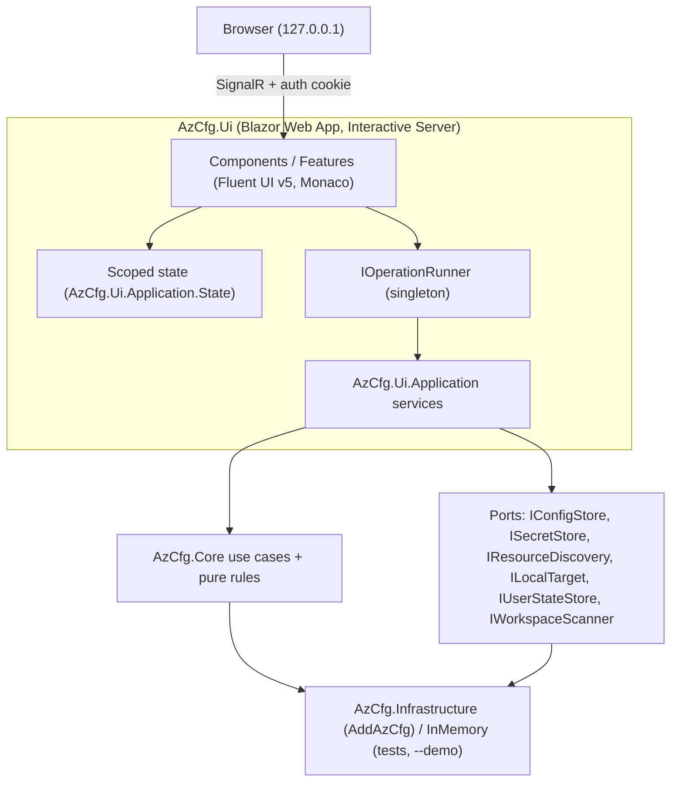
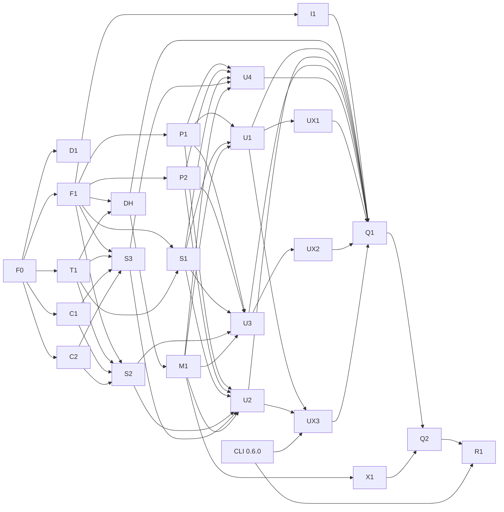

# AzCfg UI — MVP implementation plan

Self-contained plan for an **orchestrator agent**. It hands the tasks of §10 to executor agents that have no other
context than the repository, `CLAUDE.md` and this file. §0 is for the orchestrator; everything else is reference
material that task briefs point to (field **Read**).

Baseline: `master` @ `15419ba` (2026-11-18). Notation: **[exists]** — already in code; **[new]** — introduced here.
`G*` — gaps (§4), `AD-*` — architecture decisions (§5), `FR-*` — requirements (§1.3), `F0…Q2` — tasks (§10).

### Revision 2026-11-21 (scope review, `docs/cli-roadmap.md` §8)
- **One trunk.** From M1 on, UI tasks branch from `origin/master` and PR into `master`; `dev`, `release/*` and the merge
  tasks M2/M3 are gone (`docs/mvp-plan.md` «Гілки», «Сесії оркестратора»). CLI 0.5.0 is merged by M1.
- **More UI instead of speculative CLI scope:** UX1 Problems panel, UX2 consistency matrix + copy to environment
  (FR-C5 becomes MVP), UX3 editable `local.settings.json` + share with team (`azcfg.json`). R1 is the 0.7.0 release PR.
- Orchestrator sessions: session 0 = M1; session 1 = U1–U4; session 3 = UX1–UX3, X1 → Q1 → Q2 → R1 (CLI 0.6.0 runs as
  session 2, in parallel with session 1).

### What changed against the previous revision (review summary)
- **UX:** three working modes inside one project tab — **Browse / Compare / Sync** — with a persistent inspector and a
  *draft* of pending Azure edits, instead of opening a separate review tab per action. Environment ↔ environment
  compare added (§2).
- **Reuse instead of hand-made code:** Microsoft **Fluent UI Blazor v5** replaces ~25 self-written components
  (dialogs, toasts, data grid, splitters, menus, icons, key handling, theming). Hosting follows the **.NET Aspire
  dashboard** pattern (Blazor Server + Fluent UI + one-time browser token → cookie) using ASP.NET Core cookie
  authentication instead of custom middleware; host tests use `WebApplicationFactory`; `.sln/.slnx` parsing uses
  Microsoft `SolutionPersistence` (§5.4, §6).
- **One source of truth for rules:** apply gate, plan subset, edit-JSON patching, environment comparison, conflict
  resolution and stale-edit protection live in **Core** (TDD, reusable by the CLI). The UI Application layer only
  orchestrates (§7.1).
- **Stale Remote JSON** is fixed in Core by a 3-way base (`PushSource.EditedJson.BaseJson`) instead of a UI-side
  "remote changed" detector (G14).
- **Testability:** `AzCfg.Ui.Application` is a plain class library (no Razor/ASP.NET); the in-memory Azure adapters
  move from CLI tests into Infrastructure and power both tests and a **`--demo` mode** — the UI runs without Azure,
  so agents and reviewers can see every screen (G36).
- **Simpler:** no raw local-file editor (inspector edits local values through `ILocalTarget`), no single-instance
  lock, three tab kinds (Welcome / Project / Settings), no custom `shortcuts.js`.
- **Defects of the previous revision fixed:** UI ADR numbers collided with 0008/0009 (→ 0010/0011, G34); saving
  *resolved* environments would corrupt profile labels/mode (G26); `Ctrl+W`/`F5` are browser-reserved (G31); PR base
  `dev` is 35 commits behind `master` (G32); environment mode (stores/labels) could not be set without the CLI (FR-E1).

---

## 0. Orchestrator protocol

### 0.1 F0 — before the first wave (orchestrator itself, each push only with the user's OK)
1. `git fetch origin`. If `git rev-list --count origin/dev..origin/master` > 0, ask the user, then fast-forward:
   `git push origin origin/master:refs/heads/dev` (never force; if rejected — stop and ask).
2. From `origin/dev` create `chore/ui-packages`; add to `Directory.Packages.props` (versions verified on nuget.org
   2026-11-18):

   | Package | Version | Used by |
   | --- | --- | --- |
   | `Microsoft.FluentUI.AspNetCore.Components` | 5.1.0 | AzCfg.Ui |
   | `Microsoft.FluentUI.AspNetCore.Components.Icons` | 5.1.0 | AzCfg.Ui |
   | `BlazorMonaco` | 3.5.0 | AzCfg.Ui |
   | `Microsoft.VisualStudio.SolutionPersistence` | 1.0.52 | AzCfg.Infrastructure |
   | `Microsoft.Extensions.Hosting.Abstractions` | 10.0.10 | AzCfg.Ui.Application |
   | `bunit` | 2.15.2 | AzCfg.Ui.Tests |
   | `Microsoft.AspNetCore.Mvc.Testing` | 10.0.10 | AzCfg.Ui.Tests |
   | `Microsoft.Extensions.TimeProvider.Testing` | 10.10.0 | AzCfg.Ui.Tests |

   ASP.NET/Extensions packages stay on the same patch as the existing `Microsoft.Extensions.*` pins (10.0.10) to avoid
   NU1605 downgrade errors (warnings are errors). `dotnet build AzCfg.slnx` + `dotnet test AzCfg.slnx` green → PR into
   `dev` → the user merges.

### 0.2 Cycle
1. Pick the tasks of §10 whose **Depends on** are all merged into `origin/master` (status in 0.7; waves in §11.2).
   Before M1 is merged the base was `origin/dev`; from M1 on it is `origin/master` (0.4).
2. Start one executor per task in its **own git worktree** with the brief of 0.3. In parallel only tasks of one wave
   (their files do not overlap, §11.3). Start the biggest task of a wave first (W1: F1, W2: P1).
3. When an executor returns a PR — check it with 0.5.
4. Merging into `master` is done by the user (or by the orchestrator only with the user's explicit permission). After a
   merge update 0.7 and start the unblocked tasks from a fresh `origin/master`. A merge publishes nothing unless it
   changes `<Version>` (`--skip-duplicate`).
5. A blocker or a contract deviation → 0.6. Never decide for the executor when the decision changes a contract.

### 0.3 Executor brief (substitute `<ID>`, `<title>`, `<slug>`, `<Read>`; add nothing else)
```text
You implement task <ID> "<title>" in the AzCfg repository (.NET 10). Code, comments, commits: English.

Context (read only this):
1. CLAUDE.md (layer rules, security, conventions).
2. docs/ui-mvp-plan.md: §9 (coding rules), the block of task <ID> in §10, and sections <Read>.
3. Code: only the files named in the task, plus the nearest sibling file/test as a style sample.
4. UI tasks (P1, P2, U*): docs/ui-components.md once it exists. Do not use Fluent UI or BlazorMonaco APIs from memory —
   Fluent UI v5 differs from v4; check the package XML docs under ~/.nuget/packages/<package>/<version>/lib/net10.0/.

Git (you are in your own worktree; never check out master — another worktree holds it):
  git fetch origin && git switch -c feature/ui-<id>-<slug> origin/master
Then follow skill /feature from step 2 (tests first, build/test, commit, push, PR into master).

Rules:
- Change only the files in the task's "Files" field, plus `- [ ] **<ID>` → `- [x]` in docs/ui-mvp-plan.md §10.
- The contracts of §7 are binding 1:1. If one cannot be met — stop and return a blocker (what, why, proposed change)
  without committing.
- No packages beyond §6, no mock libraries, no changes to Directory.Packages.props / AzCfg.slnx unless the task names them.
- Secret values never reach logs, exceptions, markup before Reveal, ToString or JSON.
- `dotnet build AzCfg.slnx` without warnings, `dotnet test AzCfg.slnx` green, `dotnet format AzCfg.slnx --verify-no-changes`
  clean before committing.
- UI tasks: run `dotnet run --project src/AzCfg.Ui -- --demo` (after DH is merged) and check your screens; if you cannot,
  say so under "not verified".

Reply (only this): PR URL; 1–3 bullets of what was done; deviations from the plan (or "none");
what is not verified (e.g. manual browser check).
```

### 0.4 Branches, worktrees, PRs
- One task = one branch `feature/ui-<id>-<slug>` from `origin/master` = one PR into `master` (from M1 on; earlier tasks
  went into `dev`).
- A dependent task starts only after its dependencies are merged into `origin/master` (never from another agent's branch).
- CI (`ci.yml`, build/test/format) runs on every PR since CLI 0.5.0 (H0); the orchestrator still checks 0.5 locally.
- The UI is in `master` but not in the NuGet package until X1 adds `azcfg ui` (`AzCfg.Cli` does not reference
  `AzCfg.Ui` before that); the package changes only with a `<Version>` bump (R1).
- CLI 0.6.0 (`docs/mvp-plan.md` stage 10) runs in parallel with U1–U4 in another session; its files do not overlap the UI.

### 0.5 PR checklist
1. `gh pr diff <N> --name-only` — only the task's "Files" (+ its `[x]` line in this plan).
2. In a worktree of the PR branch: `dotnet build AzCfg.slnx -v q --nologo`, `dotnet test AzCfg.slnx -v q --nologo`,
   `dotnet format AzCfg.slnx --verify-no-changes`.
3. Every "Acceptance" item is covered by a test whose name matches it (except items marked *manual*).
4. Signatures of §7 unchanged (or changed in the same PR together with §7, after 0.6).
5. Grep the diff: no `Reveal()` outside Core, the `SecretValue` component and `LocalValuesService.SetSecretAsync`;
   no logging of `PlanRequest`/`PushSource`/`RemoteDraft`/values/tokens; no `static` mutable state; no
   `PackageReference` with a version; no hex colours in `.razor`/`.razor.css` (only `app.css` defines `--az-*`).
6. Move the executor's "not verified" items into the Q2 smoke checklist.

### 0.6 Blockers and contract changes
- A clarification that changes no signature (message text, private helper) — the executor decides and lists it under
  "deviations".
- A change of a §7 signature — only via the orchestrator: find affected tasks (§11.3), update §7 in a PR
  `docs/ui-plan-contract-<slug>` (or in the task PR), restart affected unmerged tasks with a new brief.
- An executor failed twice on the same task — split it at the "Application / UI" boundary and tell the user.
- F1 spike fails (Fluent UI 5.1.0 or BlazorMonaco 3.5.0 broken on net10) → try Fluent 5.0.1; still broken → ask the
  user about Fluent 4.14.5 (R4). Only P1/U* components are affected.

### 0.7 Status
| ID | Task | Depends on | Wave | Status |
| --- | --- | --- | --- | --- |
| F0 | Sync `dev` with `master`, package versions | — | W0 | [x] |
| D1 | ADR 0010, 0011 | F0 | W1 | [x] |
| C1 | Core: pure helpers (patch, selection, comparer) | F0 | W1 | [x] |
| C2 | Core: sync use cases (pull selected, resolve, read remote, base JSON, guard) | F0 | W1 | [x] |
| T1 | In-memory adapters → Infrastructure | F0 | W1 | [x] |
| F1 | UI scaffold, contracts, state, `AzureErrors`, spike | F0 | W1 | [x] |
| I1 | Infrastructure: credential, state lock, scanner | F1 | W2 | [x] |
| P1 | UI platform: theme, workbench, tree-grid, palette | F1 | W2 | [x] |
| P2 | Host security + Monaco | F1 | W2 | [x] |
| S1 | Application: workspace, environments, Azure status, operations | F1, T1 | W2 | [x] |
| S2 | Application: configuration, compare, local values, reveal | F1, T1, C1, C2 | W2 | [x] |
| S3 | Application: sync workflow, drafts | F1, T1, C1, C2 | W2 | [x] |
| DH | Demo mode | F1, T1 | W2 | [x] |
| M1 | One trunk: `dev` ↔ `master` (CLI 0.4.0 + 0.5.0), Application delegates to Core | DH | W2.5 | [ ] |
| U1 | UI: workspace, environments, settings | P1, S1, M1 | W3 | [ ] |
| U2 | UI: project tab + Browse | P1, P2, S1, S2, S3, M1 | W3 | [ ] |
| U3 | UI: Compare | P1, P2, S1, S2, M1 | W3 | [ ] |
| U4 | UI: Sync + make active | P1, P2, S1, S3, M1 | W3 | [ ] |
| UX1 | UI: Problems panel | U1 | W4 | [ ] |
| UX2 | UI: consistency matrix + copy to environment | U3 | W4 | [ ] |
| UX3 | UI: editable `local.settings.json` + share with team | U1, U2, CLI 0.6.0 | W4 | [ ] |
| X1 | Distribution: `azcfg ui` in the CLI tool | M1 | W4 | [ ] |
| Q1 | Integration and security tests | I1, DH, U1–U4, UX1–UX3 | W4 | [ ] |
| Q2 | Docs, polish, measurements, smoke checklist | Q1, X1 | W5 | [ ] |
| R1 | Release CLI 0.7.0 (`azcfg ui` preview) | Q2, CLI 0.6.0 | W6 | [ ] |

---

## 1. Product and scope

### 1.1 Product
**AzCfg UI** is a local developer workspace on top of `AzCfg.Core`/`AzCfg.Infrastructure`: open a folder with .NET
projects, bind a project to a service in Azure App Configuration, browse an environment's configuration, compare it
(local ↔ Azure, environment ↔ environment), edit it and synchronise local files with Azure with a preview.

Model: **Project → Environment → Sources**.

| Level | What | Where from |
| --- | --- | --- |
| Project | `.csproj` + `ProjectBinding` (service, targets, vault per env, active env, ignore) | `IWorkspaceScanner`, `IProjectService`, `projects.json` |
| Environment | `ConfigEnvironment(Name, StoreEndpoint, Label, IsProtected, WriteLabel)`; mode `UserProfile.Mode` (ADR 0008) | `profile.json` (one per user) |
| Sources | local targets (user-secrets, `appsettings.local.json`), App Configuration store, Key Vaults of KV references | `ILocalTarget`, `IConfigStore`, `ISecretStore` |

App Configuration and Key Vault are one source per environment: a secret exists in the UI only as a KV reference;
the vault comes from the reference URI (ADR 0005). There is no "browse a whole Key Vault" view.

### 1.2 Goals and non-goals
**Goals:** every CLI scenario (`init`, `pull`, `use`, `plan`, `push`, `edit`, `ignore`, `config`) available in the UI
without the CLI; tree + JSON view; compare; selective sync; conflicts; secrets never reach the browser before an
explicit Reveal; protected environments read-only by default; demo mode without Azure.

**Non-goals (MVP):** a separate promote flow (Compare "copy to ‹env›" covers it, UX2), environment rename,
raw editing of local files in the UI, creating Key Vaults, vault ranking, light theme, remote/multi-user access,
browser E2E (Playwright), a separate UI package or installer (the UI ships inside the `azcfg` tool as `azcfg ui` —
X1), cross-process lock CLI ↔ UI.

### 1.3 Functional requirements
**[MVP]** is part of the DoD; **[S]** — stretch.

Workspace
- FR-W1 [MVP] Open folder: server-side folder browser (AD-1), path input with completion, recent and pinned folders.
- FR-W2 [MVP] Scan `.sln`, `.slnx`, `.csproj` (G2): tree Solution → Project → config files; projects outside any
  solution under "Projects"; a project in several solutions under each; libraries/test projects dimmed (no targets).
- FR-W3 [MVP] Config files shown: `appsettings.json`, `appsettings.{Env}.json`, `appsettings.local.json`, user-secrets,
  `local.settings.json` (read-only until UX3 makes it a target, CLI 0.6.0); badges "values"/"secrets" on bound targets.
- FR-W4 [MVP] Project status: unbound / bound (service, active env); change counters once a view is loaded.
- FR-W5 [MVP] Bind / re-bind wizard: service (candidates, confident one preselected, free text), values target,
  secrets target (only `IsSafeForSecrets`, disabled ones with the reason); re-bind keeps vaults, active env and
  ignore patterns (G5, G19).
- FR-W6 [MVP] Recent folders: remove (bindings untouched), pin.
- FR-W7 [MVP] Share the binding with the team: write `azcfg.json` (`project.shared`), "shared" badge; a project with a
  manifest opens bound without the wizard (UX3, ADR 0012 amendment 2).

Environments
- FR-E1 [MVP] First-run wizard: mode (one store per environment / one store + labels), discovery candidates, names,
  `IsProtected` (default from `IsProtectedByName`), labels in label mode (offered from the store), manual endpoint.
- FR-E2 [MVP] Settings: add/remove environments, edit endpoint/label/protected, default label, `gitignoreLocalFiles`;
  no rename (G15).
- FR-E3 [MVP] Kind and colour (Development/Staging/Production/Custom), derived (`EnvironmentRules.KindOf`).
- FR-E4 [MVP] *Select* an environment to view (no side effects) vs *Make active* (= `azcfg use`, writes local files).
- FR-E5 [MVP] Vault for new secrets per environment (`VaultByEnvironment`).
- FR-E6 [MVP] Status: account; per environment Connected / Checking / Auth required / Forbidden / Unreachable.

Browse
- FR-B1 [MVP] Key tree-grid (segments by `:`): Key / Local / Azure·env / Status; branch counters; virtualised.
- FR-B2 [MVP] Search (key + plain values, never secret values) and filters (changed, secrets, ignored, scope).
- FR-B3 [MVP] Inspector: key, scope (+ "overrides global" with the global value), label, type, local value + source
  target + `//@global` marker, remote value or KV reference (vault host, secret name), status, warnings, Reveal (30 s).
- FR-B4 [MVP] Azure edits go into the environment's draft: edit value, add key (service; global with confirmation),
  delete, set secret value, move to Key Vault, revert; draft bar with the count → Review.
- FR-B5 [MVP] Local edits: set/remove a local value, toggle the `//@global` marker, ignore locally / stop ignoring.
- FR-B6 [MVP] Tree ↔ JSON: Azure JSON = the draft in Monaco (editable, schema, diagnostics); Local JSON read-only
  (secrets as `***`).
- FR-B7 [MVP] Non-active environment → remote-only view + "Make active" bar.

Compare
- FR-C1 [MVP] Sides: Local or any environment on each side; default Local ↔ active env; swap.
- FR-C2 [MVP] Grid Key / Left / Right / Result (same, different, only left, only right); "differences only" (default);
  counts.
- FR-C3 [MVP] JSON diff (Monaco diff editor) of both sides; secrets as references (Azure) or `***` (local).
- FR-C4 [MVP] Secrets compared without exposing values: local ↔ Azure by fingerprint, Azure ↔ Azure by secret name.
- FR-C5 [MVP] "Copy to <right env>" for plain values (adds to the right environment's draft) — UX2.
- FR-C6 [MVP] Consistency matrix: keys × all environments, gaps only, copy from another environment — UX2.

Health
- FR-H1 [MVP] Problems panel: the `status --check` report (sign-in, access, unsafe targets, dead references, missing
  keys, binding mismatch, manifest, secret-like keys in tracked files) with actions — UX1.

Sync
- FR-S1 [MVP] Push local files → **active** env: conflicts, changes with checkboxes, warnings; "Include deletions"
  (default off = upsert).
- FR-S2 [MVP] Pending edits (draft) → selected env: same list and apply.
- FR-S3 [MVP] Pull active env → local: incoming changes with checkboxes; Pull selected / Pull all (blocked handling).
- FR-S4 [MVP] Conflicts: base/local/remote; Keep local / Keep remote; a conflict blocks only its own key.
- FR-S5 [MVP] Apply: summary; protected → typed name; touches global → checkbox; requires vault → vault picker;
  failures (412) → "Refresh plan".
- FR-S6 [MVP] Make active: first-pull overwrite warning (G20), blocked → Push first / Discard local changes / Cancel;
  protected → warning that its secrets will be written locally.
- FR-S7 [MVP] Sync summary (⇡ local, ⇣ remote, ! conflicts) in the project header and the status bar.

Security, protected environments
- FR-X1 [MVP] Protected env read-only until "Unlock editing" (per browser tab, per env); red top border, lock,
  PROTECTED badge.
- FR-X2 [MVP] Secret values never rendered before Reveal; auto-hide after 30 s, on tab change and on dispose.
- FR-X3 [MVP] Loopback host with a one-time token (AD-1).

General
- FR-U1 [MVP] Dark theme. FR-U2 [MVP] Tabs keep state. FR-U3 [MVP] Command palette, quick open, keyboard (§2.10).
- FR-U4 [MVP] Notifications, loading/empty/error states (§2.9). FR-U5 [MVP] Responsive (§2.11).
- FR-U6 [MVP] `--demo` mode on in-memory Azure, never touching real Azure or real user state (DH).

---

## 2. UX specification

### 2.1 Principles
- **Dark-first developer workspace**, visual language of VS Code, Postman and Infisical. Fluent 2 dark theme as the
  base, brand/accent `#5B9DFF`.
- **Compact and information-dense:** 28 px rows, 13 px UI text, monospace keys/values, small (24 px) controls. No
  cards, no hero blocks, no illustrations, no oversized buttons; an empty state is one line of text + one action.
- **Three modes, no screen hopping:** Browse / Compare / Sync live in one project tab and switch in place (`Alt+1/2/3`)
  keeping the environment, filter and selected key. An operation never navigates away from the project.
- **Context always visible:** environment colour pills, sync summary in the tab header and status bar, inspector on
  the right always describing the selected key.
- **Non-intrusive notifications:** results → toast; view-blocking errors → inline message bar with Retry; long
  operations → status bar.
- **Visible safety:** secrets masked with a key icon; protected environment framed red with a lock; destructive actions
  confirmed; production apply needs the typed name.
- **Keyboard-first:** command palette, quick open, shortcuts for modes and main actions.

### 2.2 Workbench layout
```
┌────┬──────────────────────┬──────────────────────────────────────────────────────────────────────────────────┐
│ ▣  │ EXPLORER             │ [⌂ Welcome] [◆ Orders.Api ●] [⚙ Settings]                                         │
│ ⌕  │ ▾ WORKSPACE · Shop   ├──────────────────────────────────────────────────────────────────────────────────┤
│ ⚙  │  ▾ ◫ Shop.slnx       │ ◆ Orders.Api · orders   (dev ●)(stage)(prod 🔒)   [Browse│Compare│Sync 4]  ⇡2 ⇣1 !1 ⟳ │
│    │   ▾ ◆ Orders.Api dev │ ⌕ filter keys…   ☐ changed ☐ secrets ☐ ignored  scope ▾        [Tree│JSON]  ＋     │
│    │      appsettings.json│ ┌──────────────────────────────────────────────────────┬───────────────────────┐ │
│    │      appsettings.lo… │ │ KEY                    LOCAL          AZURE · dev  ST │ ConnectionStrings:Db  │ │
│    │      user-secrets 🔑 │ │ ▾ ConnectionStrings                                1M │ ● modified locally    │ │
│    │   ▸ ◆ Billing.Worker │ │     Db                 🔑 ••••••      🔑 orders-db  M │ scope service · no lbl│ │
│    │   ▸ ◇ Shop.Contracts │ │ ▾ Logging:LogLevel                                 1⇣ │ LOCAL  🔑 •••••• 👁    │ │
│    │ ▾ ENVIRONMENTS       │ │     Default            Information    Warning      ⇣ │   user-secrets        │ │
│    │  ● dev   connected   │ │ ▸ Features                                       2 ● │ AZURE  🔑 kv-shop-dev  │ │
│    │  ● stage connected   │ │     Payments:Enabled   true           false        ! │   /orders-db  👁       │ │
│    │  🔒 prod  sign in    │ │                                                      │ [Edit] [Set secret]   │ │
│    │ ▾ RESOURCES          │ │                                                      │ [Revert] [Delete]     │ │
│    │  dev  appcs-shop-dev │ └──────────────────────────────────────────────────────┴───────────────────────┘ │
│    │       kv-shop-dev    │ ▌ 3 pending edits to dev        [Discard]  [Review ▸]                              │
├────┴──────────────────────┴──────────────────────────────────────────────────────────────────────────────────┤
│ 👤 dev@contoso.com ● │ Orders.Api · dev ⇡2 ⇣1 !1 │ ⟳ Reading dev…                       │ DEMO │   Ctrl+K   │
└───────────────────────────────────────────────────────────────────────────────────────────────────────────────┘
```
Sizes: activity bar 48 px; sidebar 280 px (resizable 200–480, `Ctrl+B`); inspector 340 px (resizable 260–560,
`Alt+I`); tab strip 32 px; project header 36 px; toolbar 32 px; rows 28 px; status bar 24 px.

### 2.3 Sidebar (one Explorer view with collapsible sections, VS Code style)
- **WORKSPACE** — header: folder name + Open folder, Refresh, Collapse all. Tree Solution → Project → config files;
  loose projects under "Projects". Project row: icon (application ◆, library/test ◇ dimmed), name, on the right the
  active-env pill (bound) or muted "unbound", counters ⇡⇣! when known. Click opens/activates the project tab. Context
  menu: Open, Bind… / Binding settings…, Make ‹env› active ▸, Copy path. Config file rows are informational (badges
  values/secrets; `local.settings.json` with tooltip "read-only, not supported yet"); context: Copy path.
- **ENVIRONMENTS** — row per environment: colour dot by kind, name, detail (store host, or label in label mode),
  connection state; protected → lock. Click selects that environment in the active project tab. Context: Check
  connection, Copy endpoint, Make active (for the active project). Header action: Manage → Settings tab.
- **RESOURCES** — per environment: App Configuration store host and the Key Vault for new secrets of the selected
  project ("not set — Choose…"); "Discover in Azure…" lists stores and vaults from Resource Graph with Copy buttons.
- Activity bar: Explorer, Search (opens the palette), Settings; account avatar at the bottom.

### 2.4 Project tab
- **Header:** project name · service; environment pills (all environments; `●` marks the *active* one = reflected in
  local files; the *selected* one is highlighted); mode switch Browse │ Compare │ Sync (Sync shows the number of
  pending items); summary ⇡ local changes ⇣ remote changes ! conflicts (selected env when it is active);
  Refresh (`Alt+R`); lock button for protected envs; overflow: Binding settings, Make ‹env› active.
- **Selected ≠ active:** info bar "Viewing stage — remote only. Local files reflect dev. [Make stage active]".
- **Protected env:** 2 px top border `--az-env-prod` around the body; header "PROTECTED · read-only [Unlock editing]";
  after unlock "Editing unlocked [Lock]". Unlock lasts for this browser tab only.
- **Body** = the mode view. Each mode renders its own inspector content in the same right pane (same width, same
  `Alt+I` toggle); the selected key is shared across modes.
- **Draft bar** (bottom; only when the selected env has pending edits): "N pending edits to ‹env› [Discard] [Review ▸]";
  Review switches to Sync › Pending edits.
- **Tab:** title = project name; dirty dot when any environment of the project has pending edits; closing a dirty tab
  asks "Discard N pending edits?".

### 2.5 Browse mode
- **Toolbar:** search (`Ctrl+F`; key and plain values, highlights matches), toggles Changed / Secrets / Ignored, scope
  (All / Service / Global), Tree │ JSON, expand/collapse all, Add key (`+`).
- **Columns:** Key (tree indent, monospace) │ Local (value or mask; source icon user-secrets/appsettings.local; `global`
  badge for `//@global`) │ Azure · ‹env› (value or KV reference `kv-host/secret-name`) │ Status (A/M/D local in diff
  colours, ⇣ remote change, ! conflict, `ignored` muted, accent dot = pending draft edit). Branch rows show aggregate
  counts. Remote-only: Local and Status columns hidden (draft dots stay).
- **Interactions:** click selects (inspector); double-click on the Azure cell or `F2` → inline edit (plain) into the
  draft; `Del` → delete into the draft; context menu: Edit value, Set secret value…, Move to Key Vault, Revert, Delete,
  Copy key, Copy value (plain), Ignore locally / Stop ignoring, Mark as global / service (local marker), Compare across
  environments (→ Compare with this key selected).
- **JSON view:** sub-toggle Azure │ Local. Azure = the draft edit JSON in Monaco (schema + diagnostics; read-only while
  protected and locked); edits update the draft after 250 ms; invalid JSON keeps the last valid draft and shows
  diagnostics. Local = read-only nested JSON of local values (secrets `***`).
- **Inspector:** key path (copy), status chip, scope (+ "overrides global: ‹value›"), label, warnings for the key
  (duplicate labels, label override); Local section (value masked + Reveal, source target, global marker toggle,
  Edit / Remove); Azure section (value or KV ref with vault host and secret name, Reveal, Edit / Set secret value /
  Move to Key Vault / Delete); Draft section when pending (before → after, Revert).

### 2.6 Compare mode
- **Toolbar:** Left [Local │ dev │ stage │ prod ▾] ⇄ Right [… ▾], swap; default Local ⇄ selected env when it is
  active, else active env ⇄ selected env; "Differences only" (on); search; Tree │ JSON diff.
- **Grid:** Key │ Left │ Right │ Result (`=` muted, `≠` warning colour, `←` only left, `→` only right). Toolbar counts:
  "12 different · 3 only left · 1 only right".
- **Secrets:** local ↔ Azure by fingerprint ("same secret value" / "different secret value"); Azure ↔ Azure by
  reference name ("values not compared"). Ignored keys are excluded (count shown as a hint).
- **JSON diff:** read-only Monaco diff editor of `LeftJson` / `RightJson`.
- **Inspector:** both values side by side with scope/label/vault; Open in Browse; [S] Copy to ‹right env›.
- Loading local ↔ Azure fingerprints remote secrets: indeterminate progress "Reading secrets…".

### 2.7 Sync mode
- **Sub-views:** Push (Local → ‹active›) · Pull (‹active› → Local) · Pending edits (→ ‹selected›, only when a draft
  exists). When the selected env is not active, Push/Pull are disabled with "Make ‹env› active to sync local files".
- **Groups:** Conflicts first (not selectable; base / local / remote mini-table; [Keep local] [Keep remote]); Changes
  (checkbox per row + select all; Kind Add/Update/Delete/Secret, Key, before → after (plain), scope badge); Warnings
  (DeleteSkipped, LabelOverride, DuplicateLabels).
- **Push:** "Include deletions" toggle (off). **Pull:** incoming remote changes (selectable) + "local changes Pull all
  would overwrite" (info).
- **Inspector:** the selected row; small Monaco diff for plain before/after; secret rows show only "secret value will be
  set/changed".
- **Footer (sticky):** "3 of 5 changes · 1 secret · touches global" + primary action: Apply to ‹env› (`Ctrl+Enter`) /
  Pull selected (+ secondary Pull all…) / Apply edits to ‹env›. When disabled, a tooltip lists the reasons (nothing
  selected, vault required → "Choose vault…", confirmation needed). When the plan `RequiresVaultChoice`, the vault picker
  is shown above the list first.
- **Apply dialog:** summary table; protected → "Type ‘prod’ to confirm" (button enabled only on a case-insensitive
  match, Enter does not submit); touches global → checkbox "I understand this changes global keys shared by all
  services". Result: toast "Applied 3 changes to dev" or message bar "1 change failed: ‹key› changed in Azure (412)
  [Refresh plan]".
- After any write: the project's views are invalidated and the current sub-view re-previews.

### 2.8 Key flows
1. **First run (no profile):** Welcome tab shows a 3-step checklist (rows, not cards): ① Azure sign-in (state; "Run
   `az login`, then Retry") ② Set up environments [Set up…] ③ Open a folder [Open…]. Environment wizard
   (`FluentWizard`): mode → discovered stores table (name guessed, protected guessed, label options in label mode, Add
   manually) → review → Save.
2. **Open folder:** dialog with path input (completion), folder list (".NET" marker on folders with
   `.sln/.slnx/.csproj`), recent and pinned → background scan → tree.
3. **Bind:** click an unbound project → Bind wizard → after Bind "Pull ‹env› now?" → Make active flow.
4. **Make active** (= `azcfg use`): no active env and local targets have keys → confirm "N local keys will be replaced
   by ‹env›"; protected → warning "Secrets of ‹env› will be written to local files"; pull → blocked → dialog listing the
   local changes: [Push first] (opens Sync › Push) / [Discard local changes] (danger, force) / [Cancel].
5. **Edit in Azure:** Browse → edit (draft bar counts) → Review → resolve conflicts if Azure changed meanwhile → Apply.
6. **Push local changes:** edit files in the IDE or via the inspector → Sync › Push → select → Apply.
7. **Pull:** Sync › Pull → select → Pull selected.
8. **Conflict:** Keep remote (pulls that key) / Keep local (accepts Azure as the base; the key becomes an Update).
9. **Protected:** Unlock editing (confirm) → edit → Apply → typed confirmation.
10. **Compare dev ↔ stage:** Compare → pick sides → differences only → inspect.

### 2.9 Notifications, status, errors, states
- **Toasts** (`INotificationService`): success/info 5 s, warning 8 s, error until closed; at most 3 visible.
- **Message bars** (`FluentMessageBar`) inline for view-blocking errors with [Retry] and [Copy details] (exception type
  + message — Core never puts values into messages). Auth required → workbench-level bar "Azure sign-in required: run
  `az login`, then Retry".
- **Status bar:** account (state dot) │ selected project sync summary (click → Sync) │ running operation (spinner +
  title; click → popover with the last 20 outcomes) │ DEMO badge │ `Ctrl+K` hint.
- **Loading:** skeleton rows in grids, spinner inside buttons, indeterminate progress bar under the project header.
- **Empty (one line + one action):** "Open a folder to start", "Set up environments", "Bind this project to a
  service", "No keys for ‘orders’ in dev", "No differences", "Nothing to push", "Nothing to pull".

### 2.10 Keyboard
Never bind browser-reserved combinations (`Ctrl+W/T/N/Tab`, `Ctrl+Shift+T/N/W`, `F5`, `Ctrl+R`, `Ctrl+L`, `Alt+F4`) — G31.

| Keys | Command id | Action |
| --- | --- | --- |
| `Ctrl+K`, `Ctrl+Shift+P` | `workbench.palette` | Command palette (`>` commands, `#` projects, `@` keys, `env:` environments) |
| `Ctrl+P` | `workbench.quickOpen` | Go to project / key |
| `Ctrl+B` / `Alt+I` | `workbench.toggleSidebar` / `workbench.toggleInspector` | Toggle panes |
| `Alt+W` / `Alt+PageDown` / `Alt+PageUp` | `workbench.closeTab` / `workbench.nextTab` / `workbench.prevTab` | Tabs |
| `Alt+1` / `Alt+2` / `Alt+3` | `project.mode.browse` / `.compare` / `.sync` | Modes (Linux browsers that keep `Alt+1…8` for tab switching: use the mode switch or the palette) |
| `Alt+R` | `project.refresh` | Reload the current mode |
| `Ctrl+F` | `browse.find` | Focus search |
| `F2` / `Del` / `Alt+N` | `browse.edit` / `browse.delete` / `browse.addKey` | Edit selected / delete / add key |
| `Ctrl+S` | `draft.review` | Review pending edits (Sync › Pending edits) |
| `Ctrl+Enter` | `sync.apply` | Open the apply dialog / pull selected |
| `Shift+Alt+F` | `editor.format` | Format JSON in Monaco |
| `Esc` | — | Close overlay / clear search |

### 2.11 Responsive (desktop-first)
≥ 1280 px: full layout. 1024–1279: inspector becomes an overlay drawer (`Alt+I`). 768–1023: sidebar hidden by
default (activity bar + `Ctrl+B` overlay), JSON diff in inline mode. < 768: best effort — single column, tab strip
scrolls, header wraps. Never a horizontal page scroll.

### 2.12 Visual language
Fluent v5 dark theme + brand colour `#5B9DFF` (`IThemeService`); Fluent design tokens for everything Fluent styles.
Own tokens only where Fluent has none (`wwwroot/css/app.css`, names fixed):
```css
:root {
  --az-env-dev: #3fb68b; --az-env-stage: #e5a43b; --az-env-prod: #f0605d; --az-env-custom: #a78bfa;
  --az-diff-added: #3fb68b; --az-diff-modified: #e5a43b; --az-diff-deleted: #f0605d;
  --az-diff-conflict: #f472b6; --az-diff-remote: #5aa9e6; --az-draft: #5b9dff;
  --az-font-mono: "Cascadia Code", "JetBrains Mono", "SF Mono", Consolas, monospace;
  --az-row-h: 28px; --az-header-h: 36px; --az-tab-h: 32px; --az-statusbar-h: 24px;
  --az-activitybar-w: 48px; --az-sidebar-w: 280px; --az-inspector-w: 340px;
}
```
| State | Visual |
| --- | --- |
| LocalAdded / LocalModified / LocalDeleted | `A`/`M`/`D` in `--az-diff-added/modified/deleted` |
| RemoteAdded / RemoteModified / RemoteDeleted | ⇣ in `--az-diff-remote` |
| Conflict | `!` in `--az-diff-conflict`; always first in Sync |
| Pending draft edit | dot in `--az-draft` |
| Secret | key icon + `••••••` + eye (Reveal) |
| Global scope / label | badge `global` (informative) / neutral label badge |
| Connection | green Connected, amber Checking, red AuthRequired/Forbidden/Unreachable |
| Environment kind | pill colour `--az-env-dev/stage/prod/custom`; protected adds a lock |

Icons: Fluent UI System Icons (`Microsoft.FluentUI.AspNetCore.Components.Icons`), Regular Size16 in content, Size20
in the activity bar.

---

## 3. Code baseline (facts the UI relies on)

### 3.1 Layers
```
AzCfg.Core            BCL + ILogger. Model, Mapping, Environments, Sync, Abstractions (ports), UseCases. Never prompts/prints.
AzCfg.Infrastructure  Azure SDK, file system, user state; DI services.AddAzCfg() — all singletons.
AzCfg.Cli             Spectre.Console.Cli; composition of scenarios and prompts (the reference for UI Application).
```

### 3.2 Core API reused by the UI
| API | Facts |
| --- | --- |
| `ISyncService.PullAsync(binding, env, progress, force)` | Ensures gitignore (profile mode), checks the secrets target is safe, then: blocked (nothing written, `LocalChanges`) when local files differ from the snapshot of the **active** env; **no check at all when `ActiveEnvironment == null`** (G20). Rewrites targets fully (ignored keys keep local values), saves the snapshot, sets `ActiveEnvironment = env`. `Warnings`, `Ignored`. |
| `ISyncService.ExportJsonAsync` | Edit JSON (`ToEditJson`): secrets `{"@kv": name}`, global under `@global`. |
| `ISyncService.ExportPromoteJsonAsync` | Promote JSON (not used by the MVP UI). |
| `ISyncService.PlanPushAsync(binding, env, source)` | `LocalFiles(Delete=false)`: base = snapshot, upsert (local deletes → `DeleteSkipped`), ignored keys skipped. `EditedJson`: base = **current remote** (G14). New secret without a known vault → `CreateSecret` with `After == null`, `RequiresVaultChoice`. |
| `ISyncService.DiffAsync` | `ConfigDiff(Items: DiffItem(Key, Kind, Base, Local, Remote))`, ignored keys removed. **Resolves every remote secret sequentially** to fingerprint it (G13). Local values are always `StateValue.Plain` — secret-ness comes from the remote/base side or the target (AD-6). |
| `ISyncService.ApplyAsync(plan, ApplyOptions)` | Throws before any write on conflicts, `RequiresVaultChoice`, protected without typed name (ignore case), global without confirmation. KV first, then App Config. Without failures the snapshot is updated **only for the plan's keys**. |
| `IProjectService.ResolveAsync(repoPath)` | With a binding → `Existing`, empty `Candidates`/`TargetOptions` (G19). Candidates = prefixes of the `dev` store matched to project names. |
| `IProjectService.BindAsync(repoPath, service, values, secrets)` | Unsafe secrets target → `InvalidOperationException`; **resets** `VaultByEnvironment`, `ActiveEnvironment`, `Ignore` (G5). |
| `IProjectService.AddIgnoreAsync/RemoveIgnoreAsync` | Edit `binding.Ignore` only. |
| `ISetupService.DiscoverEnvironmentsAsync / SaveProfileAsync / ListLabelsAsync` | Environment wizard. |
| `IUserSettingsService` | `mode`, `defaultLabel`, `gitignoreLocalFiles`, `env.<name>.endpoint/label/protected`. |
| `IEnvironmentResolver.Resolve(profile)` | `ProfileEnvironmentResolver`. **Resolved** envs differ from profile envs (store mode: `Label = null`, `WriteLabel = env.Label ?? DefaultLabel`) — never save resolved envs back (G26). |
| `JsonProjection` | `ToNestedJson`, `ToNestedJsonText` (`//@global` markers), `ReadGlobalMarkers`, `ToEditJson`, `FromEditJson(json, fingerprinter, knownSecrets)` (`{"@kv": n}` unknown → `Secret(null, "")`; with `"value"` → `NewSecrets`). |
| `KeyMapper` | `ToStoreKey`, `TryParseStoreKey`, `ToKeyVaultSecretName` (`:` → `--`), `ToLocalJsonPath`, `FromLocalJsonPath`. |
| `LabelSelector.Select`, `ScopeMerger.Merge`, `IgnoreRules.IsIgnored/Normalize` | Label rules (ADR 0008), service overrides global, ignore patterns. |
| `SecretString` (`Reveal()`, `ToString()` = `***`, JSON `"***"`), `LocalValue` (redacted), `ISecretFingerprinter` | Secret policy. |
| `ConfigEnvironment.IsProtectedByName` | Protected suggestion. |

`ILocalTarget` for a binding is chosen as in Core: `targets.First(t => t.Kind == binding.X.Kind)`.

### 3.3 Infrastructure
- `AppConfigStore`, `KeyVaultSecretStore` (client per vault), `ResourceGraphDiscovery`, each with its **own**
  `DefaultAzureCredential` (G10).
- `CsprojDetector`: recursive, skips only `bin`/`obj` (G2); sets `IsLibrary` (ADR 0009).
- `AppSettingsLocalTarget`, `UserSecretsTarget` (base `JsonFileTarget`: read via `ConfigurationBuilder`, write
  `ToNestedJsonText`, full rewrite; `EnsureGitIgnoredAsync`).
- `JsonUserStateStore(root)`: `DefaultRoot = %APPDATA%/azcfg`; `profile.json`, `projects.json` (key
  `Path.GetFullPath`, ignore case on Windows), `snapshots/<sha256>/<env>.json`, `fingerprint.key`; atomic writes;
  **no locking** (G11).
- Error texts live in `AzCfg.Cli/CliErrors.Describe` (G9).
- Realistic in-memory port fakes exist in `tests/AzCfg.Cli.Tests/Scenario` (`InMemoryAppConfig` with labels and ETags,
  `InMemorySecretStore`, `InMemoryUserStateStore`, `InMemoryLocalTarget`, `FixedProjectDetector`,
  `FixedResourceDiscovery`, `RemoteSetting`) — moved to Infrastructure by T1.

### 3.4 CLI composition the UI reproduces
- Environment: `--env` → `binding.ActiveEnvironment` → `"dev"`; names compare `OrdinalIgnoreCase`.
- Bind: confident candidate → automatic; otherwise a choice; secrets only into a safe target.
- Push: conflicts → refuse; `RequiresVaultChoice` → pick from `FindKeyVaultsAsync` → save `VaultByEnvironment[env]` →
  re-plan; protected → typed name; `TouchesGlobal` → separate confirmation; `Warnings` shown.
- `use <env>` = `PullAsync(force: false)` → `Blocked` → show keys → `force: true` on consent.

---

## 4. Gaps and decisions

| # | Gap | Decision | Task |
| --- | --- | --- | --- |
| G1 | No `.sln`/`.slnx` parsing, no config-file discovery | Port `IWorkspaceScanner` (Core) + `WorkspaceScanner` (`SolutionPersistence`) | F1, I1 |
| G2 | `CsprojDetector` descends into `.git`, `node_modules`, … | Skip `.git`, `.vs`, `.idea`, `node_modules`, `bin`, `obj`, dot-folders | I1 |
| G3 | No list of opened folders | `<state-root>/ui/workspaces.json` | S1 |
| G4 | Binding keyed by `RepoPath`; a workspace has many projects | New binding: `RepoPath` = folder of the `.csproj`. Lookup: that folder, then ancestors up to the workspace root; an ancestor binding is accepted only if its `ValuesTarget.ProjectPath` or `SecretsTarget.ProjectPath` equals this `.csproj`; an accepted binding is used as is (its `RepoPath` keys the snapshots shared with the CLI) | S1 |
| G5 | `BindAsync` resets vaults/active/ignore | `WorkspaceService.BindAsync` re-saves the old `VaultByEnvironment`, `ActiveEnvironment`, `Ignore` | S1 |
| G6 | Pull is all-or-nothing | Core `ISyncService.PullSelectedAsync` | C2 |
| G7 | Selecting part of a push plan | Core `PlanSelection.Select` | C1 |
| G8 | `PushSource.EditedJson/Promote.ToString()` prints JSON that may hold secret values | `PrintMembers` → `Json = ***` | C2 |
| G9 | Azure error texts live in the CLI | `AzureErrors.Describe/Classify` in Infrastructure; `CliErrors` delegates | F1 |
| G10 | Three `DefaultAzureCredential`s; no sign-in check | One `TokenCredential` singleton; `AzureStatusService` probes a token | I1, S1 |
| G11 | `SaveBindingAsync` read-modify-write without a lock | `SemaphoreSlim(1,1)` in `JsonUserStateStore` (cross-process — R7) | I1 |
| G12 | `SyncProgress` never reported | Indeterminate progress | — |
| G13 | `DiffAsync` resolves secrets sequentially | View caches per project session + explicit Refresh; measure in Q2 (R3) | S2, Q2 |
| G14 | `EditedJson` uses the current remote as base → a long-open edit silently reverts others' changes | `EditedJson.BaseJson`: 3-way against the export the edit started from; drafts always carry it | C2, S3 |
| G15 | Snapshots/active/vault keyed by environment name | Rename not offered (remove + add) | U1 |
| G16 | Vault ranking not implemented | Searchable list (parity with the CLI) | U4 |
| G17 | `LocalSettingsTarget` not implemented | `local.settings.json` listed read-only until CLI 0.6.0 (LS1); then a target | I1, U1, UX3 |
| G18 | Default-environment rule lives in the CLI | `EnvironmentRules.SelectDefault` (same rule) | S1 |
| G19 | `ResolveAsync` of a bound project gives no candidates/targets → re-bind impossible | `ProposeSetupAsync` builds `TargetOptions` (`CanHandle` + `InspectAsync`, format `LocalSettings` → `FlatDictionary`, else `NestedJson`) and `Candidates` (`ListServicePrefixesAsync` of the default env, current service first), `IsConfident = false`, keeps `Existing` | S1 |
| G20 | First pull (no active env) silently overwrites existing local files | `UnmanagedLocalKeysAsync` → confirm before pull | S3, U4 |
| G21 | ASP.NET Core logs request URLs (with `?t=`) | `Logging:LogLevel:Microsoft.AspNetCore = Warning`; own code never logs the token | F1, P2 |
| G22 | Dynamic port known only after start | URL from `IServerAddressesFeature` on `ApplicationStarted` | P2 |
| G23 | Static registries = global state, break parallel tests | DI registrations (`TabRegistration`, …) | F1 |
| G24 | `ThreeWayDiff.SecretName` is internal | `KeyMapper.SecretNameOf` public | C1 |
| G25 | No Core operation to resolve a local-files conflict | `ISyncService.ResolveConflictAsync` | C2 |
| G26 | Saving resolved environments back would corrupt the profile | `IEnvironmentService` works on `UserProfile` | S1 |
| G27 | Remote-only browse and env ↔ env compare need entries without resolving secrets | `ISyncService.ReadRemoteConfigAsync` + `EnvironmentComparer` | C1, C2 |
| G28 | A UI apply gate would duplicate Core rules | `ApplyGuard` used by `ApplyAsync` and the UI | C2 |
| G29 | Singleton events arrive off the render thread and from other circuits | Rule: handlers → `InvokeAsync(StateHasChanged)`, unsubscribe in `Dispose` (§9) | all UI |
| G30 | A deleted environment may remain `binding.ActiveEnvironment` | `SelectDefault` ignores it; Settings warns when deleting an env active in open projects | S1, U1 |
| G31 | `Ctrl+W`, `F5`, … are browser-reserved | Keymap §2.10 | P1 |
| G32 | `dev` is 35 commits behind `master` | F0 fast-forward | F0 |
| G33 | `/feature` used to run `git switch dev`, failing inside a worktree | `/feature` and brief 0.3 branch from `origin/master` | — |
| G34 | ADR numbers 0008/0009 are taken | UI ADRs are 0010/0011 | D1 |
| G35 | Agents' knowledge of Fluent UI v5 is unreliable (GA 2026-09-28) | P1 writes `docs/ui-components.md` from the package XML docs; features copy its patterns | P1 |
| G36 | The UI cannot be seen without Azure | In-memory adapters in Infrastructure + `--demo` | T1, DH |

**Unchanged:** Core model, ports and existing services — Core changes are additive only (C1, C2, scanner types) and
TDD. CLI behaviour does not change (CLI tests are only touched for `ISyncService` stubs and the moved fakes).

---

## 5. Architecture

### 5.1 Diagram


### 5.2 Projects and layer rules
```
src/AzCfg.Ui.Application   classlib → Core, Infrastructure; pkg Microsoft.Extensions.Hosting.Abstractions.
                           NO Microsoft.AspNetCore.*, Microsoft.JSInterop, Fluent UI (architecture test, F1).
src/AzCfg.Ui               Microsoft.NET.Sdk.Web → Ui.Application; pkgs Fluent UI, Fluent Icons, BlazorMonaco.
tests/AzCfg.Ui.Tests       Microsoft.NET.Sdk.Razor → AzCfg.Ui; xunit, bunit, Mvc.Testing, TimeProvider.Testing.
```
- **Components/Features** render and interact. They inject only Application interfaces, State, `IOperationRunner`,
  `ICommandRegistry`, Fluent `IDialogService`/`INotificationService`/`IKeyCodeService`/`IThemeService` and the
  cross-feature flows (§7.5). Every IO call goes through `IOperationRunner.RunAsync`.
- **Application** orchestrates Core use cases and ports (the counterpart of CLI `*CommandBase`): view models, masking,
  UI safety rules (AD-6…AD-8). Plain classes, tested with xunit on **real** Core services + in-memory adapters.
  Exceptions: `ArgumentException` (bad input), `InvalidOperationException` (forbidden state); messages name keys,
  never values.
- **Application never re-implements a Core rule.** Anything that decides sync/apply semantics lives in Core (C1/C2).
- **State** — scoped (per circuit) observable containers with `event Action? Changed`.
- Core/Infrastructure rules of `CLAUDE.md` are unchanged.

### 5.3 Decisions
| ID | Topic | Decision |
| --- | --- | --- |
| AD-1 | Hosting | [new] Blazor Web App, global `InteractiveServer` with `prerender: false`. Kestrel only on `127.0.0.1:<--port or 0>`; `AllowedHosts=localhost;127.0.0.1`. Per run a 32-byte base64url token; the console prints `http://127.0.0.1:<port>/login?t=<token>` and the browser is opened with it. `GET /login?t=` validates with `CryptographicOperations.FixedTimeEquals`, signs in with ASP.NET Core **cookie authentication** (cookie `azcfg_ui`, HttpOnly, SameSite=Strict, session, Path=/) and redirects to `/`. A **fallback authorization policy** requires an authenticated user for every endpoint incl. `/_blazor`; static assets are anonymous; unauthenticated → 401 (no redirect). Headers: CSP `default-src 'self'; script-src 'self'; style-src 'self' 'unsafe-inline'; img-src 'self' data:; font-src 'self' data:; worker-src 'self' blob:; connect-src 'self' ws://127.0.0.1:*; frame-ancestors 'none'`, `X-Content-Type-Options: nosniff`, `Referrer-Policy: no-referrer` (relaxations needed by Monaco/Fluent are documented in ADR 0010). `HubOptions.MaximumReceiveMessageSize = 2 MB`, `DetailedErrors = false`, `Microsoft.AspNetCore` logs ≥ Warning (G21). Real URL from `IServerAddressesFeature` (G22). Options `--port N`, `--no-browser`, `--demo[=empty]`, `--state-root <dir>`. Pattern of the .NET Aspire dashboard. |
| AD-2 | Projects | [new] §5.2. `AzCfgUiApp.Build(args, overrides)` composes the app; `Program.cs` is one line, tests use `WebApplicationFactory<Program>`. |
| AD-3 | Components | [new] Fluent UI Blazor **v5** + Fluent icons. Custom components only where Fluent has no equivalent: workbench shell, tab strip, `KeyTreeGrid`, command palette, `EnvPill`/`EnvironmentSwitcher`, `SecretValue`, Monaco wrappers. No other UI library, no own JS except what BlazorMonaco needs. |
| AD-4 | State | [new] Scoped observable state (`WorkspaceState`, `TabsState`, `ProjectSessions`/`ProjectSession`, `ProtectedUnlockState`), no Fluxor. `ProjectSession` caches the Browse view, the comparison and the drafts of one project tab; caches are invalidated after pull/apply/local edit/profile change; drafts survive invalidation. Several browser tabs = independent circuits. |
| AD-5 | Edit model | [new] **Azure edits** (tree, inspector, JSON) → `RemoteDraft` per (project, env): `BaseJson` = export when the draft started, `Json` = edited edit JSON without secret values, `Secrets` = typed secret values (`SecretString`). Review = `PlanPushAsync(EditedJson(Json + injected secrets, BaseJson))` — Core does a 3-way merge, so concurrent Azure changes of untouched keys are never reverted and same-key edits become conflicts (G14). **Local edits** (inspector) are immediate writes through `ILocalTarget` (`ILocalValuesService`), then normal Push. |
| AD-6 | Secrets | [exists] `SecretString`, fingerprints, plans/snapshots without values. [new] (1) a secret value is never rendered before Reveal; (2) Reveal remote = `ISecretStore.GetAsync`, value only in a `SecretValue` component field, hidden after 30 s, on tab change and on `Dispose`; (3) a key is secret when its remote/base side is a secret **or** its local value comes from `SecretsTarget` while that differs from `ValuesTarget` (`SecretPolicy.IsSecret`) — local values from Core are plain strings, so this rule is mandatory everywhere a local value is shown; (4) search, palette and filters never index secret values; (5) logs contain only keys and operation titles; (6) a typed secret value goes straight into `SecretString`, reaches Core only via `"value"` of edit JSON built in `DraftService.ToPushSource`, and is dropped after apply/discard; (7) JSON shown in Monaco never contains secret values (`{"@kv": name}` or `***`). |
| AD-7 | Protected env | [exists] `IsProtected`, `ConfirmedEnvironment`, `ConfirmGlobal` in Core. [new] red frame + PROTECTED badge + lock; **read-only by default** — edit actions disabled until "Unlock editing" (`ProtectedUnlockState`, per circuit and env); apply → typed confirmation (button disabled until a case-insensitive match, no default Enter); pull from a protected env → separate warning. UI checks are an extra layer; Core makes the final check. |
| AD-8 | Active env | [new] Push of local files and Pull preview only for the **active** env (`InvalidOperationException` in Application otherwise); Browse of a non-active env is remote-only; Make active = the `use` flow (FR-S6). Drafts and Compare work for any env. |
| AD-9 | Long operations | [new] `IOperationRunner` (singleton): `Running`, `Recent` (last 20), exceptions mapped via `AzureErrors`. **Read** is cancelled by the component's token. **Write** (apply, pull, local edit, bind, save profile) ignores the UI token and runs with `ApplicationStopping` — closing a tab cannot cause a partial apply; action buttons are disabled while it runs; the outcome stays in `Recent` even if the circuit is gone. |
| AD-10 | Extensibility | [new] Feature modules register themselves via DI records (G23): `TabRegistration`, `ProjectModeRegistration`, `SidebarSectionRegistration`, `StatusBarItemRegistration`, `ICommandContributor`. Each feature has `Features/<X>/<X>Feature.cs`. Cross-feature calls go through small interfaces (`IActivationFlow`, `IBindingFlow`) with no-op defaults (`TryAdd`) replaced by the owning feature. Workbench renders via `DynamicComponent`. |
| AD-11 | Monaco | [new] `BlazorMonaco` (assets from the package, no CDN) wrapped by `CodeEditor`/`DiffEditor` — a switch to own interop touches only them (R5). Theme `azcfg-dark` matches §2.12. Schema `wwwroot/schemas/edit-json.schema.json`. Document limit 1 MB. |
| AD-12 | Demo and test seams | [new] In-memory adapters live in `AzCfg.Infrastructure.InMemory` (T1) with `AddAzCfgInMemory(world)`; `--demo` seeds a temp sample workspace and an in-memory Azure (DH); `UiHostOptions.StateRoot` keeps UI files out of the real state in demo/tests. |
| AD-13 | Errors | [new] `AzureErrors.Classify/Describe` (Infrastructure) → `OperationErrorKind` + message (Application) → message bar/toast (UI). Auth errors raise the workbench "sign in" bar. |

### 5.4 Alternatives considered
| Topic | Chosen | Rejected (why) |
| --- | --- | --- |
| Hosting | Blazor Server on loopback (one .NET stack, secrets stay server-side, runs anywhere, Aspire precedent) | MAUI Blazor Hybrid (no Linux, workload install); Photino.Blazor (small community — can wrap the same components later); Avalonia (full rewrite, no Monaco); SPA + API (two stacks, secrets cross an API) |
| Components | Fluent UI Blazor v5 (Microsoft, VS Code/Azure look, dialogs/toasts/grid/splitters/icons/keys/theme) | Hand-made kit (previous revision: ~25 components to build and test); MudBlazor (Material look, less IDE-like); Radzen (heavier, not the target look) |
| State | Scoped observable containers | Fluxor (boilerplate for a single-user local app) |
| Editor | BlazorMonaco | Own Monaco interop (fallback only); CodeMirror (no equivalent diff editor) |
| Stale edits | Core 3-way with `BaseJson` | UI re-export comparison (previous revision: detects but cannot merge) |
| Tests | xunit + bUnit + `WebApplicationFactory` + demo world | Playwright (browser install, slow — next iteration, cheap thanks to `--demo`) |

---

## 6. Libraries

| Package | Version | Project | Why |
| --- | --- | --- | --- |
| `Microsoft.FluentUI.AspNetCore.Components` | 5.1.0 (GA 5.0.0 on 2026-09-28) | AzCfg.Ui | Component library, theme, dialogs, toasts, keys |
| `Microsoft.FluentUI.AspNetCore.Components.Icons` | 5.1.0 | AzCfg.Ui | Fluent UI System Icons |
| `BlazorMonaco` | 3.5.0 (has `net10.0`) | AzCfg.Ui | Monaco editor + diff editor, local assets |
| `Microsoft.VisualStudio.SolutionPersistence` | 1.0.52 | AzCfg.Infrastructure | Official `.sln`/`.slnx` parser (used by the dotnet CLI) |
| `Microsoft.Extensions.Hosting.Abstractions` | 10.0.10 | AzCfg.Ui.Application | `IHostApplicationLifetime` for `OperationRunner` |
| `bunit` | 2.15.2 | AzCfg.Ui.Tests | Component tests |
| `Microsoft.AspNetCore.Mvc.Testing` | 10.0.10 | AzCfg.Ui.Tests | `WebApplicationFactory<Program>` host tests |
| `Microsoft.Extensions.TimeProvider.Testing` | 10.10.0 | AzCfg.Ui.Tests | `FakeTimeProvider` (30 s auto-hide, cache ages) |

**Fluent UI v5 facts verified in the 5.1.0 package XML docs** (P1 extends them in `docs/ui-components.md`):
- Setup: `builder.Services.AddFluentUIComponents()`; `<FluentProviders />` in the layout; stylesheet
  `_content/Microsoft.FluentUI.AspNetCore.Components/Microsoft.FluentUI.AspNetCore.Components.bundle.scp.css`; the
  package's `*.lib.module.js` loads automatically as a Blazor JS initializer; `@using Microsoft.FluentUI.AspNetCore.Components`
  and `@using Icons = Microsoft.FluentUI.AspNetCore.Components.Icons` in `_Imports.razor`.
- Services: `IDialogService` (`ShowConfirmationAsync`, `ShowDialogAsync<TDialog>(Action<DialogOptions>)`,
  `ShowDrawerAsync<T>`, `ShowMessageBoxAsync`, `CloseAsync(IDialogInstance, DialogResult)`); `INotificationService`
  (`ShowToastAsync(Action<ToastOptions>)`, `CloseAllToastsAsync`); `IKeyCodeService`
  (`RegisterListener(Func<FluentKeyCodeEventArgs, Task>)`, needs `FluentKeyCodeProvider`); `IThemeService`
  (`SetThemeAsync(ThemeMode.Dark)`, `SetThemeAsync(ThemeSettings{ Color, Mode })`).
- Components used: `FluentLayout`, `FluentMultiSplitter`(+`Pane`), `FluentAppBar`/`FluentAppBarItem` (activity bar),
  `FluentTabs`/`FluentTab`, `FluentTreeView`/`FluentTreeItem` (workspace tree, `LazyLoadItems`), `FluentDataGrid<T>`
  (`Virtualize`, `ItemSize`, `RowSize`, `OnRowClick`, `ItemKey`), `FluentMenu`/`FluentMenuButton`/`FluentMenuItem`,
  `FluentMessageBar`, `FluentToast`, `FluentDialog`/`FluentDialogBody`, `FluentWizard`/`FluentWizardStep`, `FluentButton`,
  `FluentSplitButton`, `FluentToggleButton`, `FluentTextInput`, `FluentCombobox`/`FluentSelect`/`FluentAutocomplete`,
  `FluentCheckbox`, `FluentSwitch`, `FluentBadge`/`FluentCounterBadge`, `FluentTooltip`, `FluentSpinner`,
  `FluentProgressBar`, `FluentSkeleton`, `FluentHighlighter`, `FluentStack`, `FluentText`, `FluentIcon<T>`,
  `FluentErrorBoundary`, `FluentPopover`, `FluentOverlay`.
- **Do not** use v4 names from memory (`FluentDesignTheme`, `IToastService`, `FluentDesignSystemProvider`, …).

---

## 7. Contracts

Binding 1:1 (change only via 0.6). XML `<summary>` in code carries the comments of these blocks. One type per file.

### 7.1 Core (additive)
```csharp
// ---- F1: AzCfg.Core.Abstractions / AzCfg.Core.Model (types only; implementation I1) ----
public interface IWorkspaceScanner
{
    /// Solutions (only .csproj entries, absolute paths), projects (via IProjectDetector) and well-known config files in
    /// each project folder. A broken solution file is skipped with a logged warning and never fails the scan.
    Task<WorkspaceScan> ScanAsync(string rootPath, CancellationToken ct);
}
public enum SolutionFormat { Sln, Slnx }
public sealed record SolutionInfo(string Path, string Name, SolutionFormat Format, IReadOnlyList<string> ProjectPaths);
public enum ConfigFileKind { AppSettings, AppSettingsEnvironment, AppSettingsLocal, LocalSettings, UserSecrets }
/// EnvironmentName only for AppSettingsEnvironment (appsettings.{Env}.json); UserSecrets: Exists = false when the file does not exist yet.
public sealed record ConfigFileInfo(string Path, ConfigFileKind Kind, string? EnvironmentName, bool Exists);
public sealed record WorkspaceProject(ProjectInfo Project, IReadOnlyList<ConfigFileInfo> ConfigFiles);
public sealed record WorkspaceScan(string RootPath, IReadOnlyList<SolutionInfo> Solutions, IReadOnlyList<WorkspaceProject> Projects);

// ---- C1: AzCfg.Core.Mapping ----
// KeyMapper — add:
/// Secret name of a Key Vault secret URI: the segment after "secrets/" (a version segment is ignored).
/// ArgumentException when the URI has no "secrets/<name>" segment. ThreeWayDiff.SecretName(Uri) delegates to it.
public static string SecretNameOf(Uri secretUri);

public sealed record ScopedKey(ConfigScope Scope, string Key);

/// Pure edits of edit-JSON text (format of JsonProjection.ToEditJson: nesting by ':', Global under "@global"; an object
/// with "@kv" is a leaf). Returns indented JSON (2 spaces); existing properties keep their order, new ones are appended.
/// Invalid JSON → JsonException; a path through a leaf, or a leaf where an object is (and vice versa) → ArgumentException
/// naming the key. Messages never contain values.
public static class EditJsonPatch
{
    public static string SetPlain(string editJson, ScopedKey key, string value);
    public static string SetSecretReference(string editJson, ScopedKey key, string secretName);          // {"@kv": name}
    /// {"@kv": name, "value": value}. The result contains the secret: pass it straight to Core; never store, log or render it.
    public static string SetSecretValue(string editJson, ScopedKey key, string secretName, SecretString value);
    /// No-op when missing; removes parents that become empty and an empty "@global".
    public static string Remove(string editJson, ScopedKey key);
    /// `target` with the node of `key` taken from `source` (removed from target when `source` has none).
    public static string CopyKey(string source, string target, ScopedKey key);
    /// Deep clone of the node of `key`, or null.
    public static JsonNode? Get(string editJson, ScopedKey key);
    /// Leaves that differ between two texts (added, removed or changed; a secret reference compares as its JSON),
    /// ordered by scope (Global first) then key, ordinal.
    public static IReadOnlyList<ScopedKey> ChangedKeys(string before, string after);
}

// ---- C1: AzCfg.Core.Sync ----
public static class PlanSelection
{
    /// Restricts `plan` to `keys` (ordinal): Changes whose (After ?? Before).Key is in keys, Conflicts and Warnings whose
    /// Key is in keys. A CreateSecret with Before == null and After == null (awaiting a vault, its key is unknown) is kept
    /// regardless of keys. Recomputes TouchesGlobal (a selected change other than Delete whose After or Before has Scope
    /// Global) and RequiresVaultChoice (a selected CreateSecret with After == null). Binding, Environment unchanged.
    /// Applying the result updates the snapshot only for the selected keys (existing ApplyAsync rule).
    public static SyncPlan Select(SyncPlan plan, IReadOnlySet<string> keys);
}
public enum ComparisonKind { Same, Different, OnlyLeft, OnlyRight }
/// One key of two effective configurations (after ScopeMerger). Secret values are never involved.
public sealed record ComparisonItem(string Key, ComparisonKind Kind, ConfigEntry? Left, ConfigEntry? Right);
public static class EnvironmentComparer
{
    /// Matches by Key (ordinal), ordered by Key. Plain↔Plain: ordinal value equality. KeyVaultRef↔KeyVaultRef (or
    /// ResolvedSecret, value ignored): equal KeyMapper.SecretNameOf (vault hosts may differ). Plain↔reference: Different.
    /// Scope and label do not affect Kind. A duplicate key within one side → ArgumentException naming the key.
    public static IReadOnlyList<ComparisonItem> Compare(IReadOnlyList<ConfigEntry> left, IReadOnlyList<ConfigEntry> right);
}

// ---- C2: AzCfg.Core.Sync ----
// PushSource — change:
/// Push from developer-edited JSON (azcfg edit, UI drafts). BaseJson = the edit JSON the edit started from. With BaseJson,
/// PlanPushAsync uses it (parsed with FromEditJson and the known secrets) as the 3-way base instead of the current remote:
/// Azure changes made after the export are not reverted, keys changed on both sides become Conflicts. Without BaseJson
/// the behaviour is unchanged (base = current remote).
public sealed record EditedJson(string Json, string? BaseJson = null) : PushSource;
// EditedJson and Promote get PrintMembers: "Json = ***" (+ "BaseJson = ***" or "BaseJson = null"; Promote keeps
// "FromEnvironment = <name>").

/// Effective remote configuration of a service in one environment, without secret values: Entries = after LabelSelector
/// (ADR 0008) and ScopeMerger (one entry per key, service overrides global), labels and ETags kept; Shadowed = global
/// entries hidden by a service override.
public sealed record RemoteConfig(ConfigEnvironment Environment, IReadOnlyList<ConfigEntry> Entries, IReadOnlyList<ConfigEntry> Shadowed)
{
    public IReadOnlyList<SyncWarning> Warnings { get; init; } = [];
}
public enum ConflictResolution { KeepLocal, KeepRemote }
public enum ApplyBlocker { Conflicts, VaultChoiceRequired, EnvironmentNotConfirmed, GlobalNotConfirmed }
public static class ApplyGuard
{
    /// Every reason ApplyAsync refuses `plan` with `options`, in this order; empty → ApplyAsync proceeds.
    /// SyncService.ApplyAsync calls it and throws InvalidOperationException with today's message of the first blocker.
    public static IReadOnlyList<ApplyBlocker> Check(SyncPlan plan, ApplyOptions options);
}

// ---- C2: AzCfg.Core.UseCases.ISyncService — add (CLI test stubs: => throw new NotSupportedException()) ----
/// Reads the remote configuration of binding.Service in env. Never calls ISecretStore.
Task<RemoteConfig> ReadRemoteConfigAsync(ProjectBinding binding, ConfigEnvironment env, CancellationToken ct);
/// Pulls only `keys` of `env`, keeping every other local value. `env` must equal binding.ActiveEnvironment
/// (OrdinalIgnoreCase), else InvalidOperationException (also when there is no active environment). Before any write: the
/// same gitignore and secrets-target safety steps as PullAsync. A selected key: remote plain → ValuesTarget (removed from
/// SecretsTarget); KV reference → secret value to SecretsTarget (removed from ValuesTarget); missing remotely → removed
/// locally; the scope marker follows the remote entry. Ignored keys are skipped (listed in Ignored). The snapshot is
/// updated only for `keys` (secrets as fingerprint). Returns counts; Blocked = false, LocalChanges = [].
Task<PullResult> PullSelectedAsync(ProjectBinding binding, ConfigEnvironment env, IReadOnlyCollection<string> keys, CancellationToken ct);
/// Resolves a local-files conflict of `key` (active env only, same rule as PullSelectedAsync).
/// KeepRemote = PullSelectedAsync([key]). KeepLocal = the snapshot item of `key` becomes the current remote item (removed
/// when missing remotely); local files are untouched, so the next PlanPushAsync(LocalFiles) plans the local value
/// (Add/Update; a local deletion is a Delete only with LocalFiles.Delete, else DeleteSkipped).
Task ResolveConflictAsync(ProjectBinding binding, ConfigEnvironment env, string key, ConflictResolution resolution, CancellationToken ct);
```

### 7.2 Infrastructure
```csharp
// ---- F1: AzCfg.Infrastructure.Azure ----
public enum AzureErrorKind { Auth, Forbidden, NotFound, PreconditionFailed, Network, Validation, Other }
public static class AzureErrors
{
    /// Today's CliErrors.Describe texts unchanged, plus 404, 412 and network texts.
    public static string Describe(Exception ex);
    /// AuthenticationFailedException, CredentialUnavailableException, 401 → Auth; 403 → Forbidden; 404 → NotFound;
    /// 412 → PreconditionFailed; HttpRequestException, TaskCanceledException not caused by the token,
    /// RequestFailedException{Status: 0} → Network; ArgumentException, JsonException, InvalidOperationException → Validation;
    /// anything else → Other.
    public static AzureErrorKind Classify(Exception ex);
}
// CliErrors.Describe(ex) => AzureErrors.Describe(ex).

// ---- I1 ----
// DependencyInjection.AddAzCfg: services.AddSingleton<TokenCredential>(_ => new DefaultAzureCredential());
// AppConfigStore, the SecretClient factory of KeyVaultSecretStore and ArmClient take it from the IServiceProvider;
// services.AddSingleton<IWorkspaceScanner, WorkspaceScanner>().
// JsonUserStateStore: private SemaphoreSlim(1,1) around every write and the read-modify-write of SaveBindingAsync.

// ---- T1: AzCfg.Infrastructure.InMemory (moved from tests/AzCfg.Cli.Tests/Scenario, behaviour unchanged, public) ----
// InMemoryAppConfig, RemoteSetting, InMemorySecretStore, InMemoryUserStateStore, InMemoryLocalTarget (Kind = UserSecrets;
// its xunit Assert helpers become LINQ Single(...) / InvalidOperationException), FixedProjectDetector, FixedResourceDiscovery.
/// Unsigned JWT access token with "upn"/"preferred_username" and "tid" claims, valid for 1 hour; for tests and --demo.
public sealed class StaticTokenCredential(string account = "demo@azcfg.local", string tenantId = "00000000-0000-0000-0000-000000000000") : TokenCredential;
/// The in-memory Azure + user state of one test or demo session.
public sealed class InMemoryWorld
{
    public InMemoryAppConfig AppConfig { get; } = new();
    public InMemorySecretStore Secrets { get; } = new();
    public InMemoryUserStateStore State { get; } = new();
    public InMemoryLocalTarget UserSecrets { get; } = new();
    public FixedResourceDiscovery Discovery { get; } = new();
    public StaticTokenCredential Credential { get; init; } = new();
    /// null keeps the real CsprojDetector (scans real folders).
    public FixedProjectDetector? Detector { get; init; }
}
public static class InMemoryServiceCollectionExtensions
{
    /// Call after AddAzCfg(): replaces IConfigStore, ISecretStore, IUserStateStore, IResourceDiscovery and TokenCredential
    /// with the world's instances, IProjectDetector when world.Detector is set, and the UserSecretsTarget registration of
    /// ILocalTarget with world.UserSecrets (AppSettingsLocalTarget stays real).
    public static IServiceCollection AddAzCfgInMemory(this IServiceCollection services, InMemoryWorld world);
}
```

### 7.3 Application (`AzCfg.Ui.Application`, F1; one type per file, folder = namespace suffix)
```csharp
// ---- Operations ----
public enum OperationKind { Read, Write }
public enum OperationErrorKind { Auth, Forbidden, NotFound, PreconditionFailed, Network, Validation, Other }
public sealed record OperationInfo(Guid Id, string Title, OperationKind Kind, DateTimeOffset StartedAt);
public sealed record OperationOutcome(OperationInfo Info, bool Succeeded, string? Message, DateTimeOffset FinishedAt);
public abstract record OperationResult<T>
{
    public sealed record Success(T Value) : OperationResult<T>;
    public sealed record Failed(string Message, OperationErrorKind Kind) : OperationResult<T>;
    public sealed record Cancelled : OperationResult<T>;
}
public interface IOperationRunner                                          // singleton
{
    IReadOnlyList<OperationInfo> Running { get; }
    IReadOnlyList<OperationOutcome> Recent { get; }                        // last 20, newest first
    event Action? Changed;
    /// Read: cancelled by uiToken. Write: ignores uiToken, runs with ApplicationStopping (AD-9). Never throws.
    Task<OperationResult<T>> RunAsync<T>(string title, OperationKind kind, Func<CancellationToken, Task<T>> work, CancellationToken uiToken);
    Task<OperationResult<bool>> RunAsync(string title, OperationKind kind, Func<CancellationToken, Task> work, CancellationToken uiToken);
}

// ---- Security ----
public static class SecretPolicy                                           // implemented by F1
{
    public const string Mask = "••••••";
    /// AD-6 (3): true when the diff's Remote/Base value is StateValue.Secret, or `remote` is a KeyVaultRef/ResolvedSecret,
    /// or `localSource` == binding.SecretsTarget while binding.SecretsTarget != binding.ValuesTarget.
    public static bool IsSecret(DiffItem? diff, ConfigEntry? remote, LocalTargetBinding? localSource, ProjectBinding binding);
}

// ---- Workspace ----
/// Root of the UI's own files. AzCfgUiApp registers new UiStatePaths(UiHostOptions.StateRoot); --demo re-registers it
/// with the demo folder (last registration wins).
public sealed record UiStatePaths(string Root);
public sealed record WorkspaceEntry(string RootPath, string DisplayName, DateTimeOffset LastOpened, bool Pinned);
public interface IWorkspaceRegistry                                        // <UiStatePaths.Root>/ui/workspaces.json
{
    Task<IReadOnlyList<WorkspaceEntry>> ListAsync(CancellationToken ct);  // pinned first, then LastOpened desc
    Task AddOrTouchAsync(string rootPath, CancellationToken ct);
    Task RemoveAsync(string rootPath, CancellationToken ct);              // never touches projects.json
    Task SetPinnedAsync(string rootPath, bool pinned, CancellationToken ct);
}
public sealed record ProjectNode(WorkspaceProject Project, ProjectBinding? Binding) { public string Id => Project.Project.CsprojPath; }
public sealed record SolutionNode(SolutionInfo Solution, IReadOnlyList<ProjectNode> Projects);
public sealed record WorkspaceTree(string RootPath, IReadOnlyList<SolutionNode> Solutions, IReadOnlyList<ProjectNode> LooseProjects);
public sealed record ProjectSetupProposal(ProjectInfo Project, ProjectResolution Resolution);
public interface IWorkspaceService
{
    /// Scan + binding lookup (G4) + registry touch.
    Task<WorkspaceTree> OpenAsync(string rootPath, CancellationToken ct);
    /// IProjectService.ResolveAsync(folder of the .csproj) + G19 for a bound project.
    Task<ProjectSetupProposal> ProposeSetupAsync(ProjectNode project, CancellationToken ct);
    /// New binding: RepoPath = folder of the .csproj. Existing (project.Binding): its RepoPath; VaultByEnvironment,
    /// ActiveEnvironment and Ignore are kept (G5).
    Task<ProjectBinding> BindAsync(ProjectNode project, string service, LocalTargetBinding values, LocalTargetBinding secrets, CancellationToken ct);
    Task<ProjectBinding> SetVaultAsync(ProjectBinding binding, string environment, Uri? vault, CancellationToken ct); // null removes
    Task<ProjectBinding> AddIgnoreAsync(ProjectBinding binding, string pattern, CancellationToken ct);              // IProjectService
    Task<ProjectBinding> RemoveIgnoreAsync(ProjectBinding binding, string pattern, CancellationToken ct);
}
public sealed record DirectoryItem(string Name, string FullPath, bool HasDotNetProjects);
public sealed record DirectoryListing(string? Path, string? Parent, IReadOnlyList<DirectoryItem> Items); // Path null → roots
public interface IDirectoryBrowser
{
    Task<DirectoryListing> ListAsync(string? path, CancellationToken ct); // folders only, no hidden; no access → empty
    IReadOnlyList<string> Complete(string partialPath, int max = 20);
}

// ---- Environments ----
public enum EnvironmentKind { Development, Staging, Production, Custom }
// EnvironmentRules — static class created by S1 (not F1):
//   bool IsActive(ProjectBinding binding, ConfigEnvironment env)              ActiveEnvironment == Name, OrdinalIgnoreCase
//   ConfigEnvironment? SelectDefault(IReadOnlyList<ConfigEnvironment> envs, ProjectBinding? binding)   active (if listed) → "dev" → first → null
//   EnvironmentKind KindOf(ConfigEnvironment env)     IsProtected → Production; dev|development → Development;
//                                                     stage|stg|staging|test|qa|uat → Staging; else Custom
/// Profile as saved plus the environments resolved for operations; Environments is empty when Profile is null.
public sealed record EnvironmentsSnapshot(UserProfile? Profile, IReadOnlyList<ConfigEnvironment> Environments);
public interface IEnvironmentService
{
    Task<EnvironmentsSnapshot> LoadAsync(CancellationToken ct);
    Task<IReadOnlyList<EnvironmentCandidate>> DiscoverAsync(CancellationToken ct);
    Task<IReadOnlyList<string>> ListLabelsAsync(Uri store, CancellationToken ct);
    /// Saves the whole profile as given (Mode, DefaultLabel, GitIgnoreLocalFiles included) and returns the new snapshot.
    /// ArgumentException: empty or duplicate name (OrdinalIgnoreCase), endpoint not an absolute https URI.
    Task<EnvironmentsSnapshot> SaveAsync(UserProfile profile, CancellationToken ct);
}
public enum ConnectionState { Unknown, Checking, Connected, AuthRequired, Forbidden, Unreachable }
public sealed record AzureAccountStatus(ConnectionState State, string? Account, string? TenantId, string? Message);
public sealed record EnvironmentHealth(string Environment, ConnectionState State, string? Message, DateTimeOffset CheckedAt);
public interface IAzureStatusService                                       // singleton; results cached 5 min
{
    AzureAccountStatus Account { get; }
    IReadOnlyDictionary<string, EnvironmentHealth> Environments { get; }  // by name, OrdinalIgnoreCase
    event Action? Changed;
    /// Token for https://management.azure.com/.default; account/tenant from JWT claims (upn | unique_name |
    /// preferred_username, tid; base64url decode without validation, display only). Token never stored or logged.
    Task<AzureAccountStatus> CheckAccountAsync(CancellationToken ct);
    /// Probe: first item of IConfigStore.ReadAsync(env, service), or of ListServicePrefixesAsync when service is null.
    Task<EnvironmentHealth> CheckEnvironmentAsync(ConfigEnvironment env, string? service, CancellationToken ct);
}

// ---- Configuration (Browse, Compare, local values, reveal) ----
public enum ConfigSide { Local, Remote }
/// Value is null when Masked.
public sealed record LocalCell(string? Value, bool Masked, LocalTargetBinding Source, ConfigScope Scope);
/// Value and ShadowedGlobalValue only for plain values.
public sealed record RemoteCell(string? Value, bool IsSecret, Uri? SecretUri, string? SecretName, string? VaultHost,
    ConfigScope Scope, string? Label, string? ShadowedGlobalValue);
/// Status null in remote-only views and for ignored keys.
public sealed record ConfigRow(string Key, DiffKind? Status, bool IsSecret, bool IsIgnored, LocalCell? Local, RemoteCell? Remote);
public sealed record ConfigurationView(ProjectBinding Binding, ConfigEnvironment Environment, bool IsRemoteOnly,
    IReadOnlyList<ConfigRow> Rows, IReadOnlyList<SyncWarning> Warnings, DateTimeOffset LoadedAt);
public sealed record ConfigFilter(string? Text = null, bool ChangedOnly = false, bool SecretsOnly = false, bool IgnoredOnly = false, ConfigScope? Scope = null);
// ConfigFilters — static class created by S2: IReadOnlyList<ConfigRow> Apply(IReadOnlyList<ConfigRow> rows, ConfigFilter filter)
//   text matches the key (ignore case) and plain unmasked values; never secret values.
public interface IConfigurationService
{
    /// Active env: DiffAsync + ReadRemoteConfigAsync + ReadAsync of each target (Source, Scope, ignored keys). Other env:
    /// ReadRemoteConfigAsync only — IsRemoteOnly, no ISecretStore call. Masking per SecretPolicy. Ignored keys are rows
    /// with IsIgnored = true and Status = null. Rows ordered by key (ordinal).
    Task<ConfigurationView> LoadAsync(ProjectBinding binding, ConfigEnvironment env, CancellationToken ct);
    /// Remote: ToEditJson of the remote entries ({"@kv": name}, "@global"). Local: nested JSON of local values with
    /// secret values replaced by "***".
    string ToJson(ConfigurationView view, ConfigSide side);
}
public abstract record CompareSide
{
    public sealed record Local : CompareSide;
    public sealed record Remote(ConfigEnvironment Environment) : CompareSide;
}
public enum CompareResult { Same, Different, OnlyLeft, OnlyRight }
/// Value only for plain values.
public sealed record CompareCell(string? Value, bool IsSecret, string? SecretName, ConfigScope Scope, string? Label);
public sealed record CompareRow(string Key, CompareResult Result, CompareCell? Left, CompareCell? Right);
public sealed record ComparisonView(ProjectBinding Binding, CompareSide Left, CompareSide Right, IReadOnlyList<CompareRow> Rows,
    int IgnoredCount, string LeftJson, string RightJson, DateTimeOffset LoadedAt);
public interface ICompareService
{
    /// Remote↔Remote: two ReadRemoteConfigAsync + EnvironmentComparer (secrets by name). Local↔Remote (either order):
    /// DiffAsync(binding, env), Local vs Remote ignoring Base; a local secret equals a remote one when
    /// ISecretFingerprinter.Fingerprint(local) == remote fingerprint; ignored keys excluded (IgnoredCount).
    /// Local↔Local → ArgumentException. JSON per IConfigurationService.ToJson rules.
    Task<ComparisonView> CompareAsync(ProjectBinding binding, CompareSide left, CompareSide right, CancellationToken ct);
}
public interface ILocalValuesService
{
    /// Writes through ILocalTarget.ReadAsync/WriteAsync (full rewrite, ADR 0009 formatting) and keeps the key's scope
    /// marker. Plain → ValuesTarget (removed from SecretsTarget); secret → SecretsTarget (removed from ValuesTarget).
    /// Writing a secret re-checks InspectAsync(SecretsTarget).IsSafeForSecrets → InvalidOperationException, nothing written.
    Task SetPlainAsync(ProjectBinding binding, string key, string value, CancellationToken ct);
    Task SetSecretAsync(ProjectBinding binding, string key, SecretString value, CancellationToken ct);
    Task RemoveAsync(ProjectBinding binding, string key, CancellationToken ct);              // no-op when missing
    Task SetScopeAsync(ProjectBinding binding, string key, ConfigScope scope, CancellationToken ct); // //@global marker
}
public interface ISecretRevealService
{
    Task<SecretString> RevealRemoteAsync(Uri secretUri, CancellationToken ct);
    Task<SecretString?> RevealLocalAsync(ProjectBinding binding, string key, CancellationToken ct);
}

// ---- Sync (push/pull previews, drafts) ----
public enum ConflictChoice { KeepLocal, KeepRemote }
public enum PushOrigin { LocalFiles, Draft }
/// Key = (After ?? Before)?.Key, or the SecretName for a CreateSecret awaiting a vault (AwaitsVault). Before/After only plain.
public sealed record ChangeRow(string Key, ChangeKind Kind, ConfigScope Scope, bool IsSecret, string? Before, string? After, string? SecretName, bool AwaitsVault);
/// Base/Local/Remote only plain, else null.
public sealed record ConflictRow(string Key, ConfigScope Scope, bool IsSecret, string? Base, string? Local, string? Remote);
public sealed record PushPreview(ProjectBinding Binding, ConfigEnvironment Environment, PushOrigin Origin, SyncPlan Plan,
    IReadOnlyList<ChangeRow> Changes, IReadOnlyList<ConflictRow> Conflicts, IReadOnlyList<SyncWarning> Warnings);
/// Local/Remote only plain, else null.
public sealed record PullRow(string Key, DiffKind Kind, bool IsSecret, string? Local, string? Remote);
/// Incoming = Remote{Added,Modified,Deleted}; Conflicts = Conflict; LocalChanges = keys Local{Added,Modified,Deleted}.
public sealed record PullPreview(ProjectBinding Binding, ConfigEnvironment Environment, IReadOnlyList<PullRow> Incoming,
    IReadOnlyList<PullRow> Conflicts, IReadOnlyList<string> LocalChanges);
public sealed record ApplyConfirmation(string? TypedEnvironmentName, bool GlobalConfirmed);
public enum ApplyBlock { NothingSelected, Conflicts, VaultChoiceRequired, EnvironmentNotConfirmed, GlobalNotConfirmed }
public interface ISyncWorkflowService
{
    /// Active env only (AD-8), else InvalidOperationException. PlanPushAsync(LocalFiles(includeDeletes)).
    Task<PushPreview> PreviewPushAsync(ProjectBinding binding, ConfigEnvironment env, bool includeDeletes, CancellationToken ct);
    /// PlanPushAsync(IDraftService.ToPushSource(draft)); any env.
    Task<PushPreview> PreviewDraftAsync(RemoteDraft draft, CancellationToken ct);
    /// Core PlanSelection.Select; rows filtered accordingly.
    PushPreview Select(PushPreview preview, IReadOnlySet<string> keys);
    /// NothingSelected (no changes) + Core ApplyGuard mapped 1:1.
    IReadOnlyList<ApplyBlock> Check(PushPreview selected, ApplyConfirmation confirmation);
    Task<ApplyResult> ApplyAsync(PushPreview selected, ApplyConfirmation confirmation, CancellationToken ct);
    Task<IReadOnlyList<AzureResource>> ListVaultsAsync(CancellationToken ct);              // ordered by name
    /// Active env only. From DiffAsync.
    Task<PullPreview> PreviewPullAsync(ProjectBinding binding, ConfigEnvironment env, CancellationToken ct);
    /// Keys of the local targets when binding.ActiveEnvironment is null (a first pull replaces them, G20); else [].
    Task<IReadOnlyList<string>> UnmanagedLocalKeysAsync(ProjectBinding binding, CancellationToken ct);
    Task<PullResult> PullAsync(ProjectBinding binding, ConfigEnvironment env, bool force, CancellationToken ct);
    Task<PullResult> PullSelectedAsync(ProjectBinding binding, ConfigEnvironment env, IReadOnlyCollection<string> keys, CancellationToken ct);
    Task ResolveConflictAsync(ProjectBinding binding, ConfigEnvironment env, string key, ConflictChoice choice, CancellationToken ct);
}
public sealed record DraftKey(ConfigScope Scope, string Key);
public sealed record DraftSecret(string SecretName, SecretString Value);
/// Pending Azure edits of one environment (AD-5). Json/BaseJson never contain secret values. PrintMembers prints only
/// the environment name and counts.
public sealed record RemoteDraft(ProjectBinding Binding, ConfigEnvironment Environment, string BaseJson, string Json,
    IReadOnlyDictionary<DraftKey, DraftSecret> Secrets);
public sealed record JsonDiagnostic(string Message, string? Key, int? Line, int? Column);
public interface IDraftService
{
    Task<RemoteDraft> StartAsync(ProjectBinding binding, ConfigEnvironment env, CancellationToken ct); // export; Base == Json
    RemoteDraft SetValue(RemoteDraft draft, DraftKey key, string value);
    /// Secret name: the existing reference's name (Json, else BaseJson), else
    /// KeyMapper.ToKeyVaultSecretName(KeyMapper.ToStoreKey(scope, service, key)). Json gets {"@kv": name}.
    RemoteDraft SetSecretValue(RemoteDraft draft, DraftKey key, SecretString value);
    RemoteDraft MoveToKeyVault(RemoteDraft draft, DraftKey key);       // the plain value becomes the secret value
    RemoteDraft Remove(RemoteDraft draft, DraftKey key);
    RemoteDraft Revert(RemoteDraft draft, DraftKey key);               // CopyKey(Base → Json), drops its pending secret
    /// Monaco edits; keeps Secrets whose key still holds {"@kv"} with the same name.
    RemoteDraft ReplaceJson(RemoteDraft draft, string json);
    /// FromEditJson on the injected text; no network; messages and keys only, never values.
    IReadOnlyList<JsonDiagnostic> Validate(RemoteDraft draft);
    /// EditJsonPatch.ChangedKeys(BaseJson, Json) ∪ Secrets keys.
    IReadOnlyList<DraftKey> PendingKeys(RemoteDraft draft);
    /// EditedJson(Json with secret values injected via EditJsonPatch.SetSecretValue, BaseJson).
    PushSource ToPushSource(RemoteDraft draft);
    /// Fresh export; KeepRemote: CopyKey(fresh → Json) and CopyKey(fresh → BaseJson) (key no longer pending); KeepLocal: CopyKey(fresh → BaseJson).
    Task<RemoteDraft> ResolveConflictAsync(RemoteDraft draft, string key, ConflictChoice choice, CancellationToken ct);
}
```

### 7.4 State (`AzCfg.Ui.Application.State`, F1 — working implementation, scoped)
```csharp
public sealed class WorkspaceState
{
    public WorkspaceTree? Tree { get; }
    public EnvironmentsSnapshot? Environments { get; }          // null until loaded; Profile null → first run
    public string? SelectedProjectId { get; }
    public event Action? Changed;
    public void SetTree(WorkspaceTree? tree);
    public void SetEnvironments(EnvironmentsSnapshot? environments);
    public void SelectProject(string? projectId);
    public ProjectNode? FindProject(string projectId);
    public void UpdateBinding(string projectId, ProjectBinding binding);   // replaces the node in Tree
}
public enum ProjectMode { Browse, Compare, Sync }
public enum SyncView { Push, Pull, Draft }
public sealed class ProjectSession                               // one per open project tab
{
    public ProjectSession(string projectId);
    public string ProjectId { get; }
    public string? EnvironmentName { get; }                      // selected env
    public ProjectMode Mode { get; }                             // default Browse
    public SyncView SyncView { get; }                            // default Push
    public ConfigFilter Filter { get; }
    public string? SelectedKey { get; }
    public bool JsonView { get; }
    public ConfigurationView? View { get; }
    public CompareSide? CompareLeft { get; }
    public CompareSide? CompareRight { get; }
    public ComparisonView? Comparison { get; }
    public IReadOnlyDictionary<string, RemoteDraft> Drafts { get; } // by env name, OrdinalIgnoreCase
    public event Action? Changed;
    public void SetEnvironment(string name);                     // a different name clears View and Comparison
    public void SetMode(ProjectMode mode);
    public void SetSyncView(SyncView view);
    public void SetFilter(ConfigFilter filter);
    public void Select(string? key);
    public void SetJsonView(bool on);
    public void SetView(ConfigurationView? view);
    public void SetComparison(CompareSide left, CompareSide right, ComparisonView? view);
    public void SetDraft(string environment, RemoteDraft? draft, int pendingCount); // null removes
    public RemoteDraft? DraftFor(string environment);
    public int PendingCount(string environment);
    public int TotalPending { get; }
    public void Invalidate();                                    // View = Comparison = null; drafts kept
}
public sealed class ProjectSessions
{
    public ProjectSession GetOrCreate(string projectId);
    public bool TryGet(string projectId, out ProjectSession session);
    public void Close(string projectId);
    public void InvalidateAll();
    public event Action? Changed;
}
public sealed class ProtectedUnlockState                         // key: env name, OrdinalIgnoreCase
{
    public bool IsUnlocked(string environment);
    public void Unlock(string environment);
    public void Lock(string environment);
    public event Action? Changed;
}
public enum TabKind { Welcome, Project, Settings }
public sealed record TabDescriptor(TabKind Kind, string? ProjectId = null);   // dedupe key
public sealed record WorkbenchTab(Guid Id, TabDescriptor Descriptor, string Title, bool IsDirty, bool IsLoaded);
public sealed class TabsState
{
    public const int MaxLoaded = 8;
    public IReadOnlyList<WorkbenchTab> Tabs { get; }
    public Guid? ActiveId { get; }
    public event Action? Changed;
    public Guid Open(TabDescriptor descriptor, string title);    // existing → activate (title updated)
    public bool RequestClose(Guid id);                           // false → dirty, needs confirmation
    public void ForceClose(Guid id);
    public void SetDirty(Guid id, bool dirty);
    public void Activate(Guid id);                               // loads it; > MaxLoaded → unload the oldest inactive non-dirty
}
public sealed class WorkbenchNavigator(TabsState tabs, ProjectSessions sessions, WorkspaceState workspace)
{
    /// Opens/activates the project tab and applies the optional env, mode and selected key to its session.
    public void OpenProject(string projectId, string? environment = null, ProjectMode? mode = null, string? key = null);
    public void OpenSettings();
    public void OpenWelcome();
}
```

### 7.5 UI shared contracts (`AzCfg.Ui.Shared`, F1)
```csharp
public sealed record TabRegistration(TabKind Kind, Type Component);               // [Parameter, EditorRequired] WorkbenchTab Tab
public sealed record ProjectModeRegistration(ProjectMode Mode, Type Component);   // [Parameter, EditorRequired] ProjectSession Session
public sealed record SidebarSectionRegistration(string Id, string Title, Type Component, int Order);
public enum StatusBarAlignment { Left, Right }
public sealed record StatusBarItemRegistration(Type Component, StatusBarAlignment Alignment, int Order);
public static class UiRegistrationExtensions                                       // duplicate Kind/Mode/Id → InvalidOperationException at registration
{
    public static IServiceCollection AddTab(this IServiceCollection services, TabKind kind, Type component);
    public static IServiceCollection AddProjectMode(this IServiceCollection services, ProjectMode mode, Type component);
    public static IServiceCollection AddSidebarSection(this IServiceCollection services, string id, string title, Type component, int order);
    public static IServiceCollection AddStatusBarItem(this IServiceCollection services, Type component, StatusBarAlignment alignment, int order);
    public static IServiceCollection AddCommands<TContributor>(this IServiceCollection services) where TContributor : class, ICommandContributor; // scoped
}
public sealed record UiCommand(string Id, string Title, string Category, string? Shortcut, Func<Task> Execute, Func<bool>? IsEnabled = null);
public interface ICommandContributor { IEnumerable<UiCommand> Commands { get; } }
public interface ICommandRegistry                                                 // scoped; implemented by P1
{
    IReadOnlyList<UiCommand> All { get; }                                         // contributors + dynamic
    IDisposable Register(UiCommand command);
    Task<bool> ExecuteAsync(string id);                                           // false: unknown or disabled
    event Action? Changed;
}
public static class CommandIds { /* every id of §2.10 + workspace.openFolder, workspace.refresh, project.bind,
    project.settings, env.setup, env.manage, env.makeActive, project.unlock, project.lock, draft.discard,
    sync.pullSelected — const string each */ }
/// Make `environment` active for the project (FR-S6). Implemented by U4; default (F1) shows "not available yet".
public interface IActivationFlow { Task<bool> MakeActiveAsync(string projectId, ConfigEnvironment environment); }
/// Bind / re-bind wizard (FR-W5). Implemented by U1; default (F1) shows "not available yet".
public interface IBindingFlow { Task<bool> BindAsync(string projectId); }
```

---

## 8. Solution layout and file ownership
```
src/AzCfg.Core/                                  (additive only)
  Abstractions/IWorkspaceScanner.cs, Model/{SolutionFormat,SolutionInfo,ConfigFileKind,ConfigFileInfo,WorkspaceProject,WorkspaceScan}.cs  F1
  Mapping/{KeyMapper.cs (+SecretNameOf), ScopedKey.cs, EditJsonPatch.cs}, Sync/{ThreeWayDiff.cs (delegate only), PlanSelection.cs,
    EnvironmentComparer.cs, ComparisonItem.cs, ComparisonKind.cs}                                                       C1
  Sync/{PushSource.cs, RemoteConfig.cs, ConflictResolution.cs, ApplyGuard.cs, ApplyBlocker.cs}, UseCases/{ISyncService.cs, SyncService.cs}  C2
src/AzCfg.Infrastructure/
  Azure/{AzureErrors,AzureErrorKind}.cs                                                                                 F1
  InMemory/**                                                                                                           T1
  DependencyInjection.cs, AzCfg.Infrastructure.csproj, State/JsonUserStateStore.cs, Local/{WorkspaceScanner,CsprojDetector}.cs  I1
src/AzCfg.Cli/CliErrors.cs                                                                                              F1
src/AzCfg.Ui.Application/
  AzCfg.Ui.Application.csproj, ApplicationServices.cs (AddAzCfgUiApplication → area Add*Services + scoped state)         F1
  Operations/  contracts F1; OperationRunner, OperationErrors, OperationServices.cs (F1 empty → S1)                     S1
  Security/SecretPolicy.cs                                                                                              F1
  Workspace/   contracts F1; WorkspaceRegistry, WorkspaceService, BindingLocator, DirectoryBrowser, WorkspaceServices.cs S1
  Environments/ contracts F1; EnvironmentRules, EnvironmentService, AzureStatusService, JwtClaims, EnvironmentServices.cs S1
  Configuration/ contracts F1; ConfigurationService, ConfigFilters, CompareService, LocalValuesService,
                 SecretRevealService, ConfigurationServices.cs                                                          S2
  Sync/        contracts F1; SyncWorkflowService, DraftService, PlanRows, SyncServices.cs                               S3
  State/**                                                                                                              F1
src/AzCfg.Ui/
  AzCfg.Ui.csproj, Program.cs, appsettings.json, Properties/launchSettings.json                                         F1
  Hosting/{AzCfgUiApp.cs, UiHostOptions.cs}                                                                             F1
  Hosting/HostSecurityExtensions.cs (F1 empty UseAzCfgHostSecurity/MapAzCfgEndpoints → P2), Hosting/{AccessToken,
    SecurityHeadersMiddleware,BrowserLauncher}.cs                                                                       P2
  Demo/DemoServiceCollectionExtensions.cs (F1 no-op → DH), Demo/**                                                     DH
  Shared/** (§7.5, no-op flows)                                                                                         F1
  Components/{App.razor, Routes.razor, _Imports.razor}                                                                  F1
  Components/Pages/Home.razor, Components/Layout/MainLayout.razor (F1 placeholders → P1), Components/Spike/** (F1, P1 deletes)
  Components/Layout/** (Workbench, ActivityBar, SidebarHost, TabStrip, TabHost, StatusBar, OperationsIndicator,
    WelcomeTab, CommandPalette, AuthBar)                                                                                P1
  Components/Common/** (EnvPill, EnvironmentSwitcher, StatusDot, DiffBadge, SecretValue, InspectorPane, ErrorBar,
    EmptyState, TypedConfirmDialog, DialogServiceExtensions)                                                            P1
  Components/KeyTree/** (KeyTreeModel, KeyTreeRow, KeyTreeGrid)                                                        P1
  Components/Editors/** (CodeEditor, DiffEditor, MonacoSetup)                                                          P2
  Features/FeatureRegistrations.cs                                                                                     F1
  Features/Platform/** (PlatformFeature.cs F1 empty → P1; CommandRegistry, FuzzyMatcher, KeyBindings, PlatformCommands, LayoutState)  P1
  Features/Workspace/**, Features/Environments/**   (each <X>Feature.cs F1 empty)                                       U1
  Features/Project/**, Features/Browse/**                                                                               U2
  Features/Compare/**                                                                                                   U3
  Features/Sync/**                                                                                                      U4
  wwwroot/css/app.css (F1 empty → P1), wwwroot/schemas/edit-json.schema.json (P2)
tests/AzCfg.Ui.Tests/
  AzCfg.Ui.Tests.csproj, Support/UiTestContext.cs (bUnit context with Fluent + Loose JS), State/**, Composition/**, Architecture/**  F1
  Application/{Operations,Workspace,Environments}/**  S1;  Application/Configuration/**  S2;  Application/Sync/**  S3
  Components/{Layout,Common,KeyTree}/**, Features/Platform/**  P1;  Components/Editors/**, Hosting/**  P2;  Demo/**  DH
  Features/{Workspace,Environments}/** U1;  Features/{Project,Browse}/** U2;  Features/Compare/** U3;  Features/Sync/** U4
  Integration/**, Security/**  Q1
docs/adr/0010-*.md, docs/adr/0011-*.md  D1;   docs/ui-components.md  P1
```
Test fakes of Application interfaces live in the test folder of the task that needs them (`…/<Area>/Fakes`), never shared.

---

## 9. Coding rules

General (as in the existing Core/Infrastructure code):
- C# latest: file-scoped namespaces, primary constructors, collection expressions, expression-bodied members,
  pattern matching, `var`. Short methods are one expression; no blank lines inside short methods.
- One type per file (nested record variants such as `ConfigValue.Plain` allowed). Models are immutable `sealed record`s.
- Comments only as XML `<summary>` on public contracts/services with behaviour and error rules.
- Async: `CancellationToken ct` last; no `ConfigureAwait`.
- No abstractions beyond §7; no `static` mutable state; no mock libraries; no packages beyond §6.
- Logs: `ILogger<T>`, only keys, operation titles, exception types. Never values, `PushSource`, `SyncPlan`,
  `RemoteDraft`, tokens.

Application (`AzCfg.Ui.Application`):
- No reference to ASP.NET Core, JSInterop or Fluent (architecture test).
- Calls Core use cases and pure rules; never re-implements them (§5.2). Masks with `SecretPolicy` wherever a local value
  becomes a view model.
- Registrations only in its own area file `<Area>/<Area>Services.cs`.

Razor (`AzCfg.Ui`):
- `.razor` with a short `@code`; `.razor.cs` partial when code > ~80 lines; styles in `.razor.css`, colours/spacing only
  via Fluent tokens or `--az-*` (§2.12). Fluent components per `docs/ui-components.md`; `Size` small where available.
- `[Parameter, EditorRequired]` for required parameters; events `EventCallback<T>`.
- No business logic: IO via `IOperationRunner.RunAsync`, then `switch` on `Success` / `Failed` / `Cancelled`
  (`Failed` → message bar for view-blocking errors, toast otherwise, §2.9).
- Subscribe to state/singleton events in `OnInitialized`, handler `() => InvokeAsync(StateHasChanged)`, unsubscribe in
  `Dispose` (G29). Read operations use a `CancellationTokenSource` cancelled in `Dispose`.
- Secrets: a component keeps only `SecretString?`; `Reveal()` only inside `SecretValue`'s markup; cleared on hide,
  tab change, 30 s (`TimeProvider`) and `Dispose`. A secret typed into a password input lives in a string field only
  while the input is open; on submit it is wrapped into `SecretString` and the field is cleared.
- Commands, tabs, modes, sidebar sections, status items — only via registrations in the feature's `<X>Feature.cs`.

Tests:
- xunit, names `Method_Condition_Result`. Application: real `SyncService`/`ProjectService`/`SetupService`/
  `UserSettingsService` via `AddAzCfg().AddAzCfgInMemory(world)` + temp folders. Components: bUnit 2
  (`BunitContext`, `Render<T>`), `Services.AddFluentUIComponents()`, `JSInterop.Mode = JSRuntimeMode.Loose`,
  `FakeTimeProvider` for timers. Host: `WebApplicationFactory<Program>`.
- Every "Acceptance" item has at least one test, except items marked *manual*.
- Secret sentinel for leak tests: `AZCFG-TEST-SECRET-7f3a`.

---

## 10. Tasks

Common to all: build without warnings, tests green, `dotnet format` clean; TDD for Core; §9 is binding. "Files" is the
complete list of allowed changes (plus the task's `[x]` line here).

- [x] **F0 — Sync `dev` with `master`, package versions** — orchestrator, see 0.1.

- [x] **D1 — ADR 0010 and 0011**
  - **Goal:** decisions recorded as contracts before code (G34).
  - **Read:** §2.1, §4, §5, §7.1, `docs/adr/0008-environment-modes-labels-ignore.md` (format).
  - **Scope:** `docs/adr/0010-ui-architecture-and-hosting.md` — AD-1…AD-4, AD-9…AD-13 and §5.4 (context, decision,
    consequences). `docs/adr/0011-ui-editing-sync-and-secret-safety.md` — AD-5…AD-8 and the Core semantics of §7.1
    (draft + `BaseJson` 3-way, `PlanSelection`, `ApplyGuard`, `ResolveConflictAsync`, `PullSelectedAsync`,
    `ReadRemoteConfigAsync`, `EnvironmentComparer`). English, structure of ADR 0008 (Status / Context / Decision /
    Consequences). `CLAUDE.md`: extend the ADR list with "0010 UI architecture and hosting, 0011 UI editing, sync and
    secret safety".
  - **Files:** the two ADRs, `CLAUDE.md` (ADR list line only).
  - **Depends on:** F0.
  - **Acceptance:** no decision beyond §5/§7; every AD id appears in exactly one ADR (manual review by the orchestrator).

- [x] **C1 — Core: pure helpers (patch, selection, comparer)**
  - **Goal:** G7, G24, G27 (comparer) and edit-JSON patching — rules shared by CLI and UI.
  - **Read:** §3.2, §4 (G7, G24, G27), §7.1 (C1 blocks), §9.
  - **Scope:** `KeyMapper.SecretNameOf` (+ `ThreeWayDiff.SecretName(Uri)` delegates); `ScopedKey`; `EditJsonPatch` on
    `System.Text.Json.Nodes`, segments via `KeyMapper.ToLocalJsonPath`/`FromLocalJsonPath`, `WriteIndented = true`;
    `PlanSelection`; `ComparisonKind`, `ComparisonItem`, `EnvironmentComparer`.
  - **Files:** `src/AzCfg.Core/Mapping/{KeyMapper,ScopedKey,EditJsonPatch}.cs`,
    `src/AzCfg.Core/Sync/{ThreeWayDiff,PlanSelection,EnvironmentComparer,ComparisonItem,ComparisonKind}.cs`,
    `tests/AzCfg.Core.Tests/Mapping/{KeyMapperSecretNameTests,EditJsonPatchTests}.cs`,
    `tests/AzCfg.Core.Tests/Sync/{PlanSelectionTests,EnvironmentComparerTests}.cs`.
  - **Depends on:** F0.
  - **Acceptance:** (1) `SecretNameOf` with and without a version segment; no `secrets/` → `ArgumentException`;
    existing `ThreeWayDiff` tests green. (2) `EditJsonPatch`: set into empty / nested / global; plain ↔ secret reference
    replacement; `SetSecretValue` writes `value`; remove with empty-parent and empty-`@global` cleanup; leaf/object clash
    → `ArgumentException` naming the key and not containing the value (sentinel); `CopyKey` both directions; `Get`;
    `ChangedKeys` for add/remove/change/secret reference; `JsonProjection.FromEditJson` of a patched `ToEditJson` gives
    the expected state. (3) `PlanSelection`: subset of changes, conflicts and warnings; `TouchesGlobal` and
    `RequiresVaultChoice` recomputed; key-less `CreateSecret` kept; applying a selected plan with the real
    `SyncService` (Core fakes) updates the snapshot only for the selected keys. (4) `EnvironmentComparer`: all four
    kinds; secrets equal by name across vaults; plain vs reference = Different; ordinal order; duplicate key →
    `ArgumentException`.
  - **Tests:** one or more per item, Core fakes from `tests/AzCfg.Core.Tests/Fakes`.

- [x] **C2 — Core: sync use cases**
  - **Goal:** G6, G8, G14, G25, G27 (`ReadRemoteConfigAsync`), G28.
  - **Read:** §3.2, §4 (G6, G8, G14, G25, G27, G28), §7.1 (C2 blocks), §9.
  - **Scope:** `PushSource.EditedJson(Json, BaseJson)` + `PrintMembers` for `EditedJson` and `Promote`;
    `RemoteConfig`, `ConflictResolution`, `ApplyBlocker`, `ApplyGuard`; in `SyncService`: `ReadRemoteConfigAsync`
    (reuse `ReadEntriesAsync` + `ScopeMerger`; `ExportJsonAsync` may reuse it), `PullSelectedAsync` (reuse
    `ReadEntriesAsync`, `ReadTargetsAsync`, target routing of `PullAsync`), `ResolveConflictAsync`, `BaseJson` as
    the 3-way base in `PlanPushAsync`, `ApplyAsync` calls `ApplyGuard` (messages unchanged). The 4 CLI `StubSync`
    classes get the 3 new members as `=> throw new NotSupportedException();`.
  - **Files:** `src/AzCfg.Core/Sync/{PushSource,RemoteConfig,ConflictResolution,ApplyGuard,ApplyBlocker}.cs`,
    `src/AzCfg.Core/UseCases/{ISyncService,SyncService}.cs`,
    `tests/AzCfg.Core.Tests/Sync/{PushSourceRedactionTests,ApplyGuardTests}.cs`,
    `tests/AzCfg.Core.Tests/UseCases/{SyncServicePullSelectedTests,SyncServiceResolveConflictTests,SyncServiceReadRemoteConfigTests,SyncServiceEditedJsonBaseTests}.cs`,
    `tests/AzCfg.Cli.Tests/{PullCommandTests,PlanPushCommandTests,EditCommandTests,PromoteCommandTests}.cs` (stubs only).
  - **Depends on:** F0.
  - **Acceptance:** (1) `ToString()` of `EditedJson`/`Promote` contains no JSON (sentinel), `BaseJson` redacted.
    (2) `EditedJson` with `BaseJson`: an untouched key changed in Azure after the export → no change (the old behaviour
    reverted it); a key edited locally and in Azure → `Conflict`; edited only locally → `Update`; removed in `Json` →
    `Delete`; unchanged secret reference → no change; new secret with `value` → `CreateSecret`; without `BaseJson` all
    existing tests unchanged. (3) `PullSelectedAsync`: unselected local values and local changes kept; selected remote
    change written; remote deletion removes locally; plain ↔ secret moves between targets; ignored keys skipped;
    env ≠ active or no active → `InvalidOperationException`; unsafe secrets target → nothing written; snapshot updated
    only for the keys (secrets as fingerprint); a following `PullAsync(force: false)` is not blocked by them.
    (4) `ResolveConflictAsync`: KeepRemote = the key pulled; KeepLocal → the next `PlanPushAsync(LocalFiles)` has an
    `Update` with the local value and no conflict, local files untouched; non-active env → exception.
    (5) `ReadRemoteConfigAsync`: label selection and merge equal to `ExportJsonAsync`'s entries; `Shadowed`;
    `DuplicateLabels` warning; zero `ISecretStore.GetAsync` calls. (6) `ApplyGuard`: each blocker, order;
    `ApplyAsync` messages unchanged. (7) All CLI tests green.
  - **Tests:** files above; Core fakes.

- [x] **T1 — In-memory adapters → Infrastructure**
  - **Goal:** G36 seam — one set of realistic fakes for CLI scenarios, UI tests and `--demo`.
  - **Read:** §3.3, §5.3 (AD-12), §7.2 (T1 block), `tests/AzCfg.Cli.Tests/Scenario/*.cs`.
  - **Scope:** `git mv` the 7 types of §7.2 to `src/AzCfg.Infrastructure/InMemory/`, namespace
    `AzCfg.Infrastructure.InMemory`, `public`, behaviour unchanged (replace xunit `Assert` in `InMemoryLocalTarget`
    helpers with LINQ `Single(...)` / `InvalidOperationException`); add `StaticTokenCredential`, `InMemoryWorld`,
    `InMemoryServiceCollectionExtensions.AddAzCfgInMemory`. Scenario tests only get `using` updates.
  - **Files:** `src/AzCfg.Infrastructure/InMemory/**`, `tests/AzCfg.Cli.Tests/Scenario/**` (moves + usings),
    `tests/AzCfg.Infrastructure.Tests/InMemory/InMemoryCompositionTests.cs`.
  - **Depends on:** F0.
  - **Acceptance:** (1) all CLI scenario tests green; (2) `AddAzCfg().AddAzCfgInMemory(world)` resolves `ISyncService`;
    `IConfigStore` is `world.AppConfig`; `ILocalTarget` set = { `AppSettingsLocalTarget`, `world.UserSecrets` };
    `TokenCredential` is `world.Credential`; (3) `StaticTokenCredential` returns a JWT whose payload has `upn` and `tid`;
    (4) Infrastructure does not reference xunit.
  - **Tests:** `InMemoryCompositionTests`.

- [x] **F1 — UI scaffold, contracts, state, `AzureErrors`, spike**
  - **Goal:** compiling UI projects with every contract of §7.1 (F1 block), §7.2 (F1 block), §7.3–§7.5, working state,
    empty feature/area modules and a spike proving Fluent UI v5 + BlazorMonaco on net10 — so W2 runs in parallel
    without shared files.
  - **Read:** §3, §4 (G1, G9, G21, G23), §5, §6, §7.1 (F1 block), §7.2 (F1 block), §7.3, §7.4, §7.5, §8, §9.
  - **Scope:**
    - Projects (§5.2): `src/AzCfg.Ui.Application` (refs Core, Infrastructure; `Microsoft.Extensions.Hosting.Abstractions`,
      `Microsoft.Extensions.Logging.Abstractions`), `src/AzCfg.Ui` (Web SDK; ref Ui.Application; Fluent, Icons,
      BlazorMonaco), `tests/AzCfg.Ui.Tests` (Razor SDK; `IsPackable=false`; xunit, xunit.runner.visualstudio,
      Microsoft.NET.Test.Sdk, coverlet.collector, bunit, Microsoft.AspNetCore.Mvc.Testing,
      Microsoft.Extensions.TimeProvider.Testing; `<Using Include="Xunit" />`; ref AzCfg.Ui). Add the 3 to `AzCfg.slnx`.
    - `Hosting/UiHostOptions` (`Port` = 0, `NoBrowser`, `Demo` (null / "full" / "empty"), `StateRoot` = 
      `JsonUserStateStore.DefaultRoot`; bound from configuration keys `port`, `no-browser`, `demo`, `state-root`, so
      `--port 5000` works; bare switches are normalised before binding: `--no-browser` → `--no-browser=true`,
      `--demo` → `--demo=full`).
      `Hosting/AzCfgUiApp.Build(string[] args, Action<IServiceCollection>? overrides = null)`: Kestrel `Listen(IPAddress.Loopback, Port)`;
      services `AddAzCfg()`, `AddAzCfgUiApplication()`, `new UiStatePaths(StateRoot)`, `AddFluentUIComponents()`,
      `TimeProvider.System`,
      `AddRazorComponents().AddInteractiveServerComponents().AddHubOptions(o => o.MaximumReceiveMessageSize = 2 * 1024 * 1024)`,
      `AddAzCfgUi()`, `AddAzCfgDemo(options)` when `Demo` is set, then `overrides`; pipeline `UseAzCfgHostSecurity()`,
      `UseAntiforgery()`, `MapStaticAssets()`, `MapRazorComponents<App>().AddInteractiveServerRenderMode()`,
      `MapAzCfgEndpoints()`. `Program.cs`: `await AzCfgUiApp.Build(args).RunAsync();` + `public partial class Program;`.
      `Hosting/HostSecurityExtensions.cs` with empty `UseAzCfgHostSecurity`/`MapAzCfgEndpoints` (P2 fills);
      `Demo/DemoServiceCollectionExtensions.AddAzCfgDemo` no-op (DH fills).
    - `appsettings.json`: `AllowedHosts=localhost;127.0.0.1`, `Logging:LogLevel:Default=Information`,
      `Microsoft.AspNetCore=Warning`, `DetailedErrors=false`. `launchSettings.json` profiles: `AzCfg.Ui`, `AzCfg.Ui (demo)`.
    - `Components/App.razor` (Fluent stylesheet §6, `css/app.css`, `AzCfg.Ui.styles.css`, `HeadOutlet` and `Routes`
      with `@rendermode="new InteractiveServerRenderMode(prerender: false)"`, `_framework/blazor.web.js`, BlazorMonaco
      scripts per its README), `Routes.razor`, `_Imports.razor`, `Layout/MainLayout.razor` placeholder with
      `<FluentProviders />` and `<FluentKeyCodeProvider />`; empty `wwwroot/css/app.css`.
    - Spike `Components/Spike/SpikePage.razor`, rendered by `Components/Pages/Home.razor` (`@page "/"`; P1 replaces its
      content with `<Workbench />`): dark theme via `IThemeService`, a button opening
      `ShowConfirmationAsync`, a toast via `INotificationService`, `FluentDataGrid` with 2000 virtualised rows, a
      BlazorMonaco editor with JSON. Record verified setup snippets in the PR description (P1 turns them into
      `docs/ui-components.md`).
    - Core scanner types (§7.1 F1), `AzureErrors` + `AzureErrorKind` (§7.2 F1), `CliErrors.Describe` delegates.
    - Application: all §7.3 types in their area folders; `SecretPolicy` implemented; `ApplicationServices.AddAzCfgUiApplication()`
      calls `AddOperationServices()`, `AddWorkspaceServices()`, `AddEnvironmentServices()`, `AddConfigurationServices()`,
      `AddSyncServices()` (each `=> services;` in `<Area>/<Area>Services.cs`) and registers the §7.4 state (scoped).
    - State (§7.4) fully implemented.
    - Shared (§7.5): registrations, extension methods, `UiCommand`, `ICommandContributor`, `ICommandRegistry`,
      `CommandIds`, `IActivationFlow`/`IBindingFlow` with no-op defaults registered via `TryAdd`.
    - `Features/FeatureRegistrations.AddAzCfgUi()` = `AddPlatformFeature()`, `AddWorkspaceFeature()`,
      `AddEnvironmentsFeature()`, `AddProjectFeature()`, `AddBrowseFeature()`, `AddCompareFeature()`, `AddSyncFeature()`
      — each `=> services;` in `Features/<X>/<X>Feature.cs`.
  - **Files:** `src/AzCfg.Ui.Application/**`, `src/AzCfg.Ui/**` (only the files above),
    `src/AzCfg.Core/Abstractions/IWorkspaceScanner.cs`,
    `src/AzCfg.Core/Model/{SolutionFormat,SolutionInfo,ConfigFileKind,ConfigFileInfo,WorkspaceProject,WorkspaceScan}.cs`,
    `src/AzCfg.Infrastructure/Azure/{AzureErrors,AzureErrorKind}.cs`, `src/AzCfg.Cli/CliErrors.cs`,
    `tests/AzCfg.Ui.Tests/**`, `tests/AzCfg.Infrastructure.Tests/Azure/AzureErrorsTests.cs`, `AzCfg.slnx`.
  - **Depends on:** F0.
  - **Acceptance:** (1) *manual:* `dotnet run --project src/AzCfg.Ui` serves the spike on `127.0.0.1` in dark theme;
    dialog, toast, 2000-row scroll and Monaco JSON editing work; no CDN requests (DevTools → Network). Broken package →
    blocker per 0.6. (2) The DI container of `AzCfgUiApp` builds with `ValidateOnBuild` and `ValidateScopes`.
    (3) `AzureErrors.Classify` for every kind; `Describe` returns today's CLI texts; CLI tests green. (4) State:
    `TabsState` open/dedupe/close/dirty/`MaxLoaded`; `ProjectSession` env change clears caches and keeps drafts, pending
    counts; `ProjectSessions`; `ProtectedUnlockState` ignore case; `WorkspaceState.UpdateBinding`;
    `WorkbenchNavigator.OpenProject` applies env/mode/key. (5) `SecretPolicy` rules; `RemoteDraft.ToString()` without
    JSON or secret. (6) Duplicate tab/mode/sidebar registration → `InvalidOperationException`. (7) bUnit renders
    `MainLayout` with Fluent services. (8) Architecture test: `AzCfg.Ui.Application` references no
    `Microsoft.AspNetCore*`, `Microsoft.JSInterop`, `Microsoft.FluentUI*` assembly.
  - **Tests:** `tests/AzCfg.Ui.Tests/{State,Composition,Architecture}/**`, `AzureErrorsTests`.

- [x] **I1 — Infrastructure: credential, state lock, scanner**
  - **Goal:** G1, G2, G10, G11, G17.
  - **Read:** §3.3, §4 (G1, G2, G10, G11, G17), §7.1 (F1 block), §7.2 (I1).
  - **Scope:** `AddAzCfg()`: singleton `TokenCredential`, all clients take it from DI; `IWorkspaceScanner` registration.
    `JsonUserStateStore`: private `SemaphoreSlim(1,1)`. `WorkspaceScanner`: projects via `IProjectDetector`; every
    `*.sln`/`*.slnx` under the root (same skip list) via `SolutionSerializers.GetSerializerByMoniker(path)` →
    `OpenAsync(path, ct)` → `SolutionModel.SolutionProjects` (only `.csproj`, absolute paths; verify against the package
    XML docs); broken solution → `ILogger` warning, skipped; config files in each project folder: `appsettings.json`,
    `appsettings.*.json` (`.local` → `AppSettingsLocal`, other → `AppSettingsEnvironment` with `EnvironmentName`),
    `local.settings.json`; `UserSecrets` via `PathHelper.GetSecretsPathFromSecretsId` when `UserSecretsId` is set.
    `CsprojDetector`: skip `.git`, `.vs`, `.idea`, `node_modules`, `bin`, `obj` and dot-folders.
    `PackageReference Microsoft.VisualStudio.SolutionPersistence`.
  - **Files:** `src/AzCfg.Infrastructure/{DependencyInjection.cs,AzCfg.Infrastructure.csproj}`,
    `src/AzCfg.Infrastructure/State/JsonUserStateStore.cs`, `src/AzCfg.Infrastructure/Local/{WorkspaceScanner,CsprojDetector}.cs`,
    `tests/AzCfg.Infrastructure.Tests/{DependencyInjectionTests.cs,State/JsonUserStateStoreConcurrencyTests.cs,Local/WorkspaceScannerTests.cs,Local/CsprojDetectorTests.cs}`.
  - **Depends on:** F1.
  - **Acceptance:** (1) one `TokenCredential` instance in DI; (2) 50 parallel `SaveBindingAsync` of different repos →
    all 50 in `projects.json`; (3) temp repo with `.sln` + `.slnx` + a loose project + `node_modules/x.csproj` +
    `.git/x.csproj` → correct structure, skips work; a broken `.sln` does not fail the scan; (4) cancellation via `ct`;
    (5) CLI tests green.
  - **Tests:** as in "Files"; `.sln`/`.slnx` fixtures generated in the test.

- [x] **P1 — UI platform: theme, workbench, tree-grid, palette, guide**
  - **Goal:** FR-U1…U5 platform part, AD-3, AD-10, G31, G35 — everything features only plug into.
  - **Read:** §2 (all), §5 (AD-3, AD-4, AD-6, AD-9, AD-10), §6, §7.3 (Operations, Security), §7.4, §7.5, §8, §9.
  - **Scope:**
    - `docs/ui-components.md`: for every Fluent component/service used, a verified minimal snippet (from the 5.1.0 XML
      docs and the spike), sizes/appearances to use, do/don't (v4 names), how to register a tab/mode/section/status
      item/command, how to test with bUnit.
    - Theme: dark mode + brand `#5B9DFF` via `IThemeService` at first render; `app.css` tokens exactly §2.12 + layout CSS.
    - Shell: `Workbench` (replaces the spike; CSS grid: `FluentAppBar` activity bar, `FluentMultiSplitter`
      sidebar │ main, status bar), `ActivityBar`, `SidebarHost` (collapsible sections from `SidebarSectionRegistration`),
      `TabStrip` (dirty dot, lock for protected, close, `Alt+W`, middle-click), `TabHost` (`DynamicComponent` by
      `TabRegistration`, keep-alive via `IsLoaded`, `FluentErrorBoundary` per tab with message bar + "Reload tab"),
      `StatusBar` (`StatusBarItemRegistration`), `OperationsIndicator` (`IOperationRunner`), `AuthBar` (workbench-level
      sign-in bar driven by `IAzureStatusService`), `WelcomeTab` (checklist §2.8.1 via command ids, recent folders from
      `IWorkspaceRegistry`), `LayoutState` (sidebar/inspector visibility and widths; breakpoints §2.11).
    - Common: `EnvPill` (kind colour, lock, active dot, selected), `EnvironmentSwitcher` (pills, `OnSelect`),
      `StatusDot`, `DiffBadge` (§2.12 table), `SecretValue` (mask, Reveal callback returning `SecretString`, 30 s
      auto-hide via `TimeProvider`, clear on Dispose), `InspectorPane` (header, sections, toggle), `ErrorBar`
      (`FluentMessageBar` + Retry + Copy details), `EmptyState` (one line + one action), `TypedConfirmDialog` +
      `DialogServiceExtensions.ConfirmTypedAsync(this IDialogService, title, message, expected)` and `ConfirmAsync`.
    - `KeyTree/KeyTreeModel` (pure: keys → tree by `:`, a key may be leaf and branch, ordinal order, expand/collapse,
      flatten visible rows, aggregate counters from a row predicate) + `KeyTreeGrid<TRow>` (columns as
      `RenderFragment<TRow>`, `Virtualize`, ↑↓←→ Enter keyboard, selection, highlight of search text).
    - Commands: `CommandRegistry` (contributors + dynamic), `FuzzyMatcher` (pure), `CommandPalette` (prefixes `>`, `#`,
      `@` keys of the active session's view — keys only, `env:`; ↑↓ Enter Esc; shortcut hints), quick open,
      `KeyBindings` (table §2.10 → command ids, via `IKeyCodeService`), `PlatformCommands` (palette, quick open,
      toggles, tabs). `PlatformFeature` registers the Welcome tab and platform commands.
  - **Files:** `src/AzCfg.Ui/Components/{Layout,Common,KeyTree}/**` (incl. `MainLayout.razor`),
    `src/AzCfg.Ui/Components/Pages/Home.razor`, `src/AzCfg.Ui/Components/Spike/**` (delete),
    `src/AzCfg.Ui/Features/Platform/**`, `src/AzCfg.Ui/wwwroot/css/app.css`, `docs/ui-components.md`,
    `tests/AzCfg.Ui.Tests/{Components/Layout,Components/Common,Components/KeyTree,Features/Platform}/**`.
  - **Depends on:** F1.
  - **Acceptance:** (1) no hex colours outside `app.css` (grep test over `*.razor*`); (2) Workbench renders test
    registrations of sections/tabs/status items; (3) tab dedupe, dirty close → confirm, an exception in one tab does not
    break the workbench; (4) palette: fuzzy ranking, prefixes, disabled commands not executed, secret values never
    listed; `FuzzyMatcher` on 2000 items < 50 ms measured (test asserts < 200 ms); (5) `KeyBindings` covers §2.10 and
    contains none of the reserved combinations; (6) `KeyTreeModel`: leaf + branch keys, counters, expand/collapse,
    flatten 2000 keys < 20 ms measured; `KeyTreeGrid` keyboard and virtualisation; (7) `TypedConfirmDialog` button
    disabled until a case-insensitive match; (8) `SecretValue`: mask by default, reveal, auto-hide after 30 s with
    `FakeTimeProvider`, cleared on Dispose; (9) `docs/ui-components.md` covers every Fluent API used in `src/AzCfg.Ui`.
  - **Tests:** bUnit with test components in registrations; fakes of `IOperationRunner`, `IWorkspaceRegistry`,
    `IAzureStatusService` in the P1 test folders.

- [x] **P2 — Host security + Monaco**
  - **Goal:** AD-1, AD-11, G21, G22.
  - **Read:** §4 (G21, G22), §5 (AD-1, AD-11), §6, §7.3 (`JsonDiagnostic`), §2.12, §9.
  - **Scope:**
    - Hosting: `AccessToken` (singleton, 32 random bytes base64url, `Matches(string)` with `FixedTimeEquals`);
      `HostSecurityExtensions.UseAzCfgHostSecurity` (security headers middleware, authentication, authorization) and
      `MapAzCfgEndpoints` (`GET /login?t=` → `SignInAsync` cookie → 302 `/`; wrong/missing → 401); cookie auth options
      (§AD-1, `Events.OnRedirectToLogin`/`OnRedirectToAccessDenied` → 401); fallback policy `RequireAuthenticatedUser`;
      static assets `AllowAnonymous`; `BrowserLauncher` (Windows `Process.Start` with `UseShellExecute`, macOS `open`,
      Linux `xdg-open`) on `ApplicationStarted` with the URL from `IServerAddressesFeature`; `--no-browser` → URL only
      in the console (`Console.WriteLine`, never `ILogger`).
    - Editors: `CodeEditor` (`Value`, `ReadOnly`, `SchemaUri`, `OnChange(string)` debounced 250 ms, `OnDirtyChanged(bool)`
      against a baseline, `GetValueAsync`, `SetValueAsync` (new baseline), `FormatAsync`,
      `SetMarkersAsync(IReadOnlyList<JsonDiagnostic>)`, `RevealKeyAsync(string key)`, `Shift+Alt+F` format, 1 MB limit
      → message instead of the editor), `DiffEditor(Original, Modified, Inline)`, `MonacoSetup` (theme `azcfg-dark`
      from §2.12, schema registration, model disposal); `wwwroot/schemas/edit-json.schema.json` (`@kv`: string, `value`:
      string|null, `@global`: object; other properties recursively object|string|number|boolean).
  - **Files:** `src/AzCfg.Ui/Hosting/{HostSecurityExtensions,AccessToken,SecurityHeadersMiddleware,BrowserLauncher}.cs`,
    `src/AzCfg.Ui/Components/Editors/**`, `src/AzCfg.Ui/wwwroot/schemas/**`, `src/AzCfg.Ui/Components/App.razor`
    (BlazorMonaco script tags only), `tests/AzCfg.Ui.Tests/{Hosting,Components/Editors}/**`.
  - **Depends on:** F1.
  - **Acceptance:** (`WebApplicationFactory<Program>` with `no-browser`) (1) without cookie `GET /` → 401 and
    `POST /_blazor/negotiate` → 401; wrong token → 401; right token → 302 to `/` with `azcfg_ui` cookie HttpOnly +
    SameSite=Strict; then `GET /` → 200; (2) `Host: evil.example` → 400; (3) CSP, nosniff, no-referrer present;
    (4) the token appears in no log message during a full login sequence (capturing `ILoggerProvider`); (5) browser
    launcher not invoked with `no-browser`; (6) `CodeEditor`: dirty false after editing back to the baseline,
    `SetValueAsync` resets the baseline, diagnostics → markers, > 1 MB → message (bUnit, Loose JS); (7) *manual:* Monaco
    and diff editor work under the CSP, no CDN requests.
  - **Tests:** as in "Files".

- [x] **S1 — Application: workspace, environments, Azure status, operations**
  - **Goal:** backend of FR-W1…W6, FR-E1…E6, AD-9, AD-13; G3, G4, G5, G18, G19, G26, G30.
  - **Read:** §3.2, §3.4, §4 (G3–G5, G18, G19, G26, G30), §5 (AD-9, AD-13), §7.3 (Operations, Workspace,
    Environments), §9.
  - **Scope:** `OperationRunner` (AD-9; `IHostApplicationLifetime`; `AzureErrors` → `OperationErrorKind` + message;
    logs only title and exception type), `WorkspaceRegistry` (`<UiHostOptions.StateRoot>/ui/workspaces.json`, root as a
    constructor parameter, atomic write), `BindingLocator` (G4, path comparison like `JsonUserStateStore`:
    `GetFullPath`, ignore case on Windows), `WorkspaceService` (G4, G5, G19; `OpenAsync` groups projects by
    `SolutionInfo.ProjectPaths`, rest → `LooseProjects`), `DirectoryBrowser` (roots: home + ready drives on Windows /
    `/` on Unix; `HasDotNetProjects` = `*.sln`/`*.slnx`/`*.csproj` one level deep; `UnauthorizedAccessException` →
    empty), `EnvironmentRules`, `EnvironmentService` (`LoadProfileAsync` + `IEnvironmentResolver`; `SaveAsync` →
    `ISetupService.SaveProfileAsync`; G26), `AzureStatusService` (`TokenCredential` from DI, `JwtClaims`,
    `AzureErrors.Classify` → `ConnectionState`). `WorkspaceRegistry` gets its folder from the `UiStatePaths` singleton
    (registered by `AzCfgUiApp`, overridden by the demo).
  - **Files:** `src/AzCfg.Ui.Application/{Operations,Workspace,Environments}/**` (not the F1 contract files),
    `tests/AzCfg.Ui.Tests/Application/{Operations,Workspace,Environments}/**`.
  - **Depends on:** F1, T1.
  - **Acceptance:** (1) a CLI binding at the repo root is adopted for the project it points to and **not** for others;
    its `RepoPath` unchanged; (2) re-bind keeps vaults, active env and ignore; `ProposeSetupAsync` of a bound project has
    `TargetOptions` and candidates (current service first); (3) removing a workspace leaves `projects.json` untouched;
    order pinned → LastOpened; (4) `SaveAsync` rejects duplicates (ignore case) and non-https endpoints; a label-mode
    profile round-trips unchanged (labels, mode, default label, gitignore — G26 regression); `SelectDefault` with a
    deleted active env → dev → first; `KindOf` rule; (5) `StaticTokenCredential` → Connected with account and tenant;
    `AuthenticationFailedException` → AuthRequired; 403 → Forbidden; (6) `OperationRunner`: cancelling the UI token
    does not stop a Write, cancels a Read (`Cancelled`); exception → `Failed` with `AzureErrors` text;
    `Running`/`Recent`/`Changed`; (7) `DirectoryBrowser` on a temp tree.
  - **Tests:** real `ProjectService`/`SetupService` via `AddAzCfg().AddAzCfgInMemory(world)`; `FakeWorkspaceScanner` in
    `tests/AzCfg.Ui.Tests/Application/Workspace/Fakes`; temp folders.

- [x] **S2 — Application: configuration, compare, local values, reveal**
  - **Goal:** backend of FR-B1…B7, FR-C1…C4; AD-6; G13, G27.
  - **Read:** §3.2, §4 (G13, G27), §5 (AD-5, AD-6, AD-8), §7.1 (C1, C2 blocks), §7.3 (Security, Configuration), §9.
  - **Scope:** `ConfigurationService` (§7.3; rows = union of diff items, remote entries, ignored local keys; `Source`
    from separate `ReadAsync` of each target; `SecretUri`, `SecretName` via `KeyMapper.SecretNameOf`, `VaultHost`;
    `ShadowedGlobalValue` from `RemoteConfig.Shadowed`), `ConfigFilters`, `CompareService`, `LocalValuesService`,
    `SecretRevealService`; registrations in `ConfigurationServices.cs`.
  - **Files:** `src/AzCfg.Ui.Application/Configuration/**` (not the F1 contract files),
    `tests/AzCfg.Ui.Tests/Application/Configuration/**`.
  - **Depends on:** F1, T1, C1, C2.
  - **Acceptance:** (1) the sentinel secret (remote KV value and a local value in `SecretsTarget`) is absent from the
    serialized `ConfigurationView`, `ComparisonView` (incl. `LeftJson`/`RightJson`) and `ToJson` outputs; (2) non-active
    env → `IsRemoteOnly`, zero `ISecretStore.GetAsync` calls (counting decorator in the test folder); (3) active env:
    statuses equal `DiffAsync`; ignored keys present with `IsIgnored` and no status; shadowed global value; labels;
    (4) filters: text over keys and plain values only; changed/secrets/ignored/scope; (5) compare: remote ↔ remote kinds
    and secrets by name; local ↔ remote secret same/different by fingerprint without the value; reversed sides; local ↔
    local → `ArgumentException`; `IgnoredCount`; (6) local values: plain → values target; secret → secrets target and
    removed from the other; scope marker kept; `SetScopeAsync` toggles `//@global`; remove; unsafe secrets target →
    `InvalidOperationException`, nothing written; (7) reveal remote/local.
  - **Tests:** `AddAzCfg().AddAzCfgInMemory(world)` + a temp project folder for `AppSettingsLocalTarget`.

- [x] **S3 — Application: sync workflow, drafts**
  - **Goal:** backend of FR-B4, FR-S1…S6; AD-5, AD-8; G14, G20.
  - **Read:** §3.2, §3.4, §4 (G14, G20), §5 (AD-5…AD-8), §7.1 (C1, C2 blocks), §7.3 (Security, Sync), §9.
  - **Scope:** `SyncWorkflowService`, `DraftService`, `PlanRows` (maps `SyncPlan`/`DiffItem` → rows with
    `SecretPolicy`); registrations in `SyncServices.cs`.
  - **Files:** `src/AzCfg.Ui.Application/Sync/**` (not the F1 contract files), `tests/AzCfg.Ui.Tests/Application/Sync/**`.
  - **Depends on:** F1, T1, C1, C2.
  - **Acceptance:** (1) `PreviewPushAsync` for a non-active env → `InvalidOperationException`; `includeDeletes` maps
    to `LocalFiles(Delete)`; rows: plain before/after, secrets null with `SecretName`, `AwaitsVault` rows;
    (2) `Select` = `PlanSelection`; `Check` = `NothingSelected` + `ApplyGuard`; (3) apply of a subset updates the
    snapshot only for the selected keys (real `SyncService`); typed name and global confirmation reach `ApplyOptions`;
    (4) pull preview grouping; `UnmanagedLocalKeysAsync` non-empty only without an active env; pull/pull
    selected/resolve delegate to Core; (5) drafts: `StartAsync` (Base == Json); set/remove/revert/move/secret → expected
    `PendingKeys`; secrets never in `Json`/`BaseJson`/`ToString`; `ToPushSource` injects values and `BaseJson`;
    `Validate` gives key + line/column and no values; `ReplaceJson` keeps matching secrets; `ResolveConflictAsync`
    KeepRemote/KeepLocal → re-preview has no conflict (KeepLocal → Update); (6) G14 end-to-end: draft started, another
    writer changes an untouched key in `InMemoryAppConfig`, preview → no change for that key; (7) the sentinel is absent
    from serialized `PushPreview`/`PullPreview` and from logs.
  - **Tests:** `AddAzCfg().AddAzCfgInMemory(world)`.

- [x] **DH — Demo mode**
  - **Goal:** FR-U6, AD-12, G36 — every screen visible without Azure.
  - **Read:** §1.3 (FR-U6), §2 (to know which states to seed), §5 (AD-12), §7.2 (T1 block).
  - **Scope:** `Demo/DemoSeed` writes a sample workspace to `<temp>/azcfg-demo/<yyyyMMdd-HHmmss>/Shop`: `Shop.slnx` with
    `src/Orders.Api` (Web SDK, `UserSecretsId`, `appsettings.json`), `src/Billing.Worker` (Worker SDK),
    `src/Shop.Contracts` (library); loose `tests/Orders.Tests` (test project). In-memory Azure (`InMemoryWorld`): store
    mode; envs `dev`, `stage`, `prod` (protected) with `https://appcs-shop-<env>.azconfig.io`; vaults
    `https://kv-shop-<env>.vault.azure.net`; per env ~40 keys of service `orders`, ~10 `global:` keys, 6 secrets; a
    duplicate-label key in `stage`; 5 keys differ between `stage` and `prod`; service `billing` keys. Variant `full`:
    profile saved, `Orders.Api` bound (values → `appsettings.local.json` in the sample folder, secrets → in-memory
    user-secrets), `dev` pulled, then 2 local edits, 1 remote change and 1 conflict applied; workspace registered.
    Variant `empty`: nothing saved (first run). `UiHostOptions.StateRoot` → `<demo folder>/state`. `AddAzCfgDemo`
    registers `AddAzCfgInMemory(world)`, the seed (runs once at startup) and a `DEMO` status bar item.
  - **Files:** `src/AzCfg.Ui/Demo/**`, `tests/AzCfg.Ui.Tests/Demo/**`.
  - **Depends on:** F1, T1.
  - **Acceptance:** (1) `full`: `DiffAsync(dev)` shows exactly 2 local changes, 1 remote change, 1 conflict; `stage`
    read gives a `DuplicateLabels` warning; `prod` protected; (2) `empty`: `LoadProfileAsync` → null; (3) with `--demo`
    the composed `IConfigStore` is `InMemoryAppConfig`, the state root is under the demo folder and nothing is written
    to `JsonUserStateStore.DefaultRoot` or to the real user-secrets folder; (4) *manual:*
    `dotnet run --project src/AzCfg.Ui -- --demo` opens the workbench with the sample workspace.
  - **Tests:** `tests/AzCfg.Ui.Tests/Demo/**`.

- [ ] **M1 — One trunk: `dev` ↔ `master`, Application delegates to Core** (session 0)
  - **Goal:** the UI builds on the Core use cases of CLI 0.4.0 and 0.5.0 (ADR 0013 + amendment, ADR 0014) instead of its
    own copies, and `dev` stops existing (`docs/cli-roadmap.md` §8).
  - **Read:** `docs/adr/0013-cli-daily-workflow-status-diff-key-selection.md`, `docs/adr/0014-remote-providers-and-project-settings.md`,
    `docs/cli-roadmap.md` §2/§5/§8, §5.2, §7.3, §9.
  - **Scope:** (1) orchestrator: after CLI 0.5.0 is in `master`, `git merge origin/master` into a branch from
    `origin/dev` (no fast-forward). Conflicts in Core files from C1/C2 (cherry-picked into 0.4.0 as `e2b3983`,
    `3ef4bfe`) → take `master`; `docs/ui-mvp-plan.md` → take `dev`; `CHANGELOG.md`, `README.md`, Cli csproj, `CLAUDE.md`,
    `.claude/**` → take `master`. The UI fakes of `ISecretStore` gain the 0.5.0 member `ExistsAsync`.
    (2) Application delegates, behaviour unchanged: `Environments/EnvironmentRules` → Core `EnvironmentRules` (CW2);
    `CompareService` → a row/JSON adapter over `IConfigComparisonService` (CW4); `SyncWorkflowService.UnmanagedLocalKeysAsync`
    → `ISyncService.UnmanagedLocalKeysAsync`; FR-S7 counts → `ISyncService.StatusAsync`; `AzureStatusService`
    per-environment probe → Core health (`IHealthService`; the account/token check may stay); project settings
    (service, targets, vault per env) → `IProjectSettingsService`, `WorkspaceService.BindAsync` keeps only what Core does
    not do (G5). §7.3 signatures stay; one that must change → 0.6.
    (3) PR of the merge branch into `master` (no `<Version>` change → nothing is published); after it is merged the
    orchestrator, with the user's OK, deletes `dev` and `release/*` and removes stale worktrees.
  - **Files:** merge result; `src/AzCfg.Ui.Application/{Environments,Configuration,Sync,Workspace}/**`, matching tests in
    `tests/AzCfg.Ui.Tests/Application/**`; this file (status line).
  - **Depends on:** DH; CLI 0.5.0 in `master`.
  - **Acceptance:** build + all tests green (CLI, Core, UI suites); no type or rule duplicated between
    `AzCfg.Ui.Application` and Core (no access-probe or binding-edit rule left only in the UI); `--demo` shows the same
    screens as before; the published package unchanged (same version); `dev` deleted.
  - **Tests:** Application tests keep their intent; delete only tests of logic that moved to Core (Core has its own).

- [ ] **U1 — UI: workspace, environments, settings**
  - **Goal:** FR-W1…W6, FR-E1…E6 (UI), G15, G17, G30.
  - **Read:** §2.2, §2.3, §2.8 (1–3), §2.9, §4 (G15, G17, G30), §5 (AD-9, AD-10), §7.3 (Workspace, Environments),
    §7.4, §7.5, §9, `docs/ui-components.md`.
  - **Scope:** sidebar sections WORKSPACE / ENVIRONMENTS / RESOURCES (§2.3; `FluentTreeView` for the workspace tree);
    `OpenFolderDialog` (`IDirectoryBrowser`, completion, recent/pinned via `IWorkspaceRegistry`); `BindingFlow`
    (`IBindingFlow`: wizard §FR-W5; after Bind → `WorkspaceState.UpdateBinding` and "Pull ‹env› now?" →
    `IActivationFlow`); `EnvironmentSetupWizard` (`FluentWizard`, FR-E1) and `SettingsTab` (`TabKind.Settings`: envs
    add/remove/edit endpoint/label/protected, mode, default label, gitignoreLocalFiles; no rename; warning when deleting
    an env active in open projects; save → `WorkspaceState.SetEnvironments` + `ProjectSessions.InvalidateAll`;
    project settings via `IProjectSettingsService` — M1);
    `AccountStatusItem` (status bar, Retry); per-environment connection checks; commands `workspace.openFolder`,
    `workspace.refresh`, `project.bind`, `project.settings`, `env.setup`, `env.manage`.
  - **Files:** `src/AzCfg.Ui/Features/{Workspace,Environments}/**`, `tests/AzCfg.Ui.Tests/Features/{Workspace,Environments}/**`.
  - **Depends on:** P1, S1, M1.
  - **Acceptance:** (1) scanning a folder with 3 solutions and 20 projects runs through `IOperationRunner` (Read), the
    UI stays responsive, closing the dialog cancels; (2) unsafe targets are not offered for secrets (reason shown);
    after Bind the tree updates; re-bind keeps vaults; (3) environment wizard saves mode and labels; validation errors
    shown inline; (4) saving environments invalidates sessions; protected environments marked everywhere;
    (5) `local.settings.json` read-only with tooltip; libraries dimmed; (6) *manual (demo `empty` and `full`)*.
  - **Tests:** bUnit with fakes of Application interfaces (`tests/AzCfg.Ui.Tests/Features/<X>/Fakes`).

- [ ] **U2 — UI: project tab + Browse**
  - **Goal:** FR-B1…B7, FR-X1, FR-X2, FR-S7 (header), AD-5…AD-8 in editing.
  - **Read:** §2.4, §2.5, §2.9–§2.12, §5 (AD-4…AD-8), §7.3 (Configuration, Sync: drafts), §7.4, §7.5, §9,
    `docs/ui-components.md`.
  - **Scope:** `ProjectTab` (`TabKind.Project`): `ProjectHeader` (env switcher, mode switch, summary, Refresh, lock),
    remote-only bar (`IActivationFlow`), protected frame + Unlock/Lock (`ProtectedUnlockState`, confirm),
    `DraftBar`, body via `ProjectModeRegistration` (unregistered mode → "not available"), dirty state from drafts,
    close confirmation. `BrowseView` (`ProjectMode.Browse`): toolbar, `KeyTreeGrid` columns §2.5, inline edit, context
    menu, Tree/JSON (Azure draft in `CodeEditor` with schema + `IDraftService.Validate` markers; Local read-only),
    `BrowseInspector` (§2.5). Draft actions → `IDraftService` + `ProjectSession.SetDraft`; local actions →
    `ILocalValuesService` (Write) + invalidate; ignore → `IWorkspaceService.AddIgnoreAsync`/`RemoveIgnoreAsync`.
    Commands `project.mode.*`, `project.refresh`, `project.unlock`, `project.lock`, `browse.*`, `draft.review`,
    `draft.discard`; quick-open contributions for keys.
  - **Files:** `src/AzCfg.Ui/Features/{Project,Browse}/**`, `tests/AzCfg.Ui.Tests/Features/{Project,Browse}/**`.
  - **Depends on:** P1, P2, S1, S2, S3, M1.
  - **Acceptance:** (1) loads via the runner (Read) with skeleton rows, caches in the session, Refresh reloads;
    (2) remote-only for a non-active env with the Make-active bar; (3) the sentinel is absent from markup until Reveal
    and after hide / tab switch / 30 s; (4) edits create and extend the draft (bar count, tab dirty); protected and
    locked → edit actions disabled; (5) JSON view edits update the draft (debounced); invalid JSON → markers, draft
    unchanged; (6) local actions call `ILocalValuesService` and invalidate; (7) switching modes keeps env, filter and
    selection; (8) 2000 keys: scrolling smooth, filter < 100 ms measured; (9) Delete / Revert / Move to Key Vault /
    Set secret value produce the right `IDraftService` calls (fakes); (10) *manual (demo)*.
  - **Tests:** bUnit + fakes (`IConfigurationService`, `IDraftService`, `ILocalValuesService`, `IActivationFlow`, …).

- [ ] **U3 — UI: Compare**
  - **Goal:** FR-C1…C4.
  - **Read:** §2.6, §2.9–§2.12, §7.3 (Configuration: compare), §7.4, §7.5, §9, `docs/ui-components.md`.
  - **Scope:** `CompareView` (`ProjectMode.Compare`): side pickers (Local + every env), swap, differences only, search,
    `KeyTreeGrid` with the Result column, JSON diff (`DiffEditor` of `LeftJson`/`RightJson`), `CompareInspector`
    (both sides, Open in Browse), counts and ignored hint; caches in `ProjectSession.SetComparison`. Copy to right and the
    matrix are UX2.
  - **Files:** `src/AzCfg.Ui/Features/Compare/**`, `tests/AzCfg.Ui.Tests/Features/Compare/**`.
  - **Depends on:** P1, P2, S1, S2, M1.
  - **Acceptance:** (1) default sides per §2.6; swap; (2) counts and "differences only"; (3) secrets show names or
    same/different only — the sentinel never in markup; (4) the diff editor receives `LeftJson`/`RightJson`;
    (5) changing the selected env or a write invalidates the comparison; (6) *manual (demo)*: dev ↔ stage and local ↔ dev.
  - **Tests:** bUnit + fake `ICompareService`.

- [ ] **U4 — UI: Sync + make active**
  - **Goal:** FR-S1…S7, FR-X1 (apply), G16, G20.
  - **Read:** §2.7, §2.8 (4–9), §2.9–§2.12, §4 (G16, G20), §5 (AD-5…AD-9), §7.3 (Sync), §7.4, §7.5, §9,
    `docs/ui-components.md`.
  - **Scope:** `SyncView` (`ProjectMode.Sync`): Push / Pull / Pending edits (§2.7), conflict rows with Keep local /
    Keep remote (`ISyncWorkflowService.ResolveConflictAsync` for local files, `IDraftService.ResolveConflictAsync` for
    drafts), change rows with checkboxes → `Select`, warnings, sticky footer with `Check` reasons, `VaultPicker`
    (searchable `ListVaultsAsync`; `IWorkspaceService.SetVaultAsync` + re-preview), `ApplyDialog` (summary,
    `ConfirmTypedAsync` for protected, global checkbox), result toast / message bar with "Refresh plan";
    Pull selected / Pull all (blocked → dialog §2.8.4). `ActivationFlow` (`IActivationFlow`, FR-S6, G20).
    `SyncStatusItem` (status bar summary → opens Sync). After every write: `ProjectSession.Invalidate()`, drafts
    cleared after a successful draft apply, `WorkspaceState.UpdateBinding` after pulls. Commands `sync.apply`,
    `sync.pullSelected`, `env.makeActive`.
  - **Files:** `src/AzCfg.Ui/Features/Sync/**`, `tests/AzCfg.Ui.Tests/Features/Sync/**`.
  - **Depends on:** P1, P2, S1, S3, M1.
  - **Acceptance:** (1) apply impossible with nothing selected, with `RequiresVaultChoice`, without the typed name for
    protected or without the global checkbox — buttons disabled while an operation runs; (2) a conflict blocks only its
    key; Keep local / Keep remote call the right service for local files vs drafts; (3) Push/Pull disabled for a
    non-active env; (4) a blocked pull never overwrites without "Discard local changes"; a first pull with local keys
    only after confirmation; protected pull warns; (5) partial selection → `Select` with the chosen keys; (6) failed
    (412) result shows "Refresh plan"; (7) *manual (demo `full`)*: push 1 of 2 local changes, resolve the conflict,
    apply a draft with a new secret (vault picker), make `stage` active.
  - **Tests:** bUnit + fakes (`ISyncWorkflowService`, `IDraftService`, `IWorkspaceService`, `IDialogService` via Fluent).

- [ ] **UX1 — UI: Problems panel**
  - **Goal:** FR-H1 — `azcfg status --check` inside the UI.
  - **Read:** `docs/adr/0013-cli-daily-workflow-status-diff-key-selection.md` (amendment 0.5.0), ADR 0012 amendment 2
    (health checks), §2.3, §2.9, §5 (AD-6), §7.3, §9.
  - **Scope:** Application `Health/IProblemsService` (adapter over Core `IHealthService.CheckAsync(repoPath)` → rows:
    severity, kind, message, environment, key, fix command; no rules of its own; added to §7.3 in the same PR — approved
    here). UI: sidebar section PROBLEMS (counts per severity, grouped list), status bar item (errors/warnings → opens the
    section), actions per finding: key → Open in Browse filtered to the key; `ValuesTargetNotIgnored` → Settings toggle
    `gitignoreLocalFiles`; `BindingMismatch` → project settings; any other `Fix` → copy the CLI command. Refresh command;
    re-check after every write (`ProjectSession.Invalidate()`). FR-E6 connection states and the account item read the same
    report when it is fresher than their own probe. Demo seed gets one missing-key warning and one dead reference.
  - **Files:** `src/AzCfg.Ui/Features/Problems/**`, `src/AzCfg.Ui.Application/Health/**`, `src/AzCfg.Ui/Demo/{DemoAzure,SampleWorkspace}.cs`,
    `tests/AzCfg.Ui.Tests/{Features/Problems,Application/Health}/**`, §7.3 of this file.
  - **Depends on:** U1.
  - **Acceptance:** (1) the check runs through the runner (Read), cancellable; (2) counts in the status bar match the
    report; (3) key finding → Browse with the key selected; (4) the sentinel secret never in markup; (5) *manual (demo)*.

- [ ] **UX2 — UI: consistency matrix + copy to environment**
  - **Goal:** FR-C5, FR-C6 — see and close gaps between environments without the CLI (`diff --missing --all`, `promote`).
  - **Read:** §2.6, §7.3 (Configuration: compare, Sync: drafts), §9, Core `MissingKeysReport`, `EnvironmentComparer`.
  - **Scope:** Compare mode gets a **Matrix** view: rows = keys, columns = all environments (present / missing / KV
    secret name; plain values only on hover, secrets never), "gaps only" filter (default), counts. Action **Copy from
    ‹env›** on a missing plain cell and **Copy to right** in the pairwise view → `IDraftService.SetValue` on the target
    environment's draft (protected → requires unlock); a missing secret cell → "Set secret value" dialog in the target
    draft (new value typed by the user, never copied). Application: `ICompareService.MissingKeysAsync(project, envs)` over
    Core `MissingKeysReport` (added to §7.3 in the same PR — approved here). Global keys are not copied (as `promote`).
  - **Files:** `src/AzCfg.Ui/Features/Compare/**`, `src/AzCfg.Ui.Application/Configuration/**` (compare adapter only),
    matching tests.
  - **Depends on:** U3.
  - **Acceptance:** (1) 3 environments: matrix and counts match `MissingKeysReport`; (2) copy adds to the right draft (bar
    count); (3) protected target requires unlock; (4) secret values never in markup; (5) *manual (demo)*.

- [ ] **UX3 — UI: editable `local.settings.json` + share with team**
  - **Goal:** FR-W3 (writable `local.settings.json`), FR-W7 (`azcfg.json`). One agent: both touch `Features/Workspace`.
  - **Read:** `docs/mvp-plan.md` stage 10 (LS1, PC3), ADR 0012 amendment 2, ADR 0014 amendment, §2.3, §7.3 (Workspace).
  - **Scope:** (1) `local-settings` is offered as a values/secrets target for Azure Functions projects in the binding
    flow and project settings; Browse reads/writes local values through it like the other targets; the read-only tooltip
    and G17 go away. (2) Project settings: **Share with team** → `IProjectSettingsService.SetAsync(repo,
    "project.shared", "true")`; badge "shared (azcfg.json)" on the project node; editing service/targets of a shared
    project says that `azcfg.json` changes ("commit it"). `WorkspaceService.OpenAsync`: an unbound project with a
    manifest shows as bound (Core `ResolveAsync`), no wizard.
  - **Files:** `src/AzCfg.Ui/Features/{Workspace,Browse}/**` (targets and settings only),
    `src/AzCfg.Ui.Application/Workspace/**`, `src/AzCfg.Ui/Demo/{DemoAzure,SampleWorkspace}.cs` (one Functions project), matching tests.
  - **Depends on:** U1, U2, CLI 0.6.0 merged into `master` (LS1, PC3).
  - **Acceptance:** (1) Functions project binds to `local.settings.json`, a pull writes only `Values`, other sections
    kept; (2) share writes `azcfg.json`, the badge appears; (3) a second workspace state without bindings opens the
    project as bound; (4) *manual (demo)*.

- [ ] **Q1 — Integration and security tests**
  - **Goal:** prove the scenarios end to end and AD-1, AD-6, AD-7 on real Core + Application + components with the
    in-memory world.
  - **Read:** §2.8, §5 (AD-1, AD-6, AD-7), §12, §7 (as needed).
  - **Scope:** `UiTestHost` (composition of `AzCfgUiApp` services over `AddAzCfgInMemory` + `DemoSeed`, bUnit render of
    `Workbench`). Scenarios: (1) first run → environment wizard → open folder → bind → make active (G20 confirm) →
    Browse; (2) local edit → Sync › Push → apply 1 of 2 → snapshot updated only for it; (3) draft with a new secret →
    vault choice → apply (KV before App Config); (4) local-files conflict Keep remote / Keep local; (5) protected:
    unlock → draft → typed confirmation; impossible without it; (6) pull blocked → Discard; (7) draft + concurrent
    remote change of an untouched key → not reverted; same key → conflict; (8) 412 → Refresh plan; (9) auth required
    → bar → Retry; (10) compare dev ↔ stage and local ↔ dev; (11) matrix → copy a missing plain key to stage → apply;
    (12) Problems shows a dead reference and a missing key; (13) share → a fresh user state opens the project bound. Security: the sentinel in KV and local secrets — walk all
    modes/tabs/states: absent from markup before Reveal and after hide; logs (capturing provider) contain neither the
    sentinel nor the access token; `ToString`/JSON of `PushSource`, `SyncPlan`, `RemoteDraft`, previews without it; no
    edit action on a locked protected env; `LocalFiles` push to a non-active env impossible.
    Defects found are fixed in the owning feature's files (allowed for this task), one commit per fix.
  - **Files:** `tests/AzCfg.Ui.Tests/{Integration,Security}/**`; fixes in `src/AzCfg.Ui/**`, `src/AzCfg.Ui.Application/**`.
  - **Depends on:** I1, DH, U1–U4, UX1–UX3.
  - **Acceptance:** the 13 scenarios and the invariants of §12.3 green, no network.

- [ ] **X1 — Distribution: `azcfg ui` in the CLI tool**
  - **Goal:** the UI ships inside the `azcfg` dotnet tool (one package, one version, one user state).
  - **Read:** §5 (AD-1), §6, `.github/workflows/publish-cli.yml`, `docs/cli-roadmap.md` §1 (command budget).
  - **Scope:** (1) ADR (next free number) «UI distribution»: `azcfg ui [--port N] [--no-browser] [--demo[=empty]]`
    is a launcher, not a workflow command (+1 top-level command, accepted 2026-11-20); `--json` prints
    `{ "url": … }` and keeps running. (2) Spike first, result recorded in the ADR: the packed tool contains `wwwroot`
    and the static web assets of Fluent UI and BlazorMonaco (`_content/**`) and runs on the ASP.NET Core shared runtime
    of the SDK. Expected shape: `AzCfg.Ui` exposes `UiHost.RunAsync(UiHostOptions, CancellationToken)` and keeps
    `Program.cs` for `dotnet run`; `AzCfg.Cli` references `AzCfg.Ui` (switching the Cli project SDK to
    `Microsoft.NET.Sdk.Web` only if static web assets require it). (3) `UiCommand` in `CliApp.Configure` via
    `/add-cli-command`. (4) CI: `ci.yml` (PR build/test/format) and `--skip-duplicate` exist since CLI 0.5.0 (H0,
    merged by M1). X1 adds a pack test to
    `ci.yml` and `publish-cli.yml`: install the packed tool into a temp `--tool-path`, run
    `azcfg ui --demo --no-browser --json`, `GET /login?t=` → 302, one `_content/` asset → 200.
  - **Files:** `docs/adr/<n>-ui-distribution.md`, `CLAUDE.md` (ADR list line), `src/AzCfg.Ui/{UiHost.cs,Program.cs}`,
    `src/AzCfg.Cli/**` (command + csproj), `tests/AzCfg.Cli.Tests/**`, `.github/workflows/**`.
  - **Depends on:** M1.
  - **Acceptance:** `dotnet pack src/AzCfg.Cli` → `dotnet tool install --tool-path <tmp> --add-source …` →
    `azcfg ui --demo` opens the workbench with styles and Monaco, no CDN requests; CLI commands unchanged; CI green.

- [ ] **Q2 — Docs, polish, measurements, smoke checklist**
  - **Goal:** MVP Definition of Done (§14).
  - **Read:** the whole plan; ADR 0010/0011.
  - **Scope:** `README.md` (UI section: run, `--demo`, `az login`, RBAC roles, localhost security, binding per `.csproj`
    folder — R9), `docs/architecture.md` (UI section), `CLAUDE.md` (commands `dotnet run --project src/AzCfg.Ui`,
    `-- --demo`, `azcfg ui`; structure with the new projects; UI layer rules from §9; `docs/ui-components.md` pointer),
    `docs/ui-components.md` final; polish of empty/loading/error states, focus and keyboard; measurements §12.4 and the
    R3 decision; manual smoke checklist §12.5 + all "not verified" items in the PR (the smoke on real Azure is run by
    the **user**; the agent prepares the checklist and runs `--demo` locally).
  - **Files:** `docs/**`, `CLAUDE.md`, `README.md`, `src/AzCfg.Ui/**`, `src/AzCfg.Ui.Application/**` (polish only, no
    new features).
  - **Depends on:** Q1, X1.
  - **Acceptance:** §14 done except the smoke item (ticked by the user).

- [ ] **R1 — Release CLI 0.7.0 (`azcfg ui` preview)** — orchestrator
  - One PR into `master`: `<Version>` 0.7.0 + release notes in the Cli csproj, `CHANGELOG.md` («`azcfg ui` — preview»),
    README. Merging it publishes the tool with the UI.
  - **Depends on:** Q2, CLI 0.6.0 released (`docs/mvp-plan.md` PC5).
  - **Acceptance:** CI green; the published tool passes the X1 pack test; smoke §12.5 ticked by the user.

---

## 11. Graph, waves, shared files

### 11.1 Graph


### 11.2 Waves
| Wave | Tasks | Agents |
| --- | --- | --- |
| W0 | F0 (orchestrator) | 0 |
| W1 | D1, C1, C2, T1, F1 | 5 |
| W2 | I1, P1, P2, S1, S2, S3, DH | 7 |
| W2.5 | M1 (session 0: orchestrator merge + 1 agent for the delegation) | 1 |
| W3 | U1, U2, U3, U4 (session 1; CLI 0.6.0 runs in parallel as session 2) | 4 |
| W4 | UX1, UX2, UX3 (once CLI 0.6.0 is in `master`), X1 (session 3) | 4 |
| W5 | Q1 (session 3) | 1 |
| W6 | Q2, then R1 (session 3, orchestrator) | 1 |

Critical path: **M1 → U1–U4 → UX1–UX3 → Q1 → Q2 → R1**; UX3 and R1 also wait for CLI 0.6.0. F1 and P1 are the largest tasks of their waves — start them first.
After W2 is merged, `--demo` works and every W3 agent can check its screens in a browser.

### 11.3 Shared files
| File | Who | How conflicts are avoided |
| --- | --- | --- |
| `Directory.Packages.props` | F0 only | All versions added up front |
| `AzCfg.slnx`, `Program.cs`, `appsettings.json`, `_Imports.razor`, `Routes.razor` | F1 only | Everything wired once |
| `Components/App.razor` | F1; P2 (BlazorMonaco script tags only) | Different waves |
| `Components/Pages/Home.razor`, `Components/Layout/MainLayout.razor` | F1 (placeholders) → P1 | Different waves |
| `Hosting/HostSecurityExtensions.cs` | F1 (empty) → P2 | Different waves |
| `Demo/DemoServiceCollectionExtensions.cs` | F1 (no-op) → DH | Different waves |
| `Application/<Area>/<Area>Services.cs` | F1 (empty) → the S task of that area | One owner per area |
| `Features/<X>/<X>Feature.cs` | F1 (empty) → the P/U task of that feature | One owner per feature |
| `Core/UseCases/{ISyncService,SyncService}.cs`, CLI `StubSync` | C2 only | — |
| `Core/Mapping/KeyMapper.cs`, `Core/Sync/ThreeWayDiff.cs` | C1 only | — |
| `Infrastructure/DependencyInjection.cs`, `JsonUserStateStore.cs`, `CsprojDetector.cs` | I1 only | — |
| `tests/AzCfg.Cli.Tests/Scenario/**` | T1 only | C2 touches only the 4 `*CommandTests.cs` stubs |
| `wwwroot/css/app.css` | F1 (empty) → P1 | — |
| `CLAUDE.md` | D1 (ADR line), X1 (ADR line), Q2 | Different waves |
| `src/AzCfg.Ui/Demo/{DemoAzure,SampleWorkspace}.cs` | DH → UX1, UX3 (additive seed entries) | Separate entries; the later PR rebases |
| `docs/ui-mvp-plan.md` §7.3 | orchestrator; UX1 (`IProblemsService`), UX2 (`MissingKeysAsync`) — pre-approved | Separate blocks |
| `docs/ui-mvp-plan.md` | everybody (own `[x]` line), orchestrator (0.7, §7 via 0.6) | Separate lines |

### 11.4 Not changeable without the orchestrator
§7 contracts; `TabKind`/`ProjectMode` and the dedupe rule; `OperationKind.Write` semantics; "Azure edits only through
drafts → Sync review" (AD-5); "local-files push/pull only for the active env" (AD-8); `ProjectId = CsprojPath` and G4;
"Application never re-implements Core rules" (§5.2); the secret rules of AD-6.

---

## 12. Testing

### 12.1 Levels
| Level | What | Where (task) |
| --- | --- | --- |
| Core unit (TDD) | patch, selection, comparer, base JSON, pull selected, resolve, read remote, guard | `tests/AzCfg.Core.Tests` (C1, C2) |
| Infrastructure | `AzureErrors`, scanner, detector, lock, credential, in-memory composition | `tests/AzCfg.Infrastructure.Tests` (F1, T1, I1) |
| CLI | unchanged suites incl. scenarios on the moved in-memory adapters | `tests/AzCfg.Cli.Tests` (T1, C2) |
| Application | every service on real Core + `AddAzCfgInMemory` | `tests/AzCfg.Ui.Tests/Application` (S1–S3) |
| Components / features | behaviour, gates, masking, dirty state (bUnit) | `tests/AzCfg.Ui.Tests/{Components,Features}` (P1, P2, U*) |
| Host | token login, cookie, 401/400, headers, logs | `tests/AzCfg.Ui.Tests/Hosting` (P2) |
| Demo | seed shape, isolation from real state | `tests/AzCfg.Ui.Tests/Demo` (DH) |
| Integration / security | Q1 scenarios and §12.3 | `tests/AzCfg.Ui.Tests/{Integration,Security}` (Q1) |
| Manual | `--demo` screens per task; real Azure smoke | §12.5 (Q2, user) |

### 12.2 Rules
No live Azure calls in automated tests; one set of in-memory adapters (T1) — never duplicated; UI fakes only in the
owning task's test folder; no mock libraries; every [MVP] FR has at least one Application or component test.

### 12.3 Security invariants (mandatory)
1. A secret value is absent from markup, view models (`ConfigurationView`, `ComparisonView`, previews, rows) and logs
   — before an explicit Reveal and after hide.
2. `PushSource.*`, `SyncPlan`, `RemoteDraft`: `ToString()` and JSON without values.
3. Apply to a protected env without the typed name is impossible in the UI and fails in Core when the gate is bypassed.
4. A conflicting key is never applied; conflicts are removed only by resolution or by deselecting the key (Core
   `PlanSelection`), never by UI code.
5. Without the access token → 401; foreign `Host` → 400; the token is never logged.
6. `--demo` never touches real Azure, `%APPDATA%/azcfg` or real user-secrets.

### 12.4 Performance (measured in Q2)
Browse with 2000 keys: tree render < 300 ms after data, filter < 100 ms, palette < 50 ms. `DiffAsync` with 200 secrets
(R3).

### 12.5 Manual smoke on real Azure (user)
`az login` → `dotnet run --project src/AzCfg.Ui` → environment wizard (discovery, both modes) → open a repo with
`.slnx` → bind a project → make dev active → local edit → push 1 change → Browse: draft with a new secret → vault choice
→ check the reference and the secret in the portal → change a key in the portal → draft review shows a conflict for the
same key and no revert for others → protected: unlock + typed confirmation → Compare dev ↔ stage → disconnect the
network → Unreachable → `az logout` → AuthRequired → Retry. Plus: CSP + Monaco without CDN (DevTools → Network);
WebSocket frames without secrets before Reveal.

---

## 13. Risks and decided questions

### 13.1 Risks
| ID | Risk | Mitigation |
| --- | --- | --- |
| R1 | Another local process talks to the UI | AD-1: loopback, one-time token, SameSite=Strict cookie, AllowedHosts, CSP |
| R2 | A secret leaks into DOM/WebSocket/logs | AD-6, §12.3, Q1, `DetailedErrors=false` |
| R3 | `DiffAsync`/`PlanPushAsync` slow with many secrets (G13) | Session caches + Refresh; if Q2 measures > 5 s on 200 secrets — a Core PR with bounded parallelism in secret resolution (same behaviour) |
| R4 | Fluent UI v5 is young (5.0.0 GA 2026-09-28, 5.1.0 on 2026-11-16) and agents know v4 better | F1 spike, P1 guide from the package XML docs, brief rule "no APIs from memory"; fallback 5.0.1 → 4.14.5 (orchestrator, touches only P1/U*) |
| R5 | BlazorMonaco/Monaco changes or CSP issues | Wrappers in P2; fallback own interop with vendored monaco-editor inside P2 files |
| R6 | Partial apply when a circuit drops | Write ops on `ApplicationStopping` (AD-9); 412 → Refresh plan |
| R7 | CLI and UI write user state concurrently | In-process lock (I1); cross-process out of MVP |
| R8 | Large JSON over SignalR | 2 MB hub limit, 1 MB editor limit |
| R9 | Binding per `.csproj` folder ≠ CLI habit of running from the repo root | Ancestor fallback (G4), README |
| R10 | Environment rename breaks snapshots | Not offered (G15) |
| R11 | Parallel agents conflict in files | §11.3, DI registrations (AD-10), briefs restrict "Files" |
| R12 | `DefaultAzureCredential` is slow to start | One singleton, first check in the background |
| R13 | Demo mistaken for real data | DEMO badge; isolation tested (§12.3.6) |

### 13.2 Decided questions (agents do not wait for them)
| # | Question | MVP decision |
| --- | --- | --- |
| Q1 | Packaging | `dotnet run --project src/AzCfg.Ui`; `azcfg ui` in the dotnet tool — next iteration |
| Q2 | Per-project environment sets | No: the profile is global, all environments shown |
| Q3 | Binding key | `.csproj` folder for new bindings; an ancestor binding is adopted as is (G4) |
| Q4 | Pull from a protected env into local files | Allowed with a separate warning |
| Q5 | Raw editing of local files | Next iteration; MVP edits values through the inspector |
| Q6 | Cross-process lock CLI ↔ UI | Out of MVP |
| Q7 | Promote | Next iteration; Compare "Copy to right" [S] is the precursor |
| Q8 | Environment rename | Next iteration (with snapshot and binding migration) |
| Q9 | Vault ranking (ADR 0005 step 4) | Next iteration, in Core for CLI and UI |
| Q10 | Light theme | Next iteration (Fluent supports it; tokens already separated) |
| Q11 | Browser E2E (Playwright) | Next iteration, on top of `--demo` |

---

## 14. MVP Definition of Done

Functionality
- [ ] Every [MVP] FR of §1.3 is available in the UI and covered by tests.
- [ ] Open folder → solution/project tree with config files; folders persist between runs.
- [ ] Environment and binding wizards work without the CLI (both environment modes); CLI bindings are adopted (G4);
      re-binding keeps vaults, active env and ignore patterns (G5, G19).
- [ ] Project tab with Browse / Compare / Sync switching in place; inspector; draft bar.
- [ ] Browse: tree, search/filters, sources, Tree/JSON, remote-only for non-active envs, local and Azure edits.
- [ ] Compare: local ↔ env and env ↔ env, differences only, JSON diff, secrets never exposed.
- [ ] Sync: push/pull/draft previews, selection, conflicts, apply gates, vault picker, make active with G20 warning.
- [ ] Protected envs: read-only by default, unlock, typed confirmation.
- [ ] Account and connection status, sign-in guidance, notifications, loading/empty/error states, palette, keyboard.
- [ ] `--demo` shows every screen without Azure.

Quality and security
- [ ] `dotnet build AzCfg.slnx` without warnings, `dotnet test AzCfg.slnx` green, `dotnet format` clean.
- [ ] Q1 scenarios and §12.3 invariants green.
- [ ] UI listens only on `127.0.0.1`, access only with the token, token never logged; no CDN requests.
- [ ] Core changes additive (C1, C2, scanner types) and TDD; CLI behaviour unchanged.
- [ ] Packages only those of §6.

Documentation
- [ ] ADR 0010, 0011; `docs/ui-components.md`; `README.md` (UI), `docs/architecture.md` (UI), `CLAUDE.md`.
- [ ] Manual smoke §12.5 passed by the user on real Azure.
- [ ] All tasks of §10 ticked `[x]`.
